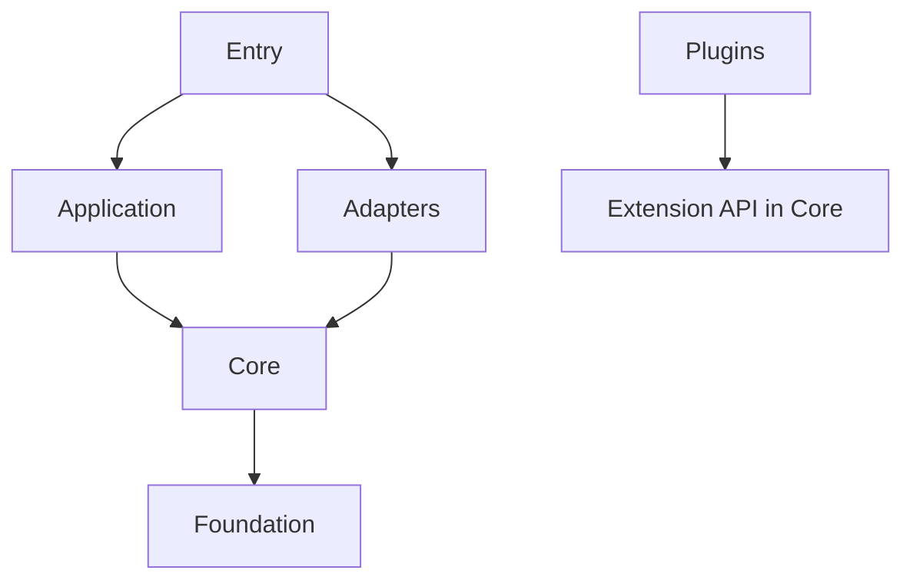

# ADR-064: Layered Architecture and Code Conventions

## Status

accepted

This record supersedes two clauses of earlier records:

- In [ADR-010](adr-010-sonarcloud-quality.md), the statement that `C901` is
  the only Ruff rule.
- In [ADR-062](adr-062-lilrae-name-and-naming-convention.md), the `lilrae`
  naming rule for module and package names inside `src/`.

## Date

2026-10-31

## Context

[Issue #1510](https://github.com/OpenRAE/lilrae/issues/1510) starts a
refactor milestone of 23 issues. The refactor must not change behavior. The
code has these problems:

- Modules are split at the 500-line limit of SonarCloud rule `python:S104`,
  not by responsibility. The splits import private names across modules and
  keep re-exports for test patch targets.
- `core`, `core/deployment`, and `backends` import each other. Three module
  cycles have 28, 14, and 11 modules. Imports inside functions hide the
  cycles.
- `DockerComposeBackend` inherits from 37 mixins.
  [ADR-037](adr-037-docker-compose-backend-cohesion.md) rejects mixins, but
  no check enforces this decision.
- Code types RAES data as `object` and reads it with `getattr`.
- Ruff checks only `C901`. No check covers layers or idioms.
- Package names do not show layers. For example, `aptl.core` holds the
  configuration, the lab orchestration, and the Docker backend.

## Decision

### Layers

Each module belongs to one layer. A module imports only modules of the layers
that the table permits.

| Layer | Holds | May import |
| --- | --- | --- |
| Entry | CLI commands, web API routes, service entry points, and the code that builds their adapters and application services | Entry, Application, Adapters, Core, Foundation |
| Application | Services for one user operation, for example lab start, a validation gate, or seat start | Application, Core, Foundation |
| Adapters | One adapter for each external system: Docker Compose deployment, the RAES backend target, the seat VM, and agent CLIs | Its own adapter, Core, Foundation |
| Core | Models, values, Protocols, errors, policies, configuration, scenario sources, key material, local records, and the extension API | Core, Foundation |
| Foundation | Shared helpers without LilRAE concepts | Foundation |
| Plugins | Scenario adapter packages, for example `aptl_techvault` | Its own plugin and the extension API |

Every layer can also import the standard library and third-party packages.

Rules:

1. Application and Adapters do not import each other. An application service
   receives an adapter as an argument. A core Protocol is the type of that
   argument. Entry code builds the adapter.
2. An adapter does not import another adapter. Adapters exchange core values.
3. No first-party package imports a plugin. Entry points load plugins.
4. Modules have no import cycles. The children of a package have no import
   cycles.
5. Every import counts: imports in functions, in `TYPE_CHECKING` blocks, and
   through package initializers. Put a Protocol in the lower layer. Do not
   import the higher layer.
6. A package holds the code of one layer. Until its refactor issue moves
   them, higher-layer modules can stay in a lower-layer package.
7. Tests and the developer tools in `tools/` are outside the layers.
   Production code does not import them.

### Package ownership

| Code | Layer | Refactor issue |
| --- | --- | --- |
| `aptl.cli`, `aptl.api`, `aptl.services`, `aptl.workbench.bootstrap` | Entry | #1527, #1530 |
| `aptl.validation`, `aptl.appliance`, `aptl.workbench` | Application | #1526, #1527, #1528 |
| The lab lifecycle, experiment execution, host check, snapshot, kill switch, and export modules in `aptl.core` | Application | #1514, #1524, #1525 |
| `aptl.backends` | Adapters: RAES backend target | #1520, #1521, #1522, #1523 |
| `aptl.core.deployment` and five deployment modules in `aptl.core` | Adapters: Docker Compose deployment | #1516, #1517, #1518, #1519 |
| The other modules of `aptl.core`, `aptl.runtime_authority`, and `aptl._asset_manifest` | Core | #1513, #1514 |
| `aptl.utils` | Foundation | #1511 |
| `aptl_techvault` | Plugins | #1515, #1529 |

The layer map in `pyproject.toml` gives the exact layer of each module. These
moves give each package one layer:

- The application and adapter modules leave `aptl.core`.
- The deployment Protocol, its values, and its errors become core code,
  separate from the Docker implementation.
- One core plugin registry and the extension API replace the discovery code
  in `aptl.backends` and `aptl.validation`.
- The participant profile models in `aptl.validation` and `aptl.workbench`
  become core code.
- The agent adapters in `aptl.workbench` and the seat VM and image code in
  `aptl.appliance` become adapters.
- `aptl.workbench.bootstrap` moves to an entry package.

### Module rules

1. A module has one responsibility, and its name states that responsibility.
   Use a package to group related modules. Do not use a name prefix such as
   `raes_` or `lilrae_`.
2. A public name has no leading underscore. Internal names and internal
   modules start with one underscore.
3. Import only public names. Import an internal module only from its own
   package.
4. Put imports at the top of the module. Import an optional-extra package in
   the function that uses it, and add it to the Ruff
   `banned-module-level-imports` setting.
5. A package `__init__.py` re-exports a name only when `__all__` lists it. Do
   not keep an import or a re-export only for a test patch target.
6. Meet `python:S104` by moving a separate responsibility to its own module.
   Do not split a module at a line count.

### Pattern rules

1. Compose objects. A class receives its collaborators through its
   constructor. Do not use mixins that share state on `self`. A Protocol or
   an abstract base class is an interface, not a mixin.
2. Use polymorphism or a registry instead of `if` or `match` chains on a type
   name, a provider string, or a product name.
3. One plugin registry discovers, loads, and checks the providers of each
   entry-point group.
4. Inject side effects: the process runner, the clock, file access, the HTTP
   client, and the deployment backend. Tests use shared fakes. They do not
   patch private names.
5. Entry code builds the object graph. Do not add a dependency injection
   framework.

### Typing rules

1. At the RAES boundary, use the typed RAES models, for example
   `raes.scenario.Scenario` and
   `raes_processor.models.runtime_model.RuntimeModel`. Do not type RAES data
   as `object`, and do not read it with `getattr`.
2. At the boundary, parse structured input from files, the network,
   processes, or users into a Pydantic model. Use a frozen dataclass for an
   internal value. Do not pass structured data as a `dict` with string keys.
3. Annotate every function. Do not use `typing.Any` in a signature.
4. [Issue #1327](https://github.com/OpenRAE/lilrae/issues/1327) selects the
   Python type checker. This record does not select one.

### Reuse rules

1. Each shared concern has one implementation, for example atomic writes,
   path containment, digests, time, strict JSON, locks, waits, process runs,
   HTTP, and redaction.
2. Use the standard library or an established dependency before custom code.
3. Use the existing schema, validator, error type, or result envelope. Do not
   copy it.

### Idiom rules

1. Use Python 3.14 syntax: `X | None`, built-in generic types,
   `collections.abc` types, type parameters, and `type` aliases.
2. Use timezone-aware datetimes. Use `datetime.UTC` for UTC.
3. Declare Typer and FastAPI parameters in the `Annotated` style.
4. A comment tells why the code is as it is. It does not record review
   history.

### Enforcement

`tools/check_architecture.py` reads `[tool.lilrae.architecture]` in
`pyproject.toml`. The table holds the layer map and the enrolled packages and
modules. The check makes sure that each module has one layer. For enrolled
code, it checks:

- the layer rules, for direct and indirect imports;
- import cycles between modules, and between the children of a fully
  enrolled package;
- private imports and the Typer `Annotated` style;
- the Ruff rules `ANN`, `DTZ`, `F`, `FAST002`, `PLC0415`, `SLF001`, `TID253`,
  and `UP`, except `UP042`. `UP042` changes the `str()` output of string
  enums.

The required **Pre-commit hooks** CI job runs the check on each pull request.
An issue that completes code enrolls it and keeps the layer map correct.
Change a layer map entry only when the responsibility of the code changes.
Review enforces the rules that no tool checks. The global Ruff `C901` gate and
the SonarCloud gate stay.

### Relation to other decisions

- ADR-010: The SonarCloud no-new-issues gate and the global `C901` gate stay.
  Meet the size and complexity rules by separating responsibilities. This
  record supersedes only the statement that `C901` is the only Ruff rule.
- ADR-037: Its guardrails stay: one runner for local and SSH transports,
  project scoping, typed backend methods, and no command passthrough. Its
  rejection of mixins becomes a general rule. Its issue-specific non-goals do
  not forbid composed collaborators. Issue #1516 composes the backend and
  amends ADR-037.
- ADR-062: The `lilrae` naming rule stays for new distributions, top-level
  import packages, commands, services, environment variables, resources, and
  configuration files. Module and package names inside `src/` state their
  responsibility and have no product prefix.
- ADR-013 and ADR-023: The `DeploymentBackend` Protocol stays the deployment
  boundary.

## Consequences

### Positive

- Dependencies point in one direction, so the cycles cannot return.
- Each refactor issue turns on all checks for its code with one change to
  `pyproject.toml`.
- Tests replace adapters with fakes and do not patch private names.

### Negative

- Entry code builds more objects, because application code does not build
  adapters.
- The layer map changes when code moves.
- Until all code is enrolled, the check does not see a cycle that goes only
  through code that is not enrolled.

### Risks

- A wrong layer map entry can block enrolled code or hide an import. The
  check requires one layer for each module, and review covers each map
  change.

## References

- [PEP 8: Public and Internal Interfaces](https://peps.python.org/pep-0008/)
- [The Clean Architecture](https://blog.cleancoder.com/uncle-bob/2012/08/13/the-clean-architecture.html)
- [Architecture Patterns with Python: Dependency Injection](https://www.cosmicpython.com/book/chapter_13_dependency_injection.html)
- [grimp usage](https://grimp.readthedocs.io/en/stable/usage.html)
- [Ruff rules](https://docs.astral.sh/ruff/rules/)
- [Issue #1510 design](../architecture/issue-1510-code-quality-design.md)
  and [preflight](../architecture/issue-1510-code-quality-preflight.md)
