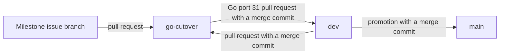

# CI verification

The ordinary Python shards also qualify the packaged provider observer module.
Those jobs install the same pinned Node version as the native transport job.
The observer probes resolve that executable before starting their minimal child environment and pass its absolute path.
They do not add ambient PATH entries to the provider process.
In CI, [Node's built-in test runner](https://nodejs.org/download/release/v22.23.3/docs/api/test.html#coverage-reporters) emits LCOV for those exact packaged-module probes.
The test normalizes only the copied module's source path; line coverage comes from Node.
The existing Python coverage artifacts carry these reports to the combiner and SonarCloud.
All workers retain the existing Python coverage requirements; observer reports are combined across the shards.
Local targeted runs do not enable coverage collection.

Issue #1468 replaces repeated verification with checks selected by changed inputs.
The target is five minutes for Python coverage and ten minutes for ordinary PR checks.
Runner queue time is reported separately.

## Components and contracts

The existing Checks workflow owns required status names.
A change selector reads the Git diff and emits bounded Boolean lane selections.
Unknown paths, workflow changes, missing diff bases, and manual or scheduled runs select all lanes.
Every required job checks selector success before it can report success.
An unselected job reports that no relevant input changed.
The image matrix also selects descendants when a parent or shared input changes.

Source changes select all coverage producers for the existing project-wide SonarCloud analysis.
Docs and image routing remain independent.
Linux runs the retained ordinary Python suite once with line coverage.
Coverage.py uses its Python 3.12 monitoring core.
The measured serial run exceeded the budget after pruning and shared setup.
Split the retained cases into three complementary pytest-split groups.
Each group uses four pytest-xdist workers and pytest-cov's supported worker combination.
Keep each file on one worker to preserve module fixtures and avoid shared module state.
Workers keep separate process environments and pytest temporary directories.
Read-only pack fixtures share declarations and realization results within each process.
Mutation tests copy their declaration fields; backends, stores, and runtime ownership stay separate.
The existing required Python check combines all groups' data before exporting coverage.
All groups and the concurrent fuzz/smoke qualification job must succeed.
The combiner checks that all expected data files exist and uses a read-only token.
The coverage comparison also checks the planner's measured lines with two workers.
macOS and Windows run portability checks instead of repeating Linux planning tests.
The installed-wheel boot retains its independent realization and teardown observations.
Periodic qualification runs retained integration checks and scans unchanged dependencies and images.
The periodic lane pulls the pinned Dashboard prerequisite from the production catalog before test collection.
A missing prerequisite fails preparation.
Live-lab checks require an explicit operator opt-in and credentials.

The required MCP lane also tests the capture lifecycle through an extracted
production red MCP payload. It opens real SSH sessions through the shipped
capture broker, leaves a shell and a one-shot command active, then signals
the MCP process. The complete broker census must reach the configured run
archive with final metadata, faithful close reasons, and valid custody chains
accepted by the transcript collector. Real container loss and a metadata
write failure must produce evidence records and a non-zero shutdown exit.
This check uses the shared isolated SSH fixture; it does not qualify a full
TechVault SOC deployment. The generic installed-wheel smoke scenario remains
a separate installation and realization check.

The controlled HTTPS service in `tests/test_mcp_transport_processes.py` binds
only to loopback and explicitly requires TLS 1.2 or newer before wrapping its
listening socket. Its ephemeral certificate and existing MCP client policy
remain test fixtures. The indexer process test verifies that the real SSH and
MCP path can still query this service with the protocol floor enforced.

The planner builds authored field prefixes once per compatibility application.
Each requirement queries that operation's index.
The index preserves exact fields, descendants, collection entries, and explicit empty declarations.
It does not survive the operation or change scenario authority.

## Data flows and security

Redaction keeps the existing Python and TypeScript public entry points.
Each delegates command parsing to an internal shell helper, which consumes
shared pattern definitions within its language:

```text
redaction -> command helpers -> credential patterns
redaction -------------------> credential patterns
```

Pattern modules never import the recursive redactor or command helpers.
The recursive entry points retain depth and scan limits, JSON handling,
key classification, and the experiment opt-out boundary.
Moving code between these modules must preserve pattern order and output.
The shared golden corpus checks Python and TypeScript parity; focused
redaction, fuzz, and consumer tests check credential masking and bounded work.
CI rebuilds and tests every MCP consumer of the common module.

```text
Contributor changes [untrusted input]
  -> Git checkout and changed-path selector [read-only runner token]
  -> lane selections [job outputs]
  -> existing test, build, scan, and artifact jobs [isolated hosted runners]
  -> coverage and diagnostic artifacts [existing Actions storage]
  -> existing SonarCloud analysis and required GitHub statuses

Scenario declarations [operator-authored input]
  -> parser explicitness map [existing semantic authority]
  -> operation-local prefix index [derived memory only]
  -> requirement delegation and evidence decisions [existing planner boundary]
```

Changed paths are data, never shell commands.
Routing failures must fail existing required jobs rather than skip them successfully.
Untrusted PRs receive no new permissions or services.
Dependency caches hold downloads, not installed executable state or lab credentials.
Existing hash pins and vulnerability thresholds remain active.
Test collection reads no lab environment file and provisions no API key.
Superseded PR cancellation uses a PR-specific group; release and branch validation have separate groups.
Cleanup steps retain their unconditional execution conditions.

## Go cutover branch

Milestone 44 ports LilRAE to Go on the long-lived `go-cutover` branch (#1584).
The Python release on `dev` and `main` keeps shipping until Go port 31.



- Each pull request of the milestone targets `go-cutover`. Other work keeps `dev` as its base.
- `go-cutover` has the protection and the required checks of `dev`.
  `.github/branch-protection-baseline.json` records both branches.
  A test keeps the `go-cutover` contexts a superset of the `dev` contexts.
- `checks.yml`, `pr-title-lint.yml`, and the Phase E workflow run for pull requests into each protected branch.
  `checks.yml` also runs on pushes to `go-cutover`, so SonarCloud keeps a current analysis of the branch.
  SonarCloud analyzes `go-cutover` as a short-lived branch, as it does `dev`, so each push gets a quality gate result.
- On `go-cutover`, `.ground-control.yaml` sets `workflow.base_branch` to `go-cutover`.
  `/implement` then uses `go-cutover` for branch preparation, synchronization, and pull requests.
  `dev` keeps the default base.
- `dev` merges into `go-cutover` through a pull request with a merge commit.
  Do not rebase, reset, or force-push `go-cutover`.
- Pull requests into `go-cutover` use a Conventional Commit type that does not release.
  Nothing ships before Go port 31, which records the breaking change.
- Go port 31 removes the `go-cutover` entries and the `base_branch` setting.
  Then it opens the pull request from `go-cutover` into `dev`.
  The maintainer merges it with a merge commit, so Release Please keeps each commit subject.
- The release, documentation deployment, and Scorecard workflows run only for `main`.

The temporary default-branch routing for Go dependency updates and weekly
Checks is bounded by the [issue #1593 preflight](issue-1593-go-cutover-schedules-preflight.md).
It qualifies the earlier bootstrap guidance: existing Dependabot entries keep
targeting `dev`, while first-party Go version updates target `go-cutover`.
The target branch's Checks workflow owns the dispatched run and its Go gates.

The Monday schedule keeps the existing default-branch Checks run.
A separate job dispatches `checks.yml` on `go-cutover` without waiting for other jobs.
Only a schedule on the repository's default branch can start this job.
Push, pull request, tag, and manual events cannot forward a run.
The child uses its own workflow and checks out its own branch.
Its manual event selects all lanes, including full Go mutation and dependency scans.
A failed dispatch fails the parent job.
An accepted dispatch does not establish that the child checks passed.

Dependabot reads its version-2 configuration from `main`.
One temporary `gomod` entry selects `/`, `/tools`, `/tools/lint`, and `/tools/gates` on `go-cutover`.
It opens weekly version updates against that branch.
The existing Caddy module entry continues to target `dev`.
This policy does not enable Dependabot security updates on the cutover branch.
The existing Go scanners provide vulnerability checks there.

```text
GitHub scheduler [external entity]
  -> schedule event -> Checks dispatcher [isolated hosted job]
  -> fixed workflow/ref request, ephemeral job token
  -> GitHub Actions API [authorization boundary]
  -> workflow_dispatch event -> go-cutover Checks [separate hosted jobs]
  -> full gate results and artifacts -> existing Actions storage

main dependabot.yml [configuration store]
  -> module paths and target branch -> Dependabot [GitHub service boundary]
go-cutover go.mod/go.sum files [manifest stores]
  -> dependency versions -> Dependabot
  -> version update pull requests -> go-cutover [protected branch]
```

The protected assets are workflow authority, dependency manifests, and check results.
Only the dispatcher job has `actions: write` for this request.
It performs no checkout and executes no repository code with that token.
The token enters only the CLI environment, never command arguments or files.
The repository comes from GitHub context; the branch is a fixed job value.
These controls prevent untrusted code from using dispatch authority or selecting another target.
Parsed workflow tests check admission and authority; a stub CLI checks the actual command and failure result.
Existing selection tests check that dispatch selects all lanes.
GitHub run records provide the later evidence for actual child execution.

The workflow and Dependabot configuration are the executable architecture model.
This change extends the existing routing decision and needs no new ADR or application model.
The [Go port 31 retirement record](https://github.com/OpenRAE/lilrae/issues/1582#issuecomment-6591003613) names both temporary removals.
The issue's Tasks section also records removal of the dispatcher and replacement of the temporary Dependabot entry.
The retirement must reach `main` before deletion of `go-cutover`.

## Verification policy

Evidence follows changed behavior and risk.
Existing tests can supply sufficient evidence without a new test for each edit.
Remove duplicate assignments, obsolete source-text checks, and repeated scenario setup.
Keep distinct behavior, serialization, rejection, and product-boundary checks.
Test count and coverage percentages are measurements, not reasons to preserve duplication.
Released-kit qualification belongs in the periodic integration lane when it exceeds the ordinary budget.

## References

- [Coverage.py 7.15.2 configuration](https://coverage.readthedocs.io/en/7.15.2/config.html): monitoring core and line coverage.
- [GitHub Actions concurrency](https://docs.github.com/en/actions/how-tos/write-workflows/choose-when-workflows-run/control-workflow-concurrency): PR cancellation groups.
- [GitHub Actions secure use](https://docs.github.com/en/actions/reference/security/secure-use): untrusted inputs and least privilege.
- [pytest markers](https://docs.pytest.org/en/stable/how-to/mark.html): explicit test selection.
- [pytest-split](https://jerry-git.github.io/pytest-split/): complementary groups without repeating a full suite.
- [Coverage.py combination](https://coverage.readthedocs.io/en/7.15.2/commands/cmd_combine.html): merge measured data before XML export.
- [GitHub Actions workflow events](https://docs.github.com/en/actions/reference/workflows-and-actions/events-that-trigger-workflows): base-branch filters for `pull_request` and `push`.
- [GitHub branch protection API](https://docs.github.com/en/rest/branches/branch-protection): required status checks of a protected branch.
- [GitHub Dependabot options](https://docs.github.com/en/code-security/reference/supply-chain-security/dependabot-options-reference): version 2, directories and target branch.
- [GitHub workflow dispatch API](https://docs.github.com/en/rest/actions/workflows): create a workflow dispatch event and Actions write permission.
- [GitHub workflow triggers](https://docs.github.com/en/actions/how-tos/write-workflows/choose-when-workflows-run/trigger-a-workflow): dispatch with the existing job token.
- [SonarQube Cloud long-lived branch pattern](https://docs.sonarsource.com/sonarqube-cloud/managing-your-projects/project-analysis/long-lived-branch-pattern): branch classification at first analysis.

This document describes the verification architecture.
The issue plan owns implementation tasks and measured delivery results.
