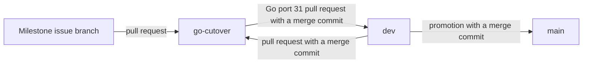

# CI verification

Issue #1468 replaces repeated verification with checks selected by changed inputs.
The target is five minutes for Python coverage and ten minutes for ordinary PR checks.
Runner queue time is reported separately.

## Components and contracts

The existing Checks workflow owns required status names.
A change selector reads the Git diff and emits bounded Boolean lane selections.
Unknown paths, workflow changes, missing diff bases, and manual or scheduled runs select all lanes.
Every required job checks selector success before it can report success.
An unselected job reports that no relevant input changed.
The image matrix also selects descendants when a parent or shared input changes.

Source changes select all coverage producers for the existing project-wide SonarCloud analysis.
Docs and image routing remain independent.
Linux runs the retained ordinary Python suite once with line coverage.
Coverage.py uses its Python 3.12 monitoring core.
The measured serial run exceeded the budget after pruning and shared setup.
Split the retained cases into three complementary pytest-split groups.
Each group uses four pytest-xdist workers and pytest-cov's supported worker combination.
Keep each file on one worker to preserve module fixtures and avoid shared module state.
Workers keep separate process environments and pytest temporary directories.
Read-only pack fixtures share declarations and realization results within each process.
Mutation tests copy their declaration fields; backends, stores, and runtime ownership stay separate.
The existing required Python check combines all groups' data before exporting coverage.
All groups and the concurrent fuzz/smoke qualification job must succeed.
The combiner checks that all expected data files exist and uses a read-only token.
The coverage comparison also checks the planner's measured lines with two workers.
macOS and Windows run portability checks instead of repeating Linux planning tests.
The installed-wheel boot retains its independent realization and teardown observations.
Periodic qualification runs retained integration checks and scans unchanged dependencies and images.
The periodic lane pulls the pinned Dashboard prerequisite from the production catalog before test collection.
A missing prerequisite fails preparation.
Live-lab checks require an explicit operator opt-in and credentials.

The required MCP lane also tests the capture lifecycle through an extracted
production red MCP payload. It opens real SSH sessions through the shipped
capture broker, leaves a shell and a one-shot command active, then signals
the MCP process. The complete broker census must reach the configured run
archive with final metadata, faithful close reasons, and valid custody chains
accepted by the transcript collector. Real container loss and a metadata
write failure must produce evidence records and a non-zero shutdown exit.
This check uses the shared isolated SSH fixture; it does not qualify a full
TechVault SOC deployment. The generic installed-wheel smoke scenario remains
a separate installation and realization check.

The planner builds authored field prefixes once per compatibility application.
Each requirement queries that operation's index.
The index preserves exact fields, descendants, collection entries, and explicit empty declarations.
It does not survive the operation or change scenario authority.

## Data flows and security

```text
Contributor changes [untrusted input]
  -> Git checkout and changed-path selector [read-only runner token]
  -> lane selections [job outputs]
  -> existing test, build, scan, and artifact jobs [isolated hosted runners]
  -> coverage and diagnostic artifacts [existing Actions storage]
  -> existing SonarCloud analysis and required GitHub statuses

Scenario declarations [operator-authored input]
  -> parser explicitness map [existing semantic authority]
  -> operation-local prefix index [derived memory only]
  -> requirement delegation and evidence decisions [existing planner boundary]
```

Changed paths are data, never shell commands.
Routing failures must fail existing required jobs rather than skip them successfully.
Untrusted PRs receive no new permissions or services.
Dependency caches hold downloads, not installed executable state or lab credentials.
Existing hash pins and vulnerability thresholds remain active.
Test collection reads no lab environment file and provisions no API key.
Superseded PR cancellation uses a PR-specific group; release and branch validation have separate groups.
Cleanup steps retain their unconditional execution conditions.

## Go cutover branch

Milestone 44 ports LilRAE to Go on the long-lived `go-cutover` branch (#1584).
The Python release on `dev` and `main` keeps shipping until Go port 31.



- Each pull request of the milestone targets `go-cutover`. Other work keeps `dev` as its base.
- `go-cutover` has the protection and the required checks of `dev`.
  `.github/branch-protection-baseline.json` records both branches.
  A test keeps the `go-cutover` contexts a superset of the `dev` contexts.
- `checks.yml`, `pr-title-lint.yml`, and the Phase E workflow run for pull requests into each protected branch.
  `checks.yml` also runs on pushes to `go-cutover`, so SonarCloud keeps a current analysis of the branch.
  SonarCloud classifies `go-cutover` as a long-lived branch before its first analysis.
- On `go-cutover`, `.ground-control.yaml` sets `workflow.base_branch` to `go-cutover`.
  `/implement` then uses `go-cutover` for branch preparation, synchronization, and pull requests.
  `dev` keeps the default base.
- `dev` merges into `go-cutover` through a pull request with a merge commit.
  Do not rebase, reset, or force-push `go-cutover`.
- Pull requests into `go-cutover` use a Conventional Commit type that does not release.
  Nothing ships before Go port 31, which records the breaking change.
- Go port 31 removes the `go-cutover` entries and the `base_branch` setting.
  Then it opens the pull request from `go-cutover` into `dev`.
  The maintainer merges it with a merge commit, so Release Please keeps each commit subject.
- The release, documentation deployment, and Scorecard workflows run only for `main`.

## Go checks

[ADR-065](../adrs/adr-065-go-implementation-and-engineering-standards.md) gives
the Go gates, and [the #1553 design](issue-1553-go-toolchain-design.md) gives
their mechanics. `tools/ci/go-gates.sh` runs each gate over the first-party Go
modules: the tracked `go.mod` files, except `web/caddy-build` and test data.

| Job | Gate |
| --- | --- |
| Go lint | `go mod tidy -diff`, `go vet`, `go fix -diff`, and golangci-lint for Linux, macOS, and Windows. The golangci-lint formatters check gofmt and goimports. |
| Go tests + coverage | `go test -race -shuffle=on` with coverage, the gate fixtures of `tools/gates`, and the [conformance suite](../reference/conformance-inventory.md) on the clean wheel. |
| Go mutation tests | Gremlins on the changed production lines, or on each whole module with production code for a scheduled or manual run. `tools/mutation-thresholds.json` holds the thresholds. |
| Go regression tests | The replay of each regression test for the issue of the pull request. |
| Go architecture | `archcheck` checks the repository and the generated diagram against `architecture/model.yaml`, and the change against the design record of the issue of the pull request. |
| Go vulnerability scan | govulncheck on the packages and the tool dependencies of each module. |
| OSV-scanner (Go modules) | OSV on each first-party `go.mod`, and a fixture module with a known vulnerability that must fail. |

- The `go` lane of `tools/ci/select_checks.py` selects these jobs. Go source also
  selects the docs lane, because Vale checks Go comments.
- The conformance cases, the published schemas, and the contract inventory
  also select the `lab` lane. The clean-install lab job runs the lab cases with
  its clean wheel.
- The Go architecture job runs whatever the routing selects. The model also
  covers `web/caddy-build` and the design notes, which are not in the `go` lane.
- SonarCloud needs current coverage from each stack. The `go` lane and the
  Python, MCP, and web lanes select each other, and the SonarCloud job reads the
  Go profiles with repository paths.
- The Trivy filesystem scan reads each `go.mod`. It also proves with the same
  fixture module that it fails on a vulnerable Go module.
- The Go jobs set `GOWORK=off` and `GOTOOLCHAIN=local`.
- The `go-cutover` protection requires the seven Go jobs.
- GitHub runs a schedule and Dependabot from the default branch, which has no Go
  code before Go port 31. Until then, a manual Checks run on `go-cutover` runs the
  full mutation and scans.

## Verification policy

Evidence follows changed behavior and risk.
Existing tests can supply sufficient evidence without a new test for each edit.
Remove duplicate assignments, obsolete source-text checks, and repeated scenario setup.
Keep distinct behavior, serialization, rejection, and product-boundary checks.
Test count and coverage percentages are measurements, not reasons to preserve duplication.
Released-kit qualification belongs in the periodic integration lane when it exceeds the ordinary budget.

## References

- [Coverage.py 7.15.2 configuration](https://coverage.readthedocs.io/en/7.15.2/config.html): monitoring core and line coverage.
- [GitHub Actions concurrency](https://docs.github.com/en/actions/how-tos/write-workflows/choose-when-workflows-run/control-workflow-concurrency): PR cancellation groups.
- [GitHub Actions secure use](https://docs.github.com/en/actions/reference/security/secure-use): untrusted inputs and least privilege.
- [pytest markers](https://docs.pytest.org/en/stable/how-to/mark.html): explicit test selection.
- [pytest-split](https://jerry-git.github.io/pytest-split/): complementary groups without repeating a full suite.
- [Coverage.py combination](https://coverage.readthedocs.io/en/7.15.2/commands/cmd_combine.html): merge measured data before XML export.
- [GitHub Actions workflow events](https://docs.github.com/en/actions/reference/workflows-and-actions/events-that-trigger-workflows): base-branch filters for `pull_request` and `push`.
- [GitHub branch protection API](https://docs.github.com/en/rest/branches/branch-protection): required status checks of a protected branch.
- [SonarQube Cloud long-lived branch pattern](https://docs.sonarsource.com/sonarqube-cloud/managing-your-projects/project-analysis/long-lived-branch-pattern): branch classification at first analysis.
- [SonarQube Cloud Go test coverage](https://docs.sonarsource.com/sonarqube-cloud/analyzing-source-code/test-coverage/go-test-coverage): `sonar.go.coverage.reportPaths`.
- [Gremlins unleash command](https://gremlins.dev/0.6/usage/commands/unleash/): changed-line mutation and the JSON report.

This document describes the verification architecture.
The issue plan owns implementation tasks and measured delivery results.
