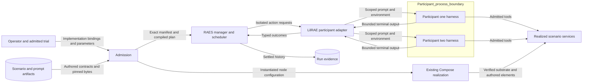

# Concurrent participant execution

## Ownership and composition

RAES owns scheduling, action admission, ordering, and accepted state.
LilRAE owns native process execution and its finite resource limits.
One RAES runtime manager owns each target.
Participants do not receive a manager, deployment client, or peer credentials.

The backend accepts explicit implementation bindings before scenario admission.
Each binding names one participant, implementation, observation boundary, and exact action-to-target relation.
The binding includes a bounded native executor and independent participant configuration.
The manifest describes these installed bindings, not arbitrary capabilities requested by SDL.
Missing bindings fail admission before execution.
The first supported autonomous policy is RAES v1 with ordered selection.
Additional policy profiles require separate qualification.
RAES 7 batches participants within one authored execution policy.
The representative red/blue scenario therefore uses one shared task-invocation policy.
Each participant still has its own installed executor, tools, model, and prompt.
The shared policy names one implementation manifest.
That reference must resolve to the same manifest for both participants.
Independent configurations can select different models and prompt artifacts within that implementation.
Two unrelated implementation manifests cannot share that reference.
Separate policies do not imply overlapping execution in this version.
Policy lifecycle controls affect all participants in that policy scope.

Dynamic composition remains under ADR-051 route 3.
Each node uses a verified substrate plus authored software and configuration.
Docker Compose is the transport for the resulting deployment.
Participant bindings use compiled target addresses, not image names or fixed container names.
Scenario parameter resolution and family trial admission precede realization.
Participant concurrency does not change artifact selection or permit a fallback image.
Parameterized package and local-account declarations use the same guest readback as literal declarations.
The manifest now admits those two constrained requirement kinds.
Other parameterized concerns remain subject to their existing capability checks.

## Participant configuration and harnesses

Bindings use participant identity, not the red or blue role as a unique key.
Each participant has its own model, prompt, execution limits, and process context.
Two participants can use the same harness with different prompts.
Changing one prompt does not change the other participant's configuration.
RAES configuration results bind configuration to the implementation and participant.
The existing configuration registry owns typed target validation.
Prompt commitments identify the exact delivered bytes.
Prompt contents and credentials are excluded from public diagnostics.

OpenCode is an explicit harness choice.
No Claude Code installation is required for an OpenCode binding.
The existing managed-agent interface remains available for other installed harnesses.
Each invocation uses a private working directory and explicit environment.
OpenCode receives its prompt on standard input and returns JSON events.
Its configuration disables ambient project instructions, plugins, automatic updates, and unselected tools.
Tool inventory is checked during installation, before native action dispatch.
Provider endpoints and credentials come from the operator's admitted configuration.
The adapter does not select a new external service.
Fresh process contexts prevent history from crossing trial boundaries.
The model identifier records the requested provider/model pair.
It does not prove which model the provider actually served.

## Execution and failure

RAES supplies isolated predecessor snapshots to bounded concurrent workers.
Each worker executes only its exact installed binding.
RAES settles worker results in request order, regardless of completion order.
Only the settled snapshot is authoritative for combined participant history.
Native observations do not establish successful portable state commitment.

Supervised timeouts, nonzero exits, malformed harness output, and cancellation with completed cleanup produce typed terminal results.
Unverified cleanup leaves the outcome unknown.
Already dispatched peer actions finish and retain their results.
RAES applies the authored stop or continue policy after settlement.
Unknown outcomes retain RAES indeterminate-work handling.
The backend does not repeat native work to repair an unknown result.

Cancellation stops new native work and signals the selected invocation.
The process runner drains and terminates its owned process group.
Cancellation does not imply rollback of earlier tool effects.
Participant cancellation leaves other participant invocations running.
Trial cancellation signals all owned invocations.
`run_participant_workload` waits for RAES settlement and native cleanup before returning to `ExperimentExecutor`.
The existing experiment owner maps the returned signal and seals evidence.
An explicit task evaluator supplies the verdict and result summaries after worker cleanup.
The workload preserves that verdict, including a failed evaluation after successful process execution.
An absent or invalid verdict produces evaluator failure instead of a completed trial.
The workload checks installed configurations against `PlannedTrial.participant_configurations` before dispatch.
Native cancellation is a trusted host operation on this target.
It is not an advertised RAES lifecycle-control operation or a new participant tool.
Escaped descendants and remote tool processes need their own cleanup evidence.
The backend must not claim their termination from local process cleanup alone.

## Data flow and security

| Threat | Boundary and control | Verification |
| --- | --- | --- |
| Cross-participant authority | Exact participant, manifest, action, boundary, and target matching | Wrong identity and target fail before native execution |
| Prompt or credential leakage | Separate invocation directories and explicit environments | Distinct red/blue payloads and no secrets in diagnostics |
| Ambient tool expansion | Explicit harness configuration and tool allowlist | Unknown tools and inherited configuration are denied |
| Stale or duplicate execution | RAES admission, generations, and native reservations | Duplicate actions and late completions are rejected |
| Lost peer history | RAES ordered settlement of isolated results | Reverse completion order retains both histories |
| Runaway child process | Existing runner bounds plus cancellation signal | Real subprocess timeout and cancellation cleanup |
| False capability claims | RAES manifest validation and exact installed offers | Unsupported bindings fail planning |
| Wrong environment variant | Existing sealed trial and dynamic composition admission | Changed node parameters reach the deployment plan |

Process supervision is not an operating-system sandbox.
Runtime bindings are trusted host inputs; participant outputs are untrusted.
Individual MCP-call admission remains the separate
[#1418 boundary](issue-1418-participant-tool-admission-preflight.md).
This design does not claim that a session-level action records each tool call.

## Existing architecture and verification

ADR-035 and ADR-046 retain portable participant semantics in RAES.
ADR-050 retains one terminal trial and evidence finalization owner.
ADR-051 retains artifact satisfaction and dynamic composition ownership.
No new architecture decision replaces these contracts.
Executable policy remains in RAES admission and existing host validation.
No independent policy engine or scheduler is introduced.
Typed bindings and the runtime manifest express the architecture in code.

The representative red/blue scenario qualifies concurrency without depending on unfinished RPT authoring.
Tests exercise actual RAES scheduling with deterministic native adapters.
Subprocess tests verify harness isolation, independent prompts, timeout, and cancellation.
Existing composition and family admission tests cover environment variation.
CI owns full suites and installed-lab qualification.

## Integration and qualification limits

Create a fresh target and installed bindings for each trial.
Use `opencode_manifest` to declare the implementation's configuration targets.
Use RAES configuration realization with `OpenCodeConfigurationValidator` and an admitted model domain.
Resolve prompt artifacts through the caller's approved artifact boundary.
`configured_opencode_executor` checks the prompt reference, exact UTF-8 digest, model, and timeout.
Bind the resulting configuration digest in the participant implementation selection.
Pass the bindings through `ScenarioAdmissionSource.autonomous_bindings` to `admit_raes_scenario`.
`OpenCodeOptions` holds the admitted launch settings; `OpenCodeToolProfile` holds the verified MCP inputs.
For experiments, call `run_participant_workload` from the existing workload callback with the admitted target, plan, and task evaluator.
The caller retains the existing capture and evidence configuration.

The initial capability uses v1 ordered-cycle policies and a simulated, stepped clock with barrier synchronization.
It supports at most eight simultaneous native actions.
It does not advertise reset, replay, retry, resource-budget policies, or public execution controls.
An installed callable must bound its execution and drain its own native resources.
The OpenCode adapter enforces process deadlines and cancellation through the existing process runner.
Process supervision does not constrain remote work that escapes that process group.

Local tests use deterministic harness substitutes and real supervised child processes.
No live model request or installed OpenCode qualification was performed.
The released RPT pack still needs authored autonomous policy bindings before it can exercise this path.
Its existing runtime declarations use generic composition; the engine does not rewrite the pack or select a prebake to satisfy an unsupported declaration.

## Related issue coverage

| Issue | Delivered coverage | Remaining acceptance surface |
| --- | --- | --- |
| #1419 | OpenCode typed model, prompt reference, prompt-byte digest, and timeout targets; model-domain validation | Complete manifest publication and prompt-asset resolution for every installed participant implementation |
| #1420 | Trial-to-executor configuration equality, independent prompt delivery, and fresh invocation contexts | Operator and study assembly across all harnesses, complete actual-delivery evidence, and installed experiment qualification |
| #1418 | No individual MCP-call admission claim | Admission and evidence for each tool call through RAES |
| #894 | Generic composition remains available; parameterized packages and local accounts pass the same readback checks | Composed kit publication and qualification |

These issues are not fully absorbed and are not closure candidates on this evidence.

## References

- RAES 7.0.0: installed `raes_backend_protocols.protocols`, `participant_execution_runtime`, and `participant_configuration`.
- [RAES execution architecture](https://github.com/OpenRAE/rae/blob/main/specs/formal/participant-semantics/autonomous-execution.md): admission, lifecycle, and scheduler ownership.
- [Docker Compose application model](https://docs.docker.com/compose/intro/compose-application-model/): services, networks, volumes, and configuration.
- [Python 3.12 futures](https://docs.python.org/3.12/library/concurrent.futures.html): cancellation and executor shutdown.
- [OpenCode CLI](https://opencode.ai/docs/cli/): noninteractive run, JSON events, and environment controls.
- [OpenCode configuration](https://opencode.ai/docs/config/): configuration precedence and isolation.
- [OpenCode permissions](https://opencode.ai/docs/permissions/): default denial and selected tool grants.
- [ASD-STE100 Issue 9](https://www.asd-ste100.org/assets/files/ASD-STE100_ISSUE9.pdf): short sentences and consistent technical names.

The prose review uses the available official STE rule excerpts.
It checks brevity, one fact per sentence, and consistent project terminology.
This document describes architecture; the issue thread contains implementation tasks and issue coverage.
