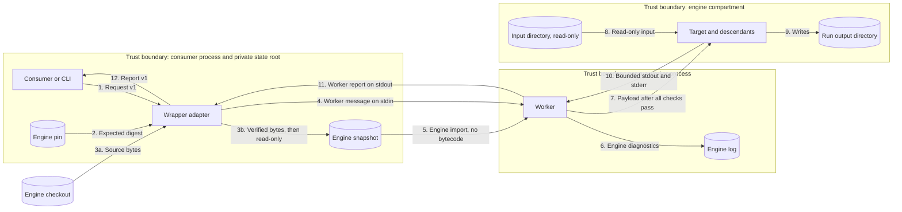
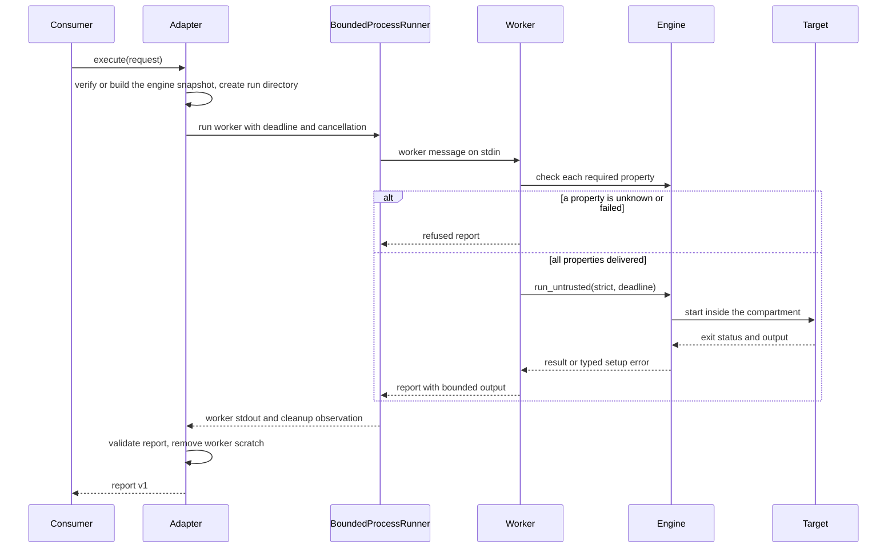

# Shared containment wrapper

Reader purpose: Explanation.
[ADR-068](../adrs/adr-068-shared-containment-wrapper.md) records the decision.
The [interface Reference](../reference/containment-interface.md) gives the exact fields.
The [case ledger](../security/containment-case-ledger.md) links each known bypass to its tests.

## Components

| Component | Layer | Responsibility |
| --- | --- | --- |
| `aptl.core.containment` | Core | Request and report models, the profile and its properties, the escape-probe protocol, and the ports. |
| `aptl.containment` | Adapter | The verified engine snapshot, private run directories, worker start, and report assembly. |
| `aptl.containment._worker` | Worker script | Property checks, the engine call, output bounds, and the worker report. It imports only the standard library and the engine. |
| `aptl.cli.containment` | Entry | The `lilrae containment run` command. It builds the adapter and injects the runner. |
| `BoundedProcessRunner` | Application | The existing runner. It starts the worker with a deadline, an output bound, cancellation, and process-group cleanup. |
| `third_party/raptor` | External | The pinned fork. The adapter copies its verified source into the snapshot. |

The adapter imports only core and foundation code.
It receives the runner through the `WorkerRunner` Protocol in core.
Entry code builds the adapter and gives it the runner.

## Data flow

The adapter hashes the bytes that it writes in flow 3b, not the checkout.
Flow 7 occurs only after every property check passes.
Flow 11 is the only trusted report channel.
The target writes only flows 9 and 10.
The worker encodes target output as data inside its report.

## Run sequence

## Security engineering

### Assets

- Host files, credentials, and other runs' outputs.
- Host processes, local services, and management sockets.
- The integrity of the report and of the setup attribution.
- The availability of the consumer process.

### Threats and controls

| Threat | Control | Verification |
| --- | --- | --- |
| The target reads host files or credentials. | Mount namespace bind tree, Landlock read restriction, and a fake home. | Probes `host-file-read` and `input-write`; retained engine regressions. |
| The target sees or signals host processes. | PID namespace with a fresh procfs. | Probes `host-process-environ` and `host-process-signal`. |
| The target reaches host loopback or Unix sockets. | Empty network namespace and mount view. | Probes `host-loopback-connect`, `host-unix-socket-connect`, and `abstract-unix-socket-connect`. |
| The target uses a dangerous system call or builds a nested namespace. | Engine seccomp-bpf filter. | Probes `keyctl-syscall` and `nested-user-namespace`. |
| The target uses an inherited descriptor or environment value. | Explicit target environment and the engine's descriptor closure. | Probes `inherited-descriptor` and `environment-canary`. |
| A descendant outlives the run through a new session. | PID namespace teardown and process-group cleanup of the worker. | Probe `detached-descendant`; cancellation test. |
| The target forges a setup result. | The worker report uses a separate channel. The engine's setup-status pipe attributes setup failure. | Report-spoof test. |
| A host lacks a required layer. | A per-property check before the target starts. | Refusal test on a restricted host. |
| An engine checkout drifts from the pin. | The digest of the copied bytes before the snapshot is used. | Pin test against the submodule. |
| Engine code changes after verification, or a bytecode cache is planted. | Workers import only the read-only snapshot, with bytecode off. An existing snapshot is verified in full. | Snapshot tests in `test_containment_engine.py`. |
| A timeout claims containment without a posture record. | The worker marks the engine-enforced properties unknown. | Worker timeout test. |
| Large output exhausts the consumer. | Engine transient capture bound, worker aggregate bound, and runner report bound. | Output-bound test. |
| One run affects another. | Per-run worker, directory, process group, and cancellation event. | Concurrent-run test. |

### Residual risks

- The engine shares the host kernel. A kernel defect can break every layer.
- Version 1 has no peak-memory, aggregate CPU, or storage budget. Issue #1457 owns those budgets.
- Engine evidence files in the output directory are target-writable. Issue #1460 owns trusted evidence.
- The operator and the consumer process are trusted. The design does not protect against them.
- Snapshot integrity depends on a state root that only the owner can write.

## Failure model

| Condition | Report status | Failure origin |
| --- | --- | --- |
| A property check fails or is unknown. | `refused` | `setup` |
| The engine root is absent or its digest differs. | `refused` | `setup` |
| The engine raises a setup error. | `refused` | `setup` |
| The target exits with a nonzero status or a signal. | `completed` | `target` |
| The target passes the deadline. | `timed_out` | `target` |
| The target output passes the aggregate bound. | `output_limit_exceeded` | `target` |
| The consumer cancels the run. | `cancelled` | `supervisor` |
| The worker report is absent or invalid. | `worker_failed` | `supervisor` |

## Qualification environment

Workstations run unit tests and static checks. A workstation that restricts user namespaces can also run the refusal test.
CI runs the integration proof and the retained engine regressions on an Ubuntu runner.
The job enables unprivileged user namespaces on that ephemeral runner before the proof.
It runs the refusal test before that change.
