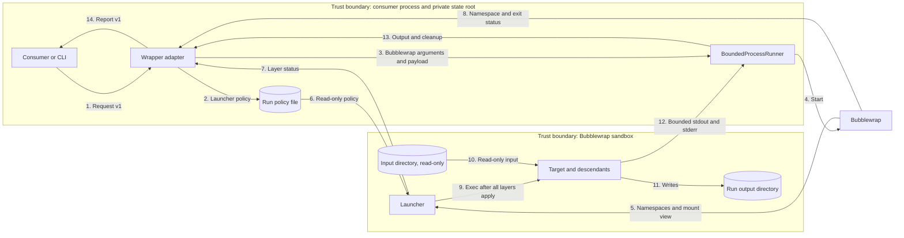
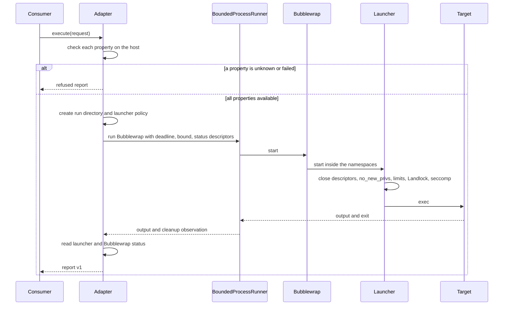

# Shared containment wrapper

Reader purpose: Explanation.
[ADR-069](../adrs/adr-069-shared-containment-wrapper.md) records the decision.
The [interface Reference](../reference/containment-interface.md) gives the exact fields.
The [case ledger](../security/containment-case-ledger.md) links each known bypass to its tests.

## Components

| Component | Layer | Responsibility |
| --- | --- | --- |
| `aptl.core.containment` | Core | Request and report models, the profile and its properties, the escape-probe protocol, and the ports. |
| `aptl.containment.adapter` | Adapter | Private run directories, host checks, the Bubblewrap start, status evidence, and report assembly. |
| `aptl.containment.host` | Adapter | Host checks: Bubblewrap version and a namespace probe, the Landlock ABI, and the libseccomp version. |
| `aptl.containment.bubblewrap` | Adapter | The Bubblewrap argument vector and the parser for its JSON status. |
| `aptl.containment.policy` | Adapter | The seccomp rules, the denied environment names, and the launcher policy document. |
| `aptl.containment._launcher` | Launcher | Runs inside the sandbox before the target. It applies the descriptor, privilege, limit, Landlock, and seccomp layers. |
| `aptl.cli.containment` | Entry | The `lilrae containment run` command. It builds the adapter and injects the runner. |
| `aptl.core.bounded_process` | Core | The `ProcessRequest` that the adapter builds and the runner executes. |
| `BoundedProcessRunner` | Application | The existing runner. It starts Bubblewrap with a deadline, an output bound, cancellation, cleanup, and the status descriptors. |
| Bubblewrap | Host | Namespaces, the mount view, a fresh procfs, a new session, the PID 1 reaper, `--die-with-parent`, and the JSON status. |

The adapter imports only core and foundation code.
It receives the runner through the `WorkerRunner` Protocol in core.
It builds one `ProcessRequest` for each start and passes it to the runner's `run_observed` method.
The launcher imports only the standard library. It runs under the host's `/usr/bin/python3`.

## Data flow

The adapter sends flow 3 only after every host check passes.
The launcher's status descriptor closes at flow 9, so the target cannot write flow 7.
The target writes only flows 11 and 12.

## Run sequence

## Security engineering

### Assets

- Host files, credentials, and other runs' outputs.
- Host processes, local services, and management sockets.
- The integrity of the report and of the setup attribution.
- The availability of the consumer process.

### Threats and controls

| Threat | Control | Verification |
| --- | --- | --- |
| The target reads host files or credentials. | Bubblewrap mount view with explicit read-only binds, and Landlock. | Probe `host-file-read`. |
| The target writes outside its grants. | Read-only binds and Landlock write rules. | Probes `host-file-write` and `input-write`. |
| The target sees or signals host processes. | PID namespace with a fresh procfs. | Probes `host-process-environ` and `host-process-signal`. |
| The target reaches host loopback or Unix sockets. | Network namespace, the mount view, and the seccomp `AF_UNIX` deny. | Probes `host-loopback-connect`, `host-unix-socket-connect`, and `abstract-unix-socket-connect`. |
| The target reads host TLS private keys. | The mount view binds only public TLS material, never `/etc/ssl/private`. | Full-layer fixture test. |
| The input directory holds a host FIFO with a reader. | The input mounts at `/run/lilrae/input`, outside the writable `/tmp` grant, so Landlock denies the write. | Probe `input-fifo-write`. |
| The input directory holds a live host Unix socket. | The seccomp `AF_UNIX` deny on the low 32 bits of the domain, and the `socketpair` deny for the `SOCK_DGRAM` and `SOCK_RAW` types. A read-only bind alone does not stop a connect. | Probes `input-unix-socket-connect`, `raw-domain-unix-connect`, `input-unix-dgram-send`, and `input-unix-raw-pair-send`. The host socket must receive no datagram. |
| The target uses a dangerous system call or creates a namespace. | Launcher seccomp filter and `--disable-userns`. | Probes `keyctl-syscall` and `nested-user-namespace`. |
| The target uses an inherited descriptor or environment value. | Launcher descriptor sweep and `--clearenv`. | Probes `inherited-descriptor` and `environment-canary`. |
| A descendant outlives the run through a new session. | Bubblewrap PID 1 reaper, PID namespace, and `--die-with-parent`. | Probe `detached-descendant`; cancellation test. |
| The target forges a setup result. | Status descriptors that close at exec. | Report-spoof test. |
| A host lacks a required layer. | Per-property host checks before the run. | Refusal tests. |
| A layer does not apply in the launcher. | The launcher refuses before exec, and the adapter requires each layer status. | Launcher tests and missing-status tests. |
| Large output exhausts the consumer. | The runner's combined capture bound. | Output-bound test. |
| One run affects another. | Per-run Bubblewrap process, directory, process group, and cancellation event. | Concurrent-run test. |

### Residual risks

- The sandbox shares the host kernel. A kernel defect can break every layer.
- Bubblewrap, libseccomp, and `/usr/bin/python3` are trusted host packages.
- Version 1 has no peak-memory, aggregate CPU, or storage budget. Issue #1457 owns those budgets.
- The operator and the consumer process are trusted. The design does not protect against them.

## Failure model

| Condition | Report status | Failure origin |
| --- | --- | --- |
| A host check fails or is unknown. | `refused` | `setup` |
| The deadline passes before the launch. | `timed_out` | `setup` |
| The run directory, policy, or status pipes cannot be created. | `supervisor_failed` | `setup` |
| Bubblewrap or the launcher fails before exec. | `refused` | `setup` |
| The target exits with a nonzero status or a signal. | `completed` | `target` |
| Bubblewrap reports no target exit after the target starts. | `supervisor_failed` | `supervisor` |
| The run passes the deadline. | `timed_out` | `target`, or `setup` when the target did not start |
| The output passes the combined bound. | `output_limit_exceeded` | `target` |
| The consumer cancels the run. | `cancelled` | `supervisor` |
| The runner fails for another reason. | `supervisor_failed` | `supervisor` |

## Qualification environment

The proof runs where Bubblewrap can create a user namespace.
Ubuntu 24.04 permits this through its AppArmor profile for Bubblewrap.
CI runs the proof on an Ubuntu runner. An explicitly approved, isolated test VM with the same host profile can also run it.
