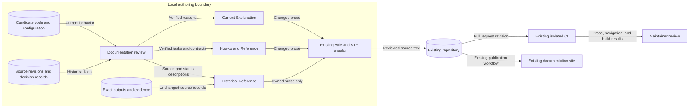
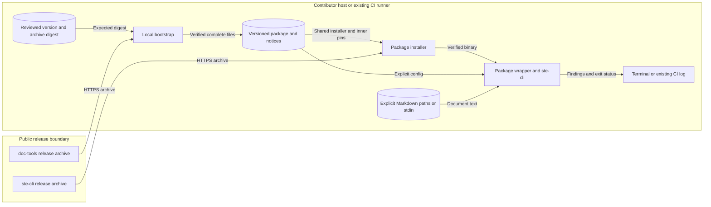

# Documentation authority and history

LilRAE documentation explains the implementation and preserves its decision history.
The code and supported interfaces determine current behavior.
A historical record describes its stated source revision.
Its age does not make its claims current or its evidence invalid.

## Components and contracts

Current explanations describe reasons, relationships, and limits.
How-to guides describe operating tasks.
Reference pages describe exact interfaces and contracts.
Each page links to the other forms when the reader needs them.
The [assignment register](documentation-assignments.md) records reader purposes, routes, and source checks.

ADRs retain their identifiers, dates, status, rationale, and amendment links.
The record's Status section determines its recorded status.
The index summarizes that status; it does not change a decision.
An editorial correction cannot accept a proposal or reverse an accepted decision.
[ADR-000](../adrs/adr-000-use-adrs.md) defines decision governance.

Requirement files retain their front matter, identifiers, lifecycle states, and traceability.
An ACTIVE requirement remains an active contract.
Historical classification describes recorded evidence, not a replacement lifecycle state.
Exact quotations, outputs, evidence files, and generated records retain their bytes.
Owned descriptions explain their source, date, and qualification limits.

Current explanations link to the applicable successor decisions.
Historical records keep their original command names and limits.
Current operating instructions use `lilrae` and the supported interface names.
Root Compose files describe their own deployment assets, not every installed Scenario Pack.

## Data flows and trust boundaries

Source examples are data, not permission to execute commands.
The documentation workflow does not read credentials or private runtime records.
Local writing checks process text locally.
The rewrite uses the existing repository, CI, and publishers.
It adds no external analyzer, hosting service, listener, or upload path.

## Security and failure behavior

| Threat | Control | Verification |
| --- | --- | --- |
| Old plans appear as delivered behavior | Separate current explanations from revision-bound records | Compare present-tense claims with candidate owners and relevant tests |
| An edit changes a decision or contract | Preserve metadata, obligations, conditions, and amendment meaning | Compare the candidate with the original record and source history |
| An edit changes exact evidence | Keep source records outside prose rewrites | Compare retained bytes with their source revision |
| An example weakens a security boundary | Check authentication, admission, TLS, redaction, and containment owners | Review applicable configuration and focused contract checks |
| A split breaks an existing link | Retain old paths and useful heading fragments | Existing navigation checks and strict MkDocs build in CI |
| A linter result becomes a false compliance claim | Review purpose, writing rules, and terminology separately | Editorial review plus explicit-path Vale and STE results |

The residual risk is an incorrect interpretation of source or historical evidence.
Passing checks cannot prove that every explanation is correct.
Review therefore retains source paths, revisions, corrected differences, and verification limits.

## Policy and executable architecture

[ADR-038](../adrs/adr-038-docs-style-lint-and-published-site.md) owns the writing and publication checks.
The existing STE configuration selects sentence length, paragraph length, and contractions.
Finished prose pages join `.ste-required.txt`.
Exact source records retain the existing passage-check boundary.
No broad exclusion replaces a necessary rewrite.

`mkdocs.yml` remains the navigation model.
The existing documentation tests check real routes and interface correspondence.
The strict build and behavior checks run in CI or an approved isolated VM.
The workstation supports source review, explicit-path prose checks, static checks, and staged hygiene.

Application models, runtime DFDs, deployment policy, and ADR decisions need no architectural change for this rewrite.
Their existing diagrams remain subject to source verification when their descriptions change.
This design adds no runtime mechanism or executable enforcement layer.

## Shared package boundary

The authoring dependency is [doc-tools v0.1.0](https://github.com/OpenRAE/doc-tools/releases/tag/v0.1.0).
[ADR-038](../adrs/adr-038-docs-style-lint-and-published-site.md#amendment-shared-documentation-package) records the pin, ownership, and gate decisions.
The package location is `.tools/doc-tools/0.1.0/`.
The local bootstrap prints that location for local and CI callers.
It uses a complete staged directory and an atomic rename.

Python's standard `os.rename` refuses to replace a populated destination during parallel installation.
This avoids platform-specific shell rename options.

Text alternative: the local bootstrap verifies the package archive against the reviewed digest before activation.
The shared installer separately verifies the ste-cli archive.
The checker reads explicit local documents and writes findings to the terminal or CI log.
No document upload or remote analyzer is involved.

| Threat or failure | Control | Verification |
| --- | --- | --- |
| Changed package archive executes code | Reviewed SHA-256 before extraction or execution | Wrong-digest integration case checks execution and extraction sentinels |
| Changed ste-cli archive executes code | Package-owned platform checksums before binary extraction | Inner-checksum integration case through `tools/install-ste.sh` |
| Failed or parallel setup exposes incomplete files | Private staging, cleanup, and atomic directory rename | Clean and parallel setup integration cases |
| Ambient configuration changes findings | Package wrapper selects its configuration explicitly | Failing and corrected samples from another working directory |
| A default invocation scans unrelated files | Local zero-argument refusal before installation | No-input integration case with a failing download sentinel |
| Prose findings become advisory on rewritten pages | Strict default; advisory override confined to corpus report | Prose samples and existing CI publishing contracts |
| A check changes exact source | Upstream Markdown parsing without fix operations | Literal-byte integration case |

The bootstrap trusts only the digest-pinned release archive layout.
The reviewed archive contains regular files and directories below `doc-tools-0.1.0/`.
Extraction stays in private staging. Public downloads use HTTPS without credentials or privilege escalation.
An installed cache remains trusted; same-user replacement after setup is a residual risk.
Missing downloads, malformed archives, and checksum failures stop setup without fallback.

The skill crosses the same reviewed-content boundary.
Claude Code registers the verified local marketplace; Codex installs the recorded commit and compares its files with the verified archive.
Existing personal skill directories remain untouched until the owner chooses migration.

Product policies remain in their existing LilRAE files.
No runtime authentication, application model, lab deployment, or estate model changes.
The existing MkDocs model and publisher guards retain publication authority.
`tests/test_documentation_checks.py` owns consumer integration evidence.
`tests/test_docs_publishing.py` and the docs job retain navigation and publishing checks.
Unknown changed inputs continue to select all checks through `tools/ci/select_checks.py`.

## Contributor documentation boundary

The [inventory](documentation-assignments.md) records page purposes, source entries, and delivery provenance.
[Contributor source checks](../reviews/1668-contributor-source-checks.md) records the final reconciliation and corrections.
New pages use ordinary Markdown links, existing reader routes, and explicit checker paths.
No new schema, generator, service, or skill is required.

Root policies retain their standard paths and authority.
Agent skill identities, invocation restrictions, workflow permissions, and merge approval boundaries remain intact.
Requirement files own lifecycle state and traceability; editorial classification cannot retire an ACTIVE contract.
The issue-scope writer validates exact UIDs against those files.

`README.md` and `docs/index.md` link to canonical procedures without copying them.
Home retains its existing task links. Useful heading fragments remain available after splits.
Typer, FastAPI, MCP definitions, and argparse own generated interface text.
Directive comments, executable fixtures, literal outputs, notices, and generated releases remain protected source material.

The existing Vale rules cover rewritten agent prose.
A rule-specific exception preserves precise workflow tool names; it does not disable other prose checks.
Finished maintained pages join `.ste-required.txt`.
The corpus report includes source records, so it remains informational.
Changed descriptions around preserved bodies use explicit passage checks.

Prose review preserves authentication, admission, strict configuration, TLS, listener scopes, private files, redaction, and evidence integrity.
Current source owners determine each contract; a heading, earlier delivery, or clean linter result does not establish behavior.
The Sonar helper can report bounded HTTP response excerpts, so diagnostics need review before sharing.
The existing diagrams above still describe authoring, checking, and publication flows.

Release Please owns versions and generated releases.
Manual QA retains candidate-byte identity and human approval.
Feature queue rules do not replace promotion or back-merge merge commits.
Tests and lab operations run only in CI or an explicitly approved, isolated VM.
Local work uses source review, static checks, explicit-path prose checks, Git, and staged hygiene.

[ADR-038](../adrs/adr-038-docs-style-lint-and-published-site.md) records the final prose selection and publisher policy.
Existing tests retain navigation, source correspondence, and publishing checks.
Source edits keep conservative CI selection through `tools/ci/select_checks.py`.
No runtime component, estate model, credential source, deployment policy, or publisher needs to change.

## Sources

- [Diataxis compass](https://diataxis.fr/compass/): reader-purpose selection.
- [Diataxis application guidance](https://diataxis.fr/how-to-use-diataxis/): incremental changes and links between forms.
- [MADR](https://adr.github.io/madr/): decision context, reasons, status, and consequences.
- [ASD-STE100](https://www.asd-ste100.org/about_STE.html), Issue 9: writing rules and technical terminology.
- [Documentation preflight](issue-1667-documentation-preflight.md): repository owners and preservation constraints at the source revision.
