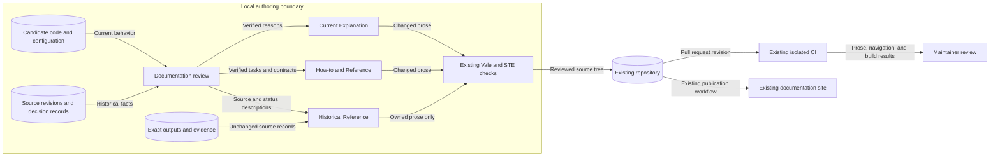

# Documentation authority and history

LilRAE documentation explains the implementation and preserves its decision history.
The code and supported interfaces determine current behavior.
A historical record describes its stated source revision.
Its age does not make its claims current or its evidence invalid.

## Components and contracts

Current explanations describe reasons, relationships, and limits.
How-to guides describe operating tasks.
Reference pages describe exact interfaces and contracts.
Each page links to the other forms when the reader needs them.
The [assignment register](documentation-assignments.md) records migration ownership.

ADRs retain their identifiers, dates, status, rationale, and amendment links.
The record's Status section determines its recorded status.
The index summarizes that status; it does not change a decision.
An editorial correction cannot accept a proposal or reverse an accepted decision.
[ADR-000](../adrs/adr-000-use-adrs.md) defines decision governance.

Requirement files retain their front matter, identifiers, lifecycle states, and traceability.
An ACTIVE requirement remains an active contract.
Historical classification describes recorded evidence, not a replacement lifecycle state.
Exact quotations, outputs, evidence files, and generated records retain their bytes.
Owned descriptions explain their source, date, and qualification limits.

Current explanations link to the applicable successor decisions.
Historical records keep their original command names and limits.
Current operating instructions use `lilrae` and the supported interface names.
Root Compose files describe their own deployment assets, not every installed Scenario Pack.

## Data flows and trust boundaries

Source examples are data, not permission to execute commands.
The documentation workflow does not read credentials or private runtime records.
Local writing checks process text locally.
The rewrite uses the existing repository, CI, and publishers.
It adds no external analyzer, hosting service, listener, or upload path.

## Security and failure behavior

| Threat | Control | Verification |
| --- | --- | --- |
| Old plans appear as delivered behavior | Separate current explanations from revision-bound records | Compare present-tense claims with candidate owners and relevant tests |
| An edit changes a decision or contract | Preserve metadata, obligations, conditions, and amendment meaning | Compare the candidate with the original record and source history |
| An edit changes exact evidence | Keep source records outside prose rewrites | Compare retained bytes with their source revision |
| An example weakens a security boundary | Check authentication, admission, TLS, redaction, and containment owners | Review applicable configuration and focused contract checks |
| A split breaks an existing link | Retain old paths and useful heading fragments | Existing navigation checks and strict MkDocs build in CI |
| A linter result becomes a false compliance claim | Review purpose, writing rules, and terminology separately | Editorial review plus explicit-path Vale and STE results |

The residual risk is an incorrect interpretation of source or historical evidence.
Passing checks cannot prove that every explanation is correct.
Review therefore retains source paths, revisions, corrected differences, and verification limits.

## Policy and executable architecture

[ADR-038](../adrs/adr-038-docs-style-lint-and-published-site.md) owns the writing and publication checks.
The existing STE configuration selects sentence length, paragraph length, and contractions.
Finished prose pages join `.ste-required.txt`.
Exact source records retain the existing passage-check boundary.
No broad exclusion replaces a necessary rewrite.

`mkdocs.yml` remains the navigation model.
The existing documentation tests check real routes and interface correspondence.
The strict build and behavior checks run in CI or an approved isolated VM.
The workstation supports source review, explicit-path prose checks, static checks, and staged hygiene.

Application models, runtime DFDs, deployment policy, and ADR decisions need no architectural change for this rewrite.
Their existing diagrams remain subject to source verification when their descriptions change.
This design adds no runtime mechanism or executable enforcement layer.

## Sources

- [Diataxis compass](https://diataxis.fr/compass/): reader-purpose selection.
- [Diataxis application guidance](https://diataxis.fr/how-to-use-diataxis/): incremental changes and links between forms.
- [MADR](https://adr.github.io/madr/): decision context, reasons, status, and consequences.
- [ASD-STE100](https://www.asd-ste100.org/about_STE.html), Issue 9: writing rules and technical terminology.
- [Documentation preflight](issue-1667-documentation-preflight.md): repository owners and preservation constraints at the source revision.
