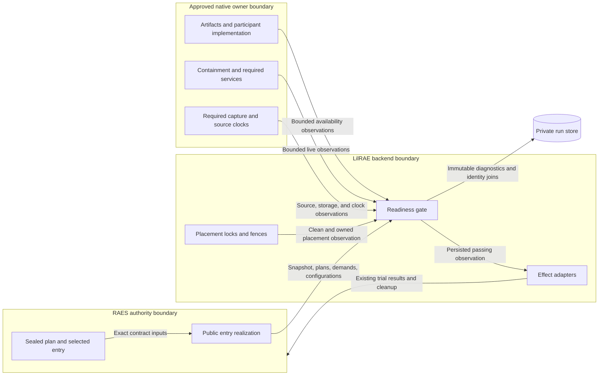

# Required trial readiness

Reader purpose: Explanation.
The [source revision `6d35d245f11a`](https://github.com/OpenRAE/lilrae/blob/6d35d245f11a7fffcaac1645cd25ccfafbad4599/docs/architecture/exp-011-resource-readiness-design.md) preserves the original design cut.
Version-specific examples and qualification statements keep their original scope.
This editorial rewrite does not qualify a provider, approve a VM, or authorize a service.

This design implements [#753](https://github.com/OpenRAE/lilrae/issues/753).
The [preflight](exp-011-resource-readiness-preflight.md) states the binding constraints.
Readiness supplies the later experiment entry point with a required-resource gate.

## Boundaries

The input is a public RAES `TrialUnitRequest` and its `TrialRealizationInputs`.
RAES reconstructs the sealed plan and realizes the selected entry.
The gate compares all three processor plans and the instantiated snapshot digest.
It checks the installed target manifest and the selected native participant bindings.
It admits the complete capture demands through the existing collector registry.
It never builds an internal LilRAE trial plan or expands another experiment matrix.

Trusted composition supplies the selected backend and bounded, read-only owner operations.
These operations prove containment, provider access, service readiness, and capture-source readiness.
They use the approved configuration and the ordinary lab's owners.
Missing operations refuse the affected trial. A declaration alone does not pass a live check.
There is no check discovery, waiver, or configurable recheck policy.

Preparation and live readiness have different boundaries.
`LilraeTrialUnit` checks clean placement under its existing project and daemon locks.
It records that observation and prepares readiness before handing work to RAES.

The gate checks local artifacts without downloading, building, or starting resources.
A fully ceased pre-dispatch refusal releases only fences newly claimed by that invocation.
Existing ownership and unconfirmed probes retain their fences.

Required mutation stays in the existing RAES provisioning path.
The native provisioner requires prepared readiness and held placement fences before applying effects.
Deletion plans still reach the existing cleanup policy when execution readiness fails.

The orchestration, evaluation, and participant adapters require live readiness before their effects.
The provisioner checks live readiness when its complete admitted resource set is present.
Live checks run after provisioning, against the exact selected target.

A failed live check leaves cleanup and interruption handling with RAES.
`ReadinessTrialServices` projects readiness refusal into the terminal trial outcome.
It preserves native cessation evidence and successful provisioning effects.

An unavailable check, crash, malformed result, or timeout never permits dispatch.

## Owner inputs

The selected participant binding supplies the implementation manifest, complete configuration, and executor.
The gate reconstructs the binding and compares its configuration with the sealed entry.
The executor's readiness operation must verify its selected build and approved provider access.

Unsupported request controls remain an admission failure; the gate does not omit them.
The managed OpenCode owner verifies its pinned executable and uses its explicit OpenRouter route and key.
Read-only authenticated key, user-model, and model-endpoint observations check the exact model and serving provider.

Catalog reads use bounded pages and never select a replacement model or endpoint.
No inference request, task text, or artifact is sent during this check.

Each required capture binds an installed collector and its read-only source readiness operation.
The operation proves the source and its destination are usable within the binding's limits.
It returns a strict boolean, not source data, a transcript, or an exception message.

Separate capture destinations need their own effective-writer and capacity checks.
Clock accuracy is checked only when the selected capture owner declares an accuracy requirement.
The existing `ClockProvider` supplies the source clock's offset and uncertainty.

Unknown synchronization does not satisfy an accuracy requirement.

The collector registration declares any required clock accuracy in milliseconds.
The admitted capture plan pins that value with the registration digest.
The source owner supplies the clock observation, not the requirement.
Omitting a required clock therefore fails the selected capture check.

The installed owner graph is Entry composition. The placement qualifier is an Application operation.
Core readiness interfaces separate the gate from concrete deployment and RAES implementations.

The installed native provisioner owns offline artifact resolution, qualification, and startup requirements.
The installed composition connects the selected Docker backend, participant executors,
windowed capture sources, and local run store to these fixed ports.
It reuses the approved placement's bound endpoint and daemon observation.

It compares fresh observations with that approved placement.
`AppliancePlacementReadiness` requires fresh host and guest proof through the ordinary boundary qualifier.
Matching but unverified endpoint observations cannot replace positive perimeter and enforcement proof.

Missing or failed proof blocks preparation and live readiness.
This check does not approve a new VM.
Its source probe invokes an explicit, bounded, read-only operation on the actual source owner.

Acquisition is never a readiness operation. Owners without a read-only operation are refused.
Stimuli, remote writes, and declared observer effects stay in the capture lifecycle.

Native startup resource requirements pass their exact minimum to the ordinary system check.
An unknown resource owner cannot satisfy a required resource check.
The ordinary startup adapter is resolved against each entry's reconstructed family trial.

The installed selection must match its pack, snapshot, provider provenance, and plan.
An absent or stale selection cannot remove a resource requirement.

The local run store proves writes through its existing create-once operation.
Descriptor-relative filesystem observation checks space for the selected bounded capture outputs and readiness records.
The observation is not a reservation. Runtime write failures remain fatal.
The gate does not create a temporary artifact in the experiment target.

## Evidence and failure behavior

Every observation uses RAES diagnostics with fixed codes and fixed messages.
Results bind the plan, entry, run, attempt, target, snapshot, and configuration digests.
Canonical result bytes select a content-addressed path in the existing run store.

Writes use `create_run_json_once`; sealed runs and conflicting bytes are refused.
The gate retains failed observations when storage works.
Persistence failure blocks execution and never claims that evidence was retained.

The handoff references readiness observations for the existing archival inventory.

The RAES execution adapter bounds synchronous owner calls and limits outstanding workers.
An injected existing `ProbeProcessRunner` bounds Docker and HTTP probe bytes during acquisition.
Its scope applies only inside read-only owner callbacks, not ordinary lifecycle execution.

Readiness accepts only bounded typed outputs and never renders owner output.
Owner transport implementations must enforce their byte bounds during acquisition.
Archive-backed source checks stream JSONL through bounded reads.

They share one byte budget across the selected files and refuse overflow before parsing it.
Container-log checks share one result budget across their selected containers.
A timed-out call cannot establish cessation; existing trial fences retain ownership.

Unverified child cleanup blocks further preparation, execution, handoff, and fence release.
Later passing checks cannot clear that refusal.
Pending delivery must use the same gate, request, target, and RAES ledger.

A new attempt cannot reuse another attempt's readiness authority.

## Data flow

## Security and verification

| Threat | Control | Verification |
| --- | --- | --- |
| Substituted trial or configuration | Public seal validation, exact plans, manifest and binding comparisons | Altered entry, snapshot, target, and configuration tests |
| False readiness after an owner failure | Strict positive results, bounded calls, no exception rendering | Missing, false, malformed, crashing, and timed-out owner tests |
| Work before required sources exist | Gate in each effect adapter, after provisioning | No participant or orchestration effect on a failed live check |
| Stale state across trials | Existing locks, fences, clean observation, and declared cleanup | Contamination and failed-cleanup integration tests |
| Storage loss or archive substitution | Descriptor-relative observation, create-once writes, seal exclusion | Disk, write-failure, symlink, and immutability tests |
| Secret disclosure | Fixed diagnostics and digest-only projections | Secret-bearing exception and configuration tests |
| Unapproved network access | Read-only local artifact availability and explicit approved provider owners | Offline and no-discovery tests |

This adds no listener, credential source, host service, or external storage.
Existing authentication, credential binding, visibility, and archival policy remain authoritative.
The fixed existing VM baseline needs no cloud account or allocator.
Later placements provide their owning containment and availability operations.
ADR-047, ADR-052, and ADR-064 retain their existing decisions.

## Released public API

RAE 10.6.1 preserves absent node identity values through its public planner.
Use that release and the compatible environment-pack release for this gate.
Move consumer imports to the current contract and processor owners.

Do not restore retired compatibility modules or alter public plan values.
Use the existing Pydantic serializer with the public canonical fallback for runtime values.
The existing lock and hashed requirements retain the tested dependency closure.

The bounded participant freeze is requalified against its prior complete model.
Only twelve absent architecture and OS-distribution values change from empty strings to null.
The source digest and all action and authority values stay unchanged.

The regression reverses those twelve values and recovers the prior approved model digest.

Verification includes the native control-only admission regression and affected
binding, artifact, plan-projection, capture, and cleanup consumers.
CI owns full-suite and installed-lab qualification.
For this issue, the user's workstation is not an execution target.
Run LilRAE commands and tests only in CI or an isolated test VM.
Workstation checks remain static source checks and commit hygiene.

## References

- Python 3.14, `os` documentation, `fstatvfs` and descriptor-relative operations: <https://docs.python.org/3.14/library/os.html>.
- Python 3.14, `subprocess` documentation, timeout and bounded pipe handling: <https://docs.python.org/3.14/library/subprocess.html>.
- Docker CLI, image inspection, local artifact observations: <https://docs.docker.com/reference/cli/docker/image/inspect/>.
- NIST SP 800-160 volume 1 revision 1, system security engineering and verification: <https://csrc.nist.gov/pubs/sp/800/160/v1/r1/final>.

- OpenRouter read-only account and model APIs: [current key](https://openrouter.ai/docs/api/api-reference/api-keys/get-current-api-key), [user models](https://openrouter.ai/docs/api/api-reference/models/list-models-filtered-by-user-provider-preferences-privacy-settings-and-guardrails), [model endpoints](https://openrouter.ai/docs/api/api-reference/endpoints/list-endpoints).
