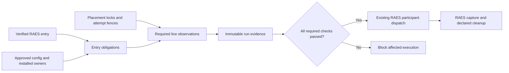

# EXP-011: Required resources before execution (#753)

The issue is the delivery contract. Readiness is an execution gate over the
RAES `admitted-trial-plan-v1` and its selected entry, not another admission
language, scheduler, or lab readiness system. This note fixes boundaries; it
does not prescribe implementation steps. No new ADR is needed: ADR-029/031,
ADR-047's released-contract successor, ADR-050, ADR-052/055/060 and ADR-064
already assign the owners.

## Decisions and invariants

- Derive obligations from the verified entry: selected participant build,
  model, prompt and complete request controls; instantiated environment;
  required capture; cleanup boundary; and concrete placement. Preserve RAES
  plan/entry/run identities, digests and distinct execution attempts. Do not
  translate into `core/experiment/trial_plan.py`'s legacy `TrialPlan`.
- A fixed control-only plan must work independently of a final factorial
  matrix. Check each concrete target's requirements. A baseline on an approved
  existing VM needs no cloud account or allocation. Future placement adds its
  owner's capability proof to the same obligations, not a scenario-name branch.
- Separate static admission, target preparation, and live readiness. Admission
  establishes compatibility; it cannot prove that collectors, providers or
  storage are usable now. Service checks happen after supported realization
  and before participant execution. Ordinary `experiment admit` remains free
  of lab mutation and live credential acquisition.
- Required checks need positive, validated evidence. Missing capability,
  unavailable check, malformed output, crash, timeout, or unknown state blocks
  affected execution. Not applicable is justified by the selected contract,
  never inferred from probe failure. A global failure blocks every dependent
  entry; one entry's pass does not qualify another configuration or target.
- Keep effects and clean-state proof under existing ownership. Preparation
  (including image materialization, seeding and credential/config rendering)
  precedes the relevant clean-state boundary. A probe that changes target
  state must be rolled back and verified before that boundary, or refused.
  Starting required capture is an owned apparatus operation; its effects must
  be declared rather than hidden inside an allegedly read-only check.
- Required results must be retained before dispatch. Persistence failure is a
  blocking failure, not permission to run without evidence. A pass is a bounded
  observation, not a guarantee of future availability; existing runtime capture,
  cancellation and cleanup enforcement remain necessary.

This is a flow of authority and evidence inside the existing RAES trial-service
lifecycle, not a new state machine. Preparation remains with that runtime;
attach the gate at its public boundary before participant effects, rather than
provisioning independently to obtain a readiness verdict. Failure to write
evidence also blocks dispatch. Locks/fences cover the protected dispatch;
results cannot authorize dispatch outside that ownership.

There are two distinct boundaries: `DockerTrialPlacement.require_clean()`
checks for residual resources before realization; required service/source
readiness checks the realized target before participant effects. Putting every
probe before `runtime_unit.execute_trial()` cannot establish the latter, since
the required services may not exist yet. Use the released runtime's public
trial-service boundary for that observation, retaining its configuration,
capture and cleanup receipts. Do not fabricate a new portable readiness phase
or run provisioning twice. If the installed public boundary cannot establish
the required ordering, refuse the affected execution. A failure after owned
preparation still owes RAES cleanup; it is not an admission-only rejection.

## Canonical owners to reuse

Paths below are relative to `src/aptl/` unless stated otherwise. Private helpers
identify incumbents, not APIs to import across package boundaries.

| Concern | Existing owner and required use |
| --- | --- |
| Public plan and concrete trial | `backends/scenario_family.py`: `admit_family_trial` invokes the public RAES entry instantiator, verifies the family/source join and returns detached canonical snapshots. `AdmittedFamilyTrial` retains sealed participant configurations and safe digest-only evidence. Reuse public RAES seal, digest and cross-artifact validators; do not copy their rules. |
| Installed contract/backend conformance | `require_family_capabilities`, release-set qualification and `_raes_admission_helpers.py` pin the exact pack/family/backend and one coherent installed adapter distribution. `create_aptl_manifest`, `raes_realization_envelope.py`, planning compatibility and runtime materialization qualification retain their gates. A declared manifest capability alone is not a successful live check. |
| Artifacts, images, rules and configuration | `experiment/resolver.py`, `spec_loading.py`, scenario bundle/staging, `raes_image_realization.py`, `raes_content_source_policy.py` and deployment runtime qualification own bounded resolution, hashes, approved sources and realized readback. Require selected prompt bytes, rules and configuration to match their admitted provenance; a tag, filename, model label or cached artifact's mere existence is insufficient. Do not call a materializing helper as a read-only probe. |
| Provenance identities | `core/provenance/` owns bounded identity collection, secret invariants and explicit unavailable/denied/timeout outcomes. Reuse its detection-content, configuration, participant and runtime-fact providers; do not rebuild a rule-tree scanner or use `snapshot.detection_content_digest`. A collected provenance section proves identity, not live readiness; its registry is not a readiness-plugin registry. |
| Participant implementation and controls | `core/participant_binding.py` joins manifest, implementation selection, execution limits and configuration result. `backends/lilrae_participant_configuration.py` validates owner, target types, digests, approved model domain and exact prompt commitment; `lilrae_participant_execution.py` checks native policy support. Reuse those gates and the installed provider's public capability path. Require support for every selected request control; never silently omit it or substitute a default. |
| Lab services and containment | `core/lab.py`, `lab_types.py`, `services.py`, `sysreqs.py` and the selected `DeploymentBackend` own ordinary checks. Deployment listener/stateful readiness and declared Wazuh attestation are the live service authorities; lab startup deliberately does not create a second login/probe owner. Use the selected durable configuration and admitted required services, not every optional SOC product. `execution_boundary.py` observes/revalidates the selected daemon; containment requires the owning appliance/seat and perimeter proof. |
| Clean target and resource ownership | `backends/trial_serving.py`: `LilraeTrialUnit` and `DockerTrialPlacement`; `core/lifecycle_guard.py`, `trial_ownership.py`, cleanup/reset records, `backends/cleanup.py` and `cleanup_evidence.py`. Reuse daemon/project locks, exact attempt fences, stopped-container/network/volume/native receipt inventory, declared cleanup and verified absence. Only RAES's resource-reuse predicate plus verified cleanup permits fence release. |
| Required capture | `experiment/capture_plan.py`, `capture_registry.py` and public RAES capture admission bind demands to exact offers, output contracts, implementation/config digests, visibility and limits. `core/evidence/adapters/wiring.py` binds real sources; the evidence coordinator owns capture failures, finalization, loss disclosure and persistence. Registry membership does not prove source connectivity, collector wiring or writable output. Keep readiness observations distinct from evidence actually captured. |
| Storage and integrity | `RunStorageBackend` / `LocalRunStore.create_run_json_once`, `utils/pathsafe.py`, evidence content storage and `core/archival/` own private contained writes, locks, canonical bytes, conflicts and sealed-run exclusion. Retain results as attempt-bound immutable run artifacts and include them in existing evidence/seal references. No second repository, journal or archive protocol. |
| Clock obligations | `core/correlation/clock.py`: `ClockProvider` and source-owned `ClockContext`. Require accuracy/offset/uncertainty only when the selected experiment/capture contract requires them. `SystemClockProvider` explicitly reports synchronization unknown; reading UTC does not prove accuracy, and host time does not qualify every source clock. |

`doctor.DoctorReport.ok` permits warnings/skips. `LabResult.success` can be true
for degraded startup; container health can fall back to merely running. None
is an experiment validity verdict. Inspect the existing structured facts
against required obligations, preserving ordinary lab behavior. Optional
startup degradation that removes required capture must block the trial.

Specific incumbent limitations must be addressed at their owners when used:

- `sysreqs.check_scenario_max_map_count()` already selects the scenario's
  kernel demand. Its underlying helper can return `passed=True` with
  `applicable=False` when the sysctl is unavailable or its owner is unknown.
  That is insufficient evidence for a required demand. Observe the actual
  kernel owner; do not probe the launcher host for a remote daemon's limit.
- `services.wait_for_service()` catches and logs raw exception text, and its
  outer deadline cannot interrupt a stuck callback. `curl_safe._run_curl()`
  buffers output without a byte ceiling; `execution_boundary._probe()` checks
  length only after acquisition. Reuse their ownership and safe result shapes,
  not these limitations. Enforce acquisition limits and safe failure reporting
  inside the owning transport/process path, not just the final verdict mapper.
- Wazuh API probes in `services.py` explicitly use `insecure=True`. They prove
  API behavior under that existing policy, not authenticated server identity.
  Preserve required TLS/CA validation at the consuming client's boundary;
  never promote this weaker observation into proof of trusted collector access.

Retained results identify the public plan/entry/run/attempt, selected target and
binding digests, applicable obligation, observation time, bounded verdict/reason
and supporting evidence references. Use existing owner result models where
available. Repeated delivery follows the RAES ledger; do not overwrite an
observation, reuse it across attempts or silently qualify a changed target.
Any later observation needs its own evidence identity under existing lineage.

There is no shared experiment disk-space gate in the inspected code. Doctor's
workspace `os.access` check and seat allocation's `shutil.disk_usage` checks
do not establish run evidence capacity. Use standard-library disk observation
and the storage owner's safe write path for this narrow missing check. Check
the actual run/capture filesystem and effective writer, including any separate
collector destination, not just the current directory or launcher host.
Account for all required outputs sharing that filesystem and the selected
writer's limits; a host-level free-byte count alone cannot prove a container's
quota or write permission. Reuse admitted capture limits rather than adding a
second capacity configuration.
Space requirements come from selected bounded capture/resource obligations;
do not invent an unbounded estimate or universal arbitrary floor. Capacity
observation is not a reservation. Permission, quota, read-only mount, exhausted
space and later write failures must remain failures. A temporary write probe
uses private contained state and verified removal, never a target artifact.

## Cross-cutting security gates

Each layer must pass independently, including failure paths. Successful RAES
validation does not authorize host effects or secret disclosure.

| Layer | Required behavior and incumbent |
| --- | --- |
| Authentication and authorization | Local composition has operator authority, not experiment-granted authority. Add no listener for readiness. Any exposure through existing API paths retains `api/main.py`, `deps.verify_token` / `WebAuthSettings` and BFF Host, same-origin/CSRF and session checks. Participant/MCP access retains its tool-admission, authorization and visibility boundaries; evaluator-only readiness data is not participant observation. |
| Input parsing and reference closure | Keep `spec_loading.py` byte/UTF-8/NUL and duplicate-key guards, `AdmissionPolicy` count/aggregate limits, contained no-follow resolution and authorized staged pack closure. Validate the public sealed entry before deriving obligations; hash and parse the same bytes. Do not reopen unchecked paths, resolve arbitrary URIs, or expand an unbounded matrix for a single baseline. |
| Config shapes and capability gates | Use strict `AptlConfig`, `ScenarioSourceConfig`, `ExperimentSettings`, participant configuration registries and existing manifests. Run each value through its actual consuming validator. No extra readiness config file, wildcard config writes, provider/project overrides, fabricated manifest compatibility or production use of `allow_uncertified_apparatus`. Unsupported installed contracts fail closed. |
| Credentials and environment binding | Reuse `ProcessEnvironmentCredentialSource`, configured participant acquisition in `workbench/participant_source_binding.py`, private provider delivery and ADR-052's ambient-source isolation. Deployment `EnvironmentGrant` binds pack/consumer/variable; `_environment_bindings.py` enforces declared sources and OPEN authority, generated-output ownership, and `_realization_primitives.environment_file_line` exact representability. `_compose_environment.py` filters the client environment. Revalidate consumers for each instantiated target; no same-name ambient lookup, home/keychain/metadata fallback, or experiment-supplied secret locator. Existing dotenv/`EnvVars` and placeholder validation remain the lab owners. |
| OS, transport and network exposure | Use the selected backend's scoped transport/runner and existing bounded provider/process execution. Do not put credentials in argv, URLs, shell strings, prompt text or probe files outside private state. `utils/curl_safe.py` keeps auth/body material in private temporary files; preserve the owning service's TLS/CA policy. Do not copy a diagnostic insecure-TLS probe into a stronger authenticated readiness claim. Bound probe elapsed time and bytes at acquisition, including stderr; truncating an already unbounded subprocess buffer is insufficient. Timeout must establish child cessation or retain unresolved ownership. |
| Host/runtime authority | Preserve realization, mount/network/capability, orchestration-authority, ownership and lifecycle policy checks. Docker endpoint labels, running containers and an approved VM label do not independently prove containment. Use selected daemon identity and owning containment evidence; changed/unreadable required identity blocks dispatch. No raw Docker passthrough, new socket exposure, privileged helper, host mount or egress exception. |
| Error envelopes and observability | Reuse RAES `Diagnostic`, `experiment/errors.py`, `raes_diagnostics` rendering, existing provider/process errors and `LabResult` projections. Normalize a crashing check to a bounded failure at its owning boundary; preserve RAES pending/cancellation semantics. No new exception hierarchy, raw `str(exc)`, Pydantic input/context, stdout/stderr, credential locator or config dump in CLI/API/log/span/result output. `get_logger` does not redact. Construct safe codes, contract addresses, counts/durations and identity/digest projections, then use shared Python/MCP redaction and OTel serialization controls. |
| Persistence and export | `create_run_json_once` enforces canonical create-once bytes, no-follow paths, per-run seal locking and the shared secret invariant. Construct secret-free result fields before hashing. If redaction would alter identity-bearing bytes, reject via the existing invariant; never scrub and retain the old digest. Include blocked results where storage works. If storage itself fails, emit a safe failure through the existing envelope and stop; do not claim durable evidence exists. |

Readiness is offline-capable: use admitted local artifacts and installed
capability paths. Do not silently download, install, pull, discover providers
or contact a new endpoint. Approved configured provider probes must be bounded
and avoid sending experiment content merely to check access. In offline mode,
a required remote capability that cannot be established blocks the affected
trial; it is not a skip, cached-success assumption or alternate-provider choice.
`DeploymentBackend.artifact_available(image_ref, allow_remote=False)` is the
existing read-only image-availability path for offline/staged execution.
Online obtainability does not prove local materialization; retain the separate
realization/readback gate before execution rather than pulling from a probe.

## Extensibility and repository boundaries

The seam is the verified entry's obligation set plus an injected selected
placement/backend, installed participant binding, pinned capture bindings,
storage destination and source clock. Required services, capacity and clock
accuracy are parameters of those contracts, not global feature flags or a
hardcoded study catalog. A later target supplies its placement capability
through its owner. #1116 may later generalize check discovery and policy;
#753 must not anticipate it with a plugin registry, waiver store or recheck DSL.

ADR-064 controls dependency direction even while modules retain historical
paths: entry composition supplies adapters to application services through core
contracts; application and adapters do not import each other. Reuse public
interfaces or expose a narrow existing owner's operation rather than importing
private startup/deployment helpers. Use typed RAES models and immutable internal
values, not a mirror portable schema or untyped dictionary protocol.
For example, a new RAES adapter import of `core.lab`/`core.doctor` (application)
or deployment internals (another adapter) breaks that direction. Composition
must inject the existing owner's narrow operation; historical cross-layer
imports elsewhere do not authorize another one. Update the architecture map
for any new production module.

The whole-repository surface includes experiment/family admission, RAES
backend/runtime composition, lab lifecycle, deployment, participant process
and credential owners, capture/evidence/provenance, correlation, run storage,
archival/export readers and any existing CLI/API/MCP projection. Host surfaces
include the selected Docker daemon/SSH transport, POSIX placement state,
container filesystems and evidence mounts, process environment/argv, SOC TLS,
and independent clock domains. Current trial serving requires POSIX placement;
ordinary Windows lifecycle support is not proof of Windows trial serving.

Canonical policy/config surfaces are `pyproject.toml`'s architecture map,
`tools/check_architecture.py`, `.ground-control.yaml`, `.gc/plan-rules.md`,
`.pre-commit-config.yaml` and `.github/workflows/checks.yml`. Existing Compose,
`config/`, appliance and pack assets remain under their owners; readiness must
not patch them to make a trial pass. Dependency adoption follows locked releases
and installed-wheel qualification, not a sibling checkout or stale version
example from an older preflight.

## Evidence bar and non-goals

Reuse the real RAES scheduler/native-cleanup fixture and
`tests/test_trial_serving.py`, family/installed-wheel qualification, participant
binding/configuration, capture registry/coordinator, environment binding,
doctor/service, runstore and redaction tests. Required negative evidence covers
missing artifacts/collectors, insufficient disk and failed cleanup, plus check
crash/unavailability, output/time limits, secret-bearing failures, persistence
failure and changed target identity. Demonstrate no participant dispatch after
required failure, no fence release after unverified cleanup, immutable results,
and control-only independence. Mutations that turn required failure into pass
or bypass dispatch gating must be detected. Use
`bash tools/run-targeted-tests.sh` for selected paths and staged `pre-commit run`;
full suites, whole-tree gates and installed-lab qualification belong in CI/CD.

This preflight implements no issue behavior. #753 adds only the required-resource
gate and its run evidence. It does not add a general check registry, waivers,
configurable rechecks (#1116), another trial controller, retry/resume or cleanup
policy, cloud provisioning, a participant endpoint, new provider/collector
installation, a capture DSL, statistical evaluation or a new archival format.
Do not extend the legacy trial-plan/executor route, scrape English logs for
verdicts, force optional services on every plan, equate a successful health
check with evidence completeness, or clear fences in a `finally` block.
