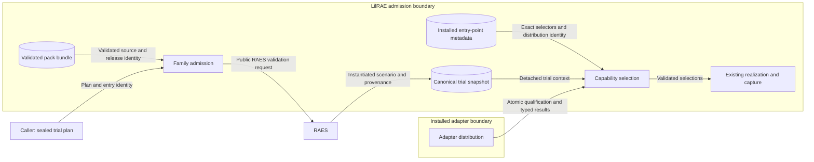

# Family adapter contract

LilRAE owns adapter discovery, admission, lifecycle order, and evidence storage.
An independently installed adapter owns behavior for its qualified scenario family.
Installed adapters are trusted Python code.
Entry points provide discovery, not isolation.

## Interfaces and identity

The existing purpose-specific entry points remain the discovery interfaces.
The public contract owners retain their existing result types and validation.
Family API `1` adds an explicit family qualification and trial context.
Legacy providers retain their existing API and absence behavior outside family trials.
A family trial requires all six capabilities before realization.
These capabilities are serving, runtime parameters, startup, capture, planning compatibility, and verification.

`QualifiedFamilyTarget` binds one pack release, family reference, and backend identity.
Pack version and content digest form one pair.
Each provider declares exact qualified targets and a literal family API version.
Installed distribution versions remain separate from contract versions.
One distribution must provide the required capabilities for a trial.
Duplicate compatible providers cause admission failure.

## Admission and data flows

The caller supplies a sealed RAES trial plan, entry ID, and expanded family.
Core compares the family with the validated bundle source.
RAES reconstructs the sealed plan and instantiates its selected entry.
Core retains the resulting canonical snapshot and provenance.
Providers receive detached copies of this context where their capability needs it.
Serving discovery uses trial identity internally.
Serving callbacks receive only pack identity, backend identity, and admitted component addresses, as ADR-053 requires.
Providers cannot change the admitted execution through these copies.
Capture sources receive only declared credentials and generated-output grants.
Container operations stay within the admitted node set.
Retry can inspect selected container state and restart an admitted node.
Inspection excludes container environment values.
Native capture records use the sealed entry identity, separate from the capture-plan identity.
Archive run identity must match the sealed trial before apply.
Runtime parameters cannot overwrite a sealed trial binding.
Retry retains the admitted snapshot and provider selections.

The existing lifecycle state remains admission, preparation, realization, observation, and finalization.
Family admission precedes preparation.
Compatibility failure prevents entry into preparation.

## Security and failure behavior

The protected assets are admitted scenario identity, credentials, evidence, and backend authority.
Pack content cannot select Python import paths or install executable code.
Core selects exact installed entry-point names before loading providers.
Atomic qualification prevents unqualified version and digest combinations.
RAES validation prevents altered selections from acquiring trial authority.
Detached snapshots prevent callback changes to the admitted scenario.
Snapshot values remain absent from automatic representations and safe identity projections.
Existing environment, path, capture, and backend validators remain mandatory.
Provider failures produce bounded codes without exception payloads.
Tests cover rejected admission before backend effects and credential canaries.

Capture uses the existing registry, source results, collector protocol, and outcome types.
Public supporting functions retain their current validation owners.
Finalization and reset retain checks against installed-provider changes.
Their persisted identities contain no credential values.
Archive payload validation uses the recorded capture distribution and version.
Capture finalization uses the explicit resume callback with safe trial identities.
Cleanup-action schema v2 carries family targets; v1 receipts retain their encoding.
Installed Python retains process authority; this contract does not provide a sandbox.

## Architecture and policy

Existing dataclasses, protocols, entry-point groups, and result validators define the executable architecture.
Family matching extends those owners without another plugin registry or executor.
`ScenarioAdmissionSource` groups a preselected bundle and startup adapter.
Trial admission validates this source before provider selection or backend preparation.
Targeted compatibility tests enforce the family boundary.
No deployment policy or infrastructure declaration changes.
ADR-047, ADR-053, and ADR-054 supply the existing ownership decisions.
Independent adapter ownership clarifies their application without changing portable SDL meaning.

## References

- [PyPA entry-point specification](https://packaging.python.org/en/latest/specifications/entry-points/): group, name, object reference, and conflict ownership.
- [PyPA plugin discovery pattern](https://packaging.python.org/en/latest/guides/creating-and-discovering-plugins/): installed package metadata.
- [Python 3.12 metadata API](https://docs.python.org/3.12/library/importlib.metadata.html): entry-point selection and distribution provenance.
- [ASD-STE100 Issue 9](https://www.asd-ste100.org/assets/files/ASD-STE100_ISSUE9.pdf): writing rules and consistent technical names.
