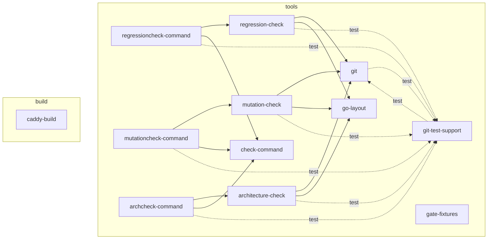

# Go Architecture

`architecture/model.yaml` is the architecture model of
[ADR-065](../adrs/adr-065-go-implementation-and-engineering-standards.md). It
gives the layers, the components, the packages of each component, and the
components and modules that each component can use. The
[#1583 design](issue-1583-architecture-model-design.md) gives the schema and the
rules.

`archcheck check` checks the repository against the model. The diagram shows
the layers, the components, and the uses that the model permits. A dashed arrow
shows a use that the model permits only for test files.
`archcheck diagram -write` makes the diagram from the model, and CI fails when
the diagram differs from the model. Do not edit the diagram by hand.

<!-- Generated from architecture/model.yaml by archcheck diagram. Do not edit. -->

<!-- End of the generated diagram. -->
