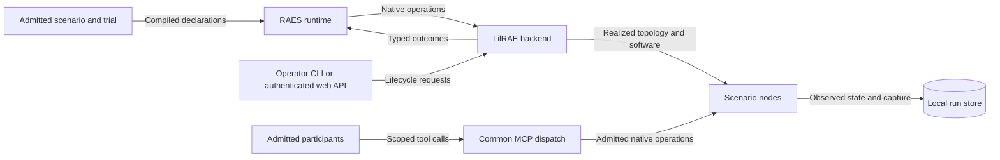

# Lab Architecture

LilRAE provides native lab realization, control, and local evidence storage.
RAES owns portable scenario semantics and admitted trial plans.
Installed Scenario Packs supply their scenario content.
The backend realizes the admitted topology; it does not substitute root Compose defaults.
[The pack boundary](pack-boundary-design.md) explains these ownership limits.

## Network Topology

[Network architecture](networking.md) explains segmentation, egress controls, and host exposure.
The [root Compose reference](../reference/compose-topology.md) lists compatibility declarations.
Those declarations include stubs and do not prove an installed pack's realized topology.

## Container Layout

The [root address tables](../reference/compose-topology.md#container-ips) describe compatibility service declarations.
[Node realization](../components/node-realization.md) describes substrate selection and authored software.
A root stub is not a deployed container specification.

## Ports

The [publication tables](../reference/compose-topology.md#host-port-mappings) describe root defaults and overrides.
[Host MCP access](../reference/host-mcp-access.md) describes operator access.
[Web authentication](../reference/web.md) describes the browser and API boundaries.
Published endpoints and authenticated access are different properties.

## Data Flow

RAES admits authored plans before LilRAE performs native work.
Native owners return observations and typed outcomes to the runtime.
The run store retains selected evidence and provenance.
[Trial serving](trial-serving.md) explains dispatch, readiness, cleanup, and ownership fences.
[Interrupted recovery](interrupted-trial-recovery.md) explains recovery without replay of native work.

Participant actions pass the [action enforcement boundary](participant-action-enforcement.md).
Diagnostic telemetry and research evidence have different owners.
[Red-side capture](../components/red-side-capture-boundary.md) explains why reasoning traces stay outside the SIEM.

## Components

[Enterprise infrastructure](enterprise-infrastructure.md) explains the lab's attack and defense design.
[Family adapters](family-adapter-contract.md) explains capability discovery and family admission.
[Participant request manifests](participant-request-manifests.md) explains selected model and content commitments.
[Trial configuration](trial-participant-configuration.md) explains delivered settings and native observations.
[Concurrent execution](concurrent-participant-execution.md) explains participant isolation and settlement.
[Managed OpenCode](managed-opencode.md) explains native process ownership and qualification limits.

[ADR-063](../adrs/adr-063-remove-thehive-and-cortex.md) records removal of TheHive, Cortex, and case-management integration.
Older plans and evidence can still describe those services.
Their presence in a historical record does not make them current capabilities.

## CI verification

[Verification architecture](ci-verification.md) explains changed-input selection and evidence ownership.
[Performance evidence](../testing/ci-performance.md) records pruning and measurement rules.
[Documentation authority](documentation-boundaries.md) explains current claims and preserved records.

## Preflights

These links lead to design constraints and historical records.
A preflight records a source revision and proposed work; it does not establish delivery or installed qualification.
Current explanations and successor ADRs determine which design remains applicable.

- [Issue #1707 Admitted Participant Smoke Providers](issue-1707-participant-smoke-provider-preflight.md)
- [Issue #1689 Native Acquisition Phase](issue-1689-native-acquisition-phase-preflight.md)
- [Issue #1421 RPT Capture](issue-1421-rpt-capture-preflight.md)
- [Issue #1510 Code Quality Architecture Preflight](issue-1510-code-quality-preflight.md)
- [Issue #1510 Code Quality Architecture Design](issue-1510-code-quality-design.md)
- [Issue #1465 Released Structural Factorial Experiment Tuple](issue-1465-released-experiment-tuple-preflight.md)
- [Issue #1465 Released Structural Factorial Tuple Design](issue-1465-released-experiment-tuple-design.md)
- [Issue #1468 CI Feedback and Test Suite](issue-1468-ci-feedback-preflight.md)
- [Owned Descendant Reporting Design](issue-1130-owned-descendant-reporting-design.md)
- [Issue #1130 Runtime Realization Attestation](issue-1130-runtime-realization-attestation-preflight.md)
- [Issue #1406 Native Evidence Test Target](issue-1406-native-evidence-test-target-preflight.md)
- [Issue #1424 Runtime Retry Ownership](issue-1424-runtime-retry-preflight.md)
- [Issue #1424 Runtime Retry Ownership Design](issue-1424-runtime-retry-ownership-design.md)
- [Issue #1447 Runtime Ownership During Evidence Refresh](issue-1447-runtime-owner-handoff.md)
- [Issue #1423 Shuffle Startup Recovery](issue-1423-shuffle-startup-readiness-preflight.md)
- [Issue #1422 Wazuh Dashboard Config Readability](issue-1422-wazuh-dashboard-config-readability-preflight.md)
- [Issue #1422 Wazuh Dashboard Owner-Declared Config Design](issue-1422-wazuh-dashboard-owned-config-design.md)
- [Issue #1413 Configured Pack Source](issue-1413-configured-pack-source-preflight.md)
- [Issue #955 Generic Systemd Substrate Privilege](issue-955-systemd-substrate-privilege-preflight.md)
- [Issue #976 Service Capability](issue-976-service-capability-preflight.md)
- [Issue #976 Samba NT ACL Store Design](issue-976-samba-acl-store-design.md)
- [Issue #958 Execution Boundary](issue-958-execution-boundary-preflight.md)
- [Native Docker Range Network Policy](issue-968-native-network-policy.md)
- [Issue #601 Participant Demonstration](issue-601-participant-demonstration-preflight.md)
- [Issue #851 First-Time User Documentation](issue-851-first-time-user-docs-preflight.md)
- [Issue #880 TechVault Env-Pack Consumption](issue-880-techvault-env-pack-consumption-preflight.md)
- [Issue #980 Pack Adapter Install Seam](issue-980-pack-adapter-install-seam-preflight.md)
- [Issue #985 Owned Lab Fixture](issue-985-owned-lab-fixture-preflight.md)
- [Issue #993 Boot Realization Regressions](issue-993-boot-realization-regressions-preflight.md)
- [Issue #970 Generic Lab Lifecycle Boundary](issue-970-generic-lab-lifecycle-preflight.md)
- [Issue #956 SDL Runtime Materialization](issue-956-sdl-runtime-authority-materialization-preflight.md)
- [Issue #957 Wazuh Attestation, Evidence, And Credentials](issue-957-wazuh-attestation-evidence-credentials-preflight.md)
- [Issue #1002 Wazuh API TLS Warm-Up](issue-1002-wazuh-api-tls-warmup-preflight.md)
- [Issue #1000 Partial Boot And Manual Release QA](issue-1000-manual-release-qa-preflight.md)
- [Issue #992 Backend Observability Ownership](issue-992-backend-observability-ownership-preflight.md)
- [Issue #1017 TechVault Bridge Retirement](issue-1017-techvault-bridge-retirement-preflight.md)
- [Issue #1017 Native Runtime Attestation Design](issue-1017-native-runtime-attestation-design.md)
- [Issue #1603 Released RAES Dependencies](issue-1603-raes-11-module-locations-preflight.md)
- [Issue #1603 Released Module Adoption Design](issue-1603-released-module-design.md)
- [Issue #974 Shuffle Worker Docker And Image Realization](issue-974-shuffle-worker-docker-images-preflight.md)
- [Issue #934 APTL-To-LilRAE Rename Boundary](issue-934-rename-boundary-preflight.md)
- [Issue #592 Scenario-Pack Terminology](issue-592-scenario-pack-terminology-preflight.md)
- [Issue #951 Fresh Env-Pack Start](issue-951-fresh-env-pack-start-preflight.md)
- [Issue #913 Shuffle Post-Realization Mutation](issue-913-shuffle-post-realization-mutation-preflight.md)
- [Issue #912 MISP/Redis Post-Realization Mutation](issue-912-misp-redis-post-realization-mutation-preflight.md)
- [Issue #905 Lab Lifecycle Robustness](issue-905-lab-lifecycle-robustness-preflight.md)
- [Issue #874 Scenario-Bundle Realization Roots](issue-874-scenario-bundle-realization-roots-preflight.md)
- [Issue #878 Scenario Verification Plugin Seam](issue-878-scenario-verification-plugin-seam-preflight.md)
- [Issue #866 TechVault Component Realization](issue-866-techvault-realization-contract-preflight.md)
- [EXP-009 ACES Archival Run And Evidence Sealing](exp-009-aces-archival-sealing-preflight.md)
- [EXP-008 Portable Research Evidence Bundle](exp-008-portable-evidence-bundle-preflight.md)
- [REP-003 Run-Scoped Provenance](rep-003-run-scoped-provenance-preflight.md)
- [Issue #862 Explicit Participant Model Selection](issue-862-explicit-participant-model-selection-preflight.md)
- [Issue #859 Idempotent Stuttering In Bounded Participant Realizations](issue-859-idempotent-stuttering-preflight.md)
- [Issue #858 Bounded Participant Choice Transport](issue-858-bounded-participant-choice-transport-preflight.md)
- [Issues #852 And #940 Dev-To-Main Promotion](issue-852-devmain-promotion-preflight.md)
- [Issue #847 OpenSSF Scorecard](issue-847-openssf-scorecard-preflight.md)
- [EXP-005 Safe Parameter Binding And Provenance](exp-005-safe-parameter-binding-provenance-preflight.md)
- [Issue #820 Resource-Bounded Participant Profile](issue-820-resource-bounded-participant-profile-preflight.md)
- [DEP-008 Self-Contained Lab Assets](dep-008-self-contained-lab-assets-preflight.md)
- [RNG-001 Ephemeral Environments](rng-001-ephemeral-environments-preflight.md)
- [DEP-003 Ephemeral Lifecycle Policy](dep-003-ephemeral-lifecycle-preflight.md)
- [GRC Boundary Surface Vocabulary](grc-boundary-surface-vocabulary-preflight.md)
- [Issue #677 Certificate Producer Ownership](issue-677-cert-producer-ownership-preflight.md)
- [OBS-002 Correlation Identity And Clock Context](obs-002-correlation-identity-clock-preflight.md)
- [EXP-010 Capture Admission And Evidence Acquisition](exp-010-capture-admission-evidence-preflight.md)
- [Issue #557 Participant Implementation Binding](issue-557-participant-implementation-binding-preflight.md)
- [Issue #589 Scenario-Pack Capture Workflow Ownership](issue-589-scenario-pack-capture-ownership-preflight.md)
- [Issue #591 Scenario-Pack Capture Asset Ownership](issue-591-scenario-pack-capture-asset-ownership-preflight.md)
- [Issue #821 In-Appliance Participant Workbench](issue-821-participant-workbench-preflight.md)
- [Issue #823 Versioned Disposable Lab Appliance](issue-823-versioned-disposable-appliance-preflight.md)
- [Issue #824 Kiosk Launcher, Reset, And Recovery](issue-824-kiosk-launcher-reset-recovery-preflight.md)
- [Issue #1022 Appliance Seat Delivery](issue-1022-appliance-seat-delivery-preflight.md)
- [Issue #1127 Seat Component Protection](issue-1127-seat-component-protection-preflight.md)
- [Issue #1127 Seat Component Protection Design](issue-1127-seat-component-protection-design.md)
