# Interrupted trial recovery

Reader purpose: Explanation.
The [source revision `6d35d245f11a`](https://github.com/OpenRAE/lilrae/blob/6d35d245f11a7fffcaac1645cd25ccfafbad4599/docs/architecture/interrupted-trial-recovery.md) preserves the original design cut.
Version-specific examples and qualification statements keep their original scope.
This editorial rewrite does not qualify a provider, approve a VM, or authorize a service.

LilRAE recovers one RAES-assigned attempt.
RAES owns admission, cancellation intent, entry selection, retry and replacement.
The [recovery preflight](issue-437-interrupted-trial-recovery-preflight.md) supplies the binding constraints.
The original design used RAES 10.7.0.
Current package metadata owns the supported dependency range.

## Components and contracts

`LilraeTrialUnit` retains an immutable intent before readiness or runtime effects.
The intent binds the request, native cleanup attempt, project and observed daemon.
It contains routing commitments, not participant settings or deletion selectors.
Its parser rejects unknown fields, duplicate members, excessive input and changed commitments.
Missing or corrupt intent never establishes a clean target.

Serving and recovery share the existing placement and project lock boundary.
The daemon lock precedes the project lock.
A concurrent owner receives a bounded busy response and can retry after the active recovery.

Recovery validates the retained intent and each existing ownership fence inside that boundary.
If a crash preceded fence publication, the original authorized assignment can
claim the absent fences under both locks. A foreign fence always prevents this.

The intent still grants no native deletion authority; original RAES and native
receipt verification remain required.
It rechecks the daemon before effects and before release.
Another live owner or changed native binding prevents recovery.

The recovery adapter receives an already bound `AssignedTrial` and coordinator control.
It requires cancellation for that exact assignment and refuses retry preparation.
It does not manufacture cancellation, bind another experiment or request another entry.

`AssignedTrial.advance(control=...)` first retains the stop intent.
The bound unit then finishes only its owed stop, capture and cleanup phases.
The RAES ledger owns each phase and its original deadline.

`AssignedTrial.outcome()` supplies original observations, operation states and timestamps.
An unresolved operation remains unknown.

The reporting composition submits the original outcome through RAES's outcome-ingestion boundary when required.
RAES verifies the admission and native observations through its installed verifier.
The existing producer supplies the run record and separate execution, capture and cleanup accounting.
No local terminal-status mapping is added.

The local archive owner persists producer records and their source artifacts.
Immutable archive options group the installed snapshot limits, producer
validation result and local limitation disclosures. Portable models stay with RAES.

It retains public assignment, outcome, scenario, processor-plan and execution-snapshot carriers.
Private runtime control journals remain with their RAES owner.
They are not portable evidence and can contain credential-bearing internal state.

It uses the existing run store, canonical writes, integrity checks, seal marker and discovery index.
Each distinct producer record and artifact snapshot has a separate immutable archive namespace.
The manifest keeps the original RAES run ID and run version.

The namespace commits the original outcome, retained artifact inventory and
local limitation disclosures.
Additional source facts can produce a new local snapshot without changing a portable record's version.
The working evidence store remains separate from the sealed snapshot.

Later cleanup observations cannot rewrite a sealed version.

The archive freezes a bounded, run-scoped artifact inventory under the store's finalization lock.
It retains source commitments, outcome facts, readiness receipts and available partial capture bytes.
It verifies every declared evidence digest against the copied bytes.
Missing or changed declared content prevents a successful completeness claim.
An immutable partial record can disclose missing capture, unknown cessation or failed cleanup.
Archive integrity does not establish experimental success or target reuse.

Publication writes the canonical manifest and inventory before the atomic seal marker.
The discovery index retains its prepared, sealed and committed recovery boundary.
An identical replay verifies the existing archive and repairs only unfinished index publication.
A changed manifest or inventory is a conflict.
Neither recovery time nor a duplicate delivery changes original event timestamps.

The adapter releases fences only after verified cleanup and complete probe cessation.
It also requires the released `replacement_resources_reusable` predicate and verified archive publication.
Unknown cleanup, pending native work or a publication failure retains both fences.

A create-once local receipt routes completed duplicate requests to the verified archive.
It lives outside the working run so it cannot change the archived inventory.
A replay never removes a later owner's fences.

Readiness handoff repair checks the exact bound request and placement under the
gate lock. A replay leaves a later delivery's gate state unchanged.
After restart, a fresh readiness gate cannot prove that old probes ceased.

It retains exclusion until that uncertainty is reconciled.
The archive discloses this as `probe-cessation-unverified`, including a crash
between intent publication and ownership acquisition.
The installed participant application retains its admission checks.

Recovery never configures a participant. After verified reusable cleanup, it
finishes the existing application before snapshotting its final evidence.
A failed participant handoff retains native exclusion.

The next dispatch remains a RAES decision.

## Data flows and trust boundaries

```mermaid
flowchart LR
    Coordinator[Trusted RAES coordinator] -->|Exact assignment and cancellation control| Recovery[LilRAE recovery adapter]
    Readiness[Bound readiness gate] -->|Exact request, placement and probe cessation| Recovery
    Recovery -->|Matching handoff only| Readiness
    Intent[(Private attempt intent)] -->|Retained identity commitments| Recovery
    Recovery -->|Same bound attempt and delivered control| Runtime[RAES runtime]
    Runtime -->|Owed stop, capture and cleanup| Owners[Installed native owners]
    Owners -->|Verified original observations| Ledger[(Protected RAES ledger)]
    Owners -->|Capture bytes and native receipts| Working[(Private working run store)]
    Ledger -->|Outcome and record source| Producer[RAES record producer]
    Producer -->|Original run versions and validation results| Archive[Local archive owner]
    Working -->|Bounded immutable artifact snapshot| Archive
    Archive -->|Canonical manifest, inventory and atomic seal| Sealed[(Versioned local archives)]
    Archive -->|Verified archive identity| Recovery
    Recovery -->|Interruption, evidence and cleanup state| Coordinator
```

The coordinator boundary validates portable identity and control carriers.
The host boundary rechecks locks, fences, daemon identity and native ownership receipts.
The storage boundary uses private, descriptor-relative, no-follow access.

The reporting boundary preserves producer validation failures and uncertainty.
The shared redactor preserves `authorization_scope` only when its value is a list of string labels.
Each label still passes the ordinary inline credential checks.

Scalar values, nested objects, compound credential keys and authorization headers remain protected.
Trusted composition supplies owners, stores and identities; authored input cannot replace them.
No network listener, credential resolver, cloud service or automatic upload is added to the product.

## Security and failure controls

| Asset and threat | Control | Verification |
| --- | --- | --- |
| Unrelated resources could be deleted through corrupt intent. | Compare exact admission and cleanup bindings; retain native receipt ownership checks. | Corrupt, cross-run, foreign-resource and replaced-resource cases. |
| Recovery could resume a workload or consume another allocation. | Require exact delivered cancellation; use only the bound attempt and original ledger. | Before-effect recovery leaves workload counters and unstarted entry counts unchanged. |
| Partial evidence could be lost or assigned to another attempt. | Preserve original facts and bytes; verify run, entry, attempt and digest joins. | Interrupted capture and wrong-identity cases retain or reject the actual bytes. |
| Duplicate recovery could repeat effects or overwrite history. | Reuse retained RAES phase decisions and create-once archive versions. | Duplicate and concurrent recovery compare native counters and sealed bytes. |
| Cleanup uncertainty could permit unsafe reuse. | Require cleanup evidence, probe cessation, verified publication and the RAES reuse predicate. | Failed cleanup, unknown cessation and publication faults retain both fences. |
| Source data or credentials could enter diagnostics. | Use existing redaction, secret-invariant checks and bounded failure codes. | Credential canaries and parser failures expose no raw input or exception text. |

A compromised host can change runtime state outside these controls.
An archive seal proves local byte integrity, not a signature or scientific validity.
Fresh independent observations remain necessary for native ownership and cessation.

## Architecture and extension points

ADR-047 and ADR-050 already assign portable semantics to RAES and local sealing to LilRAE.
ADR-064 governs dependency direction and typed composition.
No new ADR, deployment policy, configuration service or experiment state machine is needed.
The public RAES carriers and the existing layer map remain the executable architecture boundaries.
Behavioral tests enforce workload suppression, exact identity, evidence preservation and cleanup-before-reuse.

Another backend supplies the existing cleanup and observation owners.
Another capture source supplies its existing lifecycle and evidence contracts.
Neither extension changes recovery's allocation authority.
The older archival executor's unvalidated recovery helper is retired.
Shared terminal archive primitives remain available to existing consumers.

## References

- [RAES 10.7.0](https://pypi.org/project/raes/10.7.0/): published assigned-trial contracts and Python compatibility.
- [RAE assigned trials](https://github.com/OpenRAE/rae/blob/v10.7.0/docs/public/guides/assigned-trials.md): binding, controls, durable stores and original outcomes.
- [Python 3.14 dataclasses](https://docs.python.org/3.14/library/dataclasses.html): `replace`, request reconstruction.
- [Python 3.14 fcntl](https://docs.python.org/3.14/library/fcntl.html): `flock`, existing POSIX ownership locks.
- [RFC 6749](https://datatracker.ietf.org/doc/html/rfc6749): section 3.3, access scope describes permissions rather than authentication material.
- [Atomic commit in SQLite](https://www.sqlite.org/atomiccommit.html): commit points and crash recovery; RAES retains its existing ledger implementation.
