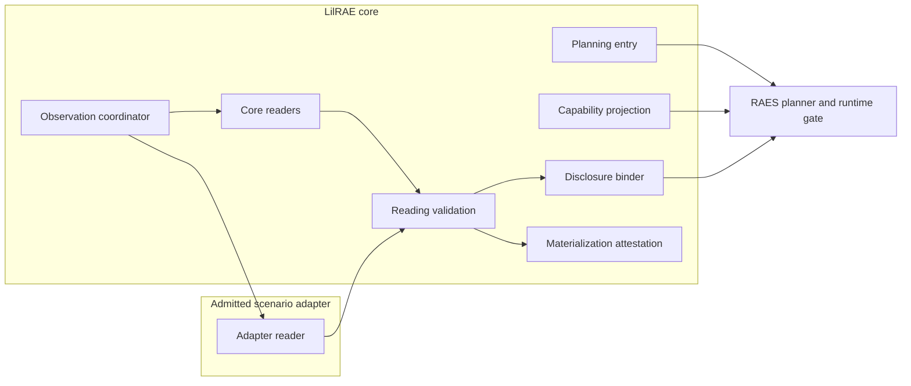
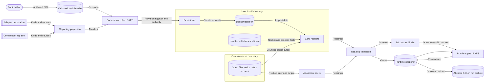
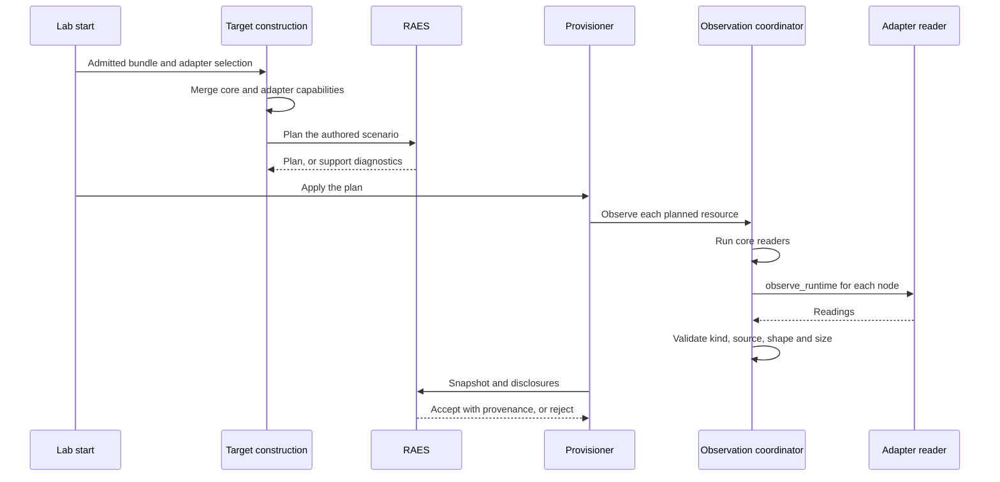

# Issue #1017 Native Runtime Attestation Design

This design replaces the temporary TechVault observation and plan-limit bridge.
LilRAE plans the authored SDL without change.
LilRAE reports each realized runtime concern from a native readback, with the source that it used.
[ADR-065](../adrs/adr-065-runtime-readback-reports-realized-state.md) records the decisions.
The [preflight](issue-1017-techvault-bridge-retirement-preflight.md) records the boundaries and the release assessment.

## Problem

The TechVault pack declares `realization: {default: open}`.
RAES 10.1.0 then compiles every registered runtime concern on every node.
The planner requires configuration-scope readback capability for each open concern.
At run time, RAES compares each disclosed value with the plan-owned authority.

The bridge does three things that this design removes:

1. It changes 377 unauthored open requirements to delegated, and RAES resolves them closed.
   It also changes three open kinds to exact, and it changes required observation strengths.
2. It discloses 13 configuration families from a table of release digests.
   The disclosed value is the planned value, labelled `daemon-observed`.
3. It replaces process-global RAES value limits during apply.

The core readers also compare a declared value with Docker state and then disclose the declared value.
A reader returns nothing when the SDL declares nothing.
So LilRAE cannot report a value that it chose under an open concern.

## Design rules

| Rule | Statement |
| --- | --- |
| R1 Plan as authored | LilRAE gives the compiled requirements and authority to the RAES planner without change. |
| R2 Read, do not echo | A disclosed value comes from native state that LilRAE reads after realization. A plan value, a declared value, or a table entry is never a disclosed value. |
| R3 Actual source | Each disclosed value carries the source that its reader used. The disclosure binder uses that source. No table maps a concern kind to a source. |
| R4 Managed subset | A reader reports the scenario-significant managed subset of its concern, as RAES issue 1078 defines it. The subset rules are in the table below. |
| R5 Honest capability | The manifest declares a readback capability only for a concern kind that an installed reader reads. Capability is a projection of the registered readers. |
| R6 Fail closed | A reader that cannot prove a value discloses nothing. A malformed, oversized, or undeclared result is dropped. RAES then applies its own rule to the omission. |
| R7 No release keys | Core contains no pack, release, or digest branch. Core reads only what core realizes. The adapter reads the product state that its pack realizes. |
| R8 One reader for each member | The component that realizes a member reads it. Readings of one concern from core and the adapter merge by member identity. A duplicate identity or a different source drops the concern. |

R2 has two limits.
A reader can use authored identities to select members, but it reads each member value from native state.
When native state omits a value, the reader discloses nothing; it does not supply a documented daemon default.

## Components

| Component | Owner | Responsibility |
| --- | --- | --- |
| Planning entry | `backends/_raes_planning_entry.py`, `backends/raes_planning_compat.py` | Compile and plan once through public RAES functions. Keep native evidence capture in `AptlRuntimeManager`. |
| Readback values | new `core/runtime_readback.py` | Define `ConcernReading` (value and source) and the `RuntimeConcernReader` Protocol for adapters. |
| Core readers | `backends/raes_runtime_observation.py` and its existing helper modules | Read container settings through Docker inspect. Read host-side kernel state for the container namespaces. Read bounded guest state. |
| Adapter readers | `aptl_techvault` startup provider | Read the product state that TechVault authors, through the product interfaces. |
| Observation coordinator | `backends/raes_observation.py` | Run core readers for each node, then the admitted adapter reader. Validate adapter results. |
| Disclosure binder | `backends/_raes_operational_observation.py` | Create one RAES observation disclosure for each reading, with the reading source. |
| Capability projection | `backends/_raes_manifest_realization.py`, `backends/_raes_runtime_target.py` | Build `observation_capabilities` from the core reader registry and the admitted adapter declaration. |
| Materialization attestation | `backends/lilrae_materialization_reporting.py` | Describe the observed values in the attested SDL. This component does not change. |

## Managed subset by concern class

RAES issue 1078 defines the closure universe of a collection.
It is the set of scenario-significant entries that the backend manages or selects.
It is not every native entry that `ps`, a package database, or `/etc/passwd` shows.
RAES 10.1.0 has no portable selector for this set, so LilRAE applies these rules.

| Class | Concern kinds | Managed subset | Reader and source |
| --- | --- | --- | --- |
| Container settings | Hostname, domain name, CPU, memory, swap and PID limits, restart policy, autoremove, entrypoint, command, every `runtime-container-*` kind, published ports, capabilities, mounts, network endpoints | The complete effective value. LilRAE creates the container, so each value is a LilRAE choice or a daemon default that LilRAE accepts. | Core, Docker inspect, `daemon-observed` |
| Environment | `runtime-environment` | The variables that LilRAE passes at container creation. Image `ENV` entries are base-image state. | Core, Docker inspect, `daemon-observed` |
| Bind state | `service-listeners` | Every socket in the container network namespace, less the Docker embedded resolver. Bind state is exposure, so all of it is significant. | Core, host kernel tables, `daemon-observed` |
| Main process | `runtime-processes` | The container init process, which LilRAE starts. Other processes are base-image or workload state. | Core, host `/proc` for the init PID, `daemon-observed` |
| Process limits | `process-resource-limits` | The effective limits of the main process. RAES requires the `guest-observed` source for this kind. | Core, existing bounded guest reader, `guest-observed` |
| Guest inventories | Packages, file system inventory, local identity, service-manager units, dependency manifests, local control interfaces, forwarding agents | The authored members and the members that LilRAE adds. | Core, existing bounded guest readers, `guest-observed` |
| Product families | Security monitoring managers, datastore services, applications, platform applications, application authorizations, database, DNS, file and identity services, network sensors and detection engines, orchestration authorities | The authored members. | Adapter, product interface, `guest-observed` |
| Software components | `runtime-software-components` | The authored members and the Wazuh agent that core installs. | Core for the agent, adapter for pack components, `guest-observed` |

A concern with an empty managed subset has no realized value.
The reader discloses nothing for it.
The attested SDL then omits the concern, which states that LilRAE realized no member.

Readers use the RAES sensitivity postures for values that LilRAE did not receive from the author.
An unauthored environment value is disclosed as `redacted`, so only its presence is recorded.
A bind mount from outside the pack is `backend_generated`, and its host path is `redacted`.

Product interface output comes from inside the workload, so product readings are `guest-observed`.
Core installs the Wazuh agent as its forwarding-agent implementation, so core reads that agent (R7, R8).

Host-side readers execute no binary from the container.
They reuse the process identity and lifetime checks in `core/deployment/_proc_net_listeners.py`.
The `ssh-compose` transport cannot read the host kernel, so its targets register no host-side kinds.

LilRAE and the adapter add some members inside guests, for example apparatus, accounts, and seed data.
Implementation lists each such addition and maps it to the reader of its concern.
A reader that omits a LilRAE addition gives an incomplete attestation, so tests cover each addition.

Readback no longer refuses a member that the authority permits.
The old readers withheld a declared port, capability, or mount set when Docker held more.
RAES now makes that decision from the authority: exact and closed scopes reject the excess, and open scopes record it.
Deployment admission in `runtime_authority.py` still controls privilege before any container starts.

## Readings and sources

`ConcernReading` is a frozen dataclass with three fields.

- `kind`: the RAES concern kind.
- `value`: the realized value in the SDL shape of that kind.
- `source`: the `ObservationStrength` that the reader used.

`ObservedResource.concerns` maps each concern payload path to one `ConcernReading`.
The snapshot builder writes `reading.value` to the payload.
The binder writes `reading.source` to the disclosure.
One binder serves all callers; the duplicate binder in `raes_diagnostics.py` goes.

## Capability projection

RAES checks that the disclosed source equals the manifest capability source for the kind.
So each kind has one source across core and the adapter.

1. The core reader registry names each core kind, its source, and whether it reads the host kernel.
2. The admitted adapter declares `observed_runtime_concerns`, a map from kind to source.
3. Target construction merges the two maps.
   A kind with two different sources fails admission with a bounded code.
4. `create_aptl_manifest` receives the merged map.
   It writes one configuration-scope capability for each kind.

This follows the existing capture capability, which is a projection of the collector registry.
The static `DAEMON_READBACK_RUNTIME_CONCERNS` list goes.

## Adapter reader contract

The startup provider keeps `observe_runtime` as its entry point.
The provider also declares `observed_runtime_concerns`.

- `observe_runtime` returns `ConcernReading` objects for one node.
- Core accepts a reading only if its kind is declared and its source equals the declared source.
- Core projects each value through the RAES observed validator before it accepts it.
- A raised exception, an undeclared kind, or a bad value drops the whole adapter result for that node.
- Readers use the existing scoped runtime operations.
  They get no new host authority, Docker socket, or guest agent.

A third-party family adapter supplies its own readers in the same way.
Each trial uses its admitted snapshot, so concern values can change between trials.
No release table is necessary.

## Removed bridge elements

| Element | Location | Replacement |
| --- | --- | --- |
| Requirement and authority rewrite | `_raes_planning_adjustment.py` | None. R1. |
| Planning compatibility decisions and discovery | `scenario_planning_compatibility*.py`, the TechVault provider, the entry-point group | None. The family capability set has five members. Core no longer reads the group, so an installed decision has no effect; RAES judges the unchanged plan. |
| Process-global RAES value limits | `_runtime_value_limits` in `raes_planning_compat.py` | RAES 10.1.0 `PLAN_VALUE_LIMITS` for plans and compiled authority. |
| Release and projection digest tables | `raes_runtime_attestation.py` | Adapter readers. The Wazuh API checks move to the adapter. |
| Release-keyed order restore | `_raes_observation_ordering.py` | None. Tests show that RAES 10.1.0 compares each affected inventory without order. A kind that fails that test is an upstream gap. |
| Static kind-to-source tables | `_raes_operational_observation.py`, `raes_diagnostics.py` | `ConcernReading.source`. |
| Core study-pack digest | `TECHVAULT_STUDY_RUNTIME_ATTESTATION_SET_DIGEST` | The adapter's own pack identity. |

## Data flows

Secret-bearing values pass through the RAES projection before the snapshot.
Protected values become presence markers or commitments.
Logs and diagnostics carry kinds, addresses, and codes, not values.

## Sequence

## Systems security engineering

Assets:

- The integrity of realization evidence and its provenance.
- Secret values in container settings and product configuration.
- Host authority over the Docker daemon and the kernel.

Trust boundaries:

- The Docker daemon and the host kernel are trusted.
- Guest output is untrusted data.
  An agent under test can change files and processes inside its container.
- Installed adapters are trusted code, but core validates their results.

| Threat | Control | Verification |
| --- | --- | --- |
| A planned value is disclosed as an observation. | R2. Readers translate native state. The digest tables go. | Tests show that changed native state changes the disclosed value. |
| A source label claims a stronger vantage than the reader used. | R3. Each reading carries its source. The adapter source must equal its declaration. | Tests reject a reading with an undeclared source. |
| The manifest claims a capability with no reader. | R5. Capability is a projection of the registered readers. | Tests compare the manifest with the reader registry. |
| A compromised guest forges guest output. | Host-side readers serve every kind that host state can prove. Guest readings stay labelled `guest-observed`. | Tests keep the source of each kind. |
| A process rewrites its own command line. | The process reading is labelled `daemon-observed`, but the process controls its `/proc` text. Research analysis must treat this field as workload-influenced. | Residual risk, recorded here. |
| A value leaks into a disclosure or a log. | The RAES projection commits protected values. Unauthored environment values and host mount paths are `redacted`. Logs carry no values. | Credential and host-path canary tests. |
| Large guest output exhausts resources. | Existing guest read limits stay. | Existing bounded-read tests. |
| A stale observation proves a new operation. | Disclosures bind to the current operation and envelope. | Existing binding tests. |
| An adapter breaks the boundary. | Core accepts only declared kinds and valid values. Adapters use scoped operations. | Adapter contract tests. |

Residual risks:

- Guest-observed facts can be false after a guest compromise.
  Realization readback runs before participants start.
  Later inventory refresh can include adversary-influenced guest facts.
- RAES 10.1.0 accepts an open concern with no disclosure at run time.
  LilRAE discloses every realized value, but RAES does not check a missing disclosure.
  See dependency U1.
- A trusted adapter can read the wrong product state.
  Core checks the shape and the source of a reading, not its truth.
  Adapter reader tests use native fixtures for each family.

## Dependencies

| ID | Dependency | Effect |
| --- | --- | --- |
| D1 | [PR #1548](https://github.com/OpenRAE/lilrae/pull/1548) adopts `raes-env-packs` 7.0.0 and removes TheHive and Cortex. | Build on it after it merges. The adapter then needs readers for 25 node and family pairs. |
| D2 | [PR #1547](https://github.com/OpenRAE/lilrae/pull/1547) adds ADR-064. | New modules follow ADR-064 and enter its layer map. |
| U1 | RAES: no backend contract for an open concern that the backend leaves empty. | The TechVault plan fails on three kinds. |
| U2 | RAES: the runtime gate evaluates constraint documents with the default relation budget. | The TechVault `webapp` applications fail. |
| U3 | RAES: runtime snapshots keep the 65,536-node limit. | Risk only. Measure in the live gate. |

U1 is an upstream gap in RAES 10.1.0.
The planner requires readback capability for every open configuration concern.
This includes concerns that the author and the backend leave empty.
TechVault authors no mail services, SSH servers, or scheduled jobs.
LilRAE adds none.
A capability for these kinds needs a reader that reads nothing, so LilRAE cannot declare it.
At run time, RAES accepts an open concern with no disclosure, so an undisclosed backend addition passes.
The RAES fix is a checked backend commitment that it adds no member, verified against the attested origins.
Until RAES releases that fix, the authored TechVault plan fails on these three kinds.

U2 is an upstream gap in RAES 10.1.0.
`realization_runtime_evaluation.py` calls `evaluate_realization_constraint` with `DEFAULT_REALIZATION_CONSTRAINT_LIMITS`.
For the authored TechVault `webapp` applications, the call returns `limit-exceeded`.
The result does not change when the realized value equals the authored value.
So no honest readback can pass.
The bridge hid this gap: it replaced the constraint document with an exact value.

U3 is a risk, not a measured failure.
The bridge also raised the snapshot node limit.
RAES 10.1.0 gives plans 262,144 nodes, but snapshots keep 65,536.
Honest readback adds one value, one disclosure, and one provenance entry for each realized concern.
An estimate from the real plan gives approximately 50,000 snapshot nodes before run history.
The live gate measures the real value.
A snapshot above the limit is an upstream gap, not a reason for a local override.

The authored `forwarding-agents` values on `ad` and `misp-suricata-sync` contain `unknown` leaves.
RAES does not accept `unknown` as proof, which is correct.
The readers must report the concrete realized value.
Tests show whether that value satisfies the constraint document.

## Verification

- Unit tests for each reader: native state to SDL value, the empty managed subset, malformed input, and the source.
- Contract tests for the adapter reader: undeclared kinds, wrong sources, bad values, and exceptions.
- A manifest test: capability equals the merged reader registry.
- A planning test: the TechVault plan reaches the RAES planner unchanged, with no value-limit change.
- A runtime gate test: two family trials with different concern values pass the RAES gate with native readings and no table.
  A missing reading for an authored member fails.
- An order test for each inventory kind that the order restore covered.
- A manifest test for the `ssh-compose` transport: no host-side kind.
- Static gate and live TechVault gate in CI. The live gate records the snapshot node count.

## References

| Source | Version | Section | Use |
| --- | --- | --- | --- |
| [RAES explicitness and realization spec](https://github.com/OpenRAE/rae/blob/main/specs/formal/realization/explicitness-and-realization.md) | v10.1.0 | I2, I3, I5; Mixed constraints and collection membership | Open permission, corroboration, provenance. |
| [RAES issue 1078 coverage decision](https://github.com/OpenRAE/rae/blob/main/docs/decisions/issue-1078-runtime-configuration-boundary-coverage-preflight.md) | v10.1.0 | Collection Closure And Ownership | Managed subset definition. |
| [RAES materialization attestation](https://github.com/OpenRAE/rae/blob/main/specs/sdl/materialization-attestation.md) | v10.1.0 | Materialization and disclosure | Attested SDL scope. |
| [Terraform plugin framework: Read](https://developer.hashicorp.com/terraform/plugin/framework/resources/read) | current | Recommendations | Refresh all values from the remote system. |
| [Kubernetes API conventions](https://github.com/kubernetes/community/blob/master/contributors/devel/sig-architecture/api-conventions.md) | current | Spec and Status | Desired state and observed state stay separate. |
| [Docker Engine API](https://docs.docker.com/reference/api/engine/version/v1.51/) | v1.51 | ContainerInspect; ContainerTop | Native container settings. |
| [SLSA requirements](https://slsa.dev/spec/v1.0/requirements) | v1.0 | Provenance is Authentic; Provenance is Unforgeable | The attested party must not supply its own evidence. |
| [proc_pid_status(5)](https://man7.org/linux/man-pages/man5/proc_pid_status.5.html) | man-pages 6.x | Description | Host-side process facts. |
| [osquery table specs](https://github.com/osquery/osquery/tree/5.24.0/specs) | 5.24.0 | processes, listening_ports | Native readers for live process and socket state. |
| [ASD-STE100](https://www.asd-ste100.org/assets/files/ASD-STE100_ISSUE9.pdf) | Issue 9 | Writing rules | Document language. |
