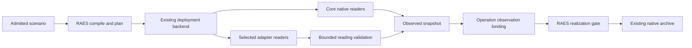

# Issue #1017 Native Runtime Readback

Reader purpose: Explanation.
The [source revision `6d35d245f11a`](https://github.com/OpenRAE/lilrae/blob/6d35d245f11a7fffcaac1645cd25ccfafbad4599/docs/architecture/issue-1017-native-runtime-attestation-design.md) preserves the original design cut.
Version-specific examples and qualification statements keep their original scope.
This editorial rewrite does not qualify a provider, approve a VM, or authorize a service.

LilRAE compiles and plans through the public RAES APIs without changing author authority.
The dependency set is RAES 10.5.0 and env-packs 7.2.1.
RAES accepts authored-empty open concerns without a proof of absence.
A reported member still needs independent native evidence.

## Existing owners

| Owner | Responsibility |
| --- | --- |
| `backends/raes_runtime.py` | Compile and plan once; retain one runtime owner and native archive capture. |
| `backends/raes_runtime_observation.py` | Read core-owned container and guest concerns through existing readers. |
| `backends/_raes_runtime_capabilities.py` | Declare installed core readers and validate adapter source declarations. |
| `core/runtime_readback.py` | Carry one typed value and its actual observation source. |
| `aptl_techvault/runtime_readback.py` | Dispatch product readers through the existing startup adapter. |
| `backends/_scenario_startup_runtime.py` | Validate adapter readings before accepting them. |
| `backends/_raes_operational_observation.py` | Bind observations to the current plan and apply operation. |
| `backends/raes_diagnostics.py` | Replace planned runtime concerns with observed values in the snapshot. |

The materialization archive and native creation receipts retain their existing owners.
The retirement does not remove these records or replace the live runtime.
RAES 10.5.0 also uses owner-provided associated-artifact parent wrappers.
Experiment admission passes those wrappers without relaxing identity checks.
The unchanged bounded participant freeze has a new compiled digest solely because
the compiler adds an empty `descriptor_profile_bindings` field.
Its source digest, action registry and all other compiled fields stay unchanged.

## Native values and provenance

Readers use authored identities to select managed objects.
Logical identifiers and labels remain author-owned metadata.
A reader establishes each reported world fact through native readback before disclosure.
Existing core observers retain their native corroboration and secret-safe projections.
They do not need a second observation framework.

Core declares daemon evidence for Docker settings and kernel socket observations.
Guest commands establish guest inventories and forwarding-agent configuration.
The adapter reads product catalogs, effective configuration, routes and component identities.
Product commands declare guest evidence.
Docker authority readback declares daemon evidence.

Each adapter declares `observed_runtime_concerns` and returns `ConcernReading` values.
The declaration must name a registered RAES concern and an independent evidence source.
An adapter cannot change the source used by a core reader of the same concern.
Core validates each reading's kind, source, bounded shape and observed projection.
An invalid adapter result contributes no observations for that node.

Core owns its installed Wazuh agent component.
The adapter owns other declared software components.
The coordinator merges these members by component identity.
Conflicting or duplicate ownership drops the concern.

The target manifest combines core capabilities with the admitted adapter's declarations.
A target without a product reader claims no product readback capability.
No release digest, projection digest or scenario name grants observation authority.
Exact pack identities still govern adapter admission and artifact integrity.

## Data flow

The Docker daemon and host kernel retain their existing trust boundary.
Guest responses are untrusted and remain bounded by command deadlines and output limits.
SQL queries select catalog and authorization metadata, not credential material.
Provider credentials stay inside their existing managed guest or backend boundary.
RAES projection removes protected values before a reading enters the snapshot.
Native failure output never becomes an observation or diagnostic value.

## Removed compatibility

The planning-compatibility discovery group and provider decisions are removed.
Family admission now requires five capabilities instead of six.
The requirement and authority rewrites are removed.
The release/projection tables and release-keyed ordering restore are removed.
The runtime uses the released finite-work limits without process-global changes.

## Verification and release qualification

Targeted tests cover unchanged planning inputs, normal runtime limits and retained archive capture.
Native readback tests cover varied values, missing facts, malformed output and wrong sources.
Installed adapter tests cover atomic family admission without the deleted capability.
Mutation probes exercise the native-fact, source and planning-identity checks.
CI owns full suites and fresh installed-lab qualification.

The released portal currently declares authentication on two unguarded routes.
They are `/logout` and `/api/v1/users/<int:user_id>` in both bundled packs.
The exact application handlers contain no authentication guard for these routes.

RAES rejects observations that report their actual authentication state.
This is a pack declaration mismatch, not permission to restore the bridge.
The correction is tracked in [env-packs #628](https://github.com/OpenRAE/env-packs/issues/628)
and [PR #629](https://github.com/OpenRAE/env-packs/pull/629).

A corrected published release must be qualified before the TechVault experiment runs.
