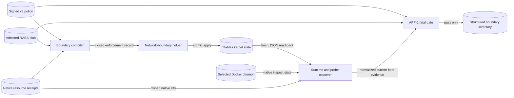
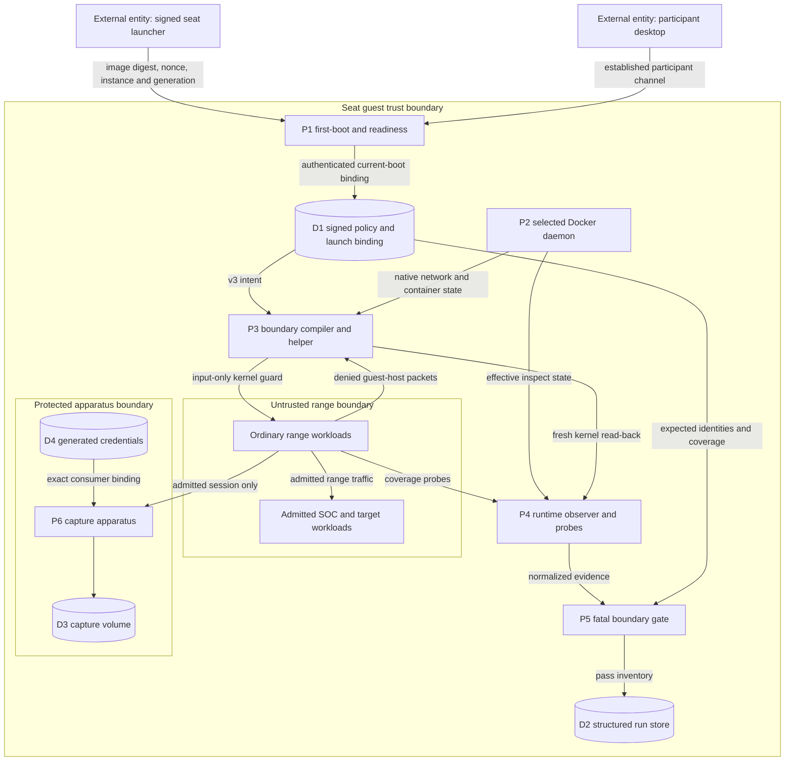
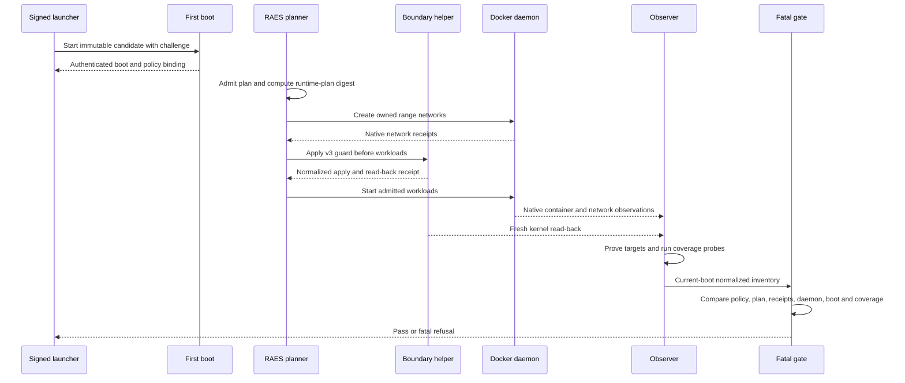

# Issue #1127: Seat Component Protection Design

This design refines the
[#1127 preflight](issue-1127-seat-component-protection-preflight.md). APP-1 is
the governing requirement. [ADR-060](../adrs/adr-060-vm-only-seat-containment.md)
owns the outer VM boundary. This design adds protection inside the VM without
changing range topology.

## Evidence

| Fact | Source |
| --- | --- |
| A Docker bridge permits container-to-host traffic by default. | [Docker bridge driver](https://docs.docker.com/engine/network/drivers/bridge/) |
| Host networking removes network isolation from the container. | [Docker host network driver](https://docs.docker.com/engine/network/drivers/host/) |
| The input hook handles packets for the local host. The forward hook handles packets routed through it. | [nftables hooks](https://wiki.nftables.org/wiki-nftables/index.php/Netfilter_hooks) |
| A complete nftables ruleset can be applied atomically. JSON output supports independent read-back. | [nftables ruleset operations](https://wiki.nftables.org/wiki-nftables/index.php/Operations_at_ruleset_level) and [nftables manual](https://netfilter.org/projects/nftables/manpage.html) |
| Access decisions should protect resources instead of trusting a network location. | [NIST SP 800-207](https://csrc.nist.gov/pubs/sp/800/207/final) |
| The seat guest pins Docker Engine 29.1.3. The network helper pins nftables 1.1.6. | Repository package and image manifests at the design baseline. |

## Scope And Threat Model

The attacker controls an ordinary range workload, including its container root.
The attacker can originate packets, inspect its environment and mounts, and use
every capability admitted for that workload. The attacker does not control the
guest kernel, guest administrator, outer launcher, hypervisor, or physical host.

The protected assets are:

- seat management and control listeners and state;
- evidence capture authority, keys, and capture volume;
- evidence storage and export paths;
- the selected guest Docker daemon and admitted authority holders; and
- platform and control credentials.

An SDL secret fixture is range content, not a platform credential. Range
workloads, including SOC products, remain inside the range. The controls do not
segment those workloads or change their permitted range traffic.

## Signed Contract

Add `aptl.appliance-boundary/v3`. Its meaning is **seat-component protection**.
The existing versions keep their meanings:

| Version | Meaning | Inner-seat claim |
| --- | --- | --- |
| `v1` | Withdrawn three-zone platform design | Historical only |
| `v2` | VM-only seat containment | None |
| `v3` | VM-only containment plus range-to-seat component protection | Default deny from ordinary range workloads |

The v3 policy carries non-secret component classes and typed permitted flows.
A component has a stable class and probe identity. A permitted flow has a
source class, destination component class, protocol, ports, purpose, and probe
identity. Unknown classes, incomplete flows, and duplicate probe identities are
invalid. An empty permitted-flow set is valid and means that range workloads
may reach no guest-host protected component.

The v3 generation is greater than the v2 generation. The policy digest remains
the canonical signed authority. The helper image tag changes because its wire
contract changes. No old policy or observation can default into v3.

The seat-image binding separately names:

- the participant-routes digest available when the image is built; and
- the admitted RAES runtime-plan digest available when a lab is planned.

They are different artifacts. The launch path must not copy one into the other.
Whether RAES ACL enforcement is required comes from the admitted realization,
not the appliance policy version.

## Components

| Component | Responsibility |
| --- | --- |
| `ApplianceBoundaryPolicy` | Defines the signed v3 component and flow classes. It contains no resource names, addresses, or secrets. |
| Boundary compiler | Combines v3 policy with the admitted realization and native resource receipts. Produces a distinct seat-protection enforcement record. |
| Network-boundary helper | Applies the closed record atomically to guest-host input hooks and reads the effective rules back from the kernel. |
| Runtime observer | Inspects every ordinary range workload on the selected daemon for namespaces, privileges, devices, mounts, Docker endpoints, protected volumes, and platform credentials. |
| Probe runner | Proves each target instrument is ready, then runs the required positive and negative probes for every range-network and protected-component class. |
| Boundary inventory and gate | Compares signed intent with fresh kernel, daemon, workload, probe, boot, and process evidence. Any missing or stale evidence is fatal. |
| Capture and run stores | Retain their existing custody, sealing, export, path-safety, and redaction contracts. They expose normalized ownership facts only. |

## Network Enforcement

The compiler selects only networks owned by the current admitted range
realization. It resolves each network through `WorkspaceOwnership` and its
append-only `ResourceReceipt`, then verifies the native network ID on the
selected daemon. A name, label, subnet, or interface address alone is never
authority. The separate desktop Compose project is not selected.

The helper installs v3 rules before the first range workload starts. The rules:

1. use guest-host input hooks for IPv4 and IPv6;
2. match only the verified bridge interfaces of the admitted range;
3. allow established replies for host-initiated management;
4. allow only signed typed flows to the exact observed bridge gateway and
   address family; and
5. reject all other traffic from those interfaces to the guest host.

The helper does not add forward, output, NAT, or egress rules. Range-to-range
traffic therefore stays under the admitted SDL and RAES authorities. The
helper accepts a closed JSON payload on standard input, applies it atomically,
and returns a normalized receipt. A separate parser reads `nft -j` output and
checks the table, hooks, priority, interfaces, rules, and policy. Rule text or
a successful helper exit is not sufficient evidence.

## Runtime And Custody Enforcement

Every ordinary range workload is resolved from its native container receipt.
The observer fails when an effective value is absent, malformed, or cannot be
read. Together with the existing RAES effective-runtime check, it rejects:

- privileged mode, host networking, or the host PID namespace;
- an unadmitted device, capability, namespace, or host bind; device counts are
  retained as bounded evidence while the RAES contract owns their exact values;
- a Docker socket, remote daemon endpoint, or equivalent proxy not admitted
  to that exact holder and daemon;
- a capture or evidence-store volume mounted outside its admitted apparatus;
- a run-store path mounted into the range; and
- platform credential material outside its declared generated-artifact or
  environment consumer.

RAES runtime admission remains necessary but is not sufficient. The effective
state must also satisfy the signed seat policy. Exact substrate requirements,
such as the admitted cgroup namespace and bind, remain typed exceptions rather
than blanket allowances.

The observer persists only normalized verdict facts through the structured,
redacting run-store path. It does not persist raw Docker inspect, environment,
nftables, journal, credential, or probe output.

## Data Flow And Trust Boundaries

Trust boundaries are the external launcher channel, the seat guest, ordinary
range workloads, and the protected apparatus. The policy and launch binding
are authenticated input. Docker and kernel observations are untrusted until
matched to the current boot, selected daemon, native receipts, and signed
digest set.

## Start And Qualification Sequence

Image qualification and every supported start use this same path. A smoke VM
that disables first boot or substitutes a test service is not qualification.

## Probe Coverage

The signed policy defines the required coverage keys. The inventory rejects a
missing, duplicate, unexpected, or stale key.

- For each owned range bridge and supported address family, prove a
  host-initiated connection and its established reply without filtering
  forwarded range traffic.
- For each range source class and each protected component class, prove the
  target instrument is ready immediately before the negative connection.
- Run the negative connection from an ordinary workload network namespace.
- Record only identity, family, protocol, port, expectation, and result.

Positive and negative active probes complement fresh kernel read-back. Neither
can replace the other.

## Failure Behaviour

The gate fails closed when policy, realization, receipt, helper, kernel,
daemon, workload, target readiness, probe coverage, boot identity, or process
identity is missing, stale, unsupported, or inconsistent. It returns the
existing coarse diagnostic envelope. It does not include raw runtime state or
secrets.

Applying a new v3 payload replaces only the owned v3 ruleset. A failed apply
does not leave a partially updated ruleset. Normal stop removes only resources
owned by the exact workspace and attempt. VM-only v2 seats keep their existing
meaning and cannot present v3 evidence.

## Policy And Architecture As Code

The enforced architecture lives in the existing code-owned contracts:

- strict versioned policy and binding models in
  `src/aptl/core/appliance_boundary.py`;
- policy construction in `src/aptl/appliance/policy.py`;
- tagged enforcement models and compiler in `src/aptl/core/deployment/`;
- closed helper validation and rule rendering in
  `containers/network-boundary-helper/`;
- fresh observation and the fatal gate in `src/aptl/appliance/` and
  `src/aptl/core/`; and
- path-to-boundary coverage in `.ground-control.yaml`.

Documentation describes those contracts. It is not an alternate source of
policy.

## Verification

Focused unit and contract tests cover strict v3 parsing, downgrade rejection,
digest separation, receipt-backed selection, input-only rule rendering,
independent read-back, runtime authority rejection, evidence custody, complete
probe coverage, and fail-closed inventory behaviour. Changed helper and
Compose surfaces use focused contract tests locally. Repository-wide checks,
clean image construction, and full suites remain CI/CD work.

Live acceptance uses one immutable candidate, the real signed launcher,
first-boot service, fresh kernel and daemon read-back, and the installed
TechVault journey. The issue asks for attack, detection, Shuffle, TheHive,
repair, and retest. ADR-063 has since directed removal of TheHive and Cortex;
qualification must therefore name its exact admitted pack and record that
conflict instead of inventing a passing TheHive result. Journey names are
qualification content, not boundary-policy values.

No LilRAE lab is started on the development workstation. If a dedicated GCP
qualification seat is needed, it uses an exact issue-owned `test-1127`
identity in the established project, does not reuse or alter BigRAE resources,
and is inventoried before creation. At the end, all issue-owned VM, disk,
address, firewall, metadata, service-account binding, and temporary evidence
resources are deleted and absence is verified. Pre-existing or shared
resources are never cleanup targets.

## Residual Risks And Limits

- Guest root or kernel compromise can disable or bypass the controls.
- An admitted raw Docker authority holder is guest-root-equivalent if it is
  compromised.
- Shared-guest denial of service is not prevented.
- The outer host, another seat, the hypervisor, and the physical machine are
  ADR-060 concerns.
- This design adds no range egress control and makes no egress-protection
  claim.
- The admitted capture sidecar shares Kali's network namespace. Its isolation
  depends on exact mount, credential, authority, and export evidence rather
  than a network boundary between the two processes.
