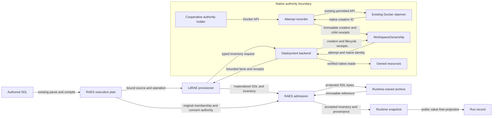
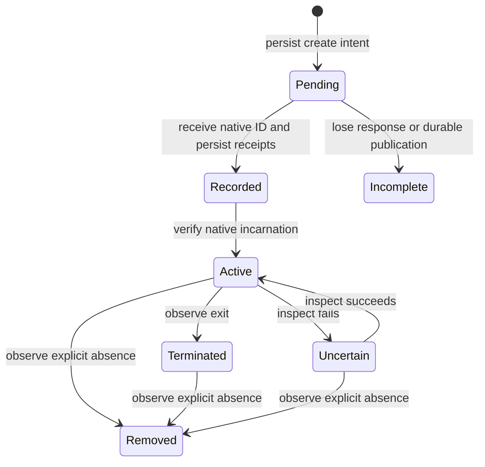

# Owned descendant reporting

This design covers the combined scope of issues #1128 and #1130.
The existing shared Docker daemon and its configuration remain unchanged.
The reporting boundary uses the public contracts introduced in RAES 8.1.0.
RAES 9.1.0 supplies the conformance repair from RAES issue #1667.

## Native runtime decision

The maintainer selected the existing shared daemon.
This delivery must not install another daemon or change host daemon configuration.
It must not move native operation into a guest.

The shared daemon has no trusted caller-to-create record.
The receipt store alone cannot discover that missing relationship.
The attribution method must distinguish callers and retain daemon-issued native IDs.

Producer log messages do not supply a complete creation record.
The inspected Shuffle sources log some IDs only after container start succeeds.
A failed start can leave a created container without that message.
Removal can also destroy a producer's logs before collection.
The inspected source revision is not bound to the pinned image by its available OCI metadata.
These messages cannot establish complete ownership.

A local recorder changes lab socket wiring and lifecycle supervision.
The maintainer selected recording without an additional authority policy: "just record."
The recorder retains the existing host-root-equivalent authority.
It does not filter images, daemon operations, host mounts, or privilege requests.
It cannot establish complete attribution against a hostile holder with that authority.
This accepted trust limit applies to the ownership and runtime reporting claims.

### Lab socket recorder

The recorder preserves the selected Docker endpoint and host configuration.
Only lab authority holders receive a different socket mount.
Each endpoint binds one workspace, attempt, and responsible holder.
The recorder retains the daemon's creation response before returning it to that holder.
It persists only bounded identity and lifecycle facts, without request secrets.

Canonical socket delegation receives a distinct recorded endpoint for each child.
Delegation of an existing endpoint from the same recorder also receives a distinct endpoint.
The request rewrite changes only the host socket source, preserving the container endpoint.
The creation response binds that endpoint to the child native ID.
Different attempts use different endpoint directories, including when images and names match.
The recorder forwards other daemon requests with their existing authority.

A child can bypass recording through direct socket access, broad host mounts, or alternate endpoints.
The recorder does not prevent these operations.
Known bypass paths produce a bounded recording limitation.
It never adopts other containers from labels, names, images, or namespace membership.
The recorded inventory describes the cooperative recording boundary, not all possible hostile host activity.
Build, Swarm, plugin, network, and volume allocation APIs remain permitted.
They produce a recording gap because their effects are outside the container-create response path.
Inherited mounts and alternate control endpoints also disclose incomplete attribution.

Recorder startup must precede authority delegation.
Its lifecycle owner must enforce deadlines while holders can create resources.
Teardown must quiesce holders, drain creation records, and remove verified children.
A crash between native creation and receipt publication must remain an explicit inventory gap.
Restart recovery must reconcile that gap before claiming complete cleanup.
One process owns an attempt's listeners and deadline supervision.
It starts only for a lab that delegates Docker authority.
It ends with that lab's recorder teardown.
No global service, host daemon change, network listener, or unrelated scheduled task is introduced.

### Transport and durable state

The native provider uses h11 for HTTP framing and protocol transitions.
It relays streaming bodies and upgraded connections without storing their contents.
Create requests and responses have bounded inspection buffers.
An oversized or unsupported carrier is forwarded with a recording-gap diagnostic.
Transport limits bound concurrent connections and pending work.
The recorder accepts at most 64 concurrent connections and 1024 holder endpoints.
Reaching the inspection or delegation limit forwards the original create with an explicit gap.
Native receipt retention remains independent of portable report size limits.

Owner-only state uses the existing no-follow path utilities.
Create intents precede forwarding.
Successful responses publish immutable creation records and existing `ResourceReceipt` records.
The creation record contains attempt, daemon, source, parent, native ID, time, and safe observed identity.
Raw requests, environment values, credentials, commands, and host mount paths are not retained.
Unfinished intents make completeness false after a crash.
They grant no cleanup authority over a guessed container.

Receipt verification checks the durable creation chain and full native ID before a read or action.
A daemon mismatch, stale attempt, replacement, malformed record, or uncertain inspect grants no authority.
An explicit not-found response differs from a failed inspect.

### Child deadlines and teardown

Each authority carries its authored execution timeout independently of its image templates.
A direct child's deadline starts at recorded creation.
A delegated child cannot extend its recorded parent's deadline.
The live process uses monotonic deadlines.
Recovery uses the persisted UTC deadline without granting a new execution period.
Teardown holds the project lifecycle lock while it quiesces recorder deadline actions.

Teardown closes the recording endpoints to new work and drains in-flight creation responses.
It removes verified holder and child resources before networks and volumes.
It retains uncertain receipts and reports residual state.
The recorder can recover existing receipt state without changing a sealed run archive.
An existing socket bind mount retains its inode after the recorder exits.
Recreating a socket file cannot repair that mounted endpoint.
An interrupted recorder therefore requires lab teardown and a new admitted start.
Retry within the same attempt requires the parent's verified proof of complete native cleanup.
The retry retains the receipt history and deadlines but supplies new mounted socket inodes.
Cleanup can still use already-recorded native identities without the old recorder process.

One deadline thread serves an attempt.
The control connection remains responsive during a stalled native inspection.
The recorder is a child operation of the admitted start.
The parent can hold the project lock while workflows create children.
A child deadline must not wait for its parent to release that lock.
The recorder therefore acts only on its attempt's verified native child IDs.
Teardown retains the project lock and explicitly quiesces the recorder.
Quiescence drains both creation responses and deadline actions before resource removal.
It does not grant another workspace owner or introduce a second workflow engine.
Recorder subprocesses receive a minimal environment without ambient credentials.

## Components and contracts

`WorkspaceOwnership` remains the native ownership store.
Each child has a `ResourceReceipt` with its immutable native ID and attempt identity.
The creation record retains the responsible source and causal ancestor.
A retry retains that record.
A replacement is a different resource.

The deployment backend owns discovery, native inspection, deadlines, and cleanup.
The RAES adapter receives bounded facts through deployment protocols.
It does not issue Docker commands or infer ownership from names, images, or labels.
Distinct endpoint and receipt scopes distinguish concurrent attempts.

A remote backend can certify empty descendant inventory only for an admitted attempt without Docker delegation or retained child receipts.
Unsupported remote delegation fails before recorder startup.
Remote inventory never inspects the controller's Docker daemon.

`AptlProvisioner` reports the observed world through `MaterializationSubmission`.
The description uses ordinary materialized SDL.
`RuntimeInventoryReport` carries scope, sequence, completeness, and typed descendant bindings.
Each binding retains source, parent, native incarnation, creation receipt, and lifecycle state.
The original authored scenario and executable plan remain unchanged.

`RuntimeManager` admits resource membership and derives `RealizationProvenanceEntry` values.
The backend never writes that ledger directly.
The manifest negotiates `backend-materialization-attestation-v1` and `backend-runtime-descendants-v1` together.
The runtime rejects a report when required evidence or admission context is absent.
The negotiated materialization contract also applies to orchestration and evaluation results.
Those adapters submit phase-bound descriptions through the same reporting helper.
Only provisioner inventory operations introduce descendant membership.

## Observation coverage

| State | Evidence and reporting boundary |
| --- | --- |
| Compute, OS family, OS identity | Existing daemon and guest binders retain their declared evidence strength. Child OS family comes from receipt-verified native inspection. |
| Runtime configuration | The existing concern registry projects verified processes, limits, environment bindings, mounts, packages, local identity, listeners, and service configuration into descriptive node fields. Unobserved values remain unavailable. |
| Networks and domain topology | Existing network membership and topology readback remains in the accepted snapshot. Switch bindings use network addresses. This is not a claim of complete host topology or traffic observation. |
| Content, generated artifacts, persistent volumes, accounts | Existing native type, content digest, artifact satisfaction, lifecycle, and credential-result checks remain authoritative. Protected materialization does not replace those checks. |
| Capture containers | Public preparation admits their node additions before creation. Native apparatus readback controls the result proposal and later inventory completeness. The runtime must derive their per-concern provenance. |
| Host instrumentation | Traffic-control rules and transient controller helpers are host apparatus, not extra scenario nodes. Existing apparatus evidence retains their observer effects and implementation facts. |

Native image configuration IDs remain native evidence.
They are not relabelled as registry manifest digests.
A protected SDL artifact remains a producer assertion.
It does not upgrade native observation strength or disclose the artifact to participants.

## Data flows and trust boundaries



The native boundary establishes ownership before inspection or mutation.
The runtime boundary establishes portable membership and concern conformance.
The archive boundary publishes protected bytes before a reference becomes accepted state.

The admitted run identity is fixed before planning.
A sealed family trial supplies its existing run identity.
Planning, native ownership, workflow records, and the archive retain that identity.
An archive mismatch or a sealed run prevents apply.
Temporary evidence and participant phases retain the same archive owner and configured manifest.
The single runtime owner keeps component ownership exclusive during those phases.
Ownership receipts are lifecycle state, not experimental evidence or authorization grants.

## Initial apply and later refresh

Initial apply reports planned resources and every admitted addition observed at that point.
Backend-created apparatus uses the existing preparation and augmentation admission contracts before creation.
Targets with capture apparatus negotiate `backend-realization-preparation-v1`.
The pure `prepare()` callback returns additional operations under the original enclosing collection authority.
Capture containers receive stable backend node addresses in the materialized description.
The provisioner checks their prospective SDL against the original augmentation and collection authority before deployment.
Only verified capture readback can add those entries to its result proposal.
The runtime must admit their membership and provenance with the complete report.
RAES 9.1.0 admits prepared capture membership but omits its per-concern provenance.
[RAES issue 1697](https://github.com/OpenRAE/rae/issues/1697) records that defect.
Published RAES 9.2.0 fixes the standalone preparation reproduction.
Environment-packs 6.5.0 supports RAES 9.2.0 and clears that dependency conflict.
[Environment-packs issue 525](https://github.com/OpenRAE/env-packs/issues/525) records the original release dependency.
The consumer's public-runtime capture regression now passes with the compatible published pair.
Host traffic-control rules add no scenario container or node.
Their existing apparatus evidence describes the host implementation and observer effects.
An open concern on one node does not open the enclosing node collection.
Exact and closed scopes retain their original meaning.

The provisioner exposes the public `refresh_inventory(request, predecessor)` interface.
Refresh performs inventory reads only.
It does not start services, install collectors, or replay provisioning.
Workflow completion can request a refresh through `RuntimeManager.refresh_inventory()`.
The returned accepted snapshot becomes the run's final snapshot.

A terminated child retains its description and a lifecycle receipt.
An autoremoved child retains its tombstone and a separate lifecycle receipt.
An incomplete scan never becomes an empty inventory.
Invalid reports retain the last accepted state and preserve backend cleanup obligations.



## Provenance and observation coverage

Explicitness, value origin, evidence strength, and ownership are separate facts.
The runtime preserves an honored author or processor origin.
`RuntimeConcernSelection` identifies a backend choice within an admitted open or constrained concern.
It cannot relabel an exact declaration.

The existing observation registry remains authoritative.
Only values supported by native observations enter the description.
The following state already has dedicated readback paths.

| State | Existing owner | Reporting rule |
| --- | --- | --- |
| Container identity, platform, image, runtime policy | Deployment queries, image identity, container-runtime observers | Use verified native IDs and safe typed concern values. |
| Networks, attachments, listeners, publications | Network and runtime-network observers | Preserve network membership, container endpoints, and host exposure separately. |
| Content, artifacts, volumes, accounts | Stateful observers, content satisfaction, account verification | Include verified identities and state without content bytes or credentials. |
| Environment, mounts, packages, services | Environment, mount, guest inventory, and service observers | Preserve secret classifications and actual observation strength. |
| Capture apparatus and operator relays | Deployment observability and operator-access owners | Report actual additions through admitted membership rather than detail-only address strings. |
| Spawned descendants | Native ownership and lifecycle provider | Report only attributed incarnations with complete causal and attempt bindings. |

## Security controls and failure behavior

| Threat and boundary | Control | Verification |
| --- | --- | --- |
| Cross-attempt adoption at the native boundary | Trusted attribution plus workspace, daemon, attempt, native ID, and creation receipt | Concurrent identical images, stale receipts, retry, and replacement tests. |
| Destructive action after uncertain inspection | Fresh receipt verification before each native lifecycle action | Inspection failure produces a bounded diagnostic and zero mutation. |
| Unreported or stale inventory at the runtime boundary | Original source, operation, predecessor, target scope, sequence, and completeness checks | Replay, incomplete scan, duplicate identity, and foreign-attempt tests. |
| False provenance | Runtime-owned classification with typed backend-selection claims | Author, processor, backend, and constrained-choice tests through the public manager. |
| Secret disclosure through reporting | Existing concern projectors, account-result closure, redaction forms, and protected archive storage | Credential canaries across snapshots, details, diagnostics, logs, and archive references. |
| False success after archive failure | Publish exact protected bytes before accepting their reference | Archive refusal retains trusted state and cleanup inventory. |

The existing authentication, operator-grant, environment-binding, and exposure rules remain authoritative.
This delivery does not accept ADR-055's proposed policy model or grant new authority through reporting.

## Experiment evidence handoff

`AcesStartOutcome.native_evidence` exposes the producer-owned handoff.
It binds the admitted plan digest, run identity, and native attempt identity.
It retains immutable initial, later inventory, and evaluation cuts in protected local run storage.
Each cut contains the public runtime snapshot, concern provenance, archive records, and original archived SDL bytes.
The backend supplies its original native resource receipts, creation records, and bounded readbacks.
These bytes remain distinct from requested constraints and from portable provenance classification.

Native observation changes and verified cleanup observations remain immutable lifecycle evidence.
Cleanup evidence names the exact receipt, native ID, daemon, and attempt.
It distinguishes absence after a removal request from an already absent object.
An inspect failure alone does not prove absence.
Cleanup requires a successful exact-ID or exact-name enumeration on the receipt's verified daemon.
An unavailable or malformed response retains the receipt and reports failure.
It grants no lifecycle authority.
It retains a copy of a volume receipt before normal retirement removes that receipt.
This source evidence stays outside sealed experiment archives.
A collector can retain a final cleanup cut without changing an earlier sealed run.

The handoff's `source(binding)` method returns the existing `WindowedSource` interface.
Its source scope is the complete bound native attempt.
It requires an evaluator-only or apparatus-only restricted binding that permits exact bytes.
Participant-visible bindings and bindings that require byte redaction are refused.
The source returns a standard ZIP archive with a versioned index and original content-addressed members.
The index retains original versions, lengths, checksums, plan/run/attempt identity, phase, and coverage gaps.
ZIP packaging does not rewrite member bytes.
The existing evidence coordinator owns capture policy, artifact references, quotas, and sealing.
Downstream capture does not create missing native proof or provenance.

Reads use the existing no-follow protected path helpers and verify stored lengths and checksums.
Archive publication uses the public RAES canonical publisher and the local store's descriptor-relative writes.
It cannot follow a replaced run parent into another directory.
Per-file, total-byte, and artifact-count limits apply before packaging.
Missing, changed, incomplete, or over-limit input produces a typed source failure.
It never becomes an empty successful collection.
No route, service, external transfer, or participant disclosure is added.

```text
Public runtime apply / inventory / evaluation
  -> protected immutable state cuts and original RAES archive bytes
Native creation / readback / verified cleanup
  -> immutable lifecycle receipts outside sealed run evidence
Trusted collector composition + admitted restricted binding
  -> bounded native evidence WindowedSource
  -> original-byte ZIP + versioned identity/checksum index
  -> existing acquisition coordinator and experiment seal
```

## Repository contracts

The dependency pin and lock select RAES 9.2.0 and environment-packs 6.5.0.
The application, development environment, CI, and release jobs use Python 3.14.
Package metadata requires Python `>=3.14,<3.15`, matching both released dependencies.
An incompatible dependency set is not replaced with a resolver override.
The existing manifest, deployment protocols, manager wrapper, and snapshot projection carry the new reporting path.
The archive owner uses the existing protected local storage boundary.
It does not modify a sealed run archive.
Experiment feasibility uses a deterministic planning-only run scope.
That plan is never executed.
Execution admission binds the actual run identity and archive before mutation.

One RAES runtime owns the run from apply through evidence, participant delivery, and teardown.
The constructor receives the admitted run scope and protected materialization archive.
Later native evidence uses the public `evaluate()` API with a fresh request key.
RAES replans evaluation against its committed snapshot while preserving the original compiled input.
The application does not clear runtime evaluation state or reacquire private component claims.
Participant behavior specifications and crossing policy enter through the runtime constructor.
They come from the admitted delivery plan and retain its existing closed policy.
Delivery uses that same owner; it cannot replace the run, archive, or policy during execution.
The runtime's operation ledger remains authoritative for every phase and failed operation.

ADR-046 records negotiated descendant reporting, later inventory refresh, and the protected collector handoff.
ADR-055 remains proposed.
The existing-daemon decision is settled.
The maintainer selected cooperative recording without a new enforcement policy.
Focused pytest tests cover the combined issue criteria.
CI retains full-suite and clean-lab qualification ownership.

## References

- [RAES 9.1.0 runtime migration](https://github.com/OpenRAE/rae/blob/v9.1.0/docs/migration/runtime-lifetime.md)
- [RAES 9.1.0 lifetime architecture](https://github.com/OpenRAE/rae/blob/v9.1.0/docs/decisions/issue-1660-runtime-lifetime-design.md)
- [Python 3.14 porting guidance](https://docs.python.org/3.14/whatsnew/3.14.html)
- [RAES 8.1.0 descendant reporting](https://github.com/OpenRAE/rae/blob/v8.1.0/docs/explain/reference/runtime-descendant-inventory.md)
- [RAES 8.1.0 materialization contract](https://github.com/OpenRAE/rae/blob/v8.1.0/specs/sdl/materialization-attestation.md)
- [Docker daemon configuration](https://docs.docker.com/reference/cli/dockerd/), multiple-daemon configuration and conflict risks.
- [Docker daemon security](https://docs.docker.com/engine/security/), daemon authority boundary.
- [Docker authorization architecture](https://docs.docker.com/engine/extend/plugins_authorization/), request and response observation patterns; no plugin installation.
- [h11 API](https://h11.readthedocs.io/en/latest/api.html), framing, streaming, connection reuse, and protocol switching.
- [Python socket servers](https://docs.python.org/3.14/library/socketserver.html), Unix listeners and thread lifecycle.
- [Python ZIP archives](https://docs.python.org/3.14/library/zipfile.html), standard uncompressed packaging with original member bytes.
- [Existing ownership design](issue-964-backend-resource-ownership-preflight.md)
- [Existing orchestration design](issue-974-shuffle-worker-docker-images-preflight.md)
