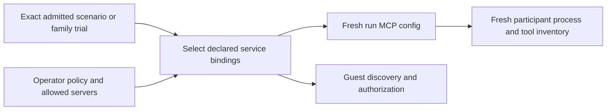

# MCP selection from admitted services

Reader purpose: Explanation.
The [source revision `6d35d245f11a`](https://github.com/OpenRAE/lilrae/blob/6d35d245f11a7fffcaac1645cd25ccfafbad4599/docs/architecture/issue-1244-mcp-service-selection.md) preserves the original design cut.
Version-specific examples and qualification statements keep their original scope.
This editorial rewrite does not qualify a provider, approve a VM, or authorize a service.

The operator policy owns server artifacts, exact tool inventories, role ceilings,
credential aliases, and service bindings. Scenario content cannot register a
server or widen that policy. `aptl.json` can further restrict allowed servers and
require servers; a required server without its declared services rejects admission
before deployment. Service bindings match exact node identities and TCP ports,
never a container found by probing or a service left over from a previous run.

The selected server IDs form an immutable value in the admitted start. Startup
rebuilds the managed server entries from the template and current credentials
and endpoint observations. It removes selected-out entries and rejects a selected
server with an unavailable endpoint instead of falling back to a default port.
Omission is a selection decision; failed readiness is a startup failure.

Guest discovery carries the selection under its existing instance/generation
identity. Dispatch intersects it with the operator role ceiling on every
connection. Participant delivery selects only those IDs and starts new discovery
and session state for each run. The workbench verifies the selected inventory,
leases only selected credentials, and removes its generated config on close.

The shipped policy is data, separate from generic workbench code. It preserves
existing role ceilings and tool names. Changes do not add external services,
transfer credentials to clients, or introduce a pack-controlled executable path.
Tests cover full and partial service sets, policy restriction, absent required
services, readiness failures, and present/absent/present transitions with fresh
configs and endpoint bindings. Existing transport and workbench tests qualify
lifecycle and inventory enforcement; CI owns full installed-lab qualification.

Startup also writes a private `.aptl/mcp-admission.json` file.
It contains the run identity, pack identity, selected servers, and admitted native-container aliases.
It also contains the realized SDL nodes, their declared service ports, and their static addresses.

Guest enrollment compares this record with the observed containers.
It does not parse the full source pack again for a reduced family trial.
Enrollment refuses a record of a different run or an incomplete admitted inventory.

When the record is absent, legacy non-trial enrollment keeps its full-inventory validation.
Participant smoke providers read the node facts through this record
([ADR-067](../adrs/adr-067-admitted-participant-smoke-providers.md)).
