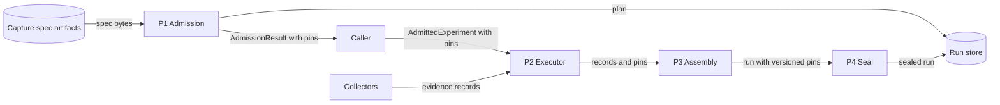

# Issue #1372: Capture Spec Version Design

This design pins each admitted capture spec version in the run traceability.
It refines the [preflight](issue-1372-capture-spec-version-preflight.md).
[ADR-047](../adrs/adr-047-raes-experiment-admission-and-trial-plan-boundary.md)
and [ADR-050](../adrs/adr-050-terminal-attempt-archival-and-atomic-seal.md)
stay the governing decisions.

## Evidence

| Fact | Source |
| --- | --- |
| The run `traceability` block links the run to capture specifications. | RAES ADR-065, Decision item 1, `raes==7.0.0`. |
| Evidence satisfaction requires the run `(capture spec id, version)` pins to equal the supplied capture specs. | `_validate_supplied_evidence_sets` in `raes_contracts/evidence_satisfaction.py`, `raes==7.0.0`. |
| Admission hashes each resolved `spec_version` into `source_set_digest` and keeps no copy. | `_build_source_set_projection` and `_admit_experiment` in `src/aptl/core/experiment/`. |
| `build_traceability` copies the record references, which have no version. | `src/aptl/core/execution/assembly.py`, `src/aptl/core/evidence/records.py`. |

## Architecture

| Component | Responsibility |
| --- | --- |
| `CaptureSpecPin` | Immutable `(capture_spec_id, spec_version)` pair for one admitted capture spec. |
| `_admit_experiment` | Builds one pin for each resolved capture spec, in authored order. Puts the pins in the admitted `AdmissionResult`. |
| `AdmissionResult` | Carries `capture_spec_pins`. A rejected result carries no pins. |
| `AdmittedExperiment` | Carries `capture_spec_pins` into execution. The pin IDs must equal the capture specs that the plan references. Rejects a duplicate pin and the executor-owned `aptl.lifecycle` identity. |
| `assemble_context` | Checks each acquisition record against the pins before the first write. |
| `build_traceability` | Emits the lifecycle pin, then each admitted pin with its version. |

Decisions:

1. **The pins stay outside the canonical plan.** `CaptureBinding`, the trial
   projection, and the plan bytes do not change. Plan IDs and digests stay the
   same for the same inputs.
2. **The pins are strings in tuples.** Contract models accept attribute
   assignment. A string pair cannot change after admission.
3. **The pins express admitted intent.** A run pins every admitted spec, also
   when a collector produced no record.
4. **Records can omit the version.** A record that supplies a version must
   agree with its pin.
5. **The lifecycle pin stays.** It is the executor's own capture spec and is
   not an admitted authoring input.

Failure behavior:

| Condition | Result |
| --- | --- |
| The plan references a spec without a pin, or a pin names a spec that the plan does not reference. | `ValueError` when `AdmittedExperiment` is built, before a workload runs. |
| Two pins have one spec ID, or a pin uses `aptl.lifecycle`. | `ValueError` when `AdmittedExperiment` is built. |
| A pin has an empty or missing ID or version. | `ValueError` when `AdmittedExperiment` is built. |
| A record names a spec without a pin. | `ValueError` in assembly, before the first write. No seal. |
| A record version differs from its pin. | `ValueError` in assembly, before the first write. No seal. |

Recovery uses the same `AdmittedExperiment`. Recovery does not read versions
from configuration, the collector registry, or new files.

## Systems Security

Assets: the sealed run record and its provenance claims.

| Threat | Boundary | Control | Verification |
| --- | --- | --- | --- |
| A run claims a capture spec version that admission did not resolve. | Admission to execution | Pins come only from resolved specs. A frozen pair carries them. | Admission-to-run pin equality test. |
| A record disagrees with the admitted version. | Collector to assembly | Assembly rejects the mismatch before the seal. | Mismatch test. |
| An authored spec takes the executor lifecycle identity. | Authoring input to execution | `AdmittedExperiment` rejects the collision. | Collision test. |

The change adds no input, privilege, credential path, file path, or network
access. Spec IDs and versions are inert data. Residual risk: full RAES
evidence satisfaction also needs a lifecycle capture spec and the record
version fix in a newer RAES. Issue #1450 owns the RAES upgrade.

## Data Flow

All processes run in one lilrae process. The trust boundary is at the
collectors: assembly checks their records against the admitted pins.

## Supporting Artifacts

| Artifact | Decision |
| --- | --- |
| ADRs | No change. ADR-047 owns admission identity. ADR-050 owns the seal. |
| Policy as code | No change. The change adds no gate or policy rule. |
| Architecture as code | No change. The repository has no model of these classes. |
| Other diagrams | No change. The data flow above shows the full path. |
