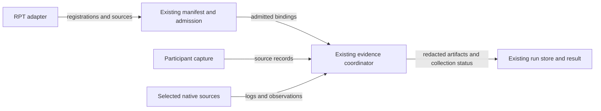

# RPT backend capture

[Issue #1421](https://github.com/OpenRAE/lilrae/issues/1421) governs this delivery.
Collect the requested RPT observations through the existing backend interfaces.
Advertise executable support and return retained artifacts with accurate status.

## Existing interfaces

The selected family adapter owns source selection and collector registrations.
`CollectorRegistry` projects those registrations into the backend manifest.
The same registry admits the capture plan; no parallel capability table is needed.
`WindowedSource` and `WindowedQueryCollector` read the selected sources.
`acquire_evidence` runs collectors around the trial body and retains results.
The existing coordinator applies redaction, limits, hashing, and artifact references.
Oversized structured logs retain a redacted prefix in bounded valid JSON.
The artifact quota includes serialized metadata.
Structured redaction processes at most the greater of 64 MiB and the artifact limit.

`AptlRuntimeManager.collect_evidence` is the backend collection entry point.
It checks the run, backend, admitted plan and manifest before acquisition.
It uses the selected sources, existing run store, and acquisition result.
The caller can supply participant archive sources alongside adapter-owned native sources.
Reject undeclared, malformed, or duplicate sources before trial effects.
Runtime read and source initialization failures remain collection outcomes.
Native read timeouts use the collector's remaining duration, including ownership checks and retries.
Read time is included in final timing; late accepted data reports timeout.
A missing native factory preserves already recorded participant artifacts.
The supplied trial window selects native logs during a later capture phase.
A missing requested source prevents a supplied trial body from starting.
During a later capture phase, retain available data and report missing peers.
Collection stops before the caller removes native resources.
Persist accepted outcomes before propagating a caller interruption.
This does not require another cleanup-hook system or export engine.

Expose the existing container log read through admitted runtime operations.
Only selected scenario container identities are allowed.
Native Docker log reads enforce byte limits while draining both streams.
On interruption or overflow, withhold an unfinished line and retain complete lines.
Allocate space across sources so one large export does not discard healthy peers.
`ContainerFileSource` supplies bounded raw file reads through those same operations.
The RPT adapter can combine these sources with its existing API reads.
Retain accepted logs if a later source fails; include both Docker log streams.
Timeout and interrupted reads retain their accepted stream prefixes as partial data.
Adapters select current and rotated file paths and supply each format's timestamp decoder.
Keep raw lines in the requested window and exclude earlier or later trials.
Disclose missing files and undecodable lines as gaps.
Selected raw file reads are bounded to 8 MiB across at most 256 paths.
A file source requires its timestamp decoder before any reads.
History coverage remains limited to the selected files.

## Participant data

An explicitly selected participant capture archive retains provider calls,
returned session events, tool dispatch/results, timestamps, and exposed usage.
The approved local OpenCode capture module observes the existing provider transport.
When request observation is required, its existing host-owned observer calls the capture wrapper.
The private configuration still loads one approved plugin.
It adds no network destination and retains no credentials.
The host removes granted credential values before writing source data.
Shared redaction retains only typed usage counts; credential-shaped replacements remain masked.
The capture archive implements the existing source interface.
`participant_capture_registration` declares its supported raw-record offer.
It refuses stronger assurance, unsupported fields and post-handoff retention promises.
Source storage separates runs, attempts and participants.
Record expected invocation membership before provider dispatch so failed publication remains visible after reopening.
Native record identities and returned references distinguish attempts as well.
Unavailable reports retain the same run, attempt and capture-request identity.
Participant offers support the run window; other window semantics are refused.
Keep valid invocations when another invocation is malformed.
Record tool-observation write failures and event gaps as incomplete collection.
Retain known action-count subtotals and leave full counts unknown after observation loss.
Invocation IDs join the existing runtime's episode records; capture allocates no episodes.
Count runtime dispatch identities and provider call attempts without study scoring.
Keep requested settings separate from returned provider claims.
Combine streamed text before redaction and retain it alongside frame metadata.
Withhold incomplete logical content and unfinished sensitive blocks.
Unavailable usage or billing stays unavailable rather than becoming zero.
Record the delivered prompt commitment and whether a provider request was observed.
Retain a redacted prefix on byte overflow and report truncation.
Timeout and cancellation preserve accepted observations before private cleanup.

## Responsibilities and limits

| Owner | Responsibility |
| --- | --- |
| RAE | Preserve authored semantics and admit or refuse supported interface requests. |
| LilRAE | Execute collection and return artifacts, source identity, and honest status. |
| RPT adapter | Select scenario sources and interpret the collected observations. |
| Experimentalist | Govern study evidence after handoff and assess research claims. |

Use the current capture interfaces and their checks.
Unsupported integrity terms receive explicit refusal.
There is no custody verifier, external trust policy, study archive assurance,
new portable schema, or overall scientific qualification in this delivery.
The earlier dependency on RAE #273 was incorrect and has been removed.
The worker command remains in #1643; RPT owns its adapter release and study qualification.

`LilraeRuntimeEvidence.reference_source` uses the current native archive producer
and returns JSON references to the protected ZIP artifact.
The original archive retains its own format, digests and validated source bytes.
Capture neither relabels that ZIP as JSON nor reconstructs its proof.

## Verification

Exercise the manifest, admitted request, source read, retained artifact, and result together.
Check both participant sources, native logs, unsupported requests, and partial failures.
Retain focused transport and secret-redaction checks for the participant observer.
Run targeted tests locally; existing CI owns full verification.
