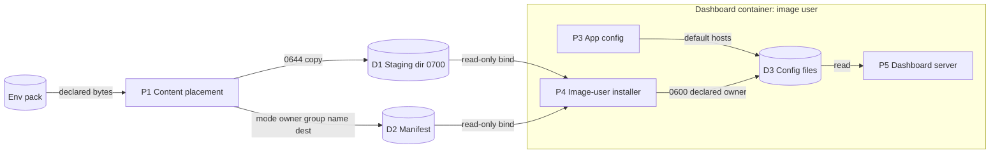
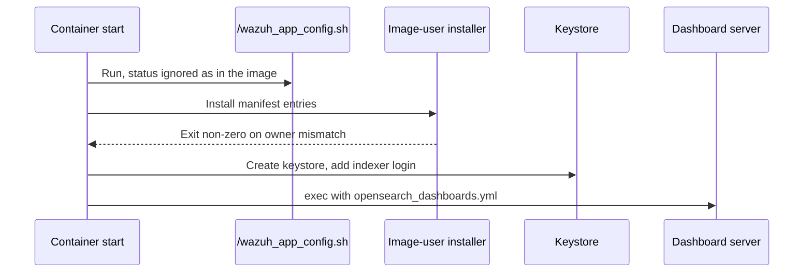

# Issue #1422: Wazuh Dashboard Owner-Declared Config Design

This design delivers the owner-declared Wazuh Dashboard config files to a
non-root image. It refines the
[preflight](issue-1422-wazuh-dashboard-config-readability-preflight.md).
[ADR-046](../adrs/adr-046-dynamic-raes-scenario-realization.md) records the
decision in its Owner-Declared Image Content Addendum.

## Evidence

| Fact | Source |
| --- | --- |
| The dashboard exits with `EACCES` on `open` of `/usr/share/wazuh-dashboard/config/opensearch_dashboards.yml`. | 2026-10-22 live run, container exit log. |
| The pack inventory declares that file and `.../data/wazuh/config/wazuh.yml` as `wazuh-dashboard:wazuh-dashboard`, mode `0600`, `secret_fixture`. | TechVault SDL, `wazuh-dashboard` node. |
| Content placement binds a sensitive file at mode `0600` with the host owner. | `_compose_content_mounts.py` |
| The image runs as `wazuh-dashboard` (uid 1000). It has no `runuser`, `setpriv`, `su`, or `gosu`. | Pinned image `8f5b50fd…`. |
| A host owner other than uid 1000 gives `Permission denied` to the image user. A host uid of 1000 hides the defect. | Local reproduction. |
| Only the manager profile runs the owned-content installer, and that installer needs root. | `_raes_backend_implementation_catalog.py` |
| The image's `/wazuh_app_config.sh` appends a second `hosts` key to a writable `wazuh.yml` without host id `1513629884013`. js-yaml 3.14.1 then refuses the file. | Pinned image scripts; local reproduction. |

## Architecture

| Component | Responsibility |
| --- | --- |
| Owned-content staging (`_compose_content_mounts.py`) | Finds the installer in the node entrypoint. Stages each owner-declared file. Writes the install manifest. |
| `OWNED_CONTENT_INSTALLER` | Runs as root. Installs each file with its declared owner and mode. Unchanged. |
| `OWNED_CONTENT_IMAGE_USER_INSTALLER` | Runs as the image user. Installs each file with its declared mode. Refuses an owner or group that is not the current user or group. |
| `wazuh-dashboard-4.12` profile entrypoint | Runs the image app-config step, then the installer, then the keystore steps, then starts the server. |

Decisions:

1. **The installer runs as the image user.** The image is non-root by design.
   The Compose model has no user selection, and the image has no tool to drop
   root privileges. A process can create a file that it owns without root.
2. **The staged copy is `0644` in a `0700` host directory.** The image user must
   read the staged source. The owner-only directory protects the copy from
   other host users. `credentials.py` and `_stateful_certificates.py` use the
   same pattern. The destination keeps the declared owner and `0600` mode.
3. **The profile runs the image entrypoint steps itself.** Declared content
   must write `wazuh.yml` last. The image entrypoint has no hook between its
   app-config step and the server start. The image digest is pinned, so these
   steps do not change.

Failure behavior:

- An owner or group mismatch stops the installer with a non-zero status. The
  container exits, and runtime observation reports a node failure.
- A missing manifest makes the installer do nothing.
- Content without a declared owner keeps its read-only bind mount.

## Systems Security

Assets: the indexer service credential in `opensearch_dashboards.yml` and the
manager API credential in `wazuh.yml`.

| Threat | Boundary | Control | Verification |
| --- | --- | --- | --- |
| Another host user reads a staged secret. | Host user to host user | Staging directory mode `0700`. | Unit test checks the directory and file modes. |
| Another container user reads an installed config. | Container user to container user | Installed file mode `0600`, owner `wazuh-dashboard`. | Real-image test checks owner, mode, and read. |
| Inventory text injects shell into the installer. | Pack to container shell | Existing account, mode, and path validation. Manifest names are generated. | Existing refusal tests. |
| The fix adds privilege. | Container to host | No root user, capability, or security option change. | Test checks the profile selections. |
| The installer gives a file an undeclared owner. | Pack to container | The installer refuses a mismatch. | Shell test runs the installer. |

Residual risks:

- Any process in the dashboard container can read the staged copy. Only the
  image user runs there, and its environment already holds the same values.
- Host root can read the staged copy.

## Data Flow

Trust boundaries: the host user owns D1 and D2. The container boundary
separates P3 to P5 from the host. The image user owns D3.

## Start Sequence

## Policy and Architecture as Code

- The backend implementation catalog is the architecture-as-code record. The
  `wazuh-dashboard-4.12` entry changes.
- No policy-as-code rule covers content ownership. Runtime filesystem-inventory
  observation enforces the declared owner and mode, and it does not change.
