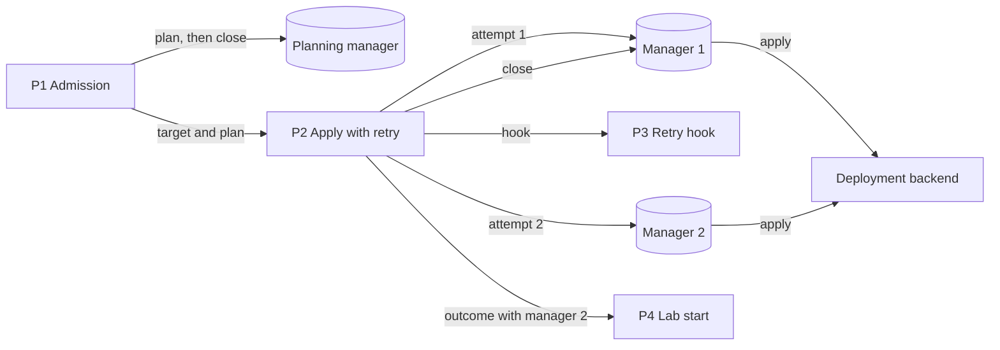

# Issue #1424: Runtime Retry Ownership Design

> **Superseded (issue #1407).** RAES 9.0.0 keeps one runtime for the whole run (OpenRAE/rae#1660). After a failed apply, its backend effects are unknown, and RAES refuses another apply. A failed apply now ends the start, and the automatic retry and its `before_backend_retry` hook are removed.

This design makes the automatic backend retry own its runtime target. It
refines the [preflight](issue-1424-runtime-retry-preflight.md).
[ADR-046](../adrs/adr-046-dynamic-raes-scenario-realization.md) stays the
governing decision.

## Evidence

| Fact | Source |
| --- | --- |
| The retry fails with `backend already has a runtime owner`. | Issue #1424. |
| RAES lets one live `RuntimeManager` own the components of a target. A second manager over the same components fails at construction. | `raes_runtime/runtime_resource_ownership.py`, `raes==7.0.0`. |
| A claim ends when its manager closes or when the manager is garbage collected. | Same module; `RuntimeManager.close()` in `raes_runtime/manager_lifecycle.py`. |
| The retry builds a second manager while the first attempt's outcome still holds the first manager. | `_apply_with_backend_retry` in `src/aptl/backends/raes.py`. |
| Admission builds a planning manager and releases it only through garbage collection. | `admit_raes_scenario` in `src/aptl/backends/raes.py`. |
| The retry tests used a manager double without the ownership claim. | `tests/test_raes_backend.py`. |

## Architecture

| Component | Responsibility |
| --- | --- |
| `admit_raes_scenario` | Plans once with a planning manager. Closes that manager after planning. |
| `_apply_with_backend_retry` | Applies the admitted plan. On a retryable failure, closes the failed attempt's manager, runs the retry hook, and applies once more. |
| `_apply_execution_plan` | Builds one manager for each attempt from the admitted base snapshot. Unchanged. |
| `RuntimeManager.close()` (RAES) | Ends the component claim. Refuses while a call or the participant clock driver is active. |

Decisions:

1. **Each attempt has its own manager.** The retry replays the admitted plan
   from its base snapshot, as before. A new manager does not keep the failed
   attempt's snapshot or operation state.
2. **Ownership ends through `close()`.** The Python data model does not
   promise when an unreachable object is collected. The code closes each
   manager that it no longer uses.
3. **A manager that does not close stops the retry.** That manager keeps its
   claim, so a second apply cannot own the target. The start returns the first
   failure and the close error. It does not run the retry hook.
4. **At most two applies.** A second failure is terminal, even when its
   diagnostic is retryable.

Failure behavior:

| Condition | Result |
| --- | --- |
| First apply fails with `aptl.provisioner.backend-start-failed`. | Close, hook, second apply. |
| Second apply fails. | Failure outcome from the second apply. |
| The failed manager does not close. | Failure outcome with the first error and the close error. `retryable` is false. |
| The retry hook raises. | The exception propagates, as before. |

## Systems Security

Assets: the runtime target components and the deployment they control.

| Threat | Boundary | Control | Verification |
| --- | --- | --- | --- |
| Two managers drive one deployment. | Manager to backend components | RAES component claim. The code closes the old manager first. | Tests with the real manager and claim. |
| A retry runs while the old attempt can still act. | Attempt to attempt | No hook and no apply when `close()` fails. | Close-failure test. |
| The error discloses a secret. | Backend to operator | RAES close errors are fixed strings. Existing diagnostic rendering is unchanged. | Code review of the error text. |

The change adds no input, privilege, credential path, or network exposure.
Residual risk: a failed attempt can leave partial containers. The existing
idempotent Compose start and lifecycle cleanup handle that state.

## Data Flow

All processes run in one lilrae process. The only trust boundary is the
deployment backend, which this change does not alter.

## Retry Sequence

```mermaid
sequenceDiagram
    participant R as Apply with retry
    participant M1 as Manager 1
    participant H as Retry hook
    participant M2 as Manager 2
    R->>M1: apply(plan)
    M1-->>R: backend-start-failed
    R->>M1: close()
    alt close fails
        R-->>R: return first failure and close error
    else close succeeds
        R->>H: prepare
        R->>M2: apply(plan)
        M2-->>R: result
    end
```

