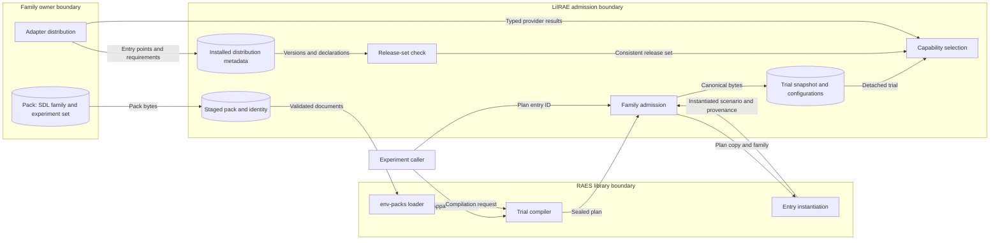
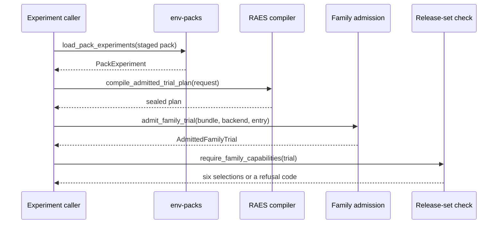

# Issue #1465: Released structural factorial tuple design

This design adopts one released dependency tuple for structural factorial experiments.
The [preflight note](issue-1465-released-experiment-tuple-preflight.md) states the ownership boundaries.
The [family adapter contract](family-adapter-contract.md) describes the seam that this design extends.

## Decisions

| Subject | Decision | Reason |
| --- | --- | --- |
| Release tuple | `raes` 10.0.0 and `raes-env-packs` 6.5.1. | Only this pair contains run and study records (rae#1630) and the experiment artifact set (env-packs#504). |
| Project metadata | `raes>=10.0.0,<11` and `raes-env-packs>=6.5.1,<7`. | The maintainer keeps major ranges with a floor at the qualified release. |
| Exact pins | `uv.lock` and the hashed `requirements/*.txt` exports. | Metadata states compatibility. The lock and exports state the tested environment. |
| Versioning | release-please uses its default strategy. | A breaking change must cause a major release, so consumer ranges stay safe. |
| Qualification scope | Compilation and family admission on installed wheels. | The issue asks for admission. Execution and record production belong to the public execution entry point (#1417). |
| Apparatus join | Out of scope. | #1417 binds a compiled plan to the LilRAE backend; #1421 supplies capture offers. |

## Architecture

| Component | Interface | Behavior |
| --- | --- | --- |
| env-packs loader | `load_pack_experiments`, `PackExperiment.compilation_request` | Validates a pack and joins its experiment documents by RAES identity. |
| RAES trial compiler | `compile_admitted_trial_plan` | Compiles typed factorial treatments into a sealed plan with one entry per trial. |
| Family admission | `admit_family_trial` | Instantiates one sealed entry and keeps its canonical snapshot and participant configurations. |
| Family trial | `AdmittedFamilyTrial` | Gives detached snapshots, provenance, and participant configuration results to each capability. |
| Release-set check | `require_family_capabilities` | Refuses a trial when installed releases do not satisfy the host or adapter declarations. |
| Experiment admission | `admit_experiment` | Converts a RAES binding-target refusal into a bounded admission rejection. |
| Capture registry | `CollectorRegistration.effective_config_digest` | Computes its RFC 8785 digest without the legacy trial-plan module. |

Family admission takes the participant configurations from the plan copy that RAES verified.
The entry digest in the trial provenance binds those configurations to the trial.
The trial stores them as canonical JSON bytes.
Each access returns new validated models, so a callback cannot change the admitted values.
Trial evidence records only participant addresses, manifest digests, and configuration digests.

The release set is `lilrae`, `raes`, and `raes-env-packs`.
The check reads the host requirements from installed metadata.
It reads the adapter requirements from the distribution that supplied the selected entry points.
It evaluates each applicable requirement against the installed version.
A missing distribution or an excluded version stops admission with `family-package-versions-inconsistent`.

RAES 10 raises one exception hierarchy instead of built-in exceptions.
Experiment admission catches `InvalidInputError` from the binding-target owners.
Other RAES calls in LilRAE keep their handlers, because those calls still refuse with `ValueError` or have broad containment.

## Data flows

## Systems security

| Asset | Threat | Control | Verification |
| --- | --- | --- | --- |
| Sealed participant configuration | A caller or callback changes a model or prompt selection. | RAES seal verification, entry-digest binding, detached copies. | An altered configuration is refused with `family-trial-invalid`. |
| Experiment identity | A record loses the public plan, entry, or run identity. | The trial keeps RAES provenance unchanged. | Every compiled entry keeps its plan, entry, and run identity. |
| Release consistency | An install without dependency resolution mixes incompatible releases. | The release-set check before preparation. | Installed wheels with an excluded host release stop at qualification. |
| Configuration values | Evidence or logs disclose model and prompt values. | Evidence holds digests only. | Evidence of a trial contains no selected value. |
| Admission availability | A RAES category exception escapes and stops the command. | The admission handler catches the binding category. | An unknown apparatus target gives the binding rejection code. |

Installed adapters remain trusted Python code.
The release-set check proves consistency of declarations, not the integrity of installed bytes.
The hashed requirement exports and the release workflow keep that control.

## Policy and architecture as code

The CI selection rules in `tools/ci/select_checks.py` need no change.
Changes under `src/` and `tests/` already select the lane that runs the installed-wheel tests.
`.github/workflows/checks.yml` runs the installed family tests and the mixed realization test, which no lane ran before.
`release-please-config.json` returns to the default versioning strategy.
The existing dataclasses, entry-point groups, and validators remain the executable architecture.
No deployment policy or infrastructure declaration changes.

## ADR impact

ADR-047 and ADR-050 record the released-contract successor boundaries.
No new ADR is necessary, because the family seam, admission boundary, and release process keep their owners.

## References

| Source | Version | Section | Use |
| --- | --- | --- | --- |
| [PyPA version specifiers](https://packaging.python.org/en/latest/specifications/version-specifiers/) | Living specification | Version specifiers, pre-releases | Range checks of installed releases. |
| [PyPA dependency specifiers](https://packaging.python.org/en/latest/specifications/dependency-specifiers/) | Living specification | Environment markers | Evaluation of applicable requirements. |
| [Python importlib.metadata](https://docs.python.org/3.14/library/importlib.metadata.html) | Python 3.14 | Distribution requirements, entry points | Host and adapter declarations from installed metadata. |
| [PyPA install_requires and requirements files](https://packaging.python.org/en/latest/discussions/install-requires-vs-requirements/) | Living guide | Whole document | Ranges in metadata and exact pins in the lock. |
| [Semantic Versioning](https://semver.org/spec/v2.0.0.html) | 2.0.0 | Specification item 8 | Major releases for breaking changes. |
| [release-please customization](https://github.com/googleapis/release-please/blob/main/docs/customizing.md) | main | Versioning Strategies | Default strategy behavior. |
| [NIST SSDF](https://csrc.nist.gov/pubs/sp/800/218/final) | SP 800-218 1.1 | PW.4 | Verified reuse of third-party components. |
