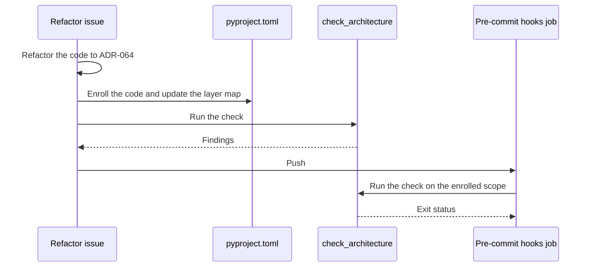

# Issue #1510: Code Quality Architecture Design

This design describes the check that enforces
[ADR-064](../adrs/adr-064-layered-architecture-and-code-conventions.md). It
refines the [preflight](issue-1510-code-quality-preflight.md). SYS-009 is the
governing requirement.

## Evidence

| Fact | Source |
| --- | --- |
| The source has 646 modules. Three import cycles have 28, 14, and 11 modules. 392 imports are in functions. | grimp 3.18 graph and Ruff `PLC0415` at `bd13dea3`. |
| grimp records imports in functions and in `TYPE_CHECKING` blocks. It parses the source and imports nothing. | grimp usage documentation; fixture experiment. |
| An import-linter 2.15 forbidden contract stays kept when a forbidden module does not exist. | Fixture experiment. |
| Ruff `PLC2701` does not report a private import from the same top-level package. | `import_private_name.rs` in Ruff 0.16.8. |
| Ruff `B008` ignores a parameter that has an immutable annotation, so it misses most Typer defaults. | Ruff `B008` documentation. |
| Ruff `PLC0415` accepts a lazy import of a module that `banned-module-level-imports` lists when `TID253` is on. | Ruff `PLC0415` documentation; fixture experiment. |
| The `ruff-complexity` CI hook installs `ruff>=0.15.0` without a lock or hashes. | `.pre-commit-ci.yaml` at `bd13dea3`. |

## Architecture

| Component | Responsibility |
| --- | --- |
| Layer map | `[tool.lilrae.architecture.layers]` in `pyproject.toml`. The most specific entry gives the layer of a module. Each adapter and each plugin also has a group name. |
| Enrolled list | `enrolled` in the same table names the packages and modules that the check covers. |
| `tools/check_architecture.py` | Validates the map, checks the enrolled code, prints the findings, and returns the exit status. |
| grimp | Builds the static import graph of `aptl` and `aptl_techvault`. |
| Ruff | Applies the `ruff-select` rules to the enrolled files. |
| `architecture` hook | Runs the check from `.pre-commit-ci.yaml` in the **Pre-commit hooks** CI job. |

Decisions:

1. **grimp, without import-linter contracts.** Import-linter needs a module
   list in each contract. It also accepts a forbidden module that does not
   exist. One layer map and one enrolled list remove both problems. grimp is
   the graph engine of import-linter.
2. **Indirect imports count.** An enrolled module fails when a chain of
   imports reaches a forbidden layer, also through code that is not enrolled.
   The finding names the import that crosses the layer boundary.
3. **Package initializers count.** Python runs each parent `__init__.py`
   before a module. The check adds these edges.
4. **The map must be complete.** Each map entry, enrolled entry, and extension
   API entry must name a module. Each module must have a layer. An enrolled
   package must not span layers.
5. **Ruff where possible.** Custom checks cover only first-party private
   imports and Typer defaults, because Ruff cannot check them.
6. **Locked tools.** The hook runs `uv run --frozen --only-group ci`. grimp
   and Ruff come from `uv.lock` with hashes. The `ruff-complexity` hook uses
   the same Ruff.

Failure behavior:

| Condition | Exit status |
| --- | --- |
| The table is missing, has an unknown or missing key, or has a value of the wrong type. | 2 |
| An entry names no module, a module has no layer, or an enrolled package spans layers. | 2 |
| grimp or Ruff is not installed. | Not 0 |
| The enrolled code has a finding, or Ruff fails. | 1 |
| No code is enrolled, and the map is valid. | 0 |
| The enrolled code has no finding. | 0 |

## Systems Security

Assets: the integrity of the required CI quality gate, the CI runner, and the
repository.

| Threat | Boundary | Control | Verification |
| --- | --- | --- | --- |
| A changed dependency runs code in CI. | Package index to CI runner | grimp and Ruff come from `uv.lock` with hashes through `uv run --frozen`. The unpinned Ruff install goes. | `uv-lock` hook; lock review. |
| The check runs code from the pull request. | Pull request to CI runner | grimp and `ast` parse the source. The check imports no project code and loads no plugin. | Fixture tests with a module that fails on import. |
| A typo or a moved module turns off a check. | Configuration to check | Each entry must name a module. Each module must have a layer. An empty `enrolled` list is explicit. | Configuration tests. |
| A layer map edit hides a violation. | Pull request to configuration | Review. ADR-064 permits a map change only when the responsibility of the code changes. | Pull request review. |
| The output shows source text, for example a fixture secret. | Check to CI log | Findings name modules, files, lines, and rules. Ruff runs with `--output-format concise`. | Fixture tests check the output. |

The change adds no product code, input, privilege, credential path, or network
exposure. Residual risk: review must find a layer map change that hides a
violation.

## Data Flow

```mermaid
flowchart LR
    subgraph untrusted [Pull request content]
        cfg[(pyproject.toml layer map and enrolled list)]
        src[(src Python files)]
    end
    index[Package index]
    lock[(uv.lock hashes)]
    subgraph runner [CI runner]
        env[P1 uv frozen environment]
        graph[P2 grimp graph build]
        check[P3 check_architecture]
        ruff[P4 Ruff]
    end
    job[Pre-commit hooks job status]
    index -->|grimp and Ruff wheels| env
    lock -->|expected hashes| env
    env -->|tools| check
    src -->|source text| graph
    graph -->|import graph| check
    cfg -->|layers and enrolled entries| check
    check -->|enrolled paths and rules| ruff
    src -->|enrolled files| ruff
    ruff -->|findings and status| check
    check -->|findings and exit status| job
```

The pull request content is untrusted input to the CI runner. The package
index is outside the runner, and the hashes in `uv.lock` bind its artifacts.

## Enrollment Sequence


