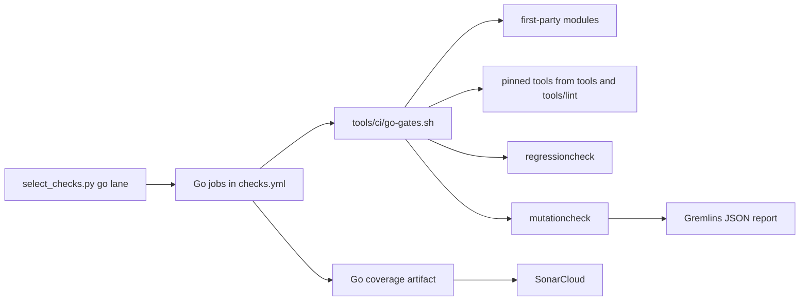

# Issue #1553: Go Toolchain and CI Gates Design

This design adds the Go modules and the CI gates of
[ADR-065](../adrs/adr-065-go-implementation-and-engineering-standards.md). It
refines the [preflight](issue-1553-go-toolchain-preflight.md). The
architecture model and the design check belong to Go port 02b.

## Evidence

| Fact | Source |
| --- | --- |
| In a module that has no packages, `go vet`, `go test`, and `go fix` exit 1, golangci-lint exits 5, and govulncheck exits 2. `go mod tidy -diff` exits 0. | Fixture experiment with Go 1.27.3. |
| `go fix -diff` and `go mod tidy -diff` exit 1 when they print a change. `gofmt -l` exits 0 when it lists a file. | Fixture experiment with Go 1.27.3. |
| The `ignore node_modules` directive removes the packages below each `node_modules` directory from `./...`. | Fixture experiment; Go 1.25 release notes. |
| `go tool` builds a tool for the target `GOOS`, so a cross-platform lint run needs a host binary. | `go help tool`; fixture experiment. |
| For a timeout, an `os.Exit` call, or a panic in another goroutine, `go test -json` reports `run` and no test result. A panic in the test goroutine reports a test `fail`. A build failure reports `build-fail`. | Fixture experiment with Go 1.27.3. |
| The Gremlins v0.6.0 threshold flags have no effect. Viper returns the flag value as a string, and the threshold code reads only numbers. | `internal/report/report.go` and `internal/configuration/configuration.go`; fixture experiment. |
| Gremlins compares repository-relative diff paths with module-relative mutant paths. In a nested module, each mutant is skipped. Git `diff.relative=true` makes the paths agree. | `internal/diff`; fixture experiment. |
| The mutant timeout is the coverage run time multiplied by a coefficient (default 3). A cached coverage run makes each mutant time out. | `internal/engine/executor.go`; fixture experiment. |
| Gremlins writes no report when a module has no mutant. Timed-out mutants count in neither ratio. | `internal/report/report.go`. |
| Gremlins reports a comparison in a case clause of a tagless switch as not covered, because a Go coverage block starts after the case expression. | Mutation run on the tools packages. |
| A full Gremlins run on the tools packages with 16 workers and a coefficient of 3 timed out 147 of 231 mutants. With 4 workers and a coefficient of 10 on 16 CPUs, it killed 217, timed out 2 infinite loops, and took 222 seconds. | Mutation runs on the tools packages. |
| Vale checks Go line, block, and doc comments, and it ignores string literals. Vale 3.14.2 reads a qualified name such as `testing.T` and a doc link as prose and reports a spacing error. Vale 3.23.0 and later do not read the opening name, `[links]`, or tool directives as prose. | Fixture experiment; Vale 3.23.0 release notes. |
| osv-scanner 2.3.8 runs Go call analysis with a govulncheck built with Go 1.26, which cannot load Go 1.27 packages. `--no-call-analysis=go` keeps the module scan. | Fixture experiment. |
| OSV reports GO-2026-5970 and GO-2026-6629 for `golang.org/x/text` v0.31.0, which Gremlins requires. v0.43.0 has neither. | osv-scanner 2.3.8 scan. |
| govulncheck accepts the `tool` pattern and scans the tool dependencies. | Fixture experiment. |
| The SonarCloud Go sensor resolves a coverage path as absolute, with the module name, relative to the project, and then by subpath. | `GoCoverageStorageImpl` in SonarSource/sonar-go. |
| GitHub runs a schedule only from the default branch. Dependabot reads its configuration from the default branch. | GitHub Actions and Dependabot documentation. |

## Architecture

| Component | Responsibility |
| --- | --- |
| `go.mod` | The product module `github.com/OpenRAE/lilrae`. It has no package until Go port 03. It ignores `node_modules`. |
| `tools/go.mod` | The developer tools module. It holds the regression and mutation checks and pins Gremlins and govulncheck with `tool` directives. |
| `tools/lint/go.mod` | Pins golangci-lint alone, so that its dependency versions stay as upstream tests them. |
| `tools/gates/go.mod` | The fixture tests of the gates. It is a separate module, so the mutation coverage run of `tools` does not run them. |
| `.golangci.yml` | The lint rules of the ADR-065 style table. |
| `tools/ci/go-gates.sh` | Finds the first-party modules and runs one gate over them. CI and the fixtures call it. |
| `tools/internal/regression`, `tools/cmd/regressioncheck` | Selects and replays the regression tests of a pull request. |
| `tools/internal/mutation`, `tools/cmd/mutationcheck` | Runs Gremlins and applies the thresholds. |
| `tools/internal/git` | Runs the Git commands that both checks need. |
| `tools/mutation-thresholds.json` | The efficacy and mutant coverage thresholds. |
| `tools/go-format-hook.sh` | The pre-commit gofmt check of staged Go files. |

The first-party modules are the `go.mod` files that Git tracks, except
`web/caddy-build` and test data. `web/caddy-build` keeps its own module, build,
and checks.



## Decisions

1. **Separate tool modules.** golangci-lint has a module of its own (ADR-065).
   The gate fixtures have a module of their own, because Gremlins sets each
   mutant timeout from the test time of the whole module.
2. **Host tool binaries.** `go-gates.sh` builds the pinned tools for the host
   once per run. It runs golangci-lint for `linux`, `darwin`, and `windows`.
3. **No packages is a reported state.** A module without packages gets
   `go mod tidy -diff` and the tool scan, and the script prints that it has no
   packages. The model of Go port 02b detects a package that disappears.
4. **Lint.** Each module gets `go mod tidy -diff`, `go vet`, `go fix -diff`,
   and golangci-lint with `.golangci.yml`. The golangci-lint formatters check
   gofmt and goimports.
5. **Tests.** `go test -race -shuffle=on` with atomic coverage. The script
   rewrites each coverage path to the repository path for SonarCloud.
6. **Vale.** The pinned Vale moves from 3.14.2 to 3.26.0, so Go doc comments
   can name identifiers with doc links. The installer points the current Vale
   at the pinned version on each run.
7. **Vulnerabilities.** govulncheck scans the packages and the `tool` pattern
   of each module. OSV scans each first-party `go.mod` without call analysis.
   Trivy already scans each `go.mod`. A fixture module with a known
   vulnerability proves that OSV and Trivy detect a Go module finding.
8. **Regression replay.** The check reads the issue number from the branch
   name. It validates each `regression:` comment in the changed test files. It
   replays each test for the issue of the pull request that the change adds or
   changes. Tests for other issues are not replayed, because the base revision
   already has their fix.
9. **Replay mechanics.** A temporary Git worktree holds the base revision. In
   each package directory of a selected test, the test files and `testdata`
   become those of the head revision. Each test runs alone with
   `go test -json -count=1 -run '^Name$'`. Only a test `fail` on the base
   revision and a test `pass` on the head revision satisfy the check.
10. **Bug label.** A pull request that changes Go production code for an issue
   with the `bug` label must add or change a regression test for that issue.
   The CI step reads the label with a read-only token and prints it.
11. **Mutation.** `mutationcheck` runs Gremlins in each module that has
    changed production files, with `--diff` at the base revision. It sets
    `diff.relative=true` for Git and `-count=1` for Go. It reads the JSON
    report and applies the thresholds itself. A full run, without `--diff`,
    covers each module on a schedule or a manual run.
12. **Mutation results.** Changed lines without a mutant pass, and the check
    names the changed files. A tool error fails, and so does a change where
    each mutant timed out. A pull request cannot lower a threshold. The first
    measurement gave 100% efficacy and 100% mutant coverage, so both
    thresholds are 100. Changed code therefore uses an if statement for a
    comparison that a case clause would hide from the coverage.
13. **Scheduled run and Dependabot.** Both read the default branch, which has
    no Go code before Go port 31. Issue #1593, on `dev`, adds Dependabot
    entries for the Go modules with `target-branch: go-cutover` and a weekly
    dispatch of the Checks workflow on `go-cutover`. Go port 31 removes both.

## Failure behavior

| Condition | Result |
| --- | --- |
| A gate finds a violation. | The tool exits non-zero, and the job fails. |
| A required tool cannot build or run. | The job fails. |
| A module has no packages. | The script reports it. The package gates do not run there. |
| A regression test passes, is skipped, does not finish, or does not compile on the base revision. | `regressioncheck` exits 1 with the test and the outcome. |
| A selected test does not pass on the head revision. | `regressioncheck` exits 1. |
| A `regression:` comment is malformed or is not on a test function. | `regressioncheck` exits 1. |
| Git, `go test`, or the event stream fails. | `regressioncheck` exits 2. |
| The label lookup fails. | The job fails. A failed lookup is not a missing label. |
| A branch name has no issue number. | No replay. Comment validation still runs. |
| Efficacy or mutant coverage is below its threshold. | `mutationcheck` exits 1 with each lived and uncovered mutant. |
| No Go production code changed. | The mutation job reports that no relevant input changed. |

## Data flows and security

```text
Pull request head and base revisions [untrusted content]
  -> checkout with persist-credentials false [read-only token]
  -> go-gates.sh [fixed argv, no shell evaluation of paths]
  -> go, git, golangci-lint, Gremlins, govulncheck, osv-scanner [pinned]
  -> job result, step summary, coverage artifact [Actions storage]
  -> SonarCloud analysis [existing token, existing job]

Branch name [untrusted]
  -> environment variable, bash regular expression
  -> issue number [digits only]
  -> GitHub issues API [issues: read] -> label names [printed]
```

- The tools receive revisions, paths, and test names as argv elements. Test
  names come from the Go parser, so they are identifiers.
- Each Go job keeps the read-only default permissions. The regression job adds
  `issues: read` only.
- The jobs set `GOWORK=off` and `GOTOOLCHAIN=local`, so an ambient workspace or
  an automatic toolchain change cannot alter the checked build.
- The replay worktree and the Gremlins work directories are temporary, and the
  tools remove them.
- The fixture with a known vulnerability is a text file, not a `go.mod`. No
  scanner or Dependabot reads it as a manifest.

## Verification

| Gate | Fixture that fails | Fixture that passes |
| --- | --- | --- |
| Lint | Formatting, vet, tidy, `go fix`, depguard, nolintlint, and a missing doc comment. | A clean package and a module without packages. |
| Tests | A data race. | A clean package, with repository paths in the coverage profile. |
| govulncheck | A call to a vulnerable `golang.org/x/text` function. | The same module without the call. |
| Mutation | A weak test in a nested module. | A strong test, and a change of comments only. |
| Regression | A regression test that passes on the base revision. | A regression test that fails on the base revision and passes on the head revision. |
| Vale | A Go comment that breaks an error-level rule. | A clean Go comment. |
| OSV and Trivy | The vulnerable module fixture, in each job. | The first-party modules. |
| Pack boundary | A pack fact in a Go file. | The covered Go files. |
| Routing | Go paths select the `go` and `docs` lanes, and the SonarCloud closure. | Other paths keep their lanes. |

The fixture tests of `tools/gates` run the real script and the pinned tools.
The unit tests of each check cover its parsing, selection, and evaluation.
Go coverage in SonarCloud and the live `go-cutover` protection need evidence
from the delivered workflow.

## References

- [Go modules reference: ignore directive](https://go.dev/ref/mod#go-mod-file-ignore)
- [Go test2json](https://pkg.go.dev/cmd/test2json)
- [golangci-lint configuration](https://golangci-lint.run/docs/configuration/file/)
- [Gremlins unleash command](https://gremlins.dev/0.6/usage/commands/unleash/)
- [govulncheck](https://pkg.go.dev/golang.org/x/vuln/cmd/govulncheck)
- [OSV-Scanner](https://google.github.io/osv-scanner/)
- [SonarQube Cloud Go test coverage](https://docs.sonarsource.com/sonarqube-cloud/analyzing-source-code/test-coverage/go-test-coverage)
- [testscript](https://pkg.go.dev/github.com/rogpeppe/go-internal/testscript)
- [GitHub Actions schedule event](https://docs.github.com/en/actions/reference/workflows-and-actions/events-that-trigger-workflows#schedule)
