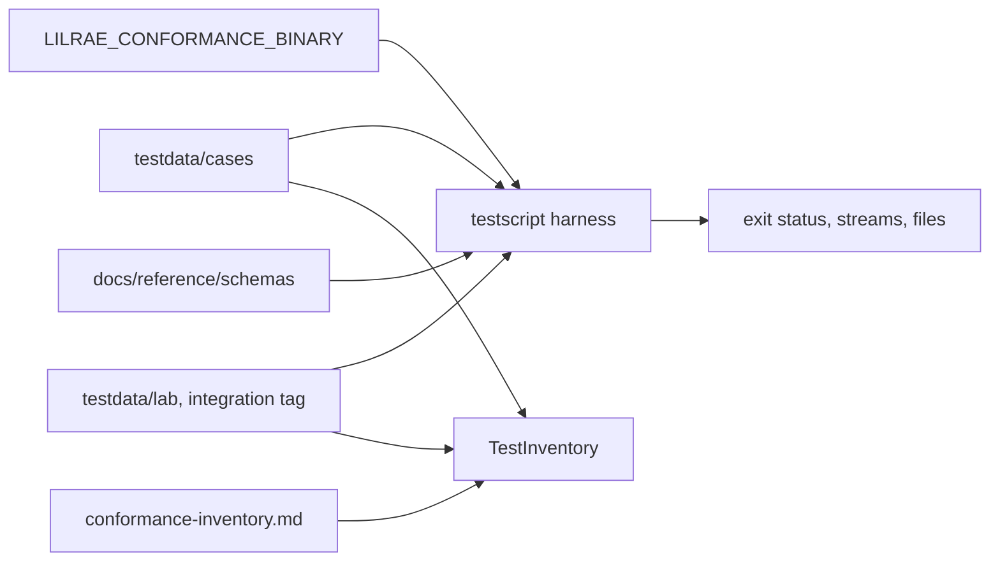

# Issue #1554: Conformance Design

This design adds the black-box conformance suite of
[ADR-065](../adrs/adr-065-go-implementation-and-engineering-standards.md). It
refines the [preflight](issue-1554-conformance-preflight.md). The suite runs an
installed `lilrae` binary and checks the contracts of the CLI, the
configuration, and the persisted files. The front matter of this note is its
design record.

## Evidence

| Fact | Source |
| --- | --- |
| The CLI has 55 commands and groups, with their options, in the installed Python release. | Typer command tree of `aptl.cli.main:app`. |
| `doctor`, `lab start`, `lab stop`, and `lab reset` share the exit status contract and one JSON envelope: `command`, `schema_version` 1, and `ok`, which is true exactly when the exit status is 0. | `docs/reference/cli.md`; `src/aptl/cli/_common.py`. |
| `lab status --json` prints the redacted range snapshot without an envelope. | `docs/reference/cli.md`; `RangeSnapshot.to_dict`. |
| `aptl.json`, the execution boundary, and the bundle manifest have Pydantic models. The configuration models reject unknown fields. | `core/config.py`, `core/execution_boundary.py`, `core/evidence_bundle/envelope.py`. |
| RAES publishes the schemas of `experiment-run-v1` and `experiment-evidence-record-v1`. | `raes_contracts` package data. |
| `lab init` and `config validate` and `config show` run without a lab. | Probe with the installed release. |
| ADR-065 selects `testscript` for the CLI contract suite and `github.com/santhosh-tekuri/jsonschema/v6` for JSON Schema. Tests that need a Docker daemon carry the `integration` build tag, and the linters read it. | ADR-065; `.golangci.yml`. |
| The `clean-install-lab-boot` job installs the wheel in a clean environment and starts a product-neutral scenario on a dedicated daemon. | `.github/workflows/checks.yml`. |
| gojq v0.12.19 runs jq queries in Go. Its input can hold `json.Number`, so a large integer stays exact, and it loads jq modules from a directory. | gojq source; experiment with a 2^53 + 1 integer. |
| goldmark v1.8.7 parses GitHub Flavored Markdown tables into table, row, and cell nodes. | goldmark `extension/ast`. |
| `jsontext.Value.IsValid` checks RFC 7493: valid UTF-8 and unique member names. It accepts surrounding white space and rejects trailing data. | Go documentation; experiment. |
| testscript prints the output streams of each command in the log of a failed script. | `TestScript.Exec` and `logStd` in go-internal v1.16.0. |
| `WorkspaceOwnership.load` reads `.aptl/lifecycle/workspace-ownership-v1.json`, which sets the Compose project name. The cleanup records of `startup_reset_state.py` keep the receipts of earlier releases readable, so the next stop finishes their cleanup. | `core/deployment/_compose_resource_ownership.py`; `core/startup_reset_state.py`. |

## Decisions

1. **Boundary.** `conformance/` in the root module holds the suite. It has
   test files only, and it imports no product package. It observes the
   binary through its arguments, environment, exit status, output streams,
   and files.
2. **Binary seam.** `LILRAE_CONFORMANCE_BINARY` names the binary by an absolute
   path. The suite fails when the variable is not set, is not absolute, or
   does not name an executable file. Nothing skips a case.
3. **Harness.** `TestConformance` runs each script in `testdata/cases` with
   `testscript`. Each script has its own work directory, with `HOME`,
   `XDG_CONFIG_HOME`, `XDG_CACHE_HOME`, `XDG_DATA_HOME`, and `DOCKER_CONFIG`
   below it, and `NO_COLOR` set. The suite adds these commands to the script
   language:

   | Command | Meaning |
   | --- | --- |
   | `lilrae ARG...` | Run the binary. `! lilrae` expects a nonzero exit status. |
   | `cleanup ARG...` | Run the binary when the script ends, also after a failure. A cleanup failure goes to the log. |
   | `status N` | The last `lilrae` command exited with status `N`. |
   | `schema NAME FILE` | The JSON file conforms to the published schema `NAME`. |
   | `jq FILE QUERY` | The jq query on the JSON file gives exactly one value, `true`. gojq runs it. |

   A query can use `$status`, the exit status of the last `lilrae` command,
   and the definitions of `testdata/conformance.jq`: `envelope($command;
   $status)` for the result envelope, and `doctor_counts($status)` for the
   counts of a doctor result. A case states its other assertions in the jq
   language, for example `has("error") and .error == null`, so a missing
   member and a null member stay different. Each JSON file must follow
   RFC 7493: valid UTF-8 and unique member names. The decoder of the JSON
   Schema library keeps each number exact. A failure message names the case,
   the command, and the rule. A schema failure prints the instance locations
   and the keywords, not the instance. The log of a failed case shows the
   output streams of each command, so the cases use synthetic data only.
4. **Lab cases.** `TestLab` runs each script in `testdata/lab`. Its file has
   the `integration` build tag, so only a job with a Docker daemon builds it.
   The `clean-install-lab-boot` job runs it with the installed wheel, a fresh
   project, and the product-neutral scenario that
   `LILRAE_CONFORMANCE_SCENARIO` names. The job keeps its own realization and
   teardown checks. A lab case registers `cleanup lab stop --volumes --yes`
   before it starts the lab, so a failed assertion leaves no lab. Its last
   command, `lab reset`, returns the lab to a clean, stopped state.
5. **Schemas.** `docs/reference/schemas/` holds the published JSON Schemas
   (draft 2020-12). The documentation site serves the same files that the
   suite reads, so no copy can drift. Each schema has an `$id` below
   `https://openrae.github.io/lilrae/reference/schemas/`. The suite loads each
   schema of the directory into a closed registry and resolves no reference
   from the network or from another file. The Schemas section lists them.
6. **Schema rules.** An action result permits additional fields, because a new
   field keeps its schema version. The configuration rejects unknown fields at
   each level, as its models do. A field that can be `null` and a field that
   can be absent are different rules. A schema with a top-level
   `schema_version` requires it, because each reader rejects a document
   without its version; `TestSchemasRequireTheirVersion` checks this.
   Pydantic models give the first draft of a schema; the published schema is
   reviewed, and the suite never makes a schema from the implementation that
   it tests.
7. **RAES records.** RAES owns `experiment-run-v1` and
   `experiment-evidence-record-v1`. The inventory names their published RAES
   schemas. This issue does not copy them.
8. **Inventory.** `docs/reference/conformance-inventory.md` lists each command,
   option, exit status, output stream, JSON result, and persisted file. Each
   row gives its source, its class (contract or detail), and its coverage: a
   case, a lab case, or the later port that owns its protocol. `TestInventory`
   reads the tables with goldmark. It finds the columns by their names, and a
   code span of the coverage cell names a case. It fails when a contract row
   names no case and no later port, when a row names a case that does not
   exist, or when no row names a case. The workspace ownership, the resource
   receipts, and the cleanup records in `.aptl/lifecycle/` are contracts,
   because a later stop or reset reads them.
9. **Text rule.** Human-readable text keeps its facts. Only the strings that a
   document or a test locks, such as `Aborted.`, stay byte-identical. Help
   layout, tables, colors, file counts, timestamps, and generated paths are not
   contracts. A case checks options by name, not by help layout.
10. **Parser differences.** A case uses only input that a strict decoder and the
    Python decoder both accept, unless the case checks a documented rejection,
    such as an unknown configuration field.
11. **CI.** The `go-tests` job builds the wheel, installs it into a clean
    environment, and sets `LILRAE_CONFORMANCE_BINARY`, so `go-gates.sh test`
    runs the suite on the Python release. The selector sends
    `conformance/`, `docs/reference/schemas/`, and the inventory to the `go`
    lane and to the `lab` lane, because the lab job runs the lab cases. The
    mutation gate selects only the modules with production code, so the
    test-only conformance package needs no binary there.
12. **Review fixes of the gates.** The regression replay rejects a head run
    whose `go test` command fails after the test passes. The overlay of linked
    test data belongs to #1583.
13. **Self-test.** `TestHarnessCommandsFail` runs scripts with false
    assertions against a fake binary, and each must fail, so a command of the
    harness cannot pass without a check.

## Schemas

| Schema | Instance |
| --- | --- |
| `cli-result.schema.json` | The envelope of the action results. |
| `doctor-result.schema.json` | `lilrae doctor --json`. |
| `lab-start-result.schema.json` | `lilrae lab start --json`. |
| `lab-stop-result.schema.json` | `lilrae lab stop --json`. |
| `lab-reset-result.schema.json` | `lilrae lab reset --json`. |
| `execution-boundary.schema.json` | `aptl.execution-boundary/v1`, also inside a start result. |
| `range-snapshot.schema.json` | `lilrae lab status --json` and `--output`, and the snapshot of a run. |
| `aptl-config.schema.json` | `aptl.json`. |
| `run-record.schema.json` | `aptl.run-record/v2`. |
| `evidence-bundle.schema.json` | `bundle.json`, `aptl-evidence-bundle/v1`. |

## Architecture



| Component | Package | Responsibility |
| --- | --- | --- |
| conformance-suite | `conformance` | Runs the contract cases against an installed binary. |

## Failure behavior

| Condition | Result |
| --- | --- |
| The binary variable is missing or names no executable file. | The test fails. |
| A case finds a different exit status, stream, field, or file. | The case fails with the rule. |
| A schema is invalid or has an unresolved reference. | The test fails. |
| An inventory row names a missing case, or a case has no row. | `TestInventory` fails. |
| The lab job has no daemon or no scenario. | `TestLab` fails. |

## Data flows and threat model

```text
Case script + fixtures [repository]
  -> lilrae binary [installed artifact, isolated HOME and XDG]
  -> exit status, stdout, stderr, files in the work directory
  -> RFC 7493 check, schema checks, jq queries <- docs/reference/schemas [repository]
  -> test result [CI log]
```

The assets are the result of the suite, which says that a build keeps the
contracts, and the CI log. The trust boundaries are these:

1. The binary under test: its output is untrusted input to the harness.
2. The cases, schemas, and inventory, which a pull request can change and
   review covers.
3. The CI log, which can show the output of the binary.

| Threat | Boundary | Mitigation |
| --- | --- | --- |
| A harness command passes without a check, so a build that breaks a contract passes. | 2 | `TestHarnessCommandsFail` proves that each command fails on a false assertion, and `TestInventory` proves that each contract row names a case or a later port. |
| Output with a duplicate member, invalid UTF-8, or trailing data passes as JSON. | 1 | `jsontext` checks RFC 7493 before any decoding. |
| A schema reference loads a document from the network or another file. | 2 | The registry is closed: each `$id` is a published schema of `docs/reference/schemas`. |
| A case reaches the projects, credentials, or Docker configuration of the operator. | 1 | Each case has its own home, XDG, and Docker configuration directories, and the binary runs with an argument array and no shell. |
| A real secret reaches the CI log. | 3 | The cases use synthetic data only. Synthetic secrets appear only in the redaction cases. |

## Verification

- Each case passes on the installed Python release in CI.
- `TestInventory` proves that each inventory row names an existing case.
- `TestHarnessCommandsFail` proves that each harness command fails on a false
  assertion.
- The lab cases pass in the `clean-install-lab-boot` job.

## References

- [testscript](https://pkg.go.dev/github.com/rogpeppe/go-internal/testscript)
- [santhosh-tekuri/jsonschema v6](https://pkg.go.dev/github.com/santhosh-tekuri/jsonschema/v6)
- [JSON Schema draft 2020-12](https://json-schema.org/draft/2020-12)
- [gojq](https://pkg.go.dev/github.com/itchyny/gojq)
- [goldmark](https://pkg.go.dev/github.com/yuin/goldmark)
- [RFC 7493: The I-JSON Message Format](https://www.rfc-editor.org/rfc/rfc7493)
- [CLI reference](../reference/cli.md)
