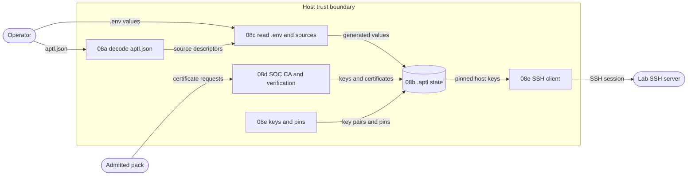

# Issue #1559: Configuration, state, and key material design

This design splits Go port 08 into five sub-issues. It also records the
decisions that the sub-issues share. It refines the #1559 preflights, which the
[architecture index](index.md) lists. Each sub-issue has its own design note.
The front matter of that note is the design record of its packages.

## Decisions

1. **One sub-issue for each concern.** The concerns of #1559 have separate
   contracts, platform behavior, and tests. `.gc/plan-rules.md` applies: each
   sub-issue delivers one pull request, and #1559 tracks them.

   | Sub-issue | Concern | Contracts | Requirements |
   | --- | --- | --- | --- |
   | 08a | `aptl.json`: strict decoding, defaults, semantic checks, discovery, migration, and the credential source descriptors | `file.aptl-json`, `json.config-show`, `cli.config.migrate`, and the `compose-project-name` and `credential-descriptor-digest` vectors | CLI-002, CLI-007 |
   | 08b | The `.aptl/` state layout and its file modes, the lifecycle locks, the lifecycle project root, and the workspace identity record | `file.project-state` and `file.workspace-ownership` | SYS-009 |
   | 08c | `.env` files, generated values, placeholder checks, credential sources, and grants | The `.env` rules of ADR-029 and ADR-052 | INF-006, SEC-005 |
   | 08d | One certificate verification path, the SOC CA and its service certificates, and the Wazuh certificate bundle checks | ADR-034 | INF-005, SEC-004, SEC-006 |
   | 08e | SSH key pairs, `authorized_keys`, host key pins, and the SSH client | ADR-040 and the `ssh-key-fingerprint` vector | SYS-009 |

2. **Order.** 08a starts first. 08b starts after 08a. 08c, 08d, and 08e start
   after 08b, because each one writes below the project state directory.
3. **Layers.** A rule that holds a LilRAE concept is a `core` component of
   `architecture/model.yaml`. A mechanism with no LilRAE concept is a
   `foundation` component. The SSH client is the adapter for the SSH servers
   of the lab. Each sub-issue design names its packages and model changes.
4. **Reuse the foundation.** The sub-issues use `internal/canonical`,
   `internal/securefile`, `internal/filelock`, `internal/clock`,
   `internal/wait`, and `internal/httpclient`. They do not add a second
   strict JSON reader, file walker, lock, or HTTP client.
5. **Parser changes are explicit.** ADR-065 requires strict JSON. #1559
   requires the dotenv parser of Docker Compose. Python reads both with other
   rules. Each sub-issue records the inputs that the Python release accepts
   and the Go build rejects. An input that passes on Python stays a
   conformance case. A deliberate rejection needs its own stated contract.
6. **An environment name is not a grant.** Compose interpolation reads values
   through a lookup function. That lookup reads only the sources that a
   descriptor or a grant names. It never reads the ambient process
   environment as a fallback.
7. **Verification purpose is explicit.** The one verification path takes the
   roots, the time, the key usage, and the expected names from its caller.
   Wazuh root aliases and provenance, the SOC names, and the exact issued leaf
   of the desktop check stay separate caller policies. Renewal eligibility is
   not current validity. TLS handshakes stay in `internal/httpclient`.
8. **Wazuh moves to Go port 19.** The Wazuh certificate generator runs a
   container, and Wazuh is service-specific. Go port 19 (#1570) runs the
   generator, reclaims the old certificate directory, and passes the
   `cert-generator-project-name` vector. Go port 19 also owns
   the Wazuh credential fields and the rendered Wazuh configuration files.
   08d verifies the Wazuh bundle that the generator writes.
9. **Requirement corrections.** INF-006 and SEC-005 say that all credentials
   live only in `.env` and reach Compose only through substitution. The
   current design also uses explicit credential sources and private
   environment files for each service. 08c corrects the two statements. The
   correction keeps the rule that no operator secret enters version control.
10. **Workspace identity.** The workspace identity record is project state, so
    08b owns it. Go port 09 reads it to name Docker resources and keeps the
    resource receipts. 08b updates the coverage of `file.workspace-ownership`
    in the conformance inventory.
11. **Native SSH keys.** The Python release runs `ssh-keygen -t ed25519`. 08e
    makes the same key type and file formats with `golang.org/x/crypto/ssh`,
    so it needs no process runner.
12. **PKCS#12 only for a caller.** The SOC CA writes a PKCS#12 keystore when
    a pack output asks for one. ADR-065 names no PKCS#12 module. 08d ports the
    keystore only if a current pack asks for it, and then records the module
    decision.

## Data flows

The assets are the operator secrets in `.env`, the generated secrets, the CA
private key, the service private keys, the SSH private keys, and the host key
pins. ADR-029 classes each of them as an operator secret, except the public
keys and pins.

| Threat | Mitigation |
| --- | --- |
| A bad configuration value causes a partial change to the project. | 08a and 08c check all values before the first write. |
| Interpolation reads a secret that no grant names. | Decision 6. 08c tests the lookup with a canary variable. |
| A secret leaks through an error, a log, or a process argument. | Errors carry the field and the category, not the value. Keys and secrets never pass through argument arrays. |
| A private file is readable by other users for a short time. | `securefile` writes each private file with its final mode from the first byte. Windows keeps its current ACLs. |
| A certificate check accepts a wrong chain, name, or usage. | Decision 7. 08d tests each Python acceptance and rejection case. |
| The SSH client accepts an unknown or changed host key. | 08e uses a host key callback that reads only the pins, and a test proves each rejection. |
| A Go process and a Python process change one project at the same time. | 08b uses the lock primitive of the Python release, and a test proves that the two locks exclude each other. |
