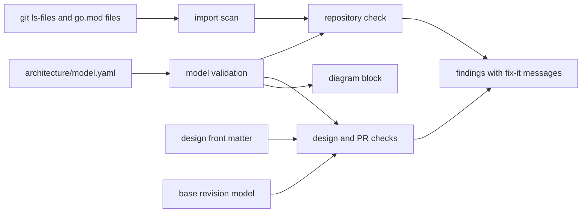

# Issue #1583: Architecture Model Design

This design adds the architecture model of
[ADR-065](../adrs/adr-065-go-implementation-and-engineering-standards.md), its
checks, and the design check. It refines the
[preflight](issue-1583-architecture-model-preflight.md). The front matter of
this note is the first design record. It uses the schema that the note
defines.

## Evidence

| Fact | Source |
| --- | --- |
| go-arch-lint v1.19.1 imports 457 packages, including `golang.org/x/image` font code, `golang.org/x/net/html`, and goldmark, for its SVG graph output. | `go list -deps` in a copy of the tools module. |
| Its module graph needs newer goldmark, `golang.org/x/image`, and `golang.org/x/net` to pass govulncheck. OSV also reports GO-2026-5932 for `golang.org/x/crypto`, which has no fixed version, although go-arch-lint imports no `golang.org/x/crypto` package. | govulncheck 1.9.0 and osv-scanner 2.3.8 on that copy. |
| go-arch-lint reads one module per run. It reports a forbidden import in each file, including tests and files for other build constraints, and a file without a component. It has no layers, rule IDs, fix-it messages, or stale-entry check. | Fixture experiment with v1.19.1. |
| The Go parser reads the imports of a file without build constraints, and `golang.org/x/mod/modfile` reads the requirements and replacements of a module. | Go standard library and `golang.org/x/mod` documentation. |
| The tools packages and `web/caddy-build` are the first-party Go code. `web/caddy-build/third_party/go-jose` is a vendored module that a local `replace` uses. | Repository. |
| Existing design notes have no front matter. | Repository. |
| depguard v2.2.1 allows and denies import path prefixes for each list of file globs, with a suggestion for each denied prefix. It has no components, layers, unassigned or stale packages, or design records. | depguard v2.2.1 README. |
| arch-go v1.7.0 loads the packages of one module with `golang.org/x/tools/go/packages` and `Tests: false`, so it does not check the imports of test files. It has rules for package patterns and a threshold for the packages that a rule evaluates. It has no layers, design records, or stale-entry check. Its module requires cobra, viper, go-pretty, color, and gomonkey. | arch-go v1.7.0 source and README. |
| `github.com/google/renameio/v2` v2.0.2 replaces a file atomically inside an `os.Root` (`WithRoot`), with the permissions of the existing file. It has no dependencies, and it exports no function on Windows, where a file cannot be replaced atomically. | renameio v2.0.2 source and README. |
| The go command ignores each file and directory whose name begins with `.` or `_`, and each `testdata` directory. The regression check of #1553 skips only `testdata`. | `go help packages`; `tools/internal/regression`. |

## Decisions

1. **The checker reads the source.** `tools/internal/architecture` lists the
   tracked Go files, reads their imports with the Go parser, and resolves each
   import to a first-party package, the standard library, or a required module
   of the module of the file. As for the go command, the module with the
   longest path that holds an import owns it, so a required module below a
   first-party module path is a module, not a first-party package. It reads
   each file, so each build constraint and
   each test file is in scope without a build matrix. It reads the working
   tree, so it skips a tracked file that the working tree deleted. It skips
   the vendored directories and the paths that the go command ignores
   (`tools/internal/golayout`). It runs no project code. The model is the
   only policy input, so no generated configuration exists.
2. **go-arch-lint leaves ADR-065.** Its dependency graph fails the vulnerability
   gates, and the checker would have to wrap it for modules, layers, fix-it
   messages, and stale entries. The parser and `golang.org/x/mod` give the
   import facts. ADR-065 records the change. depguard and arch-go are not
   the checker either: depguard checks import prefixes for file globs, and
   arch-go reads no test file. Neither has the components, layers, stale
   entries, or design records of the model, and the design-record check needs
   the import facts of each package anyway.
3. **The model** is `architecture/model.yaml`, version 1. The Schemas
   section gives its fields. A component lists the components and the modules
   that its production files can use, and the extra ones that its test files
   can use, so a test dependency never becomes a production permission. Each
   use must be permitted by the layers. The production uses have no cycle:
   the Go compiler rejects a cycle of packages, and the model keeps an order of
   components too. A test use can close a loop, for example when the tests of
   a component use a helper that uses the component. A component can always
   import its own packages. The standard library is not in the model. `vendored` lists the
   directories of third-party source in the repository, so their Go files are
   not first-party.
4. **Strict input.** The checker decodes one YAML document with known fields
   only and rejects duplicate keys, aliases, anchors, custom tags, and files
   over 1 MiB. A model or a design record that cannot be decoded, or that has
   an unsupported version, stops the check with exit 2. A decodable model with
   a semantic error, for example an unknown layer, a package in two
   components, or a use that the layers forbid, gives `invalid-model` findings
   at the model line, with exit 1.
5. **Rules.** `unassigned-package`, `stale-package`, `forbidden-import`,
   `forbidden-module`, `unresolved-import`, `undeclared-public-package`, and
   `undeclared-replacement` check the code. An importable package outside
   `internal/` must be public. A command (package `main`) and a directory of
   test files only are not importable. The checker resolves an import by its
   module path, so a `replace` directive must not move a module path to other
   code. A first-party module can be replaced only with its own tracked
   directory. Another module can be replaced with a module version, which
   `go.sum` verifies, or with a vendored directory. Test data, another
   first-party module, or a directory outside the repository cannot supply
   the code of a module path. The model must give a fix-it message for each
   rule that the checker knows.
6. **Compilation.** The checker evaluates the model directly, so no analyzer
   configuration is generated. The generated artifact is the diagram, and CI
   compares it with the model. The issue text records this change.
7. **Depguard keeps only standard-library bans.** The model forbids each
   third-party module that it does not permit, so the third-party entries of
   depguard move to the model.
8. **Design records.** The front matter of a design note names the version,
   the issue, each new, changed, or removed package, and the changed parts of
   the model. The Schemas section gives the fields.
9. **Design check before code.** `archcheck design -base REV FILE` checks the
   record against the head model, and it checks the declared model changes
   against the model of the base revision. When the base revision has no
   model, each part of the head model is a change. The check needs no code.
10. **Pull request check.** `archcheck pr -base REV -issue N` runs the whole
    repository check, and then it finds the design note of issue N. Each
    package that the change adds, changes, or removes must be in the record.
    The production and test imports of each recorded package must equal the
    record, a removed package must have no Go files, and the model changes
    must equal the record. A branch without an issue number that changes
    packages or the model fails. A promotion skips the comparison: the head
    is a protected branch (`main`, `dev`, or `go-cutover`) of this repository,
    not of a fork, and each of its changes came through a pull request with
    this check. The whole repository check still runs.
11. **Diagram.** `archcheck diagram` writes a Mermaid diagram of the layers,
    components, and uses into a marked block of
    `docs/architecture/go-architecture.md`. Names are validated identifiers,
    so the diagram holds no free text. CI fails when the block differs. With
    `-write`, `github.com/google/renameio/v2` replaces the document inside an
    `os.Root`. renameio exports no function on Windows, so there the command
    stops with an error.
12. **CI and workflow.** The `Go architecture` job runs on each pull request,
    whatever the routing selects, and `go-cutover` requires it. On a push or a
    scheduled run, it runs the whole repository check and the diagram check.
    A rule in `.gc/plan-rules.md` makes `/implement` run the design check in
    the plan phase, before any code, and state the result in the plan.
    `docs/CODING_STANDARDS.md` describes the step. CI repeats the same check
    on the pull request, so a skipped local check cannot pass.
13. **Ignored paths.** The checks of #1553 and the architecture check take
    the paths that the go command ignores from `tools/internal/golayout`, so
    the checks and the go command agree on the Go code.
14. **Shared command support.** `archcheck` takes its exit statuses, flag
    parsing, and output handling from `tools/internal/checkcmd` (#1553).
15. **Linked test data.** The regression replay of #1553 overlays the head
    revision of a test data link, of the file or the directory that the link
    names, and of each link in that target. It follows each link once, so a
    cycle of links ends, and a link that names a directory holding its package
    stops the check.
16. **Safe output.** A finding prints the rule, the repository path and line,
    the quoted import path, and the fix-it message. It prints no source text
    and no parser message. Each untrusted string (path, import, model text,
    YAML or Git error) is quoted, or its characters that are not printable and
    its invalid bytes are escaped. No output line starts with `::`, and the
    output holds at most 500 findings.

## Schemas

The model (`architecture/model.yaml`):

| Field | Meaning |
| --- | --- |
| `version` | `1`. |
| `layers[]` | `name`, `description`, and `may_use` (the layers that its components can use). |
| `components[]` | `name`, `layer`, `responsibility`, `packages` (directories), `uses`, `modules`, `test_uses`, and `test_modules`. |
| `public` | The importable packages that other modules can use. |
| `vendored` | Directories of third-party source in the repository. |
| `rules` | The fix-it message of each rule. |

Names are lower-case words joined by hyphens. Paths are valid for `io/fs`
(clean, relative, and slash-separated) and hold no backslash.

The design record (front matter of `docs/architecture/issue-<number>-<topic>-design.md`):

| Field | Meaning |
| --- | --- |
| `design` | `1`. |
| `issue` | The issue number. |
| `packages[]` | `path`, `component`, `imports`, `test_imports`, and `removed`. Imports name first-party packages by import path and third-party code by module path, without the standard library and the package itself. `test_imports` lists only the imports that the production files do not have. A removed package has no imports. |
| `model_changes` | `layers`, `public`, `rules`, `vendored`, `component:<name>` for an added or a removed component, and `component:<name>.<field>` for a changed field. |

## Architecture



| Component | Package | Responsibility |
| --- | --- | --- |
| architecture-check | `tools/internal/architecture` | Model, scan, rules, design records, and diagram. |
| archcheck-command | `tools/cmd/archcheck` | The `check`, `design`, `pr`, and `diagram` commands. |

## Failure behavior

| Condition | Result |
| --- | --- |
| The model or a design record cannot be decoded. | Exit 2. |
| A rule finds a violation. | Exit 1 with each finding. |
| Git or a file read fails. | Exit 2. |
| The diagram block is stale. | Exit 1. |
| No finding. | Exit 0. |

## Data flows and threat model

```text
Tracked Go files and go.mod files [contributor input]
  -> Go parser (imports only), x/mod modfile [no execution]
  -> import facts -> rules <- architecture/model.yaml [reviewed policy]
  -> findings: rule, path:line, quoted import, fix-it [CI log]

Design front matter [contributor input] + base model [git object]
  -> design and PR checks -> findings

Model -> diagram block -> renameio in os.Root [developer working tree]
```

The assets are the result of the architecture gate, which `go-cutover`
requires, the working tree of a developer who runs `diagram -write`, and the
CI log. The trust boundaries are these:

1. The pull request: its Go files, `go.mod` files, model, and design notes
   are untrusted until review.
2. The file system of the working tree, which can hold symlinks.
3. The CI log, which reads workflow commands from the output.

| Threat | Boundary | Mitigation |
| --- | --- | --- |
| A change brings a dependency that the model forbids and passes the gate: through a `replace` directive that moves a module path, an import that resolves to nothing, a package outside the model, a cycle of components, or a test import of a forbidden module. | 1 | The rules `undeclared-replacement`, `unresolved-import`, `unassigned-package`, and `invalid-model`, and the test uses and test modules of each component. A path that the go command ignores is not built either. |
| The design record differs from the code, or the head branch claims a promotion. | 1 | The pull request check compares each changed package, its imports, and the model changes with the record. Only a head branch `main`, `dev`, or `go-cutover` of this repository skips the comparison. |
| A crafted model or design record exhausts the checker or selects a custom type. | 1 | The decoder takes one document of at most 1 MiB with known fields only, and rejects aliases, anchors, and custom tags. |
| A symlink makes the checker read or write outside the working tree. | 2 | Each read goes through an `os.Root` at the top of the working tree, and renameio writes the diagram inside that root. The checker reads only tracked files. |
| A path, an import, or a decoder error writes a workflow command or a false line into the log. | 3 | Each untrusted string is quoted or escaped, no output line starts with `::`, and the output holds at most 500 findings. |

The checker runs no project code. Git runs with fixed arguments, full commit
names, and `--` before paths.

## Verification

- Unit tests cover the model validation, each rule with a failing and a
  passing case, the design and PR comparisons, and the diagram.
- A testscript fixture in `tools/gates` proves the command and its fix-it
  output through `tools/ci/go-gates.sh`.
- The mutation gate applies to the new packages.

## References

- [go/parser](https://pkg.go.dev/go/parser)
- [golang.org/x/mod/modfile](https://pkg.go.dev/golang.org/x/mod/modfile)
- [go.yaml.in/yaml/v3](https://pkg.go.dev/go.yaml.in/yaml/v3)
- [Go modules reference: module paths and replacements](https://go.dev/ref/mod)
- [GitHub Actions workflow commands](https://docs.github.com/en/actions/reference/workflows-and-actions/workflow-commands)
