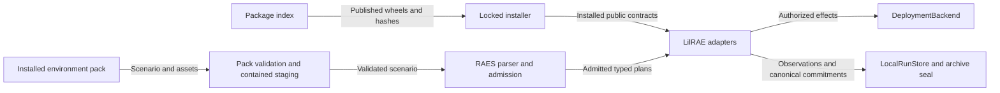

# Released RAES module adoption

Reader purpose: Explanation.
The [source revision `6d35d245f11a`](https://github.com/OpenRAE/lilrae/blob/6d35d245f11a7fffcaac1645cd25ccfafbad4599/docs/architecture/issue-1603-released-module-design.md) preserves the original design cut.
Version-specific examples and qualification statements keep their original scope.
This editorial rewrite does not qualify a provider, approve a VM, or authorize a service.

LilRAE targets RAES 10.6.0 and environment packs 7.2.2.
The maintainer selected these releases for issue #1603.
The [preflight](issue-1603-raes-11-module-locations-preflight.md) defines the existing security controls and component owners.

## Dependencies and interfaces

Use the public module that defines each RAES symbol.
Do not add compatibility imports or local replacements.
Contract digests remain owned by `raes_contracts.canonical`.

Plan projections and preparation contracts come from `raes_contracts.contracts`.
Artifact identity and explicitness come from their public contract modules.
Serialization uses `pydantic_core.to_jsonable_python` with the existing RAES fallback.

Keep the existing parser, admission, participant, evidence, and archive interfaces.
A missing public symbol fails qualification.

Project metadata declares major-version ranges with qualified release floors.
The ranges are `raes>=10.6.0,<11` and `raes-env-packs>=7.2.2,<8`.
The lock and generated hashed requirements select exact releases.

The installed structural adapter must accept the same release set.
The participant dependency model must name the relocated modules.
No component changes its layer or responsibility.

ADR-064 therefore needs no change.

## Data flow and security

The package index crosses the supply chain boundary through locked, hash-verified installs.
Pack content crosses the input boundary through existing manifest, parser, and path controls.
Deployment crosses the effect boundary through existing admission and resource ownership checks.
Stored evidence crosses the persistence boundary through existing canonical digest and seal checks.
No new process, listener, credential flow, or data destination is added.
The deployment diagram and existing architecture model therefore need no structural change.

A moved import must not weaken validation, authorization, redaction, or canonical integrity.
Existing negative tests cover rejected commitments, unsafe pack members, and credential-bearing results.
The import qualification test covers deferred annotations and function-local imports.
A restored obsolete import must make that test fail.
CI qualifies the complete installed release set and the lab.

## References

- RAES 10.6.0: https://github.com/OpenRAE/rae/releases/tag/v10.6.0: released features and fixes.
- RAES package metadata: https://pypi.org/pypi/raes/10.6.0/json: wheel identity and dependencies.
- Environment-pack metadata: https://pypi.org/pypi/raes-env-packs/7.2.2/json: release availability and dependency compatibility.
- [Existing release policy](issue-1465-released-experiment-tuple-preflight.md): release and qualification contract.
- [Participant enforcement](participant-action-enforcement.md): authority and dependency boundary.

## Released contract adjustments

RAES now requires an explicit `ArtifactParent` for associated-artifact validation.
Experiment admission supplies the upstream `ExperimentArtifactParent` wrapper.
The existing spec-loading helper wraps experiment parents at its validation boundary.
Its public callers continue to supply the concrete experiment model.
The upstream wrapper still rejects mismatched parent identities.
Existing checksum and parent mismatch tests must remain green.

The installed TechVault adapters admit exact pack versions and content digests.
Their qualification moves to the published 7.2.2 TechVault and study identities.
Exact pack admission remains separate from runtime readback.

[ADR-066](../adrs/adr-066-runtime-readback-reports-realized-state.md) requires observations from the running implementation.
The #1017 migration removed the local projection digest and ordering bridge.
This change preserves that removal and its native readback interfaces.

No broader version or digest declaration replaces exact pack admission.
