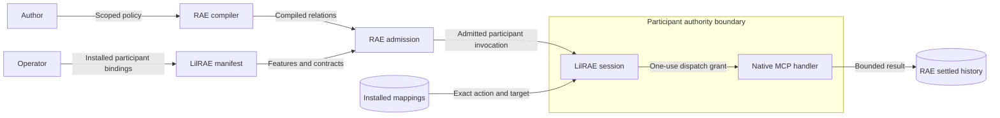

# Scoped tool affordances

LilRAE declares scoped tool support only when installed participant bindings contain tools.
The declaration owner remains `autonomous_manifest_options`.
It adds `scoped_tool_affordances` with exact support and the public required contracts.
Tool profile semantics remain `participant-tool-profile/v1`.
No new profile capacity limit is enforced or declared.
Existing per-invocation limits remain 16 calls and four concurrent calls.
RAE owns selector resolution, capability admission, scheduling, and accepted history.
LilRAE checks installed action digests, targets, boundaries, and participant relations before provisioning.
Each invocation receives only its installed tool mappings and its own RAE port.

Peer authority is the protected asset.
A shared policy must not grant the union of participant tools.
Installed relation checks and invocation ports enforce that boundary.
Deterministic native handlers verify peer refusal and both completion orders.
Malformed claims fail public manifest validation or admission before effects.
Unsupported composition retains the existing refusal tests.
Private launch data stays outside the manifest and public evidence.
Trusted host code remains outside this isolation claim.

The existing action model, dependency rules, and ADR-064 remain sufficient.
No new component, dependency direction, store, listener, or architecture decision is introduced.
The action-enforcement design supplies the remaining lifecycle and security controls.

## References

- [RAE 10.6.1 public tool gate](https://github.com/OpenRAE/rae/blob/v10.6.1/implementations/python/packages/raes_processor/participant_tool_support.py): required features, roles, contracts and typed capacity.
- [RAE 10.6.1 support contract](https://github.com/OpenRAE/rae/blob/v10.6.1/implementations/python/packages/raes_contracts/contracts/participant_tool_support.py): presence, strength, versions and constraints.
- [Python 3.14 futures](https://docs.python.org/3.14/library/concurrent.futures.html): worker ordering and shutdown.
- [Action enforcement](participant-action-enforcement.md): native dispatch, session ownership and executable invariants.

The preflight inspected the Go migration baseline.
This delivery follows the documented non-Go lane on `dev`, which contains the installed tool implementation.
