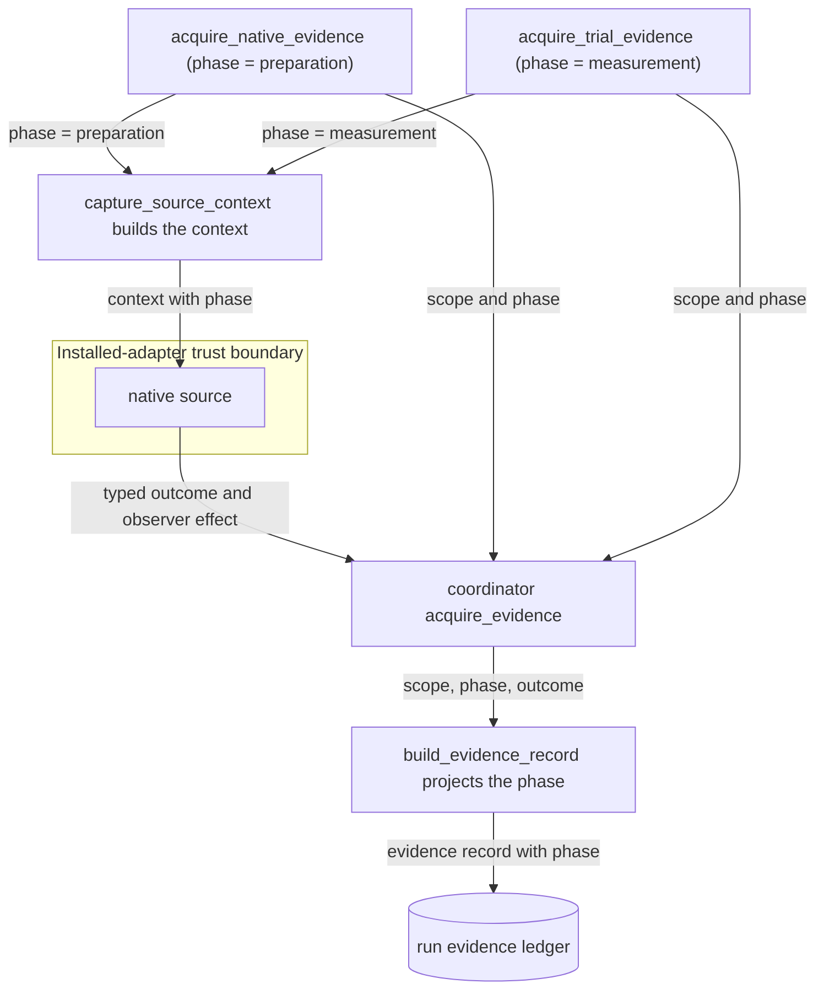
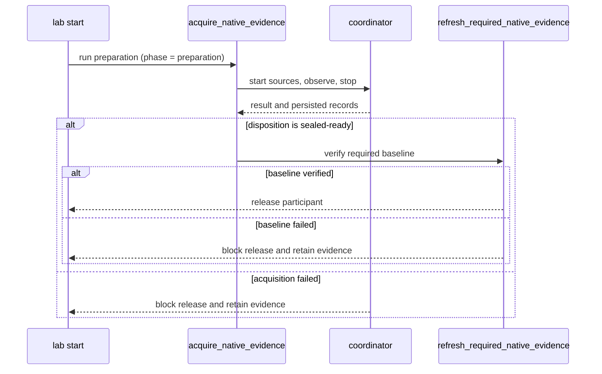

# Native acquisition phase boundary

This historical Reference preserves the original source record.
The record below describes its own evidence date and revision, where stated.
It does not establish current behavior, implementation completion, or installed qualification.
The preserved file is available at [source revision `6d35d245f11a`](https://github.com/OpenRAE/lilrae/blob/6d35d245f11a7fffcaac1645cd25ccfafbad4599/docs/architecture/issue-1689-native-acquisition-phase-preflight.md).
Its last recorded file change before this rewrite was `ce5fa71c5b8b`.
Current interfaces and successor decisions take precedence for present use.

Issue #1689 is the contract and delivery owner; no formal requirement applies.
This explanation records implementation guardrails, not an implementation plan.
Source revision: `da489388d283776b5cc77973d4a4b86d8f961538`.
The issue cites 9.2.0; this assessment uses the current checkout.

## Decision and invariants

Extend the existing frozen `CaptureSourceContext` with the native caller's explicit acquisition phase.
Define its meanings once at the acquisition boundary and retain the same value with the evidence.
Use existing `RunScope`, admitted trial identity, and `ClockProvider` for context; do not create parallel identity or clock models.
Resolve the clock once per acquisition so sources and collectors share it.

| Caller boundary | Permitted behavior |
| --- | --- |
| `acquire_native_evidence` during startup | Perform required preparation, retain its effects, and verify the required baseline before participant release. |
| `acquire_trial_evidence`, with or without `trial_body` or `window` | Observe the selected measurement sources. Never authorize preparation, including retries or fallback repair. |
| Missing, malformed, or unknown phase | Grant no preparation authority. Reject invalid context before effects, or remain observational where the contract explicitly permits it. |

The caller selects the phase; scenario content, environment variables, and adapters cannot override it.
Do not infer phase from timestamps, attempt names, `first_capture`, source order, or whether a trial window exists.
The existing `provisioning` attempt identity is not a phase discriminator.
Materialization archive phases (`initial`, `inventory`, `evaluation`) describe another concern; do not reuse them as acquisition permissions.
An unknown future phase must remain unable to mutate state until explicitly supported.

Phase limits permission; it does not command every source to perform a probe.
Keep SQL-injection stimulus, endpoint freshness events, and reload semantics with the selected scenario adapter and existing native owners.
Source construction must not perform those effects before the acquisition scope, clock, and limits apply.
Installed adapters have ordinary Python authority; the context is an API boundary, not a sandbox against malicious installed code.

## Existing lifecycle owners

`core/lab.py:_LAB_START_STEPS` already places required native acquisition before participant desktop publication and participant inject execution.
`_step_acquire_required_native_evidence` requires `SEALED_READY`, then `_refresh_required_native_evidence` verifies RAES evidence truth.
Both acquisition failure and failed truth verification must stop that sequence.
Successful collection alone does not prove the required baseline.
Neither empty evidence nor accepted degradation may bypass a required baseline.
Keep required work out of advisory SOC seeding and optional capability warnings.
Preserve adapter selection; an unavailable required source must not become a skipped obligation.

The coordinator starts collectors, runs `trial_body`, then stops collectors in reverse order.
Native on-demand checks execute during stop; their results cannot gate an already-started participant.
Required preparation and baseline verification must finish in the existing startup/provisioning boundary before release.
Keep cleanup, interruption handling, and failed-start residue accounting with their current owners.
Retain preparation evidence before any permitted teardown; never truncate logs or delete probe residue to manufacture a clean baseline.

`TrialReadiness` and `ReadinessTrialServices` already gate native trial effects and retain failed readiness observations.
Their `prepare` and live owner callbacks are read-only; they must not call acquisition or emit freshness events.
Keep mutation in the existing provisioning/capture lifecycle, with readiness observing the resulting baseline.
Do not replace readiness authority or RAES trial cleanup with adapter booleans.

## Data flow and release sequence

The phase is one value.
The native caller selects it.
The context carries it to the source.
The coordinator carries it to the evidence record.
The source reads the phase and prepares only when the phase is preparation.
The core supplies the authoritative phase for the record; source metadata cannot overwrite it.

The startup boundary verifies the required baseline before participant release.
A failed baseline blocks the release.
The failed path retains the phase, the source identity, the timing, and the observer effect.
It never erases probe residue to show a clean baseline.

## Cross-cutting passage and required reuse

Paths below are relative to `src/aptl/` unless otherwise stated.

| Layer and canonical incumbent | Required passage |
| --- | --- |
| Pack and provider admission: `backends/scenario_family.py`, `scenario_capture_discovery.py` | Preserve exact pack/backend/provider qualification, extension version, declaration limits, environment-key validation, and generated-output grants. No phase-based discovery or scenario-selected executable. |
| Capture contracts: `core/experiment/capture_registry.py`, `capture_plan.py`; acquisition request validators | Preserve pinned registration/configuration digests, supported offers, source membership, duplicate rejection, participant scope, and timezone-aware windows. Validate the new phase once at its owning boundary. |
| Runtime ownership: `backends/raes_runtime.py:AptlRuntimeManager.collect_evidence` | Preserve exact run, backend, manifest, and admitted-plan comparisons. Phase adds no authority to bypass these checks. |
| Config and environment: `core/config.py`, `env.py`, `utils/placeholders.py`, `core/deployment/_environment_bindings.py` | Keep strict first-party config and explicit consumer grants. Phase is runtime context, requiring no config, SDL, environment-binding, or credential-source shape change. |
| Secret and generated-output access: `backends/scenario_capture.py:capture_source_context` | Preserve the detached realization, declared environment allowlist, hidden credential representations, bounded generated-output reads, and no-follow containment. Never hand sources the request, store, project path, or ambient environment. |
| Container and OS effects: `backends/scenario_runtime_hooks.py:AdmittedRuntimeOperations`, `core/deployment/` | Preserve admitted node names, command/input validation, timeouts, bounded log reads, and backend transport ownership. No raw Docker/SSH, shell interpolation of phase, new listener, host privilege escalation, or widened mount. |
| Auth and process secrets: `utils/curl_safe.py`, ADR-029, existing service clients | Keep authenticated service reads on their existing transport and TLS policy. Credentials travel through protected input/files, never argv, URLs, phase metadata, logs, or errors. |
| Collection and timing: `core/evidence/coordinator.py`, `adapters/sources.py`, `deadline.py`, `core/correlation/clock.py` | Reuse `SourceResult`, `CollectorOutcome`, statuses, limits, source windows, and injected clocks. Preserve source time versus observation time and honest clock uncertainty. No independent retry loop or fabricated synchronization. |
| Persistence: `core/evidence/_persist.py`, `records.py`, `content_store.py`, `core/runstore.py`, `utils/pathsafe.py` | Use existing redaction, visibility, quotas, canonical digests, create-once writes, seal exclusion, and contained paths. Keep portable RAES evidence/reference models; add no mirror schema or store. |
| Errors and observability: `core/evidence/outcomes.py`, `core/lab_types.py`, `utils/logging.py`, `utils/redaction.py` | Keep typed source failures, RAES diagnostics, and `LabResult` at their current boundaries. Log bounded identities/statuses only; never raw exception text, stderr, payloads, environments, or context representations. |
| API and participant visibility: `api/deps.py`, `api/middleware/bff.py`, `core/evidence/visibility.py` | This change adds no endpoint or credential. Preserve `verify_token`, `WebAuthSettings`, host/session/CSRF checks, and evidence visibility projections; phase grants no new participant access. |

## Evidence retention hazards

Retain phase, run/trial/attempt identity, registration/source identity, observation timing, source timing when available, and actual observer effects.
Use a bounded backend metadata projection in the existing acquisition/persistence owners, linked through existing evidence references.
Core supplies authoritative phase and scope; source metadata cannot overwrite them.
Project allowed fields rather than serializing the context or an arbitrary `source_pipeline` dictionary.
Reuse `ClockContext` where clock context is needed; do not duplicate its schema.
Keep source payload contracts intact and include metadata in canonical integrity coverage.
Different phases must not alias or overwrite evidence through an unchanged record identity.

Current `records.py` reads only `source_pipeline["source_refs"]`; it does not retain arbitrary pipeline fields or `observer_effect`.
Adding a phase key there alone does not satisfy retention.
`adapters/sources.py:_to_outcome` drops metadata when failure has no content.
The coordinator then emits an in-memory report without a durable evidence record for that outcome.
The on-demand collector also replaces the entire source result on clock skew, losing its accepted content and metadata.
Preserve safe failure facts across these conversions without treating invalid timestamps as verified timing.
Source-factory exceptions can occur before the coordinator and produce no acquisition result.
These paths need bounded failure facts through the existing owners, including any preparation already attempted.
Do not retain unvalidated raw responses merely to obtain a failure artifact.
Storage failure blocks release and must not claim successful retention.

The on-demand collector lacks the windowed collector's native read-budget and byte-budget wrappers.
Preparation must respect pinned acquisition limits through the existing deadline and bounded transport owners.

Failed startup short-circuits before `_step_write_run_record`; keeping data only in `_LabStartContext` is insufficient.
Retained preparation artifacts must remain discoverable through existing run evidence/reference mechanisms after restart and permitted cleanup.
Preserve successful peer artifacts when another source fails and finalize accepted data before propagating interruption.
Do not claim an effect was absent when an interrupted operation leaves its outcome unknown.

`first_capture` currently grants one-time enrollment establishment through `core/retained_enrollment.py`.
Keep that authority separate from phase and preserve read-only later enrollment contexts.
A missing retained enrollment baseline cannot be recreated from measurement observations.
Enrollment identity and the scenario's required behavioral baseline are different facts.

## Extensibility, compatibility, and evidence bar

The extension seam is the phase parameter passed through `family_capture_sources` and `capture_source_context` to installed sources.
A new source consumes that shared context and returns existing typed outcomes; it needs no core branch keyed by scenario or registration.
Future phases extend one contract, with explicit permissions and safe unknown-phase behavior.
Preserve positional constructor compatibility where needed, and never use a preparation-authorizing default for old callers.

Startup family acquisition receives `CaptureSourceContext`; bundled TechVault startup currently receives the full `NativeEvidenceRequest` instead.
Trial acquisition uses the context path. Account for both paths without broadening family source authority or adding a parallel adapter API.
RPT implementation and release remain outside this repository; the optional installed-adapter smoke test alone cannot prove phase separation.

Reuse `tests/test_family_adapter_contract.py`, `test_retained_enrollment.py`, `test_raes_evidence_acquisition.py`, and `test_trial_capture.py`.
Reuse coordinator, persistence, and readiness tests for any changed shared behavior.
Required evidence covers measurement with zero preparation effects, unknown-phase refusal, and failed preparation/baseline blocking participant release.
It must also show durable failure metadata, preserved peer evidence, bounded/redacted output, and unchanged cleanup ownership.
Focused mutation checks should detect removal of phase guards or inversion of the baseline release gate.

Repository controls remain `.ground-control.yaml`, `.gc/plan-rules.md`, ADR-064, and `.gc/pack-ownership.json`.
`pyproject.toml` and `tools/check_architecture.py` govern imports; `tools/check_pack_boundary.py` enforces scenario ownership.
Use `tools/run-targeted-tests.sh` only in CI or an approved isolated VM.
Workstation verification is limited to static checks and staged `pre-commit run` hygiene.
`.github/workflows/checks.yml` owns full verification; Compose/config changes additionally require existing installed-lab qualification.

## Non-goals

No scheduler, workload framework, lifecycle state machine, evidence store, portable schema, exception hierarchy, or new validation framework.
No study scoring, RPT adapter implementation, acquisition service, dependency upgrade, new hosting, or external data transfer.
No log erasure, measurement-time repair, lifecycle reconstruction from timestamps, or custom readiness callback registry.
No broad runtime, authentication, cleanup, or Suricata configuration redesign.
Deliver the native phase boundary and its failure evidence in the issue's single PR.
ADRs 029, 044, 047, and 064 already establish these owners; no new ADR is needed.
