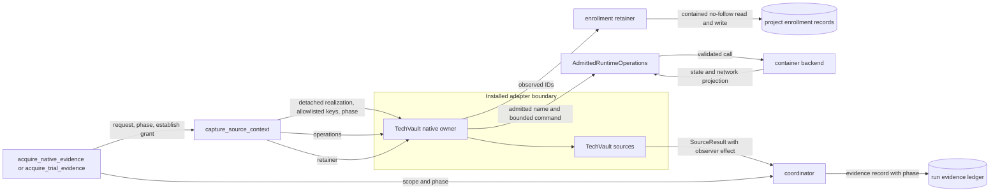

# TechVault capture context design

Reader purpose: Explanation.
Issue #1705 owns this design; no formal requirement applies.
The [preflight guidance](issue-1705-techvault-capture-context-preflight.md) sets the guardrails.
The [native phase boundary](issue-1689-native-acquisition-phase-preflight.md) defines the phase contract.

## Problem

The TechVault source factory reads `backend` and `project_dir` from its argument.
The trial path passes a `CaptureSourceContext`, which has neither field.
The factory raises an error, and core drops every TechVault native source in silence.
The startup path passes the full `NativeEvidenceRequest`, so its sources never receive the phase.

## Decisions

| Decision | Reason |
| --- | --- |
| Both acquisition paths build sources through `family_capture_sources` when the contribution declares native sources. | One factory input gives one authority boundary and one phase path. |
| The TechVault owner uses `context.operations`, `context.retain_enrollment_ids`, and `context.may_prepare`. | The owner gets no backend, project path, or run store. |
| `AdmittedRuntimeOperations.container_inspect` adds a network attachment projection. | MISP has a dynamic address. The owner must read it from the one aliased attachment. |
| Core supplies a scenario enrollment retainer when a context has no trial. | The legacy baseline file stays core-owned and keeps its reset owner. |
| Preparation alone runs the MISP write probe, the SQLi probe, and agent freshness stimulus. | Measurement must not change the range state. |
| During measurement, the MISP and SQLi sources return `source-unavailable`. | The probe did not run. A fresh success needs the probe, so the result is honestly unavailable. |
| The MISP and SQLi sources report their observer effect after their probe runs. | Failure evidence must keep the probe residue fact. |

### Network attachment projection

The projection keeps `NetworkSettings.Networks`.
For each network, it keeps a valid `IPAddress` and up to 32 string `Aliases`.
It drops all other endpoint fields, such as `Gateway`, `MacAddress`, `DriverOpts`, and `Links`.
The projection is whole or absent.
It withholds all attachments when a network name is not valid or the count is more than 16.
Thus a second attachment cannot disappear, and the MISP check can refuse an ambiguous set.

### Enrollment retention

A trial context uses the existing trial record.
A context without a trial uses the legacy baseline record, `.aptl/realization/wazuh-agent-identity/baseline.json`.
For both records, the retainer returns the IDs retained before the call.
A retainer can write only when the caller grants enrollment establishment.
`acquire_native_evidence` grants it on the first capture of a run, in the preparation phase.
Measurement never grants it, so measurement cannot make or repair a baseline.

The scenario record differs from the trial record in one rule.
Each startup preparation can add hosts that the record does not have yet.
It never replaces an ID that the record has.
This rule keeps the legacy TechVault behavior for a later lab start.

TechVault gives the observed IDs to the retainer, and then reads the record again.
In the establishing capture, the new record is the baseline for that capture.
Thus a fresh lab can pass readiness on its first start, as it does today.
A later capture compares each host with the retained ID.

This rule applies to trial and non-trial contexts.
The code review asked for a strict comparison in the establishing trial capture.
That capture has no earlier ID, so a strict comparison always fails and detects nothing.
The maintainer chose to keep the first-start rule for both contexts.
`lilrae lab stop -v` removes both records through `core/lifecycle_cleanup.py`.

### Phase effects in TechVault

| Source | Preparation | Measurement |
| --- | --- | --- |
| MISP authenticated API readiness | Creates, reads, and deletes one event. | Returns `source-unavailable`. |
| Suricata rule readiness | Runs the configuration test. | Runs the configuration test. |
| Wazuh agent readiness | Observes. Sends freshness events for stale hosts. | Observes only. A stale host fails readiness. |
| Suricata and Wazuh SQLi correlation | Sends one fixed probe. | Returns `source-unavailable`. |

The Suricata configuration test writes one temporary file in the container and removes it.
It does not change the service state, so it stays in both phases.

A probe that did not start reports `source-unavailable` with no effect.
A probe that started and then failed reports `mid-run-loss` with the effect that it can confirm.

| Probe outcome | Observer effect |
| --- | --- |
| The MISP API step exits 0. The script deletes the event in its cleanup, so exit 0 confirms the delete. | One event created, read, and deleted. |
| The MISP API step fails, or its event delete fails. | One event write attempted; creation and deletion unconfirmed. |
| The SQLi request completes. | One fixed POST to `/login` that contains `UNION SELECT`. |
| The SQLi request starts, then its transport fails. | The same POST attempted; delivery unconfirmed. |

An admitted-operation refusal occurs before a request leaves the host, so it counts as not started.

## Data flow

The installed adapter boundary is an API boundary.
It is not a sandbox against malicious installed code.

## Security

| Asset | Threat | Control | Verification |
| --- | --- | --- | --- |
| Backend authority | A source runs commands on a container that the scenario did not admit. | Admitted names, command limits, and timeouts in `AdmittedRuntimeOperations`. | Existing operations tests and the TechVault context tests. |
| Container configuration | The inspect projection exposes environment, mounts, or host settings. | An allowlist projection of state, restart count, IP address, and aliases. | Projection tests assert that other fields are absent. |
| Enrollment baseline | Measurement makes or repairs a baseline from a recreated agent. | Only a preparation capture with the establishment grant can write. Writes never replace an ID. | Retainer tests for read-only measurement and no replacement. |
| Range state | Measurement creates MISP events, sends SQLi traffic, or sends endpoint events. | `may_prepare` guards each stimulus path, including indirect callbacks. | Trial tests assert zero probe calls. |
| Evidence honesty | A failed probe loses its residue fact, or an absent probe reports success. | Observer effect after the probe runs. `source-unavailable` when it did not run. | Source tests for each failure path. |

The design applies least privilege and mediated access from
[NIST SP 800-160 Vol. 1 Rev. 1](https://csrc.nist.gov/pubs/sp/800/160/v1/r1/final), Appendix E.16 and E.19.
The network projection follows the `EndpointSettings` schema in the
[Docker Engine API v1.47](https://docs.docker.com/reference/api/engine/version/v1.47/).

## Unchanged owners

ADR-029, ADR-044, ADR-047, and ADR-064 stay sufficient; this design adds no ADR.
The design adds no component, store, schema, listener, or dependency direction.
Policy-as-code and architecture-as-code controls stay unchanged.
`tools/check_architecture.py` and `tools/check_pack_boundary.py` continue to enforce the import rules.
