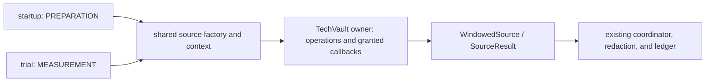

# TechVault capture context migration

Issue #1705 owns this Explanation and its delivery; no formal requirement applies.
The supplied issue is the delivery contract.
Source revision: `d9e5e30d5054af86b87297dc4659a8de612cb3c3`.
This preflight supplements the [native phase boundary](issue-1689-native-acquisition-phase-preflight.md); it does not certify implementation or qualification.
ADRs [029](../adrs/adr-029-control-plane-secret-handling.md) and [064](../adrs/adr-064-layered-architecture-and-code-conventions.md) already establish the relevant owners.
No new ADR is needed.

## Contract and authority

`CaptureSourceContext` is the single source-factory input for startup and trial acquisition, including capture selections without a family trial.
`NativeEvidenceRequest` remains acquisition authority owned by core callers.
Sources receive neither that request nor its backend, project directory, run store, or capture plan.
Do not add these fields to the context or reconstruct a request-shaped compatibility object.

Reuse `capture_source_context` and `family_capture_sources` in `backends/scenario_capture.py` for context construction and source-map validation.
The helper's family name does not justify a second implementation for ordinary pack capture.
Preserve selections without native adapters; an empty native declaration does not require a factory.
An unavailable declared source must remain accountable through the coordinator.
Give `TechVaultCaptureRuntimeAdapter.native_sources` the existing typed context and `Mapping[str, WindowedSource]` contract.

The caller passes the same explicit `AcquisitionPhase` to source construction and the coordinator.
Reuse `CaptureSourceContext.may_prepare` and `PREPARATION_PHASES`; measurement remains the safe default.
Do not infer permission from `trial is None`, attempt names, windows, or the presence of a trial body.
Phase permits preparation; it neither requires a probe nor grants host access.
Source construction must not execute service probes.

## Dependencies that an attribute rename misses

Paths in this section are relative to `src/aptl_techvault/evidence/`.

| Dependency | Required guardrail |
| --- | --- |
| `techvault_native.py`, `techvault_telemetry_stimulus.py` | Bind the owner to `context.operations`. Existing Suricata probes, manager-log reads, and admitted container operations remain adapter-owned. Fixed container names must pass admitted-name checks. No raw backend fallback. |
| `techvault_native_readiness.py` MISP address discovery | MISP uses a dynamic address, validated against its admitted subnet and unique aliased attachment. `AdmittedRuntimeOperations.container_inspect` currently exposes process state only. A direct substitution loses `NetworkSettings` and makes MISP unavailable. Any required network observation belongs at this existing operations boundary as a bounded, allowlisted projection. Keep attachment ambiguity visible; never disclose raw inspection, environment, mounts, or host configuration. Reuse the existing subnet and alias checks; do not substitute authored static addresses or DNS guesses. |
| `techvault_enrollment_baseline.py`, `techvault_native_readiness.py` | Host persistence belongs behind `context.retain_enrollment_ids`, with core-owned contained file access. Trial contexts already bind `core/retained_enrollment.py` to exact trial identity. Non-trial contexts currently supply `None`; they need an explicit core-bound capability preserving the existing legacy baseline and cleanup contract. Do not invent a fake trial, second baseline format, or plugin-owned host-path callback. |
| `techvault_readiness_probes.py` | MISP API readiness creates, reads, and deletes an event. This is preparation even when cleanup succeeds. TLS, database, cache, and API facts remain separate; a read-only success cannot stand in for `api_write_read_ok`. |
| `techvault_native.py`, `techvault.py` | Wazuh freshness can emit endpoint events, including SQLi traffic. SQLi `fetch` itself calls a trigger. Guard every stimulus path with preparation permission, including retries and indirect callbacks. Merely carrying phase in the context does not enforce it. |

Retain the existing enrollment storage identity for each mode; never use the legacy global baseline as a trial's baseline.
Preserve the trial retainer's return-before-write semantics: an agent's first observation cannot prove that its identity survived recreation.

The [design](issue-1705-techvault-capture-context-design.md#enrollment-retention) records a maintainer decision for TechVault: the establishing capture compares with the baseline that it records.
Only the authorized initial provisioning capture may establish trial enrollment; later contexts remain read-only, including after restart or baseline loss.
For non-trial capture, preserve retained legacy IDs and initialization during preparation without allowing measurement to establish or repair them.
Move or reuse existing persistence logic behind core authority; do not duplicate it inside the adapter.
`core/lifecycle_cleanup.py` remains the sole reset owner.

Measurement must not create MISP events, emit freshness events, or trigger SQLi.
Keep applicable native registrations in the source map; report unavailable or lost evidence through existing typed outcomes when observational evidence is insufficient.
MISP remains conditional on an admitted MISP state, as today.

The current MISP write/read and SQLi trigger contracts cannot produce fresh success through observation alone.
Without qualifying observational evidence, their measurement result must be explicitly unavailable rather than a successful empty result or a factory-wide omission.
Do not weaken those output contracts, invent a trigger identity, or relabel preparation evidence as current measurement evidence.
This is a limit on measurement success, not permission to drop all native sources.

Report actual preparation effects, including MISP event creation, even when a later step or cleanup fails.
Existing source failure helpers can lose that fact or label an executed probe unavailable.
Do not use a not-started status for an operation that ran; reuse `observer_effect` and the existing retained-failure policy.

## Cross-cutting passage

Paths below are relative to `src/aptl/` unless otherwise stated.

| Layer and canonical incumbent | Required passage |
| --- | --- |
| Admission: `backends/scenario_capture_discovery.py`, `scenario_family.py`; `core/experiment/capture_registry.py`, `capture_plan.py` | Preserve exact pack/backend/provider qualification, declaration bounds, registration membership, pinned configuration digests, and duplicate-source rejection. Reuse existing source-map checks for both modes; do not add a second validator. |
| Runtime authority: `backends/raes_runtime.py:collect_evidence`; acquisition request validators | Preserve run/backend/manifest/plan ownership checks, attempt scope, and ordered timezone-aware windows. A context is no substitute for these checks. |
| Secrets and config: `backends/scenario_capture.py`; `core/config.py`, `core/env.py`, `core/deployment/_environment_bindings.py`, `_generated_environment_bindings.py` | Preserve detached realizations, immutable environment allowlists, hidden credential representations, and exact consumer grants. No config, SDL, credential-source, or environment-binding shape change is needed. `INDEXER_USERNAME` and `INDEXER_PASSWORD` are currently granted but ignored by the owner; the migration must not create a new consumer. Do not broaden grants to obtain MISP credentials. |
| Generated outputs: `capture_source_context`, `backends/scenario_service_policy.py`, `utils/pathsafe.py` | Preserve declared artifact/output grants, unique admitted references, the 2 MiB read bound, and no-follow containment. No arbitrary filename or project-directory access. Enrollment is retained state, not a generated-output credential. |
| OS and transport: `backends/scenario_runtime_hooks.py:AdmittedRuntimeOperations`, deployment backend | Preserve admitted node names, bounded command/input shapes, timeouts, and sanitized transport errors. Extend only the necessary observation projection. No direct Docker/SSH, new listener, mount, privilege, shell interpolation, or deployment-adapter import from the plugin. |
| Service authentication: existing TechVault readiness probes, `utils/curl_safe.py`, ADR-029 | Keep credentials inside their admitted containers or protected input/files. Preserve owner-only curl header files, stdin bodies, `MYSQL_PWD`, and `REDISCLI_AUTH`. No credential in argv, URLs, context dumps, or errors. Preserve separate certificate verification against the lab CA; loopback API success is not TLS identity proof. |
| Collection: `core/evidence/adapters/sources.py`, `core/evidence/deadline.py`, `core/evidence/coordinator.py`, `core/correlation/clock.py` | Reuse `WindowedSource`, `SourceResult`, `CollectorOutcome`, injected clocks, limits, and native read budgets. Preserve caller windows and actual observation times. Startup uses an on-demand deadline; trial collection closes its window before fetching. Do not make a later probe fit an earlier trial window. No new retry scheduler or collector framework. |
| Errors and observability: `family_capture_sources`, `_add_native_sources`, `core/evidence/outcomes.py`, `utils/logging.py`, `utils/redaction.py` | Factory runtime failures become the fixed `family-capture-sources-unavailable` error. Invalid source maps remain `ValueError` contract failures. Preserve safe per-binding reports and RAES diagnostics; never catch both as an empty successful capture. Log only bounded identities, statuses, or fixed codes, never raw exceptions, stderr, payloads, or environments. |
| Persistence and visibility: `core/evidence/_persist.py`, `records.py`, `content_store.py`, `visibility.py`, `core/runstore.py`, `utils/pathsafe.py` | Preserve media validation, shared redaction, quotas, content digests, create-once writes, seal rules, and participant visibility. Phase and observer effects already have retained references and phase-aware record identity. Reuse these; add no evidence schema, store, or arbitrary context serialization. |
| Entry and release: `core/lab.py`, `backends/_raes_evidence_truth_refresh.py`, `api/deps.py`, `api/middleware/bff.py` | Startup still requires `SEALED_READY` and required truth verification before participant release. Existing token, host/session, and CSRF checks remain unchanged: this migration creates no endpoint or principal. Cleanup remains with its existing lifecycle owner. |

`_add_native_sources` currently preserves healthy participant sources after a factory runtime failure.
The coordinator blocks `trial_body` when a required collector is missing.
Post-execution capture can retain healthy peers while reporting native unavailability.
Preserve both behaviors; removing the catch alone would discard useful participant evidence.
A registered source can also fail during stop, after `trial_body` ran; that does not prove the participant was prevented from running.
Keep startup truth gates separate from collection status and trial execution authority.

The on-demand collector lacks the windowed collector's native read-budget wrapper.
Do not assume identical deadline and byte enforcement or expand probe work during this migration.
Preserve bounded transport operations and disclose timeout or truncation through the existing outcomes.

## Compatibility, extensibility, and evidence

The extension seam is the existing context's phase, operations, and granted callbacks.
Keep backend observation generic and node-scoped; keep MISP, Wazuh, and SQLi meanings in TechVault.
An additional native source should consume this context without a scenario branch in core acquisition.
Do not create another request DTO, phase enum, exception hierarchy, validator, or enrollment schema.
Installed plugins retain ordinary Python authority; this API boundary does not sandbox malicious installed code.

Focused evidence must cross `acquire_trial_evidence` into the real TechVault adapter and sources, rather than replace the factory with a canned map.
Use an admitted MISP-capable realization; the small owner fixture intentionally omits MISP and cannot prove four-source participation.
Assert per-registration reports, applicable retained records, exact measurement windows, and zero preparation effects, including MISP writes and indirect telemetry stimulus.
Unavailable active probes must remain visible and must not yield successful readiness.
Non-trial startup evidence must demonstrate that the actual sources receive `PREPARATION`, with bounded operations and enrollment continuity.
Include contract-failure versus runtime-unavailability behavior, healthy participant retention, and secret canaries at argv, output, and error boundaries.

Reuse `tests/test_trial_capture.py`, `test_acquisition_phase.py`, `test_family_adapter_contract.py`, and `test_retained_enrollment.py`.
Reuse `tests/techvault/test_raes_evidence_acquisition.py`, `test_techvault_native_evidence.py`, and existing MISP, Wazuh, and telemetry source tests.
Focused mutation checks must detect a restored raw-request startup path, a dropped TechVault source set, and removed preparation guards.
Run behavior and mutation tests only in CI or an explicitly approved isolated VM, using targeted paths through `tools/run-targeted-tests.sh` where supported.

Repository controls remain `.ground-control.yaml`, `.gc/plan-rules.md`, `pyproject.toml`, `.gc/pack-ownership.json`, and `tools/check_architecture.py` / `check_pack_boundary.py`.
Do not widen architecture enrollment exceptions to disguise a new plugin dependency.
`tools/vale-lint-hook.sh`, `tools/ste-lint.sh`, and staged `pre-commit run` own local documentation and hygiene checks.
`.github/workflows/checks.yml` and the [CI verification rules](ci-verification.md) own full verification and installed-lab qualification when selected.
Keep all acceptance criteria in the issue's single delivery PR; this preflight does not open or merge one.

## Non-goals

No implementation in this preflight, dependency upgrade, pack change, external service, upload, or new hosting.
No evidence scoring redesign, new observational claim schema, auth redesign, blanket exception removal, or generic acquisition framework.
No broad lifecycle refactor, new readiness authority, cleanup changes, or migration of historical baseline identities into invented trial identities.
Do not copy preparation records into measurement, erase probe residue, or treat unavailable evidence as verified readiness.
