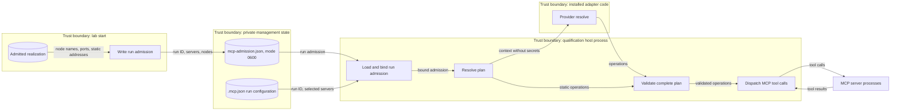
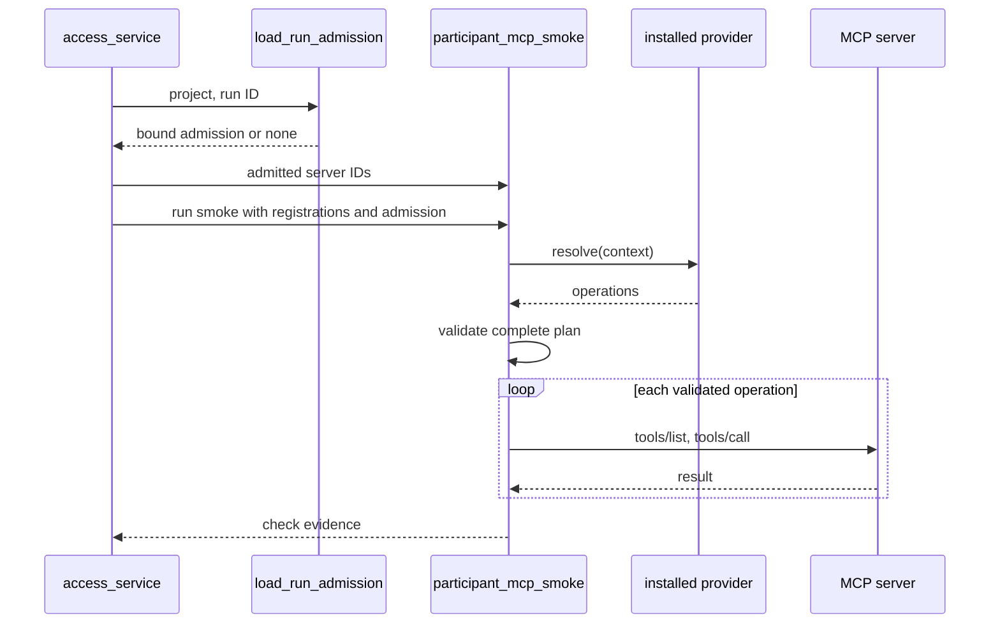

# Admitted participant smoke providers

Issue #1707 owns this change. No formal requirement applies.
[ADR-067](../adrs/adr-067-admitted-participant-smoke-providers.md) records the decisions.
The [family adapter reference](../reference/family-adapters.md#participant-mcp-smoke-providers)
gives the public interface and the migration.
This document describes the components, data flows, and security controls.

## Components

| Component | Responsibility |
| --- | --- |
| `aptl.core.mcp_smoke_contract` | Public values: operation, check declaration, tool grant, admitted node, context, provider protocol, and error. |
| `aptl.validation.participant_mcp_smoke` | Discovery, executable resolution, complete-plan validation, and MCP dispatch. It re-exports the public values. |
| `aptl.core.mcp_policy.McpRunAdmission` | Run-bound record of the admitted MCP servers and the admitted node inventory. |
| `aptl.core.lab` | Writes the run admission at lab start from the admitted realization. |
| `aptl.workbench.preparation.load_run_admission` | Reads the run admission and binds it to the run ID and the run MCP configuration. |
| `aptl.appliance.access_service` | Managed qualification caller. It passes the run admission to smoke resolution. |
| `aptl.appliance.input_profile` | Profile assembly. It uses discovery only. |
| Installed adapter | Supplies a static operation tuple or a provider through `aptl.participant_mcp_smoke_plans`. |

## Interfaces

An entry point in `aptl.participant_mcp_smoke_plans` loads one of two shapes:

- A static tuple of `McpSmokeOperation` values. Its behavior does not change.
- A provider object with `extension_api_version`, `checks`, and `resolve(context)`.

Discovery returns `McpSmokeCheck` declarations.
For a provider, discovery reads `checks` and does not call `resolve`.
Executable resolution of a provider requires a run admission.

The provider context contains these values only:

- Profile ID, scenario catalog ID, and pack identity.
- Admitted nodes: SDL node name, declared service ports, and static network addresses.
- Exact tool grants for each admitted MCP server.
- The readiness checks that the plan must cover.

`McpSmokeContext.address(node, network)` returns one admitted address.
It fails when the node is absent or the network has not exactly one address.

## Selection rules

The admitted server set is the profile server set limited to the run admission.
Without a run admission, it is the profile server set, as before.

A readiness check is required when a required narrative operation has its capability.
A required check whose server is not admitted stops qualification.
An optional check whose server is not admitted has no operation and no registration.
An empty set of expected checks stops qualification.

## Complete-plan validation

The host validates the complete plan before the first MCP process starts.
The same validation applies to installed plans, provider results, and caller-supplied operations.

- The plan is a tuple of 1 to 64 operations.
- Identifiers are bounded and check IDs are unique.
- Each operation binds to one expected readiness check by check ID and server.
- Each tool is in the exact grant of its server. Conflicting grants for one server fail.
- The operation servers equal the admitted server set.
- A provider result contains only the checks that the provider declared.
- Arguments are JSON values of 64 KiB or less. The host uses its own copy.
- The registrations equal the admitted server set.

`mcp_protocol` still checks the live `tools/list` inventory before `tools/call`.
A result validator that raises an exception gives a failed check.

## Data flow diagram

## Sequence

## Security

Assets are participant tool authority, target identities, run credentials, and qualification truth.

| Threat | Control | Verification |
| --- | --- | --- |
| A plan widens authority with an extra server or tool. | Server and tool checks against the admitted set before dispatch. | Denied-tool and extra-server tests. |
| A plan drops a required check. | Exact binding to expected checks; required checks from the narrative. | Missing-required-service test. |
| An empty selection passes. | Empty expected set and empty plan fail. | Empty-selection test. |
| A foreign or stale admission supplies inputs. | Run ID and server set binding to `.mcp.json`. | Run-binding tests. |
| A fixed or stale address reaches a target. | Addresses come from the admitted realization; absent addresses fail. | Changed-address and missing-target tests. |
| The provider receives secrets. | The context carries no credentials, environment, configuration, or paths. | Context field review and tests. |
| The provider changes arguments after validation. | The host dispatches its own JSON copy. | Mutation-after-return test. |
| Exceptions disclose data. | Stable errors; validator exceptions give failed checks. | Provider and validator failure tests. |
| Duplicate checks hide a gap. | Unique check IDs. | Duplicate-check test. |

Residual risks:

- Installed adapter code is trusted Python. Import and resolution run with host authority.
- The host does not parse shell commands in tool arguments.
  MCP server controls and the live inventory check still apply.

## Non-goals

TechVault MISP selection rules, general variation qualification, and smoke traffic
during startup, verification, or discovery are outside this change.
The in-repository TechVault plans stay static.
