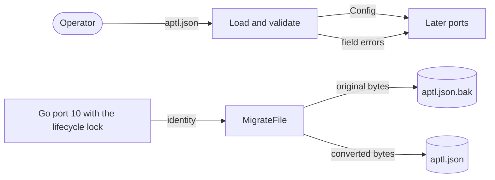

# Issue #1747: Configuration design

This design ports `aptl.json` to Go. The
[#1559 design](issue-1559-go-config-state-keys-design.md) and ADR-065 apply.
The [strict configuration preflight](issue-1559-strict-config-preflight.md)
and the [configuration and trust preflight](issue-1559-config-trust-preflight.md)
give the guardrails.

## Evidence

| Fact | Source |
| --- | --- |
| Each object rejects an unknown member. An absent member gets its default. `{"lab": {}}` fails, because `lab.name` has no default. | `core/config.py` |
| Only an optional member accepts null. A missing or null `containers.profiles` is unset, and `[]` is an empty selection. | `core/config.py`; Pydantic |
| `find_config` checks only `<dir>/aptl.json`, and it follows a link. `load_config` reads the file with `json.loads`. | `core/config.py` |
| `config show --json` prints `model_dump(mode="json")`: each member in model order, with null for an unset optional member. | `cli/config.py` |
| `migrate_config` holds the lifecycle mutation lock. It reads without links, writes `aptl.json.bak` once, checks that the file did not change, and replaces it atomically. | `core/lilrae_config_migration.py` |
| `config validate` also builds the deployment backend, which checks the `ssh-compose` members. | `cli/config.py`; `core/deployment` |

## Decisions

1. **One core component.** `internal/config` is the `configuration` component
   of the `core` layer. It uses `canonical-forms` to decode and `secure-file`
   for the path rules and the migration writes.
2. **Bounded strict decoding.** `Load` reads at most 1 MiB. The largest
   bounded members are 128 profiles of 128 characters and a 4096-character
   seat key. Thus 1 MiB leaves room for about 1,500 environment grants. An empty
   or blank file is an error. `canonical.DecodeStrict` parses the bytes, and
   the root must be an object.
3. **Explicit presence rules.** A small member reader converts each object.
   It applies the default of an absent member and rejects null for a member
   that is not optional. It also rejects an unknown member and a wrong JSON
   type. Each object has one decode function, in the order of the Python model.
4. **Safe errors.** A syntax error names the file. A validation error lists
   each field path, for example `lab.unknown_field`, with its rule. No error
   holds a value. An unknown member name shows as `<member>` unless it has
   1 to 64 ASCII letters, digits, underscores, dots, or hyphens. Thus an error
   holds no control character.
5. **Deliberate rejections.** ADR-025 and ADR-065 require strict input, and
   the published schema gives each JSON type. Go rejects these inputs that
   Python accepts:

   | Input | Python | Go |
   | --- | --- | --- |
   | A duplicate member name | The last value wins. | Rejected |
   | `NaN` or `Infinity` | Accepted | Rejected |
   | A file larger than 1 MiB | Accepted | Rejected |
   | `22.0`, `"22"`, or `true` for an integer member | Converted | Rejected |
   | `"yes"`, `1`, or `0.0` for a boolean member, also a legacy container flag | Converted | Rejected |
   | A final line feed in `lab.name` or `schedule[].at` | Accepted, because `$` matches before it | Rejected |
   | An integer outside the 64-bit range | Accepted | Rejected |

6. **The same semantic checks.** The port keeps each Python check:

   - the name and token patterns, the Compose project name, and the provider set;
   - the scenario locators, the grant uniqueness, and the schedule;
   - the participant model patterns, the source descriptors, and the character limits.

   `securefile.CheckPath` gives the path rules of `pack_directory`.

7. **Discovery.** `Find` checks only `<dir>/aptl.json` and follows a link, as
   Python does. #1748 owns the lifecycle root search.
8. **Migration.** `Migrate` converts a decoded tree and validates the result.
   It does not change the input. `MigrateFile` writes the result under the
   Python rules with `securefile`. Its caller holds the lifecycle mutation
   lock, so Go port 10 composes the #1748 lock with this function. Each read
   and the output have the 1 MiB limit of `Load`, so a migrated file always
   loads. The output keeps the member order and uses an indent of four spaces and a final line
   feed. Python escapes non-ASCII text, and Go writes UTF-8. Only this
   program reads the file, so ADR-065 gives it no vector.
9. **Resolved form.** The model types marshal with `encoding/json/v2` in the
   member order of `model_dump`, with null for an unset optional member.
   Go port 10 renders the command output.
   `experiment.participant_serving_providers` is the only map. The strict
   decoder does not keep the member order of an object, so the map marshals
   with sorted keys. Python keeps the order of the file.
10. **Members from dev.** The merge of `dev` (#1758) adds `mcp`,
    `deployment.range_egress_allowances`, the OpenCode and Vertex selections,
    `participant_serving_providers`, and `opencode_executable`. The port keeps
    their Python checks. `MCPServerIDs` copies the server order of the MCP
    catalog, and a test compares the two.
11. **Other owners.** Go port 09 checks the deployment backend members. The
    scenario admission of Go port 17 checks the profiles against the admitted
    scenario. Go port 11 computes the descriptor digest.

## Data flows and threats

| Threat | Mitigation | Test |
| --- | --- | --- |
| A large file uses too much memory. | The 1 MiB limit applies to each read before the parse. | An input of 1 MiB plus one byte fails, also as a migration source. |
| A migration writes a file that `Load` refuses. | The output has the same limit, checked before the backup. | An output larger than 1 MiB fails with no write. |
| An unknown member name puts terminal controls in an error. | Only a plain name shows. | A name with controls shows as `<member>`. |
| An error shows a configured value. | Errors hold paths and rules only. | Each rejection test checks that the value is not in the error. |
| A link replaces `aptl.json` or the backup during migration. | `securefile` opens each name without links. | Covered by the `securefile` tests. |
| An edit during migration is lost. | The file is read again before the replacement. | A changed file stops the migration. |
| A crash leaves a partial file. | `securefile` replaces the file atomically. | Covered by the `securefile` tests. |
