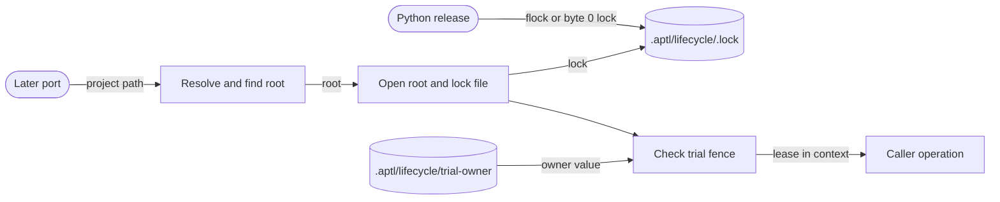

# Issue #1748: Project state and lifecycle locks design

This design ports the `.aptl/` state layout, the lifecycle project root, and
the lifecycle locks to Go. The [#1559 design](issue-1559-go-config-state-keys-design.md)
and ADR-065 apply. The [preflight](issue-1748-project-state-preflight.md)
gives the guardrails. The workspace identity record stays with Go port 09, as
the boundaries of the issue and decision 10 of #1559 state.

## Evidence

| Fact | Source |
| --- | --- |
| The lock file is `.aptl/lifecycle/.lock`. Missing directories get the mode `0700`. POSIX sets the lock file to `0600` through its descriptor. Windows inherits the project ACL. | `core/lifecycle_guard.py`; `utils/_pathsafe_core.py` |
| Ownership comes from the operating system lock. Acquisition does not wait. A conflict raises `LifecycleBusyError`. Another failure raises `LifecycleLockUnavailableError`. | `core/lifecycle_guard.py` |
| The root search resolves the path with `Path.resolve`. It returns the nearest directory, from the path up, that holds `aptl.json`. With no match, it returns the resolved path. | `canonical_lifecycle_project_root` |
| `placement_mutation_lock` locks an exact root with no search. `backends/trial_serving.py` calls it. | Source |
| The mutation lock is reentrant for one thread and for callbacks that inherit its context. A stale context cannot join a later acquisition. Another thread gets busy. | `tests/test_lifecycle_guard.py` |
| A new mutation lock reads `.aptl/lifecycle/trial-owner`, at most 65 bytes, with no link. A value that is not 64 lowercase hexadecimal digits is unavailable. A different owner is busy. | `core/trial_ownership.py` |
| The observation lock is shared and not reentrant. On Windows, `_try_lock` raises an `OSError` with no `errno`, so it reports busy. | `core/lifecycle_guard.py` |
| On Windows, Python opens the root with `FILE_FLAG_OPEN_REPARSE_POINT` and refuses a reparse point. It writes one NUL byte to an empty lock file before the lock. | `core/_lifecycle_windows.py`; `core/lifecycle_guard.py` |
| On POSIX, `Path.resolve` resolves each part from left to right, and `..` goes to the parent of the resolved part. It reads each link and resolves the parts of its target. A missing part stays as written. On Windows it normalizes the path first and uses `GetFinalPathNameByHandle`. It follows a link with a missing target itself. | CPython `posixpath.realpath` and `ntpath.realpath` |
| Since Go 1.23, `filepath.EvalSymlinks` does not resolve a Windows mount point, for example a junction. | Go 1.23 release notes |

## Decisions

1. **One core component.** `internal/projectstate` is the `project-state`
   component of the `core` layer. It uses `configuration` to find
   `aptl.json`, `secure-file` for each path and the root, and `file-lock`
   for the operating system lock. It holds no native handle code.
2. **Layout.** The package names `.aptl`, `.aptl/lifecycle`, the lock file,
   and the trial fence. `OpenProjectRoot` opens a root for the later ports.
   Each later port keeps the location and the mode rule of its own files.
   The package sets no mode on other state.
3. **Root resolution in foundation.** `securefile.Resolve` gives the result of
   `Path.resolve`. On Linux and macOS it ports `posixpath.realpath`: it reads
   each link and resolves the parts of its target. On Windows it normalizes
   the path and reads the final path of the longest part that exists. When
   the system cannot read it, Resolve follows the link chain, as
   `ntpath.realpath` does. It removes the `\\?\` prefix. A missing part stays
   as written in both cases, also in the target of a link.
4. **The root has no link.** `OpenProjectRoot` opens the resolved root as a
   child of its parent through `securefile`. Thus it refuses a link or a
   reparse point at the root. A volume root opens directly. Python on POSIX follows
   a link that replaces the root after the resolution. Go refuses it, as
   Python on Windows does.
5. **Reentrancy through the context.** `Mutate` and `MutatePlacement` give a
   derived `context.Context` to their callback. The context holds a lease for
   the root. A call with that context and the same root adds one reference.
   A call without it opens the file again and gets busy. The lease records
   its release, so a stale context opens the file again. A mutex guards the
   reference count, so a goroutine that gets the context can join safely.
   The last reference unlocks and closes the file. The package holds no
   global state.
6. **Trial fence.** A new mutation lock reads the fence after the operating
   system lock, through the same root. A nested reference does not read it
   again. The fence is read only. The runtime owner of Go port 22 writes it.
7. **Observation.** `Observe` takes a shared lock with no reentrancy and no
   fence check. On Windows the error matches both `ErrBusy` and
   `errors.ErrUnsupported`. Thus callers see the Python category, and the
   cause stays clear.
8. **Windows NUL byte.** On Windows the package writes one NUL byte to an
   empty lock file before the lock, as Python does. Without the byte, a
   Python process writes it while Go holds the lock. That write fails, and
   Python reports unavailable, not busy.
9. **Safe errors.** The text of each refusal is one of the four Python
   texts. The cause stays available to `errors.Is` and `errors.As`, but the
   text holds no path, no native message, and no fence value.

## Data flows and threats

The host file system is the trust boundary. The assets are the lifecycle
ownership and the trial fence.

| Threat | Mitigation | Test |
| --- | --- | --- |
| A Go process and a Python process change one project at the same time. | The same path and lock primitive. | A Python holder makes Go busy, and a Go holder makes Python busy. |
| A link or a junction moves the lock outside the project. | `securefile` refuses each link, also at the root. | A linked `.aptl` is unavailable, and `OpenProjectRoot` refuses a linked root. Windows refuses a junction. |
| A special file blocks the open of the lock. | `securefile` opens without blocking and requires a regular file. | A FIFO or a directory at the lock path is unavailable. |
| Another goroutine joins the mutation without its context. | The lease is only in the derived context. | An unrelated goroutine gets busy. |
| A stale context revives a released lock. | The lease records its release. | A stale context gets busy while another holder runs. |
| A lifecycle change bypasses an unresolved trial. | The fence check runs before the callback. | A different owner is busy, and the callback does not run. |
| A malformed fence counts as absent. | A strict value check. | Malformed, long, and linked fences are unavailable. |
| A dead process keeps the lock. | The operating system releases the lock when the process ends. | A killed holder process releases the lock. |
| An error shows a path or a value. | Fixed refusal texts. | Each refusal text is one of the four Python texts. |
