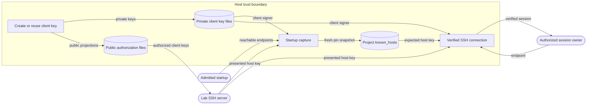

# Issue #1751 SSH design

This design applies the [#1559 design](issue-1559-go-config-state-keys-design.md) to SSH.
[ADR-040](../adrs/adr-040-terminal-ssh-host-key-verification-boundary.md) owns the server trust boundary.
[ADR-029](../adrs/adr-029-control-plane-secret-handling.md) owns secret handling.
The [SSH preflight](issue-1559-config-state-keys-preflight.md#issue-1751-ssh-preflight) identifies the boundary owners.

## Components

| Component | Interface and owner |
| --- | --- |
| `internal/sshkeys` | Generates and reads OpenSSH keys. Writes public authorization files and startup host pins. Reads pins through the project root. |
| `internal/sshstartup` | Collects one completed startup snapshot from admitted endpoints through a caller-supplied probe. |
| `internal/sshclient` | Probes an admitted endpoint during startup. Establishes a verified connection with explicit pins and a client signer. |
| `internal/securefile` | Owns the no-link file access and the owner-only private key publication on Windows, Linux, and macOS. |

Go port 23 (#1574) owns startup order and the lifecycle lease.
It supplies endpoints from the runtime inventory after SSH readiness.
Go port 19 (#1570) owns pack output placement.
Go ports 14, 25, and 28 own the MCP sessions, seat records, and web relay.

## Client keys and authorization files

| Private key | Public comment |
| --- | --- |
| `~/.ssh/aptl_lab_key` | `aptl-local-lab` |
| `config/lab-ssh/kali_pivot_key` | `aptl-kali-pivot` |
| `config/lab-ssh/workstation_pivot_key` | `aptl-workstation-pivot` |

The Go standard library makes Ed25519 keys. The SSH library encodes the private and public halves in OpenSSH format.
The comment is the same in both halves. Each public half has the `.pub` suffix.

Existing pairs keep their identity. An incomplete pair requires recovery.
An internal lock beside the key serializes creation across projects.
The key owner uses the private file handle to check protection before it reads the key.
Target authorization uses the public half that matches the validated host signer.

`keys/aptl_lab_key.pub` and `keys/authorized_keys` hold the control-plane public key.
`keys/target_authorized_keys` adds the Kali pivot public key.
`keys/victim_authorized_keys` also adds the workstation pivot public key.
The pack realization owner supplies its own output names, comments, and approved public-key selections.
The client private keys and authorization files do not contain server trust records.

The private file mode is `0600` on Linux and macOS. The public file mode is `0644`.
On Windows a protected DACL grants the current user read access, with inheritance disabled.
On macOS extended ACL entries make a private key or its staging file unavailable.

Pin and authorization storage requires owner-controlled writes on each platform.
Public files and directories can have macOS ACL entries that grant only read access or deny access.
Unix directory checks retain one descriptor for owner, mode, and ACL verification.

An exclusive temporary handle starts with a protected DACL before the first private byte.
The handle retains the rights to write and publish. The published file has the read-only grant.
Publication never replaces an existing private key. An incomplete pair fails until both halves are available.

## Startup host pins and session trust

Startup captures the server key after a successful authenticated connection.
Each probe has a ten-second budget for TCP connection, SSH handshake, and authentication.
Startup skips capture if the client key is unavailable.

Every completed capture run atomically replaces `.aptl/known_hosts` with the keys it captured.
An unreachable endpoint has no pin in the new file. A completed run with zero captures writes an empty file.
A skipped start step or a failure before replacement leaves the last file in place.
An error after replacement gives a separate durability diagnostic.
A successful later capture can replace a changed server key.

Each generated pin has one literal host token and one SSH public key.
Port 22 uses the bare host token. Other ports use `[host]:port`.

The session adapter reads a pin snapshot through the no-link file boundary before it connects.
It rejects a missing file, malformed entries, an unknown endpoint, or a changed key.
Only startup capture can write pins. The pin limits the host key algorithms for the connection.
The adapter compares the key for the exact dialed host and port before client authentication.

Dial and handshake share a bounded, cancelable context. A successful dial gives the connection to the session owner.

## Data flows

| Threat | Control and evidence |
| --- | --- |
| A server impersonates a lab endpoint. | A loopback SSH peer with an unknown or changed key fails before client authentication. A matching pin succeeds. |
| A bad pin file widens trust. | Literal endpoint and key validation rejects malformed or conflicting entries. Tests cover wrong ports, missing pins, and linked files. |
| An unreachable endpoint retains its pin. | The replacement only includes successful captures. The Python conformance and Go tests cover refresh, partial capture, and empty files. |
| A path redirects a private write or a pin read. | Opened roots and handle-relative operations reject links and reparse points. Tests cover the project state and key files. |
| Inherited permissions expose a new private key. | Linux and macOS use `0600` at creation. Native Windows tests inspect the protected DACL and verify the user's read-only grant. |
| The wrong client key reaches a target. | Projections contain only the selected public halves. Conformance tests verify the order, names, comments, and stable key reuse. |
| A stalled peer or unsafe error crosses the host boundary. | Deadlines close pending connections. Errors report the host and check, and omit raw SSH errors and key material. |

The startup probe trusts the endpoint admitted by the lifecycle owner.
The Go port keeps the existing risk if that endpoint is impersonated during capture.
The session path requires the startup pin and never repairs one.
The architecture model records both components and their dependencies. The existing ADRs and CI rules apply.

## Source records

The Python reference is revision `e79bf10b8`.
The file and startup owners are `src/aptl/core/ssh.py`, `src/aptl/core/host_keys.py`, and `src/aptl/core/lab.py`.
The pack owner is `src/aptl/core/deployment/_ssh_key_bundle.py`.
`tests/test_ssh_conformance.py` records the Python key and restart contracts.
The `ssh-key-fingerprint` vector defines the format for the Ed25519 public key fingerprint.
