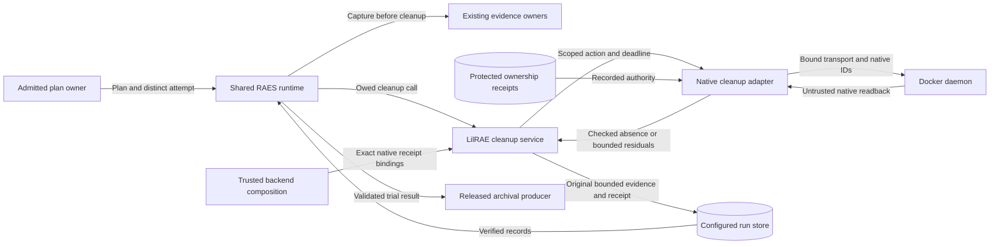

# Declared native cleanup

## Ownership

RAES owns trial progression, cancellation, retries, and the operation ledger.
LilRAE supplies declared cleanup actions and native readback.
Issue #459 composes these services into its trial adapter.
Issue #1417 supplies the experiment entry point.
Neither consumer is a prerequisite for the native cleanup service.

The service accepts the released cleanup plan and a distinct execution attempt.
Trusted composition binds each portable resource to an exact native receipt.
The binding also names the native attempt, workspace, and daemon.
An authored reference cannot create this binding.
The service rejects a changed plan, scope, or attempt before effects.

## Supported behavior

The initial capability supports idempotent `destroy` and `verify` actions.
The `native-absence` probe checks exact receipt-bound resources.
Reset, restore, compensation, custom actions, and reusable-state claims remain unsupported.
Required unsupported actions or probes fail admission before effects.
Native cleanup never deletes host files or anonymous volumes.
Named volumes require their own exact receipt and declared boundary.

The service follows declared dependency order with `graphlib.TopologicalSorter`.
Failed prerequisites prevent dependent effects.
Independent obligations can still run.
Each obligation keeps its authored timeout.
The primary trial outcome remains separate from cleanup status.
Only fresh native absence checks can establish successful destruction.
Missing or unreadable authority never establishes absence.

The native adapter uses existing Docker transport and receipt validation.
It checks ownership before observation and removal.
It removes containers by native ID without an implicit volume flag.
It removes networks and volumes only through their exact bound receipts.
It quiesces recorded creation before destructive work.
Unresolved creation or incomplete descendant coverage prevents destructive work.
The caller must select the complete attempt when quiescing its producers.
The adapter refuses an incomplete attempt selection before effects.

## Evidence and recovery

The runtime calls capture before destroy and declared cleanup.
The native service does not replace that order or collect evidence after removal.
It writes bounded native readback as content-addressed evidence in the configured run store.
It publishes immutable RAES evidence records and cleanup receipts before archival sealing.
The receipt binds the plan, entry, run, execution attempt, and native scope.
Receipt evidence includes residual references and project-qualified recovery commands.
Raw inspect output, daemon errors, credentials, and environment values are excluded.

The runtime ledger retains interrupted operations.
Existing native receipts retain resource authority across process death.
A repeated idempotent cleanup checks native state again.
A prior successful receipt does not authorize a replacement object.
Failed receipts remain immutable.
Recovery produces a separate receipt with new observations.
Publication failure prevents a successful return.
No cleanup service changes a sealed archive.

## Data flows and trust boundaries

The plan boundary protects immutable intent and attempt identity.
The native boundary protects unrelated resources from authored references.
The store boundary protects evidence integrity and sealed archives.
Tests cross each boundary with changed identities and failed observations.
Cancellation never substitutes for observed cessation.
The service adds no listener, credential lookup, external service, or new ledger.

## Architecture and verification

A core protocol separates the RAES adapter from the Docker adapter.
Composition injects the native operation owner, run store, and clocks.
No new mixin, registry, schema, lifecycle loop, or record policy is needed.
The manifest declares only installed cleanup capabilities.
The existing manifest validators and architecture checks remain authoritative.
No new policy-as-code mechanism or ADR is required.
ADR-029, ADR-050, ADR-055, and ADR-064 retain their existing decisions.

Targeted tests cover lifecycle triggers, ordering, failure, interruption, repetition,
foreign resources, stale attempts, changed daemons, evidence publication, and batch receipt validation.
Shared-runtime tests install the cleanup service through released trial-service hooks.
They do not implement a second scheduler.
CI owns complete suites and installed native-lab qualification.

This document describes components and boundaries, not implementation tasks.
The prose uses short sentences and consistent technical terms.
The STE vocabulary review is limited to public guidance; formal certification is not claimed.
