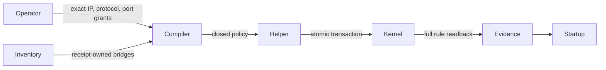

# Native Docker range network policy

Reader purpose: Explanation.
The [source revision `6d35d245f11a`](https://github.com/OpenRAE/lilrae/blob/6d35d245f11a7fffcaac1645cd25ccfafbad4599/docs/architecture/issue-968-native-network-policy.md) preserves the original design cut.
Version-specific examples and qualification statements keep their original scope.
This editorial rewrite does not qualify a provider, approve a VM, or authorize a service.


The native Docker deployment boundary owns a separate `native-range` nftables
policy. Scenario ACLs remain independent. Every admitted bridge is covered before
workloads start; network topology and internal flags remain authored.



Policy blocks host input on range bridges while preserving host-initiated replies. It permits admitted inter-bridge traffic and exact approved external destinations and ports.
IPv6 is subject to the same default deny. A separate authority prevents authored
ACL accepts from overriding the floor. Native Docker must bind direct nodes to
admitted networks at creation, including during provisioning. Builds and image
pulls run through the operator plane; they create no participant network grants.

Applying and observing the policy precedes workload creation. A failure stops
startup. Restart replaces only the owner table, atomically. Cleanup runs only
after owned workloads are absent. Evidence reports applied policy rather than
claiming that native Docker provides VM isolation.

## Operator configuration

Native Docker starts deny external traffic unless the operator adds exact
IP-address grants to `deployment.range_egress_allowances` in `aptl.json`:

```json
{
  "deployment": {
    "range_egress_allowances": [
      {"destination": "192.0.2.53", "protocol": "udp", "port": 53},
      {"destination": "192.0.2.80", "protocol": "tcp", "port": 443}
    ]
  }
}
```

These documentation addresses must be replaced with the operator's actual
resolver and mirror addresses. Hostnames, CIDRs, wildcard destinations and
port ranges are refused. Redirects and DNS results receive no additional grant.
A workload requiring a different exact destination fails normally; LilRAE does
not substitute a mirror or widen the policy. DNS forwarding uses the same
network boundary as other traffic. In-range service discovery remains available.

Native Docker refuses host-root-equivalent socket authorities, privileged
Compose services, host devices and host networking before starting workloads.
These would let participants bypass host firewall policy. Such a scenario needs
an isolated runtime rather than an unrestricted native host socket. VM seat
policy remains independent and this change makes no VM containment claim.

Compose first creates stopped resources, captures ownership, and installs the
policy across all project bridges before starting processes. Direct nodes attach
to an admitted network at creation; they never receive the default bridge as a
provisioning exception. Kernel support is checked before deployment. Apply or
readback failure prevents a successful start; failed Compose preparation rolls
back only the prepared project. Teardown retains filtering until owned networks
and workloads have been removed, then removes only this owner's policy tables.

The execution-boundary report includes `range_egress_policy`,
`range_host_access_policy`, and `range_policy_digest`. The values remain
`unverified` unless the native policy has a verified readback receipt for the
bound daemon. Policy evidence does not establish VM containment.

## Verification

`tests/test_native_range_policy.py` covers input validation, full bridge coverage,
partial apply/readback failure and owned-table replacement. The Docker CI step
runs `tests/test_native_range_policy_integration.py` against disposable bridges.
It proves blocked host access and external traffic, allowed in-range traffic,
exact external TCP/UDP grants, redirects, IPv6, DNS and absent socket authority.
A mutation that keeps a rule's identity but changes its verdict must fail
readback. Repeat apply and cleanup exercise ownership without flushing Docker
or another lab's rules.

The Debian service substrate includes the smoke scenario's declared curl and
OpenSSH packages in its existing build-time package closure. Their runtime
materialization still reads back package and service state; no package download
exception is granted to a participant. Other runtime dependencies require
operator grants or a prepared image containing the exact declared dependency.

## Publications on internal-only nodes

Docker drops effective port publications when a node has only internal networks.
LilRAE reuses its existing byte relay for these TCP or UDP publications. The node
keeps exactly its authored links. The receipt-owned relay joins the target
network and the owned operator-access network, which is covered by the native
policy before the relay starts. A relay receives no credential or Docker socket.

Publication evidence checks the live relay image, process state, target address,
shared network, forwarding configuration and effective Docker port bindings.
Labels alone cannot prove a target. The boot gate also connects through the
exact loopback binding and reads the target service's greeting. Teardown uses ownership receipts for relays, their network, and policy removal. Scenario container-name lists do not supply cleanup authority.
