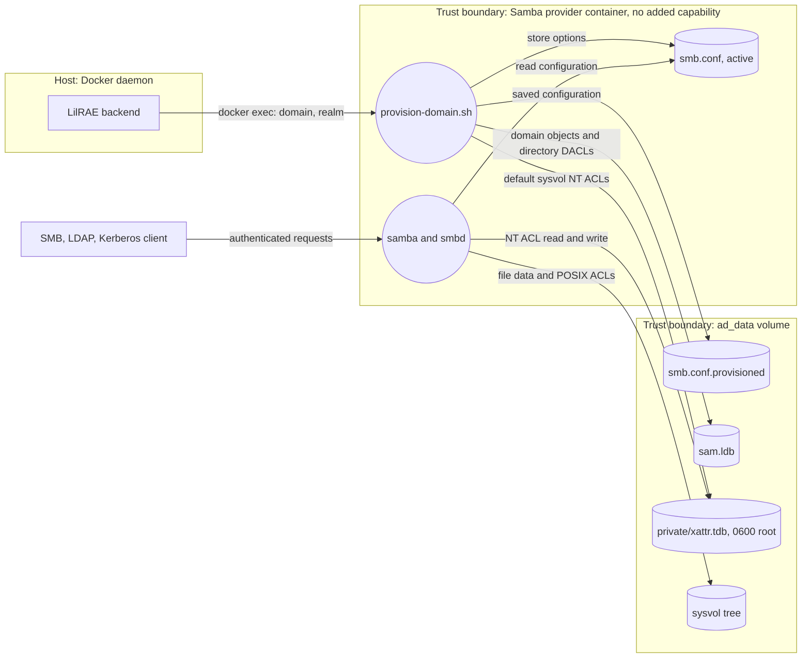

# Issue #976 Samba NT ACL Store Design

Reader purpose: Explanation. Owner: issue #976.
This note records the design that removes the last `SYS_ADMIN` grants.
The [service capability preflight](issue-976-service-capability-preflight.md) sets its constraints.

## Decisions

| Service | Decision |
| --- | --- |
| `reverse` | Issue #1121 retired the workstation and its grant. Falco has no consumer to change. A test keeps the retirement. |
| Samba AD provider | Store NT ACLs in a root-only `xattr_tdb` database. The provider adds no capability. |
| Backend capability allowlist | `_ALLOWED_BACKEND_RUN_CAPABILITIES` is empty. A backend provider cannot select a capability. |

The kernel puts the default `security.NTACL` attribute in the `security.*` namespace.
A write to that namespace needs `CAP_SYS_ADMIN`.
Samba's `xattr_tdb` module keeps extended attributes in a TDB file instead.
Samba's own AD DC test environments use the same VFS stack.
No new ADR is necessary: the store is a provider mechanic inside the existing seam.

## Components

| Component | Contract |
| --- | --- |
| `containers/generic-samba-ad-base/provision-domain.sh` | Defines the store path and options once. Fresh provisioning writes them into the active and saved `smb.conf`. |
| Same script, restart path | Restores the saved `smb.conf`. If `testparm` does not report the store, it converts the volume. |
| Same script, conversion | Copies each Samba-visible kernel xattr into the store unchanged, then adds the options and saves the configuration. |
| Same script, every path | Verifies the store before readiness. A failure stops the provider with the store path in the error. |
| `aptl-samba-acl-store` (`acl-store.py`) | Starts at the SYSVOL share root. `convert` copies the attributes. `verify` requires a root-only store with valid NT ACLs to two directory levels. |
| `provider-start.sh` | Waits for the readiness marker, verifies the configured store, then starts Samba. The marker survives a container restart. |
| `_active_directory_base()` | Selects the Samba image with no `run_capabilities`. |
| `raes_base_substrate.base_container_spec()` | Refuses every backend-selected capability. |
| Substrate attestation | Refuses to reuse a container that still holds the retired grant. |
| `aptl_techvault/log_sources.py` | Adds audit options to `[global]` and keeps all other lines, which include the store options. |

The VFS stack is `dfs_samba4 acl_xattr xattr_tdb`.
`acl_xattr` stays above `xattr_tdb`, so NT ACL reads and writes go to the database.
POSIX ACLs stay in the kernel. Root writes them without an added capability.

## Data flows

The network boundary is between clients and Samba.
Clients reach only shares, LDAP, and Kerberos. The TDB is outside every share.

## Security analysis

| Threat | Control | Verification |
| --- | --- | --- |
| A process in the container uses `CAP_SYS_ADMIN` against the host kernel. | The provider adds no capability. Docker defaults, seccomp, and AppArmor stay in force. | PID 1 `CapEff` excludes bit 21. The rendered `docker run` has no `--cap-add`. |
| A stale pre-#976 container keeps the grant. | Attestation compares the capability set before reuse. | Attestation and reuse tests refuse `SYS_ADMIN`. |
| A file owner rewrites an NT ACL locally. | The TDB is root-owned with mode `0600` in the `0700` private directory. | The integration test reads the mode and finds no `NTACL` kernel attribute. |
| A client changes an ACL outside Samba's checks. | The TDB is outside every share. Samba applies NT ACL checks to each request. | An ordinary user cannot write to sysvol. A Domain Admins member can. |
| Conversion loses a custom restrictive ACL. | Conversion copies the old descriptor bytes. A kernel `security.*` read needs no capability. | A custom ACL keeps its SDDL. The ordinary user stays denied. |
| A missing or damaged store reaches readiness. | `verify` runs before the readiness marker and before each Samba start. | Removed and corrupt stores stop provisioning and stop a restarted container. |

`user.NTACL` was measured and rejected.
Samba warns that local users can overwrite that attribute.

Residual risks:

- `xattr_tdb` keys entries by device and inode. A copy to another filesystem loses the NT ACLs. `verify` then stops the provider. Run `samba-tool ntacl sysvolreset` to write the default ACLs.
- Conversion leaves the old kernel attributes in place. Samba no longer reads them.
- Root in the container can change the TDB. Root can also change `sam.ldb`, so this adds no authority.

## Scenario behavior

The TechVault `ad` node plants a weak `Administrator` password and an over-privileged Domain Admins member.
Directory DACLs and group memberships live in `sam.ldb`. The store change does not touch them.
The pack plants no file ACL on the domain controller.
The integration test checks the group effect on sysvol with an ordinary user and a Domain Admins member.

The pack authors no capability for `ad`. The provider never added `NET_ADMIN`.
This change keeps that state. A scenario that needs `NET_ADMIN` must author it.

## Verification

`tests/test_compose_capability_necessity.py` runs on a real Docker daemon:

- The kernel measurement: a `security.*` write fails without `SYS_ADMIN`.
- The bare and Wazuh Samba images provision without `SYS_ADMIN`.
- `sysvolcheck`, winbind, Kerberos, LDAP, and sysvol allow and deny checks pass.
- A recreated container keeps the same NT ACLs and the same enforcement.
- A volume provisioned the old way converts once and stays converted. Custom ACLs on the share root and below keep their SDDL.
- A removed or corrupt store stops provisioning in a new container and stops Samba in a restarted container.

The python-qualification CI job builds both Samba images and runs these tests.
