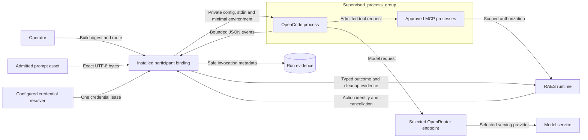

# Managed OpenCode participants

## Contracts

The existing RAES participant runtime owns admission, ordering, action history, and trial settlement.
An installed binding selects one executor for each participant.
OpenCode does not receive the deployment manager or a peer's credentials.
The executor uses `BoundedProcessRunner` and the existing verified MCP tool session.
The host process boundary is supervision, not an operating-system sandbox.
It cannot prove cleanup of remote work or escaped descendants.

An OpenCode build has a version and an executable SHA-256 digest.
The executor checks this digest before every invocation.
The supported Linux x64 baseline build is OpenCode 1.19.5.
Its release archive digest is `17c200fd4b2289954cc01552559f9b6d03ec157b2ddfb5eb54144f491656333d`.
Its executable digest is `7df4e4136301f16589b0f30bf91a61380fca5f8ef22dd36570f5ebe1d4ec802c`.
An alternate build needs an explicit version and executable digest plus separate qualification.
The adapter version remains distinct from the OpenCode build and model identity.

The route declares an endpoint, requested model, and serving provider.
The provider configuration enables only OpenRouter and the selected model.
The request specifies one serving provider and disables fallbacks.
The admitted configuration also sets an output-token limit.
The launcher supplies a fixed session title to avoid an auxiliary title-generation request.
The pinned launcher receives that limit through its supported output-token environment control.
Real transport tests verify the emitted request limit.
Provider-owned request options form a closed interface for trial configuration.
Experiment repositories own model catalogs, prompt assets, and scientific factor values.
Provider metadata does not prove which upstream model actually served a request.

## Data and authority

The operator approves the external endpoint and prompt disclosure before live execution.
Credentials come from an explicit source through the existing resolver and ephemeral broker.
The source is selected by the installed project's configuration, not a repository checkout path.
The operator supplies the process environment through the approved launcher or credential mechanism.
The executable and private work root are explicit installed-host inputs.
Credentials never enter command arguments, public metadata, or error messages.
The child receives a fresh private HOME, XDG directories, and working directory.
The generated configuration denies built-in tools and enables only the admitted MCP inventory.
Project configuration, external skills, ambient plugins, sharing, updates, and catalog downloads are disabled.
Observed trials load one digest-pinned repository-owned observer plugin, with npm offline mode and private configuration.
Its provider-fetch wrapper validates serialized controls before forwarding and retains safe request/response metadata.
A failed observer load leaves the provider URL and credential unusable.
The participant cannot authorize a new tool by returning text.
Fresh contexts prevent history reuse across trials.

| Threat | Control | Verification |
| --- | --- | --- |
| Replaced executable | Check pinned digest before dispatch | Changed executable fails before runner invocation |
| Wrong route or fallback | Explicit endpoint, provider allowlist, model whitelist, fallback denial | Real launcher request against a fake provider |
| Ambient authority | Fresh config and environment, default tool denial | Hostile ambient config and unknown tool tests |
| Credential disclosure | Explicit resolver, minimal lease, safe evidence fields | Secret marker absent from argv, metadata, and errors |
| Partial execution loss | Retain bounded metadata and cleanup proof on failure | Provider error, malformed output, timeout, and cancellation tests |
| Cross-trial state | New private process context per invocation | Independent red/blue and consecutive-trial tests |

## Evidence and release

Invocation evidence records build identity, route, prompt commitment, status, output counts, and observed usage.
The executor also reduces its private native session database before directory teardown.
This observation checks the recorded user prompt and selected model against the admitted inputs.
It records native session, message and step identifiers, timing and separate token categories.
Native cost is an estimate; it does not establish provider billing.
The Linux reader uses contained no-follow file access and read-only immutable SQLite queries.
It refuses an uncheckpointed database rather than treating an incomplete snapshot as complete.
Native data is reduced to allowlisted metadata without retaining chat, reasoning text or tool capabilities.
Missing or invalid history has an explicit status.
The sealed-trial factory requires a valid native delivery observation after a successful invocation.
An observed model or prompt mismatch fails the invocation.
Outgoing control values, provider generation identifiers and upstream serving claims remain unavailable from this native source.
Transport qualification checks request construction independently of native session observations.
The process runner retains a SHA-256 commitment to captured stdout when a limit stops an invocation.
The adapter retains this commitment even when no complete response is available.
It captures the process failure before private-directory teardown can replace that exception.
On supervised failure, the process runner can supply bounded captured stdout to a private observer after cleanup.
The observer belongs to one process request and is supplied separately to the shared supervisor.
Ordinary process callers retain the existing runner interface.
The provider reduces those bytes to session, usage, finish, and commitment metadata.
Raw bytes never enter the public process error record or the retained invocation evidence.
Raw provider output remains untrusted and is excluded from public diagnostics.
Unavailable served-model or generation metadata remains unknown.
Cleanup evidence states only the guarantees supplied by the process runner.
The invocation evidence boundary includes closing the MCP authority transport.
Transport teardown failure reports a failed invocation and uncertain transport cleanup.
It retains safe partial model evidence and does not claim overall success.
RAES retains an indeterminate operation when cleanup proof is incomplete.
Issue #1504 ends at PR merge after candidate verification and review.
Candidate verification covers installed-package transport, both roles through RAES, and the approved GCP smoke.
Installed action tests run outside the checkout with the pinned launcher, MCP SDK, and common admission carrier.
Deterministic native counters prove admitted dispatch and denial without contacting a range or external model.
Hostile parent configuration, plugins, saved credentials, and history use local canaries.
The tests require accepted tool history for both roles and no denied native effects.
The operator limits the current live check to a free-model smoke invocation.
This check must use a small token cap and short process deadline.
It does not qualify the experiment's paid model route or complete an experimental trial.
Full suites remain CI/CD operations.
Release publication and scientific control qualification occur downstream of this issue.

## References

- [OpenCode 1.19.5 release](https://github.com/anomalyco/opencode/releases/tag/v1.19.5): build assets and checksums.
- [OpenCode CLI](https://opencode.ai/docs/cli/): run, JSON events, stdin, and environment controls.
- [OpenCode configuration](https://opencode.ai/docs/config/): precedence and enabled providers.
- [OpenCode providers](https://opencode.ai/docs/providers/): base URL and OpenRouter serving-provider selection.
- [OpenCode permissions](https://opencode.ai/docs/permissions/): default denial and named MCP tool permissions.
- [Concurrent participant execution](concurrent-participant-execution.md): RAES ownership, process limits, and trial settlement.

This design extends the existing participant and process contracts.
The managed entry assembly groups admitted model, prompt, and manifest inputs in one immutable request.
The [trial factory](trial-participant-configuration.md) prepares both roles from sealed results and independently retained scope.
It verifies the pinned authoring input before reading its episode bound.
It carries the retained attempt deadline into UTC and monotonic supervision without restarting its allowance.
The native generation-step ceiling remains distinct from RAES logical steps, action attempts and provider retries.
The ceiling comes from the sealed profile's explicit `assistant_turn_limit`.
The trial-serving application keeps the original attempt deadline and retains leases while the RAE unit reports a pending attempt.
The runtime owner supplies cancellation and draining before credential contexts close.
Event helpers validate text, terminal state, and bounded usage separately, then reduce them to one evidence record.
It introduces no new scheduler, policy engine, containment mechanism, or architecture decision.
