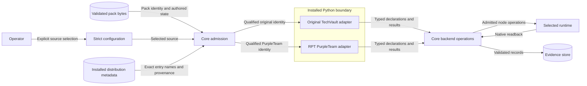

# Pack boundary

LilRAE keeps its original TechVault adapter.
RPT maintains an independent copy for its PurpleTeam scenario family.
The two packages can change and release independently.
RPT issue #15 owns its copy and delivery PR.

## Components and interfaces

Core owns configuration, source admission, installed-provider discovery, lifecycle order, backend effects, and evidence storage.
Purpose-specific `aptl.*` entry points select installed providers for exact admitted identities.
The original provider package remains `aptl_techvault`.
The RPT distribution uses `rpt-techvault-adapter` and package `rpt_techvault`.
RPT entry names select `techvault-purpleteam`, not the original pack or participant-study pack.
The copy imports public LilRAE contracts and its own modules.
RPT capture IDs use `rpt.collector.*` so evidence payload selectors remain distinct.
It does not import the original adapter package.
Each distribution retains its own source lineage, dependency range, release version, and qualification claims.
Changed pack bytes require an explicit qualification update.
A copied implementation alone does not qualify future experiment variations or capture requirements.

Configuration has no implicit scenario identity.
Initialization can create an unselected workspace.
Admission requires an explicit source before backend effects.
Container settings contain bounded profile selection rather than topology booleans.
An explicit migration preserves existing settings and rejects ambiguous conversion.
The existing lifecycle owner lock covers reading, backup, and replacement.
Loading configuration never rewrites it.

Startup and doctor use the selected provider's validated host demand.
A missing kernel demand performs no kernel probe.
Kernel demand applies independently of optional host-tool checks.
Compose version checks derive from rendered features.
Image preflight inspects the same rendered override before artifact and image operations.
No product name or pack name determines a generic version check.

## Security and failure behavior

Installed adapters are trusted Python code.
Pack content cannot choose executable imports or install packages.
Core filters entry names before loading and rejects ambiguous compatible providers.
Atomic pack identity and family qualification prevent accidental cross-release admission.
The RPT copy cannot claim original pack selectors.
Public operations retain node ownership, bounded commands, credential grants, and output containment.
Adapter failures retain the existing bounded error envelopes.
Migration validates original JSON before replacement and preserves recoverable original bytes.
No migration runs as a side effect of a read.
Unknown settings and malformed capability values fail before mutation.
Original and RPT adapter tests run against installed metadata and built distributions.
Fixture startup must avoid importing or selecting an unrelated adapter.
Live qualification remains separate from import and packaging evidence.

## Data flow

Pack files and installed Python have different trust boundaries.
Credentials enter only through existing declared grants.
Evidence storage receives validated results and safe provider provenance.
No new evidence store, network service, or runtime installer is introduced.

## Policy and executable architecture

The existing owner-derived boundary checker remains the policy owner.
It checks all generic source paths and derives identifiers from adapter ownership metadata.
Specific retained compatibility references require file and symbol ownership entries.
Exceptions cannot cover whole directories or hide new identifiers.
Existing protocols and typed DTOs remain the executable architecture.
The new RPT package has its own build metadata and import boundary checks.
No new plugin registry or catch-all adapter interface is introduced.
Compose assets lose undriven mail and reverse services.
Existing deployment ownership and effective-model checks continue to validate rendered services.

## Decisions and references

ADR-025 retains strict configuration validation.
ADR-053 retains data-only serving and installed adapter separation.
Bundling the original adapter remains the existing distribution choice.
This work does not remove that adapter or transfer its maintenance to RPT.
The public family adapter contract supplies independent release and trial admission rules.
The ownership ledger in the #1121 preflight identifies the existing mechanisms and migration boundaries.

- PyPA entry-point specification: group, name, object reference, and conflict handling.
  https://packaging.python.org/en/latest/specifications/entry-points/
- PyPA plugin discovery pattern: installed distribution metadata and separate plugin packages.
  https://packaging.python.org/en/latest/guides/creating-and-discovering-plugins/
- Python 3.12 metadata API: installed provider provenance.
  https://docs.python.org/3.12/library/importlib.metadata.html
- Pydantic v2 validators: strict configuration and explicit conversion boundaries.
  https://docs.pydantic.dev/latest/concepts/validators/
- Docker Compose merge rules: feature-specific override version requirements.
  https://docs.docker.com/reference/compose-file/merge/

## Document review

This document describes ownership, interfaces, data flows, and failure behavior.
Implementation tasks belong in the issue plans.
The review uses short sentences and consistent technical names.
The official ASD-STE100 PDF returned HTTP 403 during reference access.
Full standard compliance is not claimed from a general prose check.

## Retained compatibility ownership

The ownership ledger records exact existing source occurrences and their permitted counts.
It also identifies implementation modules owned by a family and retained at historical import paths.
New dependencies on those modules fail the same owner-derived policy check.
An adapter-free start cannot load those implementations.
The clean installed-wheel lifecycle uses an import guard derived from the same ownership paths.
The guard runs the actual public CLI and does not replace backend results with test successes.
Crypto producer identifiers remain closed backend compatibility contracts for existing authored profiles.
No new shared producer interface is promoted merely because RPT copied the original family.
