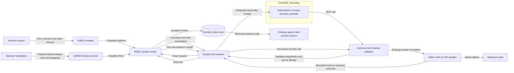

# Participant action enforcement

Status: implementation design for #1418, under ADR-065.

## Purpose and ownership

RAE describes scenario meaning at the author's chosen level of detail.
LilRAE resolves installed implementations without requiring machine recipes in every scenario.
The [research assessment](participant-tool-admission.md) supplies the rationale and alternatives.

RAES owns participant identity, admission, lifecycle, accepted history, and scheduler state.
LilRAE owns installed tool mappings, transport authentication, native execution, and cleanup.
The existing experiment owner controls collection and final archival.
Tool results do not establish experiment success or authorize collection.

Participant, controller, role, caller, and process are separate identities.
A human-directed controller can operate an authored participant through the same tool session as an automated controller.
An ordinary guest connection has transport authority only.
It gains participant authority only through an explicit management-owned runtime binding.
An operator connection must never acquire a fabricated participant identity from its role.

## Executable architecture

The architecture has two executable views.
The component view assigns semantic owners and allowed dependencies.
The action view defines permitted transitions and effect invariants.
The core owns the action model and shared contracts.
The RAES adapter package owns the session and local carrier.
Controllers receive core interfaces.
The new packages and shared result/error owners are enrolled in the ADR-064 layer check.
That check follows indirect imports and checks cycles, private imports, and Python conventions.
The stricter component check also prevents a second runtime owner or native process execution in the session.

The action view is a finite labelled transition model.
It extends the approach used by RAE's participant-crossing models.
It does not copy their equivalence claim or redefine participant-crossing semantics.
Its states distinguish proposed, admitted, dispatched, completed, withheld, and indeterminate work.
History commitment is separate from native completion.
Cancellation before dispatch withholds work.
Cancellation or connection loss after dispatch cannot establish rollback or successful completion.

An exhaustive exploration checks the finite model for two independent calls.
Negative mutations expose bypass, duplicate effects, and false completion.
Generated traces exercise the real adapter against the abstract invariants.
Independent integration checks count native effects and inspect accepted RAES histories.
Passing the model alone does not establish runtime conformance.

| Rule | Executable boundary |
| --- | --- |
| Only RAES grants action authority | Adapter calls the issued port; component checks prohibit a second manager in tool transport code. |
| Each effect needs one exact grant | Native dispatch follows successful admission and one-use dispatch. |
| Role is not participant identity | Installed bindings use participant and invocation coordinates from the port. |
| Tool names do not define action semantics | Trusted mappings bind server, tool, arguments, authored affordance, action, boundary, and targets. |
| Changed arguments need fresh admission | The local request commitment includes the complete argument value. |
| Unknown effects cannot be replayed | Connection failure reports unknown; neither transport nor adapter retries native calls. |
| Peer history survives failure | Real-scheduler checks reverse completion and one failing participant. |
| Capture is independently selected | Admission stores operational state only; collection remains with existing capture owners. |
| Unsupported composition has no effects | Planning and port checks refuse unsupported combinations. |

The model reads compiled relations and installed offers.
It introduces no second scenario language or mandatory external policy service.
Native mappings are backend configuration, not new required SDL author detail.

## Installed mappings and controllers

An installed tool binding names one server and tool, an affordance, an action, a boundary, and an execution offer.
It binds the complete compiled action specification and effective server configuration by canonical digest.
The server detaches that configuration once and uses it for both admission and native execution.
A trusted argument matcher selects the binding for the complete validated call.
Zero matches and multiple matches are refusals.
The matcher cannot dispatch work or choose authority outside its declared relation.
Different argument meanings require different admitted bindings.
A broad shell contract may declare broad effects; the adapter must not invent narrower effects from command text.

Each invocation receives its own RAES port and cancellation signal.
The native executor receives a tool session only for that invocation.
Existing executors without tools retain their current call interface.
Executors with tools must implement the explicit tool-session interface.
The same interface accepts automated harnesses and management-owned interactive controllers.
Controller choice does not change the authored participant's identity.

The current RAES hosted-tool composition supports v1 autonomous execution.
The locked dependency pair is RAES 10.2.0 and environment packs 7.0.0.
The supported ranges are RAES `>=10.2.0,<11` and packs `>=7.0.0,<8`.
This retains the integration branch's TheHive/Cortex removal under ADR-063.
Tool-action support requires the newer RAES lower bound.
The bounded-participant authored freeze is unchanged.
Comparing its RAES 9.1 and 10.2 artifacts found 199 removed empty fields and no other value changes.
The integration branch already accepts that compiled digest in its bounded-agency freeze.
The source approval digest and exact-match guard remain.
Here, autonomous execution is the enclosing authored invocation lifecycle.
It does not require every decision within that invocation to come from a model.
It does not authorize relabelling arbitrary guest sessions as autonomous participants.

Installed crossing mediation, resource-governed v3 policies, and shared-time-bound tool actions remain unsupported by the released port.
The adapter refuses these combinations before dispatch and preserves their diagnostic distinctions.
Finite abstract participants and existing bounded action paths do not require tools or this composition.
Mixed-backend claims require their own admitted mappings and time semantics.
The adapter does not infer equivalence from a shared transport.

## Data flow and transport

The Python session supports direct in-process calls and a private local socket carrier.
The socket connects existing Node MCP processes to the invocation port.
It is not a required RAE topology or a participant isolation boundary.
Compared with a new proxy process, the common handler keeps schema validation beside native dispatch.
Compared with a remote service, local IPC adds no listener outside the host.

Each server receives a fresh capability token through the existing private launch environment.
The token selects a server within one invocation; it cannot select another participant or episode.
The peer sends no participant coordinates or runtime-issued action identities.
One connection carries one proposed call, dispatch permission, bounded result, and outcome receipt.
The connection binds completion to that call.
Frames, concurrent connections, retained request identities, and execution time are bounded.
Tokens, arguments, and raw results never enter diagnostics or portable history.
The session reuses the existing MCP result redactor before delivery.
Typed terminal handles remain usable; API authentication values remain redacted.

The common MCP server validates arguments before contacting the port.
It invokes the existing handler only after dispatch permission.
It returns success only after the typed outcome receipt is accepted.
Unclassified native exceptions, timeout, lost connections, and uncertain cleanup report unknown effects.
Native owners identify known validation failures and fully observed unsuccessful results without parsing error text.
Common handlers preserve that distinction in a call-local outcome context.
An error payload alone cannot establish that native effects have stopped.
An explicit unsuccessful handler result is a failed outcome, not a transport failure.
The best-effort telemetry hook cannot grant admission or commit history.

Transport expiry interrupts the pending native wait and aborts HTTP requests through their existing signal support.
It also requests the server's existing SSH cleanup.
The response waits at most one further second for cleanup; expiry never proves remote cessation.
Pending SSH connection setup checks cancellation before it can dispatch late work.
The outer invocation retains its existing drain and cleanup obligations.

The same carrier can be installed in the existing guest relay launch by its management owner.
Existing guest authentication, revocation, inventory, and cleanup checks remain effective.
The carrier adds participant admission; it does not replace those checks.
An unbound operator relay retains its existing contract and makes no participant-history claim.
The bound relay response deadline includes the admitted action duration and time for its receipt and cleanup.

## Security and failure boundaries

| Threat | Control | Verification |
| --- | --- | --- |
| Foreign or stale invocation | Runtime-issued port, fresh server tokens, exact coordinates, closed-session refusal | Wrong server, stale port, closed session, and same-role participant tests |
| Native bypass | Common pre-handler enforcement and explicit tool-executor contract | Refusal produces zero SSH/API effects; missing tool session refuses launch |
| Argument or target substitution | Detached call and configuration; exact installed digests | Changed arguments, duplicate IDs, and changed endpoints cannot execute |
| Replay after uncertain effects | Single dispatch, no transport retry, RAES indeterminate settlement | Disconnect and late-completion traces |
| False cleanup claim | Cancellation closes admission; uncertain active work remains unknown | Cancellation before and after dispatch |
| Secret leakage | Fixed errors, private tokens, existing redaction, no raw portable payloads | Credential canaries, including capture opt-out |
| Capability overstatement | Compiled relation and execution-offer checks; unsupported-combination cases | Real runtime refuses unsupported combinations before effects |
| Scope or history conflation | Participant-keyed sessions and authoritative settled snapshot | Reverse completion, repeated roles, and peer failure |

The management process and installed native adapters remain trusted.
A malicious process with the same host credentials can bypass local IPC.
This design does not claim host containment from file permissions, tokens, or process supervision.
Existing appliance and lab containment profiles retain their own qualification requirements.
The local socket carrier requires POSIX ownership and permissions.
Other platforms can import the CLI and core contracts, but cannot launch this carrier.

## Research and qualification surface

The eleven assessment workflows have different qualification boundaries.
This table separates checked behavior from broader research claims.
An unsupported case passing a refusal check does not implement that composition.

| Assessment case | Delivered check and limit |
| --- | --- |
| 1. Abstract finite participants | The model has no machine, MCP, or capture dependency. Existing finite participant paths retain their own admission. No new abstract-language semantics are claimed. |
| 2. Backend-selected environment | `test_lilrae_composed_participants.py` preserves parameterized package and account realization without prebaked images. |
| 3. Repeated role | `test_lilrae_tool_model_fuzz.py` exercises two independent red participant sessions and verifies authority coordinates. |
| 4. Approval, handoff, cancellation | The controller retains the scoped session; model traces and cancellation tests check stopped and late work. Automated approval-policy selection and portable controller handoff are not advertised capabilities. |
| 5. Human direction and operator access | `test_mcp_relay.py` checks explicitly bound and unbound relays, inventory, revocation, and cleanup. An ordinary guest does not become a participant automatically. |
| 6. Polymorphic tools | `test_lilrae_participant_tools.py` selects distinct actions from complete arguments and refuses unmatched targets. |
| 7. Concurrent red/blue | `test_lilrae_tool_runtime.py` checks reverse completion and unknown effects with retained peer history. `test_lilrae_mcp_runtime_integration.py` uses real SDK clients and common SSH/API handlers. |
| 8. Adversarial influence | Common-server tests preserve admitted scenario command bytes. Binding refusal prevents unselected calls. This does not claim semantic interpretation of arbitrary shell programs or crossing-policy support. |
| 9. Disconnect and restart | Socket and generated tests retain unknown effects and refuse replay or late completion. RAES owns durable recovery; this carrier does not promise process-resumable sessions. |
| 10. Mixed realization | `test_lilrae_tool_composition.py` checks distinct released-port refusals for crossing, resource-governed, and shared-time compositions. No general simulation/emulation equivalence is claimed. |
| 11. Capture choice | Tool histories require no experiment collector. Redaction tests remain effective with capture redaction opt-out set. Existing workload tests retain evaluator and archival ownership. |

Run the enrolled layer check with `python tools/check_architecture.py` in the project environment.
Run the component check with `python tools/check_lilrae_participant_architecture.py` in the project environment.
Run the finite model with `bash tools/run-targeted-tests.sh tests/test_lilrae_participant_action_model.py`.
Run generated traces with `bash tools/run-targeted-tests.sh tests/test_lilrae_tool_model_fuzz.py -m fuzz`.
Run the runtime and carrier tests by their explicit paths in the table.
The ordinary CI tests run the component and finite-model checks.
The fuzz job runs generated traces; the MCP integration job runs the cross-language check.

Model exploration checks only its declared finite state space.
Generated tests provide additional implementation evidence, not an unbounded proof.
Deterministic native substitutes do not establish installed lab or provider qualification.
CI retains common MCP consumer checks and installed-lab qualification.

## Sources

- [RAES hosted tool actions, v10.2.0](https://github.com/OpenRAE/rae/blob/v10.2.0/docs/public/guides/invocation-tool-actions.md): port ownership and refusal boundaries.
- [RAE finite models, v10.2.0](https://github.com/OpenRAE/rae/blob/v10.2.0/implementations/formal/participant_crossing/README.md): bounded checks, negative corpus, and runtime mapping distinctions.
- [Hypothesis stateful testing](https://hypothesis.readthedocs.io/en/latest/stateful.html): generated action sequences and invariants.
- [Inspect tool approval](https://inspect.aisi.org.uk/approval.html): separate proposal, approval, and execution, including explicit remote-tool limits.
- [MCP tools, 2025-11-25](https://modelcontextprotocol.io/specification/2025-11-25/server/tools): input validation and protocol versus tool failure.
