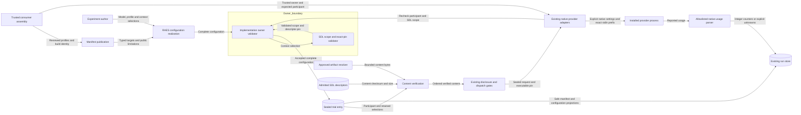

# Participant request manifests

## Ownership and interfaces

Installed Claude Code, Codex and OpenCode implementations publish the RAES participant manifest contract.
The public entry point is `aptl.core.participant_requests`.
RAES owns target declarations, configuration results, canonical digests and sealed trial entries.
LilRAE owns native request support and the complete configuration validator.
The consumer owns model catalogs, reviewed request profiles, participant addresses, role names and prompt assets.

Each publication contains one implementation identity and a separate executable build identity.
It declares compatibility with the installed RAES contracts.
Its configuration registry exposes the existing model target, a request profile target and typed control-context targets.
OpenCode retains `model`; decision implementations retain `model.identifier`.
Each control-context target has an author-supplied slot and finite exact asset references.
Manifests depend on supported domains, not the selected treatment or participant role.

An implementation-owned profile schema defines the supported request vocabulary.
It does not replace a RAES configuration schema.
Every profile has an exact version, review reference and content digest.
The realized configuration includes its digest as a required target.
The manifest also commits the complete profile definitions.
Changing profile content therefore changes both identities.
Profiles contain no executable options, credentials, environment maps or prompt text.

Profiles explicitly select gateway, requested serving provider, no-fallback policy, reasoning, sampling, seed disposition, generation limit and usage policy.
Required omissions are explicit null values with a declared reason.
Unsupported and locked controls remain public constraints.
Reasoning effort and budget are distinct modes.
Only reviewed combinations in the trusted catalog pass validation.
Claude Code and Codex do not expose sampling or seed controls through these adapters.
Their generation limits remain provider-managed and explicitly uncontrolled.
OpenCode supports a bounded generation request limit with a declared scope and reviewed sampling settings.
Its seed control remains unsupported until native transport support is qualified.
Profile selection also specifies instruction placement and slot order.

## Admission and content

The owner validator checks the complete target set, manifest identity, model domain and exact profile commitment.
It composes the existing SDL control-context validator.
The SDL validator checks exact versions, descriptor digests, participant scope and slot conflicts.
Its `for_scenario()` hook validates each instantiated trial independently.
The older experiment admission path receives the trusted validator through `ParticipantManifestBinding`.
That path refuses participant configuration when the validator is absent.
It checks the canonical manifest digest independently of the acquired file checksum.
Validators never load executable code from authored names.

Content verification accepts already resolved bytes and the sealed configuration result.
The consumer supplies those bytes through its approved artifact resolver.
Verification checks the result digest, manifest, participant, exact retained asset pin, content checksum, byte count and UTF-8 encoding.
No content URI triggers a network or filesystem read.
The returned content follows the declared slot order without newline conversion or an implicit template.
Request preparation snapshots the sealed result before content verification.
Selection and verified content do not establish live disclosure authority or actual delivery.
The existing ACT-620 and runtime gates retain those responsibilities.
The owner creates an immutable verified request after content verification.
Existing managed adapters consume that request through their sealed launch inputs.
The request binds the profile, participant configuration, prompt bytes and executable pin.
It retains the ordered content and exact selected descriptors.
Reconstruction checks asset pins, content checksums and prompt composition before dispatch.
Native launch inputs separately bind the expected participant address and trusted owner validator.
Reconstructed data cannot replace that binding.
Dispatch rechecks the trusted manifest, participant address and SDL scope before process work.
Adapters check that pin before native work and preserve minimal environments.
Claude Code restricts available models and disables fallback in explicit settings.
Codex locks its model provider and reasoning setting through native configuration arguments.
Its named provider uses the admitted OpenAI endpoint and the isolated credential key.
OpenCode applies its admitted provider restriction, generation limit, reasoning and sampling through its native configuration.
Required omissions remain omissions in native request construction.
Issue #1420 owns automatic trial-start assembly and broader actual-request evidence.
Legacy configurations retain their existing delivery checks.

## Identity and limitations

A model alias is a requested identifier.
Neither its spelling nor a date suffix proves an immutable snapshot.
An admitted model does not prove account access.
The requested route does not attest the actual serving provider.
Unavailable served identity, usage or generation metadata remains unknown.
The public manifest retains these limitations before selection.
Seed requests cannot establish deterministic output.
The selected asset commitment covers authored content only.
Harness instructions, tool schemas, auxiliary calls and provider context remain separate effective-request concerns.
OpenCode's internal retries and process-supervision limits remain documented limitations.

## Data flow and trust boundaries

## Security and verification

| Threat and boundary | Control | Verification |
| --- | --- | --- |
| Unsupported model or coupled settings | Finite trusted profiles; strict types and provider checks | Unknown model, profile, omission and cross-model rejection |
| Scalar validation bypasses owner | Required injected validator | Legacy admission rejects an absent owner |
| Stale or peer prompt | SDL scope validation; exact descriptor and content commitments | Wrong scope, stale pin, changed bytes and swapped participant rejection |
| Mutable profile alias | Exact profile version and digest in configuration and manifest | Changed profile content invalidates the old commitment |
| Ambient defaults or wider authority | Closed profile vocabulary; explicit omissions and locked settings | Unknown fields and unsupported requested controls fail |
| Credential leak or corrupted immutable record | Shared redaction; narrow typed numeric and target-declaration handling | Public manifests survive create-once storage; secret-shaped replacements remain redacted |
| False execution claim | Explicit identity, context and transport limitations | Installed contract round trips retain limitations |

The publication path adds no listener, credential access, process or remote fetch.
Claude and Codex usage stays on each launch handle.
The launch retains its injected run store for typed counters and fixed request identity fields through existing structured storage.
The browser workbench supplies its existing store.
Absent or invalid counters stay null, and each response replaces the previous observation.
Existing authentication, artifact containment, credential isolation, tool admission and process cleanup remain required at their existing boundaries.
Policy-as-code uses closed profiles, native RAES validation and shared redaction.
Architecture-as-code uses ADR-064's module map and the existing participant architecture model.
No new deployment, scheduling, containment or authority plane is needed.
ADR-047, ADR-052, ADR-064 and ADR-065 continue to govern these boundaries.
The issue-862 non-goal is superseded only for admitted model and context factors.

The MCP consumer uses patched development tools for verification.
Its minimatch override supplies the security fix while parent packages retain older dependency ranges.
Focused ESLint, TypeScript and consumer tests check compatibility.
CI retains dependency auditing and full consumer rebuilds.

## References

- [RAE experiment bindings](https://github.com/OpenRAE/rae/blob/dev/docs/explain/reference/experiment-binding-contracts.md), RAES 10.6.0: target registries and complete configuration realization.
- [RAE control context](https://github.com/OpenRAE/rae/blob/dev/specs/sdl/participant-control-context.md), RAES 10.6.0: exact pins, scope and owner hooks.
- [Codex configuration](https://developers.openai.com/codex/config-reference/), consulted 2026-11-02: model selection and reasoning effort.
- [Claude Code CLI](https://code.claude.com/docs/en/cli-reference), consulted 2026-11-02: model, effort and fallback controls.
- [OpenCode models](https://opencode.ai/docs/models/), OpenCode 1.19.5 baseline: model options and variants.
- [OpenCode request construction](https://github.com/anomalyco/opencode/blob/v1.19.5/packages/opencode/src/session/llm/request.ts), version 1.19.5: native sampling and provider options.
- [OpenCode provider transforms](https://github.com/anomalyco/opencode/blob/v1.19.5/packages/opencode/src/provider/transform.ts), version 1.19.5: OpenRouter reasoning and generation limits.
- [Managed OpenCode](managed-opencode.md): pinned native build, transport evidence and isolation.
- [RFC 8785](https://www.rfc-editor.org/rfc/rfc8785), sections 3.2 and 5: canonical commitments and security limits.
- [ASD-STE100](https://www.asd-ste100.org/assets/files/ASD-STE100_ISSUE9.pdf), Issue 9, sections 1, 6 and 9: terminology and descriptive writing.

The writing review uses consistent technical nouns and descriptive sentences of at most 25 words.
