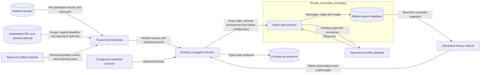
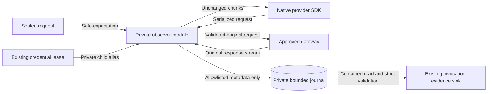

# Trial participant configuration

Status: implementation design for issue #1420.
The user selected existing native records before additional observation mechanisms.

## Boundaries and application

Trusted entry assembly receives the sealed trial request, instantiated scenario, retained attempt record and pinned experiment authoring input.
RAES remains the owner of these contracts and their lifecycle.
The authoring input's canonical identity must match the sealed plan reference.
Its episode controls describe logical scenario steps, not native assistant turns.
The sealed participant request profile must supply a separate assistant-turn limit.
Trial preparation refuses a profile without that explicit supported limit.
The attempt record supplies the original deadline; configuration must not restart that allowance.
The installed action offers supply the separate per-invocation timeout.
For a role with multiple offers, the shared executor uses their shortest admitted timeout.
Admission checks these installed limits before placement ownership or credential acquisition.
Each process receives the smaller of that invocation limit and the original remaining attempt allowance.
The sealed entry supplies each participant's complete configuration.
Readiness observes one installed owner per participant, including when several participants share one implementation manifest.
The existing request owner verifies the manifest, selected profile, content pins and participant scope.
Already resolved content comes from the approved artifact boundary.
No descriptor URI causes a new file read or network request.

All participant configurations are prepared before credentials or native processes are acquired.
Missing participants, conflicting results, stale content and unsupported controls fail preparation.
The existing managed OpenCode credential context supplies each executor's isolated credential lease.
The installed model domain cannot replace a trial selection.
Fresh executors and private invocation directories exclude previous trial history and configuration.
The native agent step limit applies the selected profile's assistant-turn limit per invocation.
The application installs the original deadline and logical horizon with the native offers.
For an explicit stepped clock, one logical step is the declared `step_ticks` advance from its initial coordinate.
Native dispatch stops at the half-open horizon `[0, max_steps)` on that clock.
Both roles can act at the same logical step; retries and tool calls do not advance this counter.
Missing clock state, changed progression policy, reset segments and unsupported clock modes refuse dispatch.
RAES retains scheduling, clock advancement, action occurrence limits and terminal records.
The native reservation checks the original deadline before starting another invocation.
An executing OpenCode process remains bounded by that same deadline through its process supervisor.
The legacy decision path uses the trial deadline when installed; its standalone 600-second default applies only without trial bounds.
RAES action attempts, logical scenario steps and provider retries remain separate counters.
Unsupported turn semantics must be refused rather than assigned an implicit interpretation.
The existing runtime owns cancellation and draining before credential release.

`LilraeTrialUnit` calls an installed participant application before it advances the admitted RAE unit.
The serving unit retains its required readiness gate before configuration and advancement.
Terminal readiness and cleanup checks complete before participant leases are released.
Published complete OpenCode configurations require this application; omission fails admission.
The application validates the exact request before placement mutation.
It acquires and installs fresh executors once for that attempt.
Repeated delivery retains those executors while RAE reports a pending attempt.
After a verified terminal result, the application drains native workers and releases their credential leases.
It neither allocates an attempt nor advances the experiment.
The downstream single-trial command in #1643 supplies this composition.
RAE names the same agent `agents.<name>` in authored configuration and `participant.behavior.<name>` in its compiled runtime.
The binding validates this exact address projection with the public address renderer; it preserves the original sealed configuration result.
All other selection, manifest and configuration checks remain exact.
The public trial compiler uses the implementation name as the authored manifest reference.
The native scheduler requires a compiled manifest address.
For that exact compiler-owned form, the binding validates `participant-implementation-manifests.<implementation-name>` as its native reference and projects the selection back for the public configuration check.
It does not rewrite the sealed result or accept arbitrary manifest aliases.

The existing finite request profiles retain routing, fallback denial, reasoning, sampling, seed and generation-limit policies.
Native transport qualification checks values and required omissions against the pinned executable.
Prompt composition retains exact authored bytes and declared slot order.
A preamble-only treatment can select its exact pinned asset.
A composite treatment can select ordered pinned preamble and playbook assets.
No implicit wrapper, newline or placeholder substitution is introduced.
Producer-declared unresolved placeholders must fail content preparation.

## Native observation

The adapter reads only its private invocation's native session records before directory teardown.
It reduces content to commitments and verifies the delivered authored prompt against its expected bytes.
Native session, message and step identities preserve joins without counting aggregate usage twice.
Reported input, output, reasoning and cache tokens remain separate categories.
Native estimated cost remains distinct from provider billing.
Selected native gateway and model identifiers do not attest upstream served identity.
Missing generation identifiers and outgoing control observations remain explicitly unavailable.
Native history is not an HTTP request log.
Transport qualification, applied native configuration and native history retain distinct evidence sources.
Matching configuration digests alone establish no delivery observation.
Required capture fields without a supported source must fail capability qualification.
The current native field assessment is recorded in [the inspection note](issue-1420-request-observation-decision.md).

The reader accepts bounded regular files through existing no-follow containment helpers.
It opens the checked descriptor through SQLite's read-only immutable mode with fixed read queries.
The Linux baseline uses the process descriptor filesystem to preserve the single-handle file identity.
An uncheckpointed database is unavailable rather than partially interpreted as complete.
Missing, malformed or oversized records produce fixed status codes without raw diagnostics.
The adapter preserves existing stdout and cleanup evidence when history is unavailable.
No database bytes, raw prompts, completions, reasoning text, environment maps or tool capabilities enter metadata evidence.
The existing evidence sink and run store remain the persistence boundary for #1421.
The approved local request observer complements native history as described below.
No recording proxy, listener, new credential source or external destination is added.

## Data flow and security

| Threat and boundary | Control | Verification |
| --- | --- | --- |
| Wrong role or stale trial selection | Sealed result and independent owner binding | Swapped participant, changed manifest and consecutive trial tests |
| Unapproved content acquisition | Already resolved bounded bytes; existing artifact and disclosure gates | No URI lookup; stale pin and changed content rejection |
| Ambient configuration or history | Private HOME, XDG and cwd; explicit plugin selection; no ambient discovery | Hostile ambient configuration and independent consecutive contexts |
| Restarted time allowance | Original retained attempt deadline | Expired and partly consumed attempt tests |
| Unsupported or stripped controls | Closed profiles and pinned native request construction | Omission, provider rejection and variation transport tests |
| Symlink or oversized native artifact | Shared contained no-follow reads and byte bounds | Symlink, oversized file and malformed database tests |
| Native metadata leaks secrets | Fixed safe projections and bounded identities | Secret markers in discarded fields stay absent from retained evidence |
| False complete capture | Explicit source types and unavailable fields | Missing history and missing control/generation tests |
| Failure loses observations | Reduce history before private teardown; preserve original failure | Cancellation, timeout and evidence-sink failure tests |

Native processes and private directories retain the existing supervision limits.
They do not create an operating-system containment guarantee.
Trace export remains an optional existing facility; this design adds no telemetry destination.
The existing DFDs for credential sourcing and participant tool admission still apply without changed authority.
Existing ADR-047, ADR-052 and ADR-064 cover ownership, credentials and dependency direction.
The approved observer exception below records the isolation-policy decision.
The architecture layer map enrolls OpenCode core values and places trial assembly at Entry.
The participant dependency model checks direct imports for native reading, launch inputs, evidence reduction and trial assembly.
No Compose, deployment policy, shared MCP or release-version change is needed.

## References

- [OpenCode export implementation](https://github.com/anomalyco/opencode/blob/v1.19.5/packages/opencode/src/cli/cmd/export.ts): version 1.19.5, native session fields and sanitization limits.
- [OpenCode session schema](https://github.com/anomalyco/opencode/blob/v1.19.5/packages/core/src/v1/session.ts): version 1.19.5, message and step evidence.
- [OpenCode native trace exporter](https://github.com/anomalyco/opencode/blob/v1.19.5/packages/core/src/observability/otlp.ts): version 1.19.5, existing OTLP export.
- [Request manifest design](participant-request-manifests.md): finite profiles, pinned content and trusted dispatch binding.
- [Managed OpenCode](managed-opencode.md): installed build, isolation and native cleanup.
- [ASD-STE100](https://www.asd-ste100.org/assets/files/ASD-STE100_ISSUE9.pdf): Issue 9, sections 1 and 6; terminology and descriptive writing.

The writing review retains project technical nouns and short descriptive sentences.

## Approved local request observer

The user approved one repository-owned local plugin on 2026-11-03.
This decision supersedes the preflight's blanket plugin prohibition for this observer only.
The plugin uses the pinned OpenCode public configuration hook and provider `fetch` option.
It adds no proxy, listener, package download or external destination.
Only observed trial invocations disable pure mode; other invocations retain it.
Private HOME, XDG and working directories, disabled ambient discovery and default plugins, exact routing and default-deny tools remain enforced.

The observer is a packaged local module copied into the private invocation directory.
The parent verifies its installed digest before launch and selects exactly that file.
A required invocation starts with an unusable provider URL and a placeholder credential.
The placeholder is an empty value; it contains no credential material.
The real credential uses a private child-environment alias that MCP children must not inherit.
The plugin initializes its private bounded journal and installs the observing fetch function before restoring the admitted URL and credential.
If plugin loading fails, the native client cannot reach the provider with its real credential.
No credential enters the observation journal.

The observer verifies the native assistant-turn setting and blocks another request after that many completed assistant turns.
Failed request attempts remain separate from completed turns and retain the original time allowance.
The fetch observer compares actual serialized request controls and authored-prefix commitments with the sealed expectation before forwarding a request.
It records only those safe controls, ordered context hashes, a local call sequence and observation times.
Response parsing runs incrementally over the same stream, without a second request or a buffered response clone.
It records available generation, model and provider claims, token categories, finish state and reported cost.
Observed provider claims remain distinct from immutable serving attestation and billing proof.
Missing fields remain unknown; cancelled and failed calls retain partial membership without successful-empty capture.
The parent reads bounded regular files through existing no-follow helpers before private-directory teardown.
Separate helpers validate invocation limits, native session membership, request controls and response stream records.
One invocation state retains process, transport and observation outcomes through the existing evidence recorder.
These helpers preserve the same credential, filesystem and persistence boundaries.
It validates the journal schema and membership, joins calls to existing action/trial/configuration coordinates, and uses the existing invocation evidence sink for #1421.

