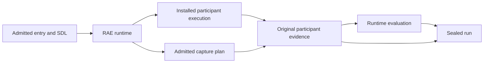
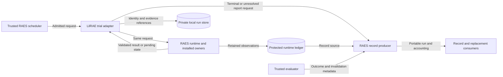

# Serving RAES trials

Reader purpose: Explanation.
The [source revision `6d35d245f11a`](https://github.com/OpenRAE/lilrae/blob/6d35d245f11a7fffcaac1645cd25ccfafbad4599/docs/architecture/trial-serving.md) preserves the original design cut.
Version-specific examples and qualification statements keep their original scope.
This editorial rewrite does not qualify a provider, approve a VM, or authorize a service.

Issue #459 implements the released `BackendTrialUnit` boundary. RAES owns the
sealed plan, request derivation, runtime admission, operation ledger, deadlines,
cancellation, replacement and resume. LilRAE wraps an already admitted runtime
unit; it never creates an experiment or advances an independent plan.

## Ownership and flow

`RAES scheduler -> LilraeTrialUnit -> RAES BackendTrialUnit -> installed owners`

The adapter receives the selected Docker backend, its declared cleanup owner,
and a trusted shared local placement-state directory. Every worker serving the
same daemon must use that directory. A daemon identity hash selects the lock
namespace; independent daemons have independent namespaces. This is the fixed
single-VM placement boundary, not a distributed allocator.
Trial serving requires the approved POSIX host for descriptor-relative native
state. Ordinary Windows lifecycle commands retain their handle-relative lock
and fence checks; the Windows primitives live in `core._lifecycle_windows`.

Before dispatch, reconstruct the request, enforce the installed operation and
attempt-time limits, and check exact cleanup identity. Acquire the daemon and
project locks, then check project containers, networks, volumes and retained
native receipts for contamination. Persist matching project and daemon fences
before calling the runtime unit. Only the same admitted attempt can reconcile
an existing fence, through the same RAES ledger. No exception or elapsed timeout
proves cessation or authorizes a different attempt.

RAES retains partial observations before teardown and invokes declared cleanup
after success, failure, cancellation or timeout. Validate the returned joins and
verify the cleanup owner's retained evidence and live readback. Remove fences
after dispatch only when RAES's scope-complete resource-reuse predicate succeeds.

Cleanup
failure and fresh-range-required outcomes retain the fences. Evidence remains
in the injected run store. Archival recovery seals an interrupted record; it
does not resume execution.

The legacy archival executor has no batch entry point.
See the [issue #437 recovery guardrails](issue-437-interrupted-trial-recovery-preflight.md)
for interrupted intent validation, sealing, cleanup uncertainty and duplicate recovery.

The existing lifecycle lock gains context propagation for RAES's AnyIO worker
callbacks. A delegated callback can enter the same live lock, while unrelated
threads and processes cannot. A stale context cannot revive released ownership.
A durable project fence also excludes ordinary lifecycle mutation after a crash.

## Required readiness

### CLI trial integration

The admitted trial path must use the runtime that owns its scenario execution.
The CLI must retain that owner through participant execution, measurement, and evaluation.
It must not reconstruct a second scenario after startup or run an independent participant scheduler.

Participant context assets remain ordered, content-identified SDL inputs.
An inject is required when the SDL declares an inject delivery.
The shared episode bound and participant action limits must be executable SDL controls.
The installed process and tool adapters enforce those controls before dispatch.
Capture starts before the shared participant start barrier.
An invocation failure cancels its peer when the admitted policy requires that action.

The seal derives capture completeness from admitted requirements and retained acquisition outcomes.
It must not substitute a fixed list of filenames for the capture plan.
Evaluation results remain separate from execution, capture, and cleanup status.
Missing evidence retains an unknown result or a capture limitation.
A completed process never supplies an objective verdict.

Image identities and reviewed image contents may supply static apparatus facts.
Such facts must retain their actual evidence basis; they cannot be labelled as independent guest readback.
Runtime changes still require the observations demanded by their admitted contracts.

`StartedTrialRuntime` transfers the startup runtime to the CLI.
The same `AptlRuntimeManager` drives native participant execution, `CapturePlan` acquisition, and evaluation.
Tests cover native cancellation, missing or changed evidence, and boolean observation records.

Readiness belongs to the exact admitted runtime target and approved placement.
One shared gate binds clean placement, preparation, and live observations.
A second runtime or an unverified endpoint cannot supply equivalent proof.
Read-only observations stay separate from capture acquisition and provisioning effects.

The [integration guide](../reference/trial-readiness-integration.md) describes owner assembly and the supported gate inputs.
The [readiness design](exp-011-resource-readiness-design.md) explains evidence and failure boundaries.

## Security and executable checks

| Risk | Control | Evidence |
| --- | --- | --- |
| Cross-trial state | Checked project inventory and native absence; cleanup-before-reuse | Contamination and cleanup-failure tests |
| Concurrent work | OS daemon and project locks, durable attempt fences | Independent-project and lifecycle exclusion tests |
| Abandoned work | Fences survive exceptions and process exit | Pending/reconciliation tests |
| Unsafe timeout/cancel | RAES stop, observation and cleanup progression | Released runtime integration tests |
| Resource exhaustion | Bounded portable request and installed operation/time ceiling | Limit tests before dispatch |
| Path substitution | Existing descriptor-relative no-follow helpers | Symlink and fence tests |

Requests and placement inputs come from trusted composition, not a network
endpoint. No new transport, service, credential resolver or upload is added.
`BackendTrialUnit`, `TrialUnitRequest`, `DeclaredCleanup` and the lifecycle lock
are the executable boundaries. ADR-047's released-contract successor applies;
no new experiment state machine or architecture decision is introduced.

## Trial outcome reporting (issue #1416 preflight)

Issue #1416 requires honest outcomes for every factorial condition and the
admitted identity and partial evidence needed by record production and
replacement. Its supplied GitHub contract governs scope; native blocked-by
relationships govern dependency readiness. This note adds guardrails, not an
implementation plan or a claim that the dependency is closed.

Follow the released-contract successor clauses in
[ADR-047](../adrs/adr-047-raes-experiment-admission-and-trial-plan-boundary.md)
and [ADR-050](../adrs/adr-050-terminal-attempt-archival-and-atomic-seal.md).
The shared RAES runtime owns trial progression and portable outcome semantics.
LilRAE supplies verified owner observations and retains their evidence. The
local `core/execution/executor.py`, `archival/status.py` and `archival/run_record.py`
describe the older route; do not extend them into a competing controller,
terminal mapping or record producer for the released route.

The inspected installed `raes` 10.2.0 exposes
`RuntimeControlPlane.experiment_records`, `ExperimentRecordSource`,
`ExperimentRunMetadata`, `ExperimentRecordBundle`, `ExperimentEvidenceReader`
and `ExperimentRecordArchive`. Build on those public seams and the selected
release's validators. An unavailable required contract is a dependency gap,
not grounds for a local mirror. This observation is not release qualification.

### Preserve separate facts

| Concern | Authoritative fact and boundary |
| --- | --- |
| Operation acceptance | `OperationReceipt.accepted` and `ApplyResult.success` describe admission/application of an operation. Neither proves that the participant, trial, capture or cleanup succeeded. Retain operation status and diagnostics as well as receipts. |
| Execution and participant | `TrialExecutionObservation` carries state and cessation. `ParticipantActionResultModel`, participant histories and declared failure dispositions retain refusal, withholding, failure, partial success and unknown outcomes. An accepted record can contain a failed action; a delivered turn or zero process exit is not a task verdict. |
| Capture | `TrialCaptureObservation` and retained `ExperimentEvidenceRecordModel` content carry actual capture facts. Existing `CollectorOutcome`, `CollectorReport`, `CollectorStatus` and `AcquisitionDisposition` preserve source/startup failure, loss, truncation, clock uncertainty, timeout and finalization failure. Reuse these owners; do not derive a second capture taxonomy. |
| Cleanup | `TrialCleanupReceiptModel.trial_outcome` and `cleanup_status` are separate. `DeclaredCleanup.cleanup` deliberately returns a successful `ApplyResult` even for a failed cleanup receipt. Keep per-obligation results, residual state and cleanup evidence. Only `replacement_resources_reusable` authorizes reuse. |
| Evaluation and validity | The task evaluator supplies result summaries and outcome metadata; the released producer derives portable run state from retained runtime facts. `ExperimentRunMetadata.invalidation` carries the public invalidation model with a concrete reason and clock-owned time. No successful-evaluation default or invented score fills a missing verdict. |

Timeout or requested cancellation does not prove cessation. Preserve
`TrialPending` and indeterminate work through the RAES ledger, including
unknown native residue. A refusal follows its admitted failure disposition;
do not erase it because execution continued, or classify every refusal as
infrastructure failure.

Missing required evidence cannot become unconditional
success. Distinguish a source that never started, invalidating evidence loss,
and an explicitly admitted degradation with loss/comparability disclosures.
Optional absence and a legitimately empty successful capture also stay distinct.

Pass these facts to the released producer rather than adding a local precedence
table. Record validation failure is visible failure data, not permission to
publish a successful or eligible result.

### Identity, partial evidence and compatibility

Keep the admitted plan ID/digest, entry ID/digest, entry-derived `run_id`,
distinct `execution_attempt_id`, instantiated SDL digest and cleanup/native
bindings joined. `TrialUnitResult` has no independent top-level run ID:
retain the request context and enforce `validate_trial_unit_result` with the
selected target scope before handing it on. Run, attempt, and condition identities remain distinct. Startup must not mint another ID, sanitize an incompatible ID, or substitute a display name. Preserve selected participant configuration/control-context
commitments from that entry without persisting secret values.

Return the validated result with its operation receipts, execution snapshot,
evidence, cleanup receipt and cleanup evidence. Preserve execution/participant
observations before teardown clears their histories. The create-once
`trial-serving/handoff.json` is an identity receipt, not a substitute for those
facts or the runtime's `ExperimentRecordSource`. A pending/failed publication
must leave recoverable owner evidence and fences; never clear them in `finally`.
Repeated delivery reconciles the same admitted attempt and ledger. Replacement
and its lineage remain RAES-owned, including fresh-range-required disposition.

`core/lab.py:_write_run_record` currently supplies hard-coded `outcome="success"`
to `backends/raes_repro.py`. That startup record has neither an admitted trial
nor a terminal evaluator verdict. Removing unconditional success must respect
this boundary: any legacy startup outcome must reflect observed lifecycle
facts, while terminal trial reporting consumes the admitted runtime result.
Do not make startup fabricate a completed trial or occupy its create-once
portable record path. Startup's non-fatal archive warning policy cannot govern
required trial evidence or terminal publication.

`GuestRuntimeEvidence.correlated_success` in `appliance/seat/access.py` and
`validation/participant_qualification_evidence.py:_validate_canonical_evidence`
require the legacy reproducibility schema and literal `"success"`. RAES
`ExperimentRunModel.outcome_status` instead uses `"succeeded"`, `"failed"`,
`"partial"`, `"inconclusive"` and `"not-evaluated"`. Preserve the schema-specific
reader contract; use `archival/legacy_manifest.py` for existing run projections.
Never globally replace strings or broaden access/qualification gates to accept
arbitrary records. An archive seal proves integrity, not experimental success;
failed and invalidated records retain their actual statuses and history.

### Cross-cutting gates

Paths below are relative to `src/aptl` unless stated otherwise. The
[released-tuple preflight](issue-1465-released-experiment-tuple-preflight.md)
and [cleanup preflight](issue-435-declared-cleanup-preflight.md) supply the
existing detailed boundaries; none is bypassed by outcome reporting.

| Layer and canonical incumbent | Required passage |
| --- | --- |
| Authority and authentication | Trusted local composition supplies the runtime unit, cleanup owner, target and placement root. Add no listener. Existing API callers retain `api/deps.py:verify_token`, `WebAuthSettings`, BFF Host/CSRF/session gates and strict response projections. Local operator authority does not authorize new uploads or services. |
| Parsing, resolution and schemas | Reuse `core/experiment/spec_loading.py`, `AdmissionPolicy`, `ProjectContainedResolver`, family admission and released sealed-plan/request/result validators. Preserve byte/count limits, duplicate-key rejection, no-follow opens and digest joins. Hash and parse the same bytes; do not reopen authored inputs at finalization or use a local DTO to bypass public validation. |
| Configuration and capability gates | `AptlConfig`, `ExperimentSettings`, `ScenarioSourceConfig`, `require_family_capabilities`, `create_aptl_manifest()` and runtime materialization/realization admission remain authoritative. Preserve strict settings and installed limits. No experiment-selected project, deployment provider, privilege, collector implementation or success-policy override. |
| Credentials and environment shapes | Keep ADR-029/052, `core/_credential_sources.py`, `EnvVars`, placeholder checks and explicit `EnvironmentGrant` pack/consumer/variable joins. Deployment `_environment_bindings.py` and `_compose_environment.py` bind only admitted sources; `_realization_primitives.environment_file_line` must carry values exactly or refuse them. Reporting requires no new secret lookup or environment binding. Never serialize resolved values or hash low-entropy secrets as provenance. |
| Participant and process gates | Reuse `lilrae_participant_configuration.py`, `lilrae_participant_execution.py`, `workbench/lilrae_opencode.py`, verified tool profiles and `BoundedProcessRunner`. Preserve exact admitted configurations, private HOME/XDG/config, bounded output, deadlines, cancellation and drain. Managed MCP config retains `workbench/agent.py`'s exact `command`/`args`/string-valued `env` shape and credential-alias checks. Prompts use stdin; credentials never enter argv, URLs or outcome messages. Existing `utils/curl_safe.py` owns credential-bearing curl delivery. |
| Host ownership and containment | Keep `DeploymentBackend`, native resource receipts, observed daemon identity, lifecycle/placement locks and durable trial fences. Preserve mount/network/capability and runtime-authority checks, POSIX serving admission and VM-seat containment where used. A timeout, exception, empty inventory or failed cleanup never grants reuse or a broader teardown scope. |
| Evidence and provenance | Reuse `core/evidence/{coordinator,records,content_store}.py`, admitted capture pins, content/media/size checks, visibility, loss disclosures and content-backed RAES evidence satisfaction. `core/provenance` and `core/correlation` retain safe run-scoped identity and clock context. Lifecycle evidence or cleanup evidence cannot stand in for missing task-required evidence. Legacy plan-field projections must not silently discard public entry identities. |
| Persistence, integrity and export | Use `RunStorageBackend`/`LocalRunStore`, `utils/pathsafe.py`, create-once transactions, finalization locks, seal verification and the recovery index. Resolve evidence bytes and checksums, not just references. Preserve canonical owner bytes; `SecretInvariantError` rejects identity-bearing content that redaction would alter. Ordinary structured writes use shared redaction; opaque file/copy writes remain pass-through and require already-safe content. `core/exporter.py` packages existing safe records without rewriting sealed history or becoming the first redaction gate. |
| Errors and observability | Preserve RAES `Diagnostic`, `core/experiment/errors.py`, provider/process errors, bounded serving error codes and `raes_diagnostics.render_raes_diagnostics(stage_label=...)`. Add no exception hierarchy or catch-all success fallback. `utils/logging.get_logger` is not a sanitizer: emit safe IDs, fixed codes, phase/status, counts and durations; use shared redaction, `RangeSnapshot.to_dict()`, `RedactingSpanExporter` and existing MCP redaction. No raw validation input, exception chain, snapshot, credential locator, prompt or stdout/stderr in CLI/API/log/span envelopes. |
| Repository boundaries and checks | Follow ADR-064's layer map in `pyproject.toml`: entry code composes owners; adapters return typed public values, without importing application orchestration or private RAES runtime internals. Reuse `.ground-control.yaml`, `.gc/plan-rules.md`, `tools/check_architecture.py`, `tools/check_pack_boundary.py`, `tools/run-targeted-tests.sh` and staged `pre-commit run`. CI owns full suites and installed-runtime/lab qualification under `checks.yml`. Shared MCP/config/lifecycle changes require their existing consumer/installed-lab lanes. |

### Extension seam and evidence bar

The seam is the admitted `TrialUnitRequest` plus its verified `TrialUnitResult`
and runtime record source, with explicitly supplied evidence reader/archive
and per-run evaluator metadata. Another condition, participant failure class,
capture source or backend supplies those same owner contracts. It must not
require scenario-name branches, per-condition providers, a new status enum,
another durable ledger or a second scheduler. New portable semantics belong
in a supported RAES contract, not a LilRAE catch-all mapping.

Extend the existing trial-serving, cleanup-runtime, participant-workload,
execution-bridge, evidence, archival, redaction and family contract evidence
at their public seams. The current trial-serving fixture chooses the first
plan entry; it alone does not prove reporting for every factorial condition.
Qualification preserves entry identities and separate timeout, cancellation, refusal, capture, cleanup, cessation, publication, and repeated-delivery outcomes.
Use real released validators and content-backed producer validation; mutation
checks must catch failure-to-success defaults and dropped identity/evidence.
This documentation-only preflight runs no runtime or mutation tests.

This preflight adds no compiler/controller, retry policy, study analysis, portable schema, credential/configuration change, service, deployment, archive migration, or broad refactor. Keep the change within
owner observation, honest outcome handoff and the existing reporting boundary;
do not absorb the public experiment entry point's separate delivery scope.

## Outcome handoff design

The startup manifest reports lifecycle health only. A ready startup maps to
legacy `success`. Degraded startup maps to `partial`; failed startup maps to
`failed`. The existing diagnostic policy determines degradation. These values
do not establish scientific success. Legacy access readers retain their strict
success gate.

The trial adapter returns the complete validated RAES result. Its immutable
handoff also retains admitted plan, entry, run, attempt and snapshot identities,
plus execution and cleanup evidence references. It stores no participant
configuration values or raw snapshot bytes. Reconciliation uses the same receipt.
A conflicting receipt fails before fences can clear.

RAES record production reads retained observations and evaluator metadata.
It maps execution causes to run status and retains separate configuration,
capture and cleanup accounting. Invalidation uses `ExperimentRunMetadata`.
No local terminal status table or alternate record producer is added.

The adapter validates joins at the runtime boundary. LocalRunStore protects
the persistence boundary with create-once writes and path containment. Existing
cleanup verification controls resource reuse. Tests check partial evidence,
receipt conflicts and retained fences. These controls prevent cross-trial
attribution and false success. Owner evidence still needs content validation;
an identity receipt alone grants no scientific eligibility.

ADR-044 and ADR-047 already define these ownership rules. No new ADR,
configuration policy or deployment model is needed. The typed request/result
validator remains the executable architecture contract. No new transport or
credential boundary is introduced.

References: Python 3.14 documentation,
[dataclasses](https://docs.python.org/3.14/library/dataclasses.html), section
`replace`, explains reconstruction at dispatch. The RAES public
`trial_unit`, `experiment_records` and `RuntimeControlPlane.experiment_records`
contracts define result and portable reporting boundaries.

`report_trial_outcomes` is the application reporting handoff. Trusted composition
supplies the same runtime, experiment ID, explicit per-run evaluator metadata,
evidence reader and archive. It returns the shared producer's bundle, including
partial sources, validation failures and eligibility. It does not turn a failed
validation into success. RAES validates metadata identity against started runs.

Each `LilraeTrialUnit` requires a `TrialOutcomeReporting` composition. After
result validation and handoff persistence, the adapter invokes this reporter.
The metadata callback receives the admitted request and verified terminal result.

For unresolved execution, it receives `None` instead of a terminal result.
It preserves known metadata without inventing an evaluator verdict.
It supplies metadata for the experiment's started runs.

The same RAES runtime
produces the records. Reporting must identify this admitted run and attempt
before the adapter can release fences. Publication failures retain fences.

The callback may report no evaluator verdict; RAES then retains not-evaluated.
It must interpret participant observations using their admitted policy.

When RAES raises `TrialPending`, the adapter requests the existing partial run
records before propagating that same exception. The producer retains admitted
identity, known observations, operation references and unobserved phase statuses.
It does not invent an end time or cleanup receipt. The injected archive owns
persistence of these records. Without an archive, callers can inspect the bundle
through `report_trial_outcomes`; the RAES ledger remains authoritative.

An unsuccessful native call can remain indeterminate under RAES supervision. Participant failure does not establish scope-complete cessation.
The adapter retains fences and never converts that uncertainty into terminal
failure or success. Reporting failures also retain fences. Native `stop` and
`continue` policy observations remain separate from task evaluation. Attempt
ceilings do not advance a stepped scenario clock.
