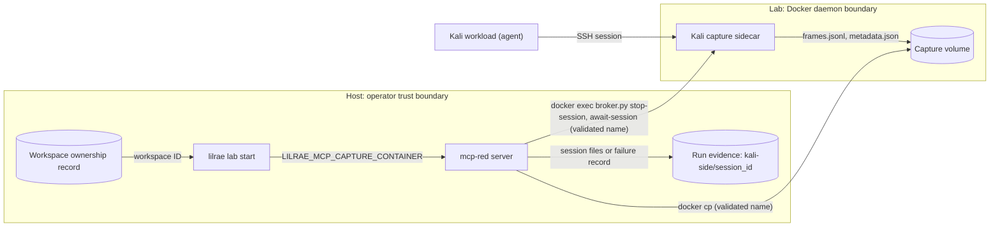

# Kali Red Team Container

`kali` is TechVault's red-team workstation: the node that AI agents and human
operators drive through the red-team MCP server. LilRAE realizes it from the
pinned TechVault pack (`resources/packs/techvault/sdl/techvault.sdl.yaml` in
the installed `raes_env_packs` package). The repository builds no image for the
node itself: `containers/kali/` has no Dockerfile, and the `kali-capture` image
described below is backend apparatus. Explicit project-tree scenarios such as
`techvault-attacker-target` declare their own, smaller `kali` node. This page
describes the pack's Kali node.

The node deliberately runs **no Wazuh agent, no rsyslog forwarding to the
SIEM, and no `redteam_logging.sh` helpers**. Under the non-contamination
principle, red self-reports must not enter the blue defensive SIEM. See ADR-033 for the full rationale.

## Realized Node

- **Substrate**: the pack declares a Linux compute node with a systemd
  service unit and Node.js 22, so the backend starts it on
  [`aptl/generic-systemd-node22-base`](https://github.com/OpenRAE/lilrae/blob/main/containers/generic-systemd-node22-base/Dockerfile).
  The Dockerfile builds the base image from `node:22-trixie-slim` (Debian 13), not from a Kali
  Linux image, and runs systemd as PID 1.
- **Tools**: the packages the pack declares, preinstalled in that image:
  `nmap`, `sqlmap`, `hydra`, `python3-impacket`, `smbclient`, `ldap-utils`,
  `dnsutils`, `netcat-openbsd`, `curl`, `wget`, `iputils-ping`, `python3` and
  `openssh-server`.
- **Participant tools**: the pack places the `aptl-mcp-common` and `mcp-red`
  sources under `/opt/techvault/mcp`.
- **User**: `kali`. Its `authorized_keys` comes from the pack's
  `techvault-ssh-keys` generated artifact and authorizes the LilRAE
  control-plane key, `~/.ssh/aptl_lab_key` on the operator's host.
- **SSH**: Key-based authentication only. The Kali capture sidecar
  (`aptl-w<id>-kali-capture`, named per workspace) shares the Kali network
  namespace and owns port 22. Its sshd accepts
  `APTL_SESSION_ID`, `APTL_RUN_ID` and `APTL_TRACE_ID` from the MCP server.
  The Kali sshd listens on loopback port 2222 behind the sidecar.
- **ForceCommand**: the sidecar sshd runs `/usr/local/bin/broker.py` for
  every `kali` session. The broker records the session transcript in the
  sidecar and relays the session to the Kali sshd. It refuses the session
  when no capture authority is active.
- **Without capture**: when no capture sidecar runs, the node's own sshd
  listens on port 22 (see [Session Capture](#session-capture)). The node
  itself publishes no host port.
- **Capabilities**: the scenario grants the node no Linux capability of its
  own.

## Network Access

- **Networks and addresses**: `redteam-net` 172.20.4.30, `dmz-net`
  172.20.1.30 and `internal-net` 172.20.2.35. All three are internal Docker
  networks with no route out of the range. The `internal-net` attachment
  exists so the agent can reach the internal targets. It is not there for the
  SIEM, which is out of scope for `kali`.
- **Targets**: in the DMZ, `webapp` 172.20.1.20 and `dns` 172.20.1.22. On the
  internal network, `ad` 172.20.2.10, `db` 172.20.2.11, `fileshare`
  172.20.2.12, `victim` 172.20.2.20 and `workstation` 172.20.2.40.

## Host Access

The pack declares `agents.red-team-operator.interactive_access.kali-ssh`.
LilRAE satisfies that operator-access declaration with a relay: a separate
container (`aptl-operator-ssh-kali`, shown with the workspace prefix in
`docker ps`, for example `aptl-w<id>-operator-ssh-kali`) that publishes
`127.0.0.1:2023` and forwards it to port 22 on `kali`. The relay carries no
credentials and binds loopback only. `APTL_HP_KALI_SSH_PROXY_2023` pins the
port. Otherwise, when 2023 is in use, `lilrae lab start` remaps it like every
other published port and prints the new one:

```text
[lab start] Host port 2023 for aptl-operator-ssh-kali is in use; publishing on <port> instead.
```

Host MCP clients use the backend's native Kali ingress, which names the
workload address. The relay describes the declared operator-access endpoint.
It does not establish that the Docker host cannot reach the workload directly.

The pack's transcript requirement enables session capture, so port 22 on
`kali` belongs to the capture sidecar and the relay ends at the capture
broker. The sidecar's sshd accepts `~/.ssh/aptl_lab_key`. The broker then
refuses any session that lacks the custody environment the red-team MCP
server sends: `APTL_SESSION_ID`, plus `APTL_RUN_ID` and `APTL_TRACE_ID` both
set to the active run's ID. A plain SSH login through the relay therefore
opens no shell. The control plane also refuses `lilrae container shell aptl-kali`.

The [Kali operating guide](kali-operations.md#access-without-required-capture) describes access when capture is not required.

## Session Capture

The pack must have a transcript of every interactive session on the red-team
workstation (its `redteam-session-transcript` evidence requirement) and
leaves the capture mechanism to the backend. LilRAE adds the `kali-capture`
sidecar from `docker-compose.capture.yml` when the admitted capture plan
demands that transcript. Without the demand, no sidecar runs.

- The sidecar shares the `kali` container's network namespace. Its own sshd
  takes port 22 there and runs every session through the capture broker
  (`ForceCommand /usr/local/bin/broker.py`).
- When it adds the sidecar, LilRAE moves the node's own sshd to
  `127.0.0.1:2222` and authorizes the pack's Kali pivot key there. The broker
  reaches the node with that key, so sessions that arrive through the relay
  pass through the broker first.
- The broker records each session's terminal input and output under
  `/var/log/aptl/captures/<run_id>/sessions/<session_id>/frames.jsonl` in the
  `kali_captures` volume. The `kali` node does not mount that volume.
- While capture is active, the control plane refuses `lilrae container shell aptl-kali`.

## MCP Integration

The red-team MCP server is [mcp/mcp-red](https://github.com/OpenRAE/lilrae/tree/main/mcp/mcp-red).
`lilrae lab start` builds it. On a project with no `.mcp.json`, it creates one
from `.mcp.json.example`, whose `aptl-red` entry runs the server.

Later starts
refresh keys and ports in the existing file. The shared SSH layer in
[mcp/aptl-mcp-common/src/ssh.ts](https://github.com/OpenRAE/lilrae/blob/main/mcp/aptl-mcp-common/src/ssh.ts)
opens sessions with `SendEnv APTL_*` and keeps an MCP-side record of each run
in that run's `mcp-side/` directory. That directory holds the continuous PTY
output copy in `sessions/<session_id>.jsonl` and the tool-call records, with full
untruncated arguments and results, in `tool-calls.jsonl`. The record is
independent of the Kali-side transcript.

See [MCP Integration](mcp-integration.md) for detailed setup
instructions.

When a session closes, the red-team MCP server copies that session's capture
directory from the capture sidecar,
`/var/log/aptl/captures/<run_id>/sessions/<session_id>/`, into the run's
`kali-side/<session_id>/` directory on the host. A session closes when the agent
closes it, when its remote side closes, or when the server stops. Lab start
gives the server the workspace-scoped sidecar name in
`LILRAE_MCP_CAPTURE_CONTAINER`.

Before the copy, the server runs `broker.py await-session` in the sidecar. This
check waits until the broker finalizes the session and writes `metadata.json`.
The server copies the session one time, after the check passes. The server
stops when stdin closes, or when it receives `SIGTERM` or `SIGINT`. At
shutdown, it runs `broker.py stop-session` for each open session first, so the
broker records `forced-teardown`. Then it harvests each session.

If the check or the copy fails, the server writes
`capture-harvest-failure.json` there instead. The record names the failure, the
container, the run and session IDs, the Docker exit code, and the time. It does
not contain the Docker output.

| Failure | Cause |
|---|---|
| `aptl.capture-harvest.container-missing` | The capture container does not exist. |
| `aptl.capture-harvest.session-missing` | The container has no directory for the session. |
| `aptl.capture-harvest.copy-failed` | `docker cp` failed for a different reason, for example the Docker daemon is not reachable. |
| `aptl.capture-harvest.metadata-missing` | Broker finalization timed out, or `metadata.json` is absent. The harvester copies no frames. |
| `aptl.capture-harvest.finalize-failed` | `broker.py stop-session` or `broker.py await-session` failed for a different reason, for example a run authority mismatch. |
| `aptl.capture-harvest.container-unresolved` | The server has no valid sidecar name, for example because `LILRAE_MCP_CAPTURE_CONTAINER` is not set. `docker cp` does not run, and the exit code is `null`. |

Only a server that declares a capture sidecar harvests. The red-team server
declares one. The reverse-engineering server declares none, so it does not
harvest.



The Kali workload has no path to the capture volume or the run evidence.

The server harvests a `kali_run_command` call the same way, under its exec session
ID, when the command finishes. When the command times out, the server stops it. After the SSH channel closes, it harvests the records and the broker's final records. The timeout error waits up to three seconds for that. If
the channel is still open then, the server returns the error and harvests the
session when the channel closes. OpenSSH refuses the stop signal for the
broker's forced-command session, so the channel can stay open until the
command exits.

## Experimental record redaction toggle

The shared Python and TypeScript redactors mask credential-shaped values in MCP-side tool-call and OCSF captures by default.
`APTL_EXPERIMENT_NO_REDACT` disables that masking for an experiment whose signal consists of credential values.
The accepted values are `1`, `true`, `yes`, and `on`.
The parser ignores case and whitespace before and after the value.
An absent value or any other value keeps redaction.

This setting changes retained experimental data.
It does not authorize disclosure or publication.
See [configure experimental redaction](kali-operations.md#configure-experimental-redaction) for the operating steps.

## Why no SIEM integration

See [the red-side capture boundary](red-side-capture-boundary.md).
