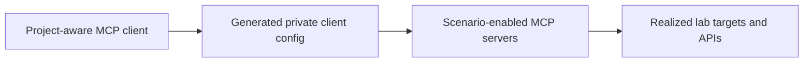

# MCP Integration Architecture

APTL uses Model Context Protocol servers as scenario-aware adapters between an
authorized AI client and the red- or blue-team systems in a realized lab.

For operator setup, availability, and supported tool naming, use the
[MCP reference](../reference/mcp.md). This page explains the component boundary
without duplicating the generated runtime configuration.

## Runtime Flow



`lilrae lab start` realizes the scenario before it updates `.mcp.json`. This
ordering lets APTL include only supported servers, inject generated credentials,
and use runtime-resolved ports. A server artifact in the project tree does not
prove that its target exists in the current scenario.

## Server Families

SSH-backed servers use `aptl-mcp-common` for connection pooling, bounded
sessions, tool definition generation, error handling, telemetry, and
redaction. API-backed servers use the common authenticated HTTP/TLS boundary
and their declared query or action configurations.

Every server owns a `toolPrefix`. The common generators apply that prefix to
the advertised tool name, preventing collisions when several servers expose a
similar capability. The connected server remains the authority for its exact
tool list and input schemas.

## Configuration Boundary

The tracked `docker-lab-config.json` files describe server identity, prefix,
target type, and non-secret transport shape. The generated `.mcp.json` binds
those definitions to one realized project and can contain credentials. Keep it
private and let APTL update managed entries; do not turn it into checked-in
documentation or a shared template.

Each server limits the size of one tool result to `server.maxToolResultTokens`
in its `docker-lab-config.json`, estimated at 4 characters per token (default
4000). A predefined query can set its own `max_result_tokens`. The value `null`
returns the whole result. The indexer `get_rule_file` query uses `null`,
because `create_rule` replaces the whole rule file. A cut read would delete
rules when the agent writes the file back.

A larger result that is a JSON object stays valid JSON. Whole records are
dropped from the end of its largest array. When not even one record fits, or
the object has no array, long strings such as command output are cut at a line
boundary. The short fields beside them, such as exit codes, stay. A tail at
the end of the object gives the counts, for example `"_truncated":
{"returned": 12, "total": 40, "note": "28 more results; refine your query"}`.
Other text is cut at a line boundary with a size tail. The tool span records
the original and returned sizes and whether the result was truncated. Neither
the tail nor the log repeats result content. The post-tool hook receives the
result that the client receives.

The optional reverse-engineering server demonstrates the artifact-versus-
availability distinction: APTL builds it with the other server artifacts, but
does not add it to the default client configuration when the scenario has no
reverse-engineering target.

## Development

Contributors can rebuild every server with:

```shell
./mcp/build-all-mcps.sh
```

Changes under `mcp/aptl-mcp-common` affect every dependent server and require a
complete dependent rebuild and test sweep. Operator workflows should use
`lilrae lab start`, which owns build, realization, credentials, and generated
client configuration together.
